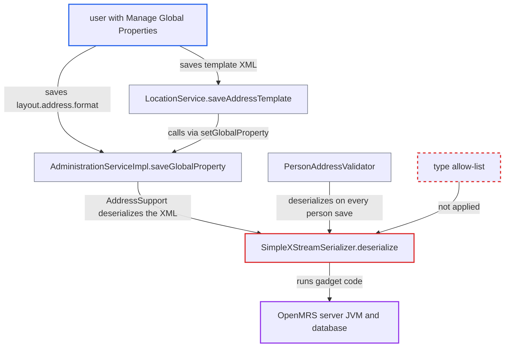

# Address layout template global property deserialized with unrestricted XStream 1.4.17

| Field | Value |
|---|---|
| ID | `find_01BqmJ7AbK2tn9S37NPSBZJz` |
| Severity | **High** |
| Status | open |
| CWE | CWE-502 — Deserialization of untrusted data |
| Created | 2026-10-21T23:00:40.371556Z |
| Claude Security | https://claude.ai/security/findings/find_01BqmJ7AbK2tn9S37NPSBZJz |

## Description

A user who holds the `Manage Global Properties` privilege can run arbitrary code on the OpenMRS server. The code runs as the Tomcat JVM user and gives access to all patient data in the database. The attacker saves a crafted XML document as the `layout.address.format` global property. `SimpleXStreamSerializer` then deserializes it with XStream 1.4.17 and no type allow-list.

1. **the attacker** saves a gadget XML document as the `layout.address.format` global property. The attacker needs `Manage Global Properties`, or both that and `Manage Address Templates` when going through `LocationService.saveAddressTemplate`, which passes the XML on to `setGlobalProperty`. ([`api/src/main/java/org/openmrs/api/impl/LocationServiceImpl.java:498-501`](https://github.com/cx-benchmark/openmrs-core/blob/e6a1b3374ef040e8821dbe4bacc1bdcb50fa4d29/api/src/main/java/org/openmrs/api/impl/LocationServiceImpl.java#L498-L501))
2. **the service method `saveGlobalProperty`** stores the value and notifies the property listeners in the same request. The method is guarded by `@Authorized(MANAGE_GLOBAL_PROPERTIES)`, and `notifyGlobalPropertyChange` runs the `AddressSupport` listener. ([`api/src/main/java/org/openmrs/api/impl/AdministrationServiceImpl.java:267-300`](https://github.com/cx-benchmark/openmrs-core/blob/e6a1b3374ef040e8821dbe4bacc1bdcb50fa4d29/api/src/main/java/org/openmrs/api/impl/AdministrationServiceImpl.java#L267-L300))
3. **the listener `AddressSupport.globalPropertyChanged`** passes the new XML to `setAddressTemplate`, which deserializes it. It calls `getDefaultSerializer().deserialize(xml, AddressTemplate.class)`. `init()` and `getAddressTemplate()` do the same with the stored value when the layout loads. ([`api/src/main/java/org/openmrs/layout/address/AddressSupport.java:128-157`](https://github.com/cx-benchmark/openmrs-core/blob/e6a1b3374ef040e8821dbe4bacc1bdcb50fa4d29/api/src/main/java/org/openmrs/layout/address/AddressSupport.java#L128-L157))
4. **`SimpleXStreamSerializer.deserialize`** calls `xstream.fromXML` on the stored XML without checking the requested class. The XStream instance is a bare `new XStream()` with no allow-list. The XML therefore decides which classes get built, and the `<dynamic-proxy>` refusal does not stop chains that use no proxy. ([`api/src/main/java/org/openmrs/serialization/SimpleXStreamSerializer.java:104-112`](https://github.com/cx-benchmark/openmrs-core/blob/e6a1b3374ef040e8821dbe4bacc1bdcb50fa4d29/api/src/main/java/org/openmrs/serialization/SimpleXStreamSerializer.java#L104-L112))
5. **XStream 1.4.17** builds the gadget object graph and runs its code in the Tomcat JVM. Version 1.4.17 allows any type except a denylist, and the CVE-2021-39139..39154 gadget chains bypass that denylist. ([`pom.xml:356-360`](https://github.com/cx-benchmark/openmrs-core/blob/e6a1b3374ef040e8821dbe4bacc1bdcb50fa4d29/pom.xml#L356-L360))
6. **`PersonAddressValidator`** deserializes the stored template again on every person or patient save that has an address. The stored payload therefore runs again on routine clinical saves, reached through `PersonValidator.validatePersonAddresses`. ([`api/src/main/java/org/openmrs/validator/PersonAddressValidator.java:93-103`](https://github.com/cx-benchmark/openmrs-core/blob/e6a1b3374ef040e8821dbe4bacc1bdcb50fa4d29/api/src/main/java/org/openmrs/validator/PersonAddressValidator.java#L93-L103))

## Assessment

The attacker is an authenticated user with `Manage Global Properties`, an admin-level privilege. They can also use `LocationService.saveAddressTemplate`, which needs `Manage Address Templates` and also reaches the `Manage Global Properties` check, so both privileges are required on that route. They save a gadget XML document as `layout.address.format`, and the chain runs when the listener deserializes it. The report says the server is reachable only from the internal network. The project does not give web admins a way to load code by default, because `ModuleUtil.allowAdmin()` defaults `module.allow_web_admin` to `false`. This flaw therefore gives such an admin code execution that no sanctioned path allows. The report assumes XStream 1.4.17 behaves as its 1.4.18 advisories describe. The shipped image runs JDK 8.

Impact: The attacker runs arbitrary code as the OpenMRS JVM user. That gives full read and write access to the application database, including all patient health data. It also exposes the database credentials in the runtime properties and lets the attacker change code and data or stop the service. The payload runs immediately on save and again on every later person or patient save with an address.

## Recommendation

(1) `SimpleXStreamSerializer` deserializes with an XStream instance that has no type allow-list. It also ignores the expected `clazz`, so stored XML controls which classes are instantiated.

Fix criteria: Deserialization instantiates only an explicit allow-list of OpenMRS value types (`AddressTemplate`, `ImplementationId`, `PersonMergeLogData`, collections and primitives) and rejects everything else before instantiation. The requested `clazz` is enforced. An XML document in `layout.address.format` that names an arbitrary JDK class, such as `java.util.PriorityQueue` or `javax.naming.ldap.Rdn$RdnEntry`, is rejected with a `SerializationException`. No code outside the allow-list runs.

(2) XStream is pinned to 1.4.17 in `pom.xml`. Its default security is denylist-based, and public gadget chains bypass it.

Fix criteria: The XStream dependency in `pom.xml` is at version 1.4.18 or later, whose default is an allow-list. The application explicitly configures the permitted types. `SimpleXStreamSerializer` fails closed on unknown types.

## Evidence

**https://github.com/cx-benchmark/openmrs-core**

- [`api/src/main/java/org/openmrs/serialization/SimpleXStreamSerializer.java:62-75`](https://github.com/cx-benchmark/openmrs-core/blob/e6a1b3374ef040e8821dbe4bacc1bdcb50fa4d29/api/src/main/java/org/openmrs/serialization/SimpleXStreamSerializer.java#L62-L75)
- [`api/src/main/java/org/openmrs/serialization/SimpleXStreamSerializer.java:104-112`](https://github.com/cx-benchmark/openmrs-core/blob/e6a1b3374ef040e8821dbe4bacc1bdcb50fa4d29/api/src/main/java/org/openmrs/serialization/SimpleXStreamSerializer.java#L104-L112)
- [`pom.xml:356-360`](https://github.com/cx-benchmark/openmrs-core/blob/e6a1b3374ef040e8821dbe4bacc1bdcb50fa4d29/pom.xml#L356-L360)
- [`api/src/main/java/org/openmrs/layout/address/AddressSupport.java:128-157`](https://github.com/cx-benchmark/openmrs-core/blob/e6a1b3374ef040e8821dbe4bacc1bdcb50fa4d29/api/src/main/java/org/openmrs/layout/address/AddressSupport.java#L128-L157)
- [`api/src/main/java/org/openmrs/validator/PersonAddressValidator.java:93-103`](https://github.com/cx-benchmark/openmrs-core/blob/e6a1b3374ef040e8821dbe4bacc1bdcb50fa4d29/api/src/main/java/org/openmrs/validator/PersonAddressValidator.java#L93-L103)
- [`api/src/main/java/org/openmrs/api/impl/AdministrationServiceImpl.java:267-300`](https://github.com/cx-benchmark/openmrs-core/blob/e6a1b3374ef040e8821dbe4bacc1bdcb50fa4d29/api/src/main/java/org/openmrs/api/impl/AdministrationServiceImpl.java#L267-L300)
- [`api/src/main/java/org/openmrs/api/impl/LocationServiceImpl.java:498-501`](https://github.com/cx-benchmark/openmrs-core/blob/e6a1b3374ef040e8821dbe4bacc1bdcb50fa4d29/api/src/main/java/org/openmrs/api/impl/LocationServiceImpl.java#L498-L501)
- [`api/src/main/java/org/openmrs/module/ModuleUtil.java:823-832`](https://github.com/cx-benchmark/openmrs-core/blob/e6a1b3374ef040e8821dbe4bacc1bdcb50fa4d29/api/src/main/java/org/openmrs/module/ModuleUtil.java#L823-L832)

