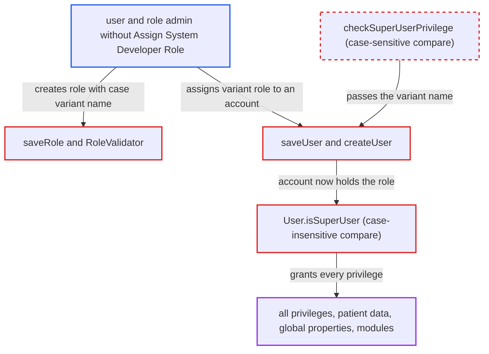

# Case-mismatched superuser checks let user/role admins grant System Developer

| Field | Value |
|---|---|
| ID | `find_016MxCPsYxPC89J9nTpzqPvD` |
| Severity | **High** |
| Status | open |
| CWE | CWE-178 — Privilege escalation |
| Created | 2026-10-21T22:56:10.797740Z |
| Claude Security | https://claude.ai/security/findings/find_016MxCPsYxPC89J9nTpzqPvD |

## Description

A user who can manage roles and users, but lacks `Assign System Developer Role`, can make an account a full superuser. Every privilege check then passes for that account. The attack needs a case-sensitive `role` key (PostgreSQL, H2), or a Hibernate behaviour on MySQL that the report assumes but does not confirm. The guard `checkSuperUserPrivilege` compares role names case-sensitively, while `User.isSuperUser()` compares them case-insensitively.

1. **attacker with `Manage Roles` and `Edit Users` or `Add Users`** creates a role named like `System developer` through `saveRole`. The role has no privileges, so `checkPrivileges(Role)` has nothing to require, and `RoleValidator` only rejects blank names or names with leading or trailing spaces. ([`api/src/main/java/org/openmrs/api/impl/UserServiceImpl.java:301-311`](https://github.com/cx-benchmark/openmrs-core/blob/e6a1b3374ef040e8821dbe4bacc1bdcb50fa4d29/api/src/main/java/org/openmrs/api/impl/UserServiceImpl.java#L301-L311))
2. **the validator `RoleValidator`** accepts the case variant of the reserved name. It does not reject names that collide case-insensitively with `System Developer`. ([`api/src/main/java/org/openmrs/validator/RoleValidator.java:50-60`](https://github.com/cx-benchmark/openmrs-core/blob/e6a1b3374ef040e8821dbe4bacc1bdcb50fa4d29/api/src/main/java/org/openmrs/validator/RoleValidator.java#L50-L60))
3. **the database** stores the variant as its own role. On PostgreSQL and H2 the `role` primary key is case-sensitive, so a separate row is created; both are supported by the install wizard. ([`web/src/main/java/org/openmrs/web/filter/initialization/InitializationFilter.java:1382-1388`](https://github.com/cx-benchmark/openmrs-core/blob/e6a1b3374ef040e8821dbe4bacc1bdcb50fa4d29/web/src/main/java/org/openmrs/web/filter/initialization/InitializationFilter.java#L1382-L1388))
4. **attacker** adds the variant role to their own or another account and calls `saveUser` or `createUser`. `checkSuperUserPrivilege` uses `r.getRole().equals(RoleConstants.SUPERUSER)`, so the variant name is not recognised and the `Assign System Developer Role` requirement is skipped. ([`api/src/main/java/org/openmrs/api/impl/UserServiceImpl.java:399-404`](https://github.com/cx-benchmark/openmrs-core/blob/e6a1b3374ef040e8821dbe4bacc1bdcb50fa4d29/api/src/main/java/org/openmrs/api/impl/UserServiceImpl.java#L399-L404))
5. **the method `User.isSuperUser()`** returns true for the account. It calls `containsRole`, which matches with `equalsIgnoreCase`, so the variant counts as `System Developer`. ([`api/src/main/java/org/openmrs/User.java:180-186`](https://github.com/cx-benchmark/openmrs-core/blob/e6a1b3374ef040e8821dbe4bacc1bdcb50fa4d29/api/src/main/java/org/openmrs/User.java#L180-L186))
6. **the method `UserContext.hasPrivilege`** grants every privilege to that account. It delegates to `User.hasPrivilege`, so every `@Authorized` check and every `Context.requirePrivilege` call passes. ([`api/src/main/java/org/openmrs/api/context/UserContext.java:324-334`](https://github.com/cx-benchmark/openmrs-core/blob/e6a1b3374ef040e8821dbe4bacc1bdcb50fa4d29/api/src/main/java/org/openmrs/api/context/UserContext.java#L324-L334))

## Assessment

The attacker is an authenticated user holding `Manage Roles` and `Edit Users` (or `Add Users`) but not `Assign System Developer Role`. They create a role such as `System developer` or `SYSTEM DEVELOPER` and attach it to their own or another account. This works directly where the `role` primary key compares case-sensitively, such as PostgreSQL and H2. On the default MySQL/MariaDB `utf8_general_ci` collation the variant cannot be a separate row. There the attack relies on an assumption about Hibernate 5.6.14.Final: that `HibernateUserDAO.getRole` (`session.get(Role.class, name)`) returns a `Role` carrying the requested spelling, which then passes the guard. The `user_role` foreign key is satisfied case-insensitively. The report assumes an internal-network attacker.

Impact: The account becomes an implicit superuser and passes every `hasPrivilege` check. That gives full read and write access to patient data, global properties and user management, plus module administration, which allows code execution on the server.

## Recommendation

(1) Superuser status is decided by a case-insensitive name match in `User.containsRole`. The guard `checkSuperUserPrivilege` and `Role.hasPrivilege` compare case-sensitively. The lenient comparison is the one that grants access.

Fix criteria: The superuser test and the assignment guard use the same comparison, so no role the guard lets through can satisfy `isSuperUser()`. A caller without `Assign System Developer Role` who assigns a role named `System developer` or `SYSTEM DEVELOPER` is either rejected, or the assigned user's `hasPrivilege` does not return true for arbitrary privileges.

(2) `saveRole` and `RoleValidator` accept role names that differ only in case from the reserved `System Developer`, `Anonymous` and `Authenticated` roles. On case-sensitive databases such a role is stored as a separate row.

Fix criteria: Creating or renaming a role to any case variant of a reserved role name is rejected, whatever the database collation. On PostgreSQL, `saveRole(new Role("System developer"))` fails.

## Evidence

**https://github.com/cx-benchmark/openmrs-core**

- [`api/src/main/java/org/openmrs/api/impl/UserServiceImpl.java:399-404`](https://github.com/cx-benchmark/openmrs-core/blob/e6a1b3374ef040e8821dbe4bacc1bdcb50fa4d29/api/src/main/java/org/openmrs/api/impl/UserServiceImpl.java#L399-L404)
- [`api/src/main/java/org/openmrs/User.java:180-186`](https://github.com/cx-benchmark/openmrs-core/blob/e6a1b3374ef040e8821dbe4bacc1bdcb50fa4d29/api/src/main/java/org/openmrs/User.java#L180-L186)
- [`api/src/main/java/org/openmrs/api/impl/UserServiceImpl.java:301-311`](https://github.com/cx-benchmark/openmrs-core/blob/e6a1b3374ef040e8821dbe4bacc1bdcb50fa4d29/api/src/main/java/org/openmrs/api/impl/UserServiceImpl.java#L301-L311)
- [`api/src/main/java/org/openmrs/validator/RoleValidator.java:50-60`](https://github.com/cx-benchmark/openmrs-core/blob/e6a1b3374ef040e8821dbe4bacc1bdcb50fa4d29/api/src/main/java/org/openmrs/validator/RoleValidator.java#L50-L60)
- [`web/src/main/java/org/openmrs/web/filter/initialization/InitializationFilter.java:1382-1388`](https://github.com/cx-benchmark/openmrs-core/blob/e6a1b3374ef040e8821dbe4bacc1bdcb50fa4d29/web/src/main/java/org/openmrs/web/filter/initialization/InitializationFilter.java#L1382-L1388)
- [`api/src/main/java/org/openmrs/api/db/hibernate/HibernateUserDAO.java:288-290`](https://github.com/cx-benchmark/openmrs-core/blob/e6a1b3374ef040e8821dbe4bacc1bdcb50fa4d29/api/src/main/java/org/openmrs/api/db/hibernate/HibernateUserDAO.java#L288-L290)
- [`api/src/main/java/org/openmrs/api/context/UserContext.java:324-334`](https://github.com/cx-benchmark/openmrs-core/blob/e6a1b3374ef040e8821dbe4bacc1bdcb50fa4d29/api/src/main/java/org/openmrs/api/context/UserContext.java#L324-L334)

