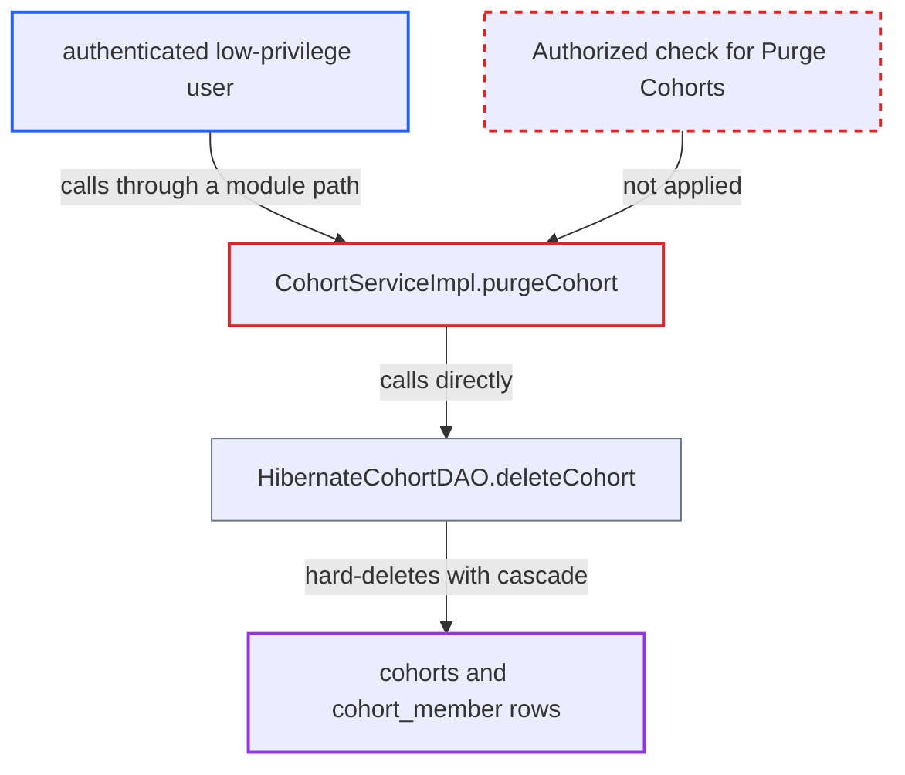

# CohortService.purgeCohort hard-deletes any cohort with no privilege check

| Field | Value |
|---|---|
| ID | `find_01M9pSKdyeuPcpGvJm5cj9ip` |
| Severity | **High** |
| Status | open |
| CWE | CWE-862 — Missing authorization |
| Created | 2026-10-21T22:53:09.844762Z |
| Claude Security | https://claude.ai/security/findings/find_01M9pSKdyeuPcpGvJm5cj9ip |

## Description

A logged-in low-privilege user can permanently delete any or all cohorts and every patient membership in them. The attacker must be authenticated and on the internal network. They also need a module path that calls the service. `CohortService.purgeCohort` has no `@Authorized` annotation, so no privilege check runs.

1. **authenticated low-privilege user** loads a target cohort through a module path. A path such as a REST purge fetches the cohort with `getCohortByUuid`, which needs only `Get Patient Cohorts`. `getAllCohorts` and the unannotated `getCohorts(String)` also work as ways to find targets.
2. **the attacker's request** causes `Context.getCohortService().purgeCohort(cohort)` to run. The interface method `purgeCohort` carries no `@Authorized`, although `voidCohort` is annotated and requires `DELETE_COHORTS`. ([`api/src/main/java/org/openmrs/api/CohortService.java:78`](https://github.com/cx-benchmark/openmrs-core/blob/e6a1b3374ef040e8821dbe4bacc1bdcb50fa4d29/api/src/main/java/org/openmrs/api/CohortService.java#L78))
3. **the advice `AuthorizationAdvice.before`** lets the call through without any check. It enforces privileges, and even requires a login, only for methods that have `@Authorized` values, so an unannotated method passes. ([`api/src/main/java/org/openmrs/aop/AuthorizationAdvice.java:65-99`](https://github.com/cx-benchmark/openmrs-core/blob/e6a1b3374ef040e8821dbe4bacc1bdcb50fa4d29/api/src/main/java/org/openmrs/aop/AuthorizationAdvice.java#L65-L99))
4. **the implementation `CohortServiceImpl.purgeCohort`** calls `dao.deleteCohort` directly. The method body is only `return dao.deleteCohort(cohort);` and has no `Context.requirePrivilege`. ([`api/src/main/java/org/openmrs/api/impl/CohortServiceImpl.java:201-203`](https://github.com/cx-benchmark/openmrs-core/blob/e6a1b3374ef040e8821dbe4bacc1bdcb50fa4d29/api/src/main/java/org/openmrs/api/impl/CohortServiceImpl.java#L201-L203))
5. **the `HibernateCohortDAO.deleteCohort` method** deletes the cohort row and its memberships. `session.delete(cohort)` removes the row, and the `all-delete-orphan` cascade on `memberships` in `Cohort.hbm.xml` removes every `cohort_member` row too. ([`api/src/main/java/org/openmrs/api/db/hibernate/HibernateCohortDAO.java:105-108`](https://github.com/cx-benchmark/openmrs-core/blob/e6a1b3374ef040e8821dbe4bacc1bdcb50fa4d29/api/src/main/java/org/openmrs/api/db/hibernate/HibernateCohortDAO.java#L105-L108))

## Assessment

The attacker is an authenticated low-privilege user on the internal network. The report says the system is not reachable from the internet. The user needs a module path that reaches the service, for example a REST purge that loads the target with `getCohortByUuid`. Read access (`Get Patient Cohorts`) is enough to find targets. The unannotated `getCohorts(String)` is another way to find them. The user then causes `purgeCohort` to run. No victim action is needed, and no other defence stands in the way.

Impact: The attacker can irreversibly destroy any or all cohort definitions and every patient membership in them. Reports, programs and workflows that rely on those cohorts lose their data, but the service itself stays up. The method discloses no data.

## Recommendation

`CohortService.purgeCohort` has no `@Authorized`, so the privilege system skips this irreversible purge. A dedicated `Purge Cohorts` privilege exists but is applied nowhere.

Fix criteria: `purgeCohort` requires `Purge Cohorts` at the service boundary. A caller without it must get `APIAuthenticationException` before `dao.deleteCohort` runs. That includes an unauthenticated caller and one holding only `Get Patient Cohorts` or `Delete Cohorts`. After such a denied call, the cohort and its `cohort_member` rows must still be in the database.

## Evidence

**https://github.com/cx-benchmark/openmrs-core**

- [`api/src/main/java/org/openmrs/api/CohortService.java:78`](https://github.com/cx-benchmark/openmrs-core/blob/e6a1b3374ef040e8821dbe4bacc1bdcb50fa4d29/api/src/main/java/org/openmrs/api/CohortService.java#L78)
- [`api/src/main/java/org/openmrs/api/impl/CohortServiceImpl.java:201-203`](https://github.com/cx-benchmark/openmrs-core/blob/e6a1b3374ef040e8821dbe4bacc1bdcb50fa4d29/api/src/main/java/org/openmrs/api/impl/CohortServiceImpl.java#L201-L203)
- [`api/src/main/java/org/openmrs/aop/AuthorizationAdvice.java:65-99`](https://github.com/cx-benchmark/openmrs-core/blob/e6a1b3374ef040e8821dbe4bacc1bdcb50fa4d29/api/src/main/java/org/openmrs/aop/AuthorizationAdvice.java#L65-L99)
- [`api/src/main/java/org/openmrs/api/db/hibernate/HibernateCohortDAO.java:105-108`](https://github.com/cx-benchmark/openmrs-core/blob/e6a1b3374ef040e8821dbe4bacc1bdcb50fa4d29/api/src/main/java/org/openmrs/api/db/hibernate/HibernateCohortDAO.java#L105-L108)
- [`api/src/main/java/org/openmrs/util/PrivilegeConstants.java:275`](https://github.com/cx-benchmark/openmrs-core/blob/e6a1b3374ef040e8821dbe4bacc1bdcb50fa4d29/api/src/main/java/org/openmrs/util/PrivilegeConstants.java#L275)

