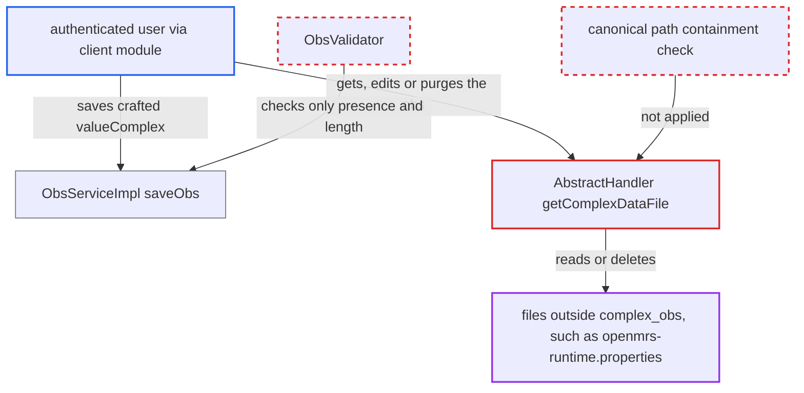

# Complex obs valueComplex path traversal: arbitrary file read and deletion

| Field | Value |
|---|---|
| ID | `find_01KEP9w2C5gNrsTX7qGRD94D` |
| Severity | **High** |
| Status | open |
| CWE | CWE-22 — Path traversal |
| Created | 2026-10-21T22:57:45.964769Z |
| Claude Security | https://claude.ai/security/findings/find_01KEP9w2C5gNrsTX7qGRD94D |

## Description

An authenticated user can read any file the servlet-container user can read, and can delete such files, by planting a crafted path in a complex observation. The attack needs `Add Observations` and `Get Observations`, a complex concept with a file-reading handler, and a deployed client module that exposes `Obs.valueComplex`. Core ships no such endpoint. `AbstractHandler.getComplexDataFile` joins the stored name to the directory without checking that the result stays inside it.

1. **authenticated user** saves an obs on a complex concept with only `valueComplex` set. The value is `x|../openmrs-runtime.properties` and no `ComplexData` is attached, so no handler runs and `dao.saveObs` stores the string unchanged. ([`api/src/main/java/org/openmrs/api/impl/ObsServiceImpl.java:243-258`](https://github.com/cx-benchmark/openmrs-core/blob/e6a1b3374ef040e8821dbe4bacc1bdcb50fa4d29/api/src/main/java/org/openmrs/api/impl/ObsServiceImpl.java#L243-L258))
2. **`ObsValidator`** accepts the crafted value. It only checks that `valueComplex` is present and at most 1000 characters long, not its format. ([`api/src/main/java/org/openmrs/validator/ObsValidator.java:134-145`](https://github.com/cx-benchmark/openmrs-core/blob/e6a1b3374ef040e8821dbe4bacc1bdcb50fa4d29/api/src/main/java/org/openmrs/validator/ObsValidator.java#L134-L145))
3. **authenticated user** fetches the obs with `getObs`, `getObsByUuid` or `getComplexObs`. For any obs on a complex concept, `ObsServiceImpl` calls `getHandler(obs).getObs(obs, RAW_VIEW)`, which resolves the stored path. ([`api/src/main/java/org/openmrs/api/impl/ObsServiceImpl.java:265-270`](https://github.com/cx-benchmark/openmrs-core/blob/e6a1b3374ef040e8821dbe4bacc1bdcb50fa4d29/api/src/main/java/org/openmrs/api/impl/ObsServiceImpl.java#L265-L270))
4. **`AbstractHandler.getComplexDataFile`** builds the file path from the last `|` segment. It returns `new File(complexObsDir, segment)` without canonicalising it or checking containment, so `../openmrs-runtime.properties` points to the file one level above `complex_obs`. ([`api/src/main/java/org/openmrs/obs/handler/AbstractHandler.java:147-153`](https://github.com/cx-benchmark/openmrs-core/blob/e6a1b3374ef040e8821dbe4bacc1bdcb50fa4d29/api/src/main/java/org/openmrs/obs/handler/AbstractHandler.java#L147-L153))
5. **`BinaryDataHandler.getObs`** reads the whole file and returns its bytes. The bytes come back in `obs.getComplexData()`, so the caller gets the database credentials. `BinaryStreamHandler`, `TextHandler` and `MediaHandler` behave the same way. ([`api/src/main/java/org/openmrs/obs/handler/BinaryDataHandler.java:52-70`](https://github.com/cx-benchmark/openmrs-core/blob/e6a1b3374ef040e8821dbe4bacc1bdcb50fa4d29/api/src/main/java/org/openmrs/obs/handler/BinaryDataHandler.java#L52-L70))
6. **authenticated user** optionally edits the obs to delete the target file. `voidExistingObs` reloads the obs and calls `getComplexDataFile(obs).delete()` on the traversal path. This needs `Edit Observations`. ([`api/src/main/java/org/openmrs/api/impl/ObsServiceImpl.java:124-147`](https://github.com/cx-benchmark/openmrs-core/blob/e6a1b3374ef040e8821dbe4bacc1bdcb50fa4d29/api/src/main/java/org/openmrs/api/impl/ObsServiceImpl.java#L124-L147))
7. **authenticated user** or purges the obs to delete the target file. `purgeComplexData` calls `file.delete()` on the file resolved from `valueComplex`. This is reached through `purgeObs`, which needs `Delete Observations`. ([`api/src/main/java/org/openmrs/obs/handler/AbstractHandler.java:127-140`](https://github.com/cx-benchmark/openmrs-core/blob/e6a1b3374ef040e8821dbe4bacc1bdcb50fa4d29/api/src/main/java/org/openmrs/obs/handler/AbstractHandler.java#L127-L140))

## Assessment

The attacker is an authenticated user with `Add Observations` and `Get Observations`. Deleting files also needs `Edit Observations` or `Delete Observations`. Core has no HTTP surface that binds `Obs` fields, so a deployed client module must map client input onto `Obs.valueComplex`. A complex concept with a file-reading handler must exist. The default `obs.complex_obs_dir` is the relative `complex_obs` under the application data directory. That directory also holds `openmrs-runtime.properties`, `modules/` and `configuration/`, so one `../` reaches them. The report notes that the owner says the server is reachable only from the internal network.

Impact: The attacker can read any file the container user can read, including `openmrs-runtime.properties` with the database credentials that unlock all patient data. They can also delete files such as module `.omod` files, configuration, other patients' complex-obs files or the runtime properties. Deleting the runtime properties at its default location makes the next start fall back to the setup wizard, and deleting modules or configuration breaks the service. Reach is limited only by the container user's filesystem permissions.

## Recommendation

(1) `AbstractHandler.getComplexDataFile` joins the stored `valueComplex` segment to the complex-obs directory without canonicalising it or checking containment. Every handler read and every delete trusts that path.

Fix criteria: A file resolved from `valueComplex` is rejected unless its canonical path is strictly inside the canonical complex-obs directory, ideally a bare file name with no separators. An obs with `valueComplex="x|../openmrs-runtime.properties"` makes `getObs`, `getComplexObs`, edit and `purgeObs` fail. No file outside `complex_obs` is returned or deleted.

(2) `ObsServiceImpl.saveObs` lets callers store any `valueComplex` for a complex concept when no `ComplexData` is attached. The pointer the handlers trust is therefore not produced by the handlers.

Fix criteria: For a complex concept, `valueComplex` is set only by the handler from the file it wrote, or is validated as a bare file name inside the complex-obs directory. A caller-supplied value with path separators or `..` fails `ObsValidator` or `saveObs`. Saving such an obs throws a validation error.

## Evidence

**https://github.com/cx-benchmark/openmrs-core**

- [`api/src/main/java/org/openmrs/obs/handler/AbstractHandler.java:147-153`](https://github.com/cx-benchmark/openmrs-core/blob/e6a1b3374ef040e8821dbe4bacc1bdcb50fa4d29/api/src/main/java/org/openmrs/obs/handler/AbstractHandler.java#L147-L153)
- [`api/src/main/java/org/openmrs/api/impl/ObsServiceImpl.java:243-258`](https://github.com/cx-benchmark/openmrs-core/blob/e6a1b3374ef040e8821dbe4bacc1bdcb50fa4d29/api/src/main/java/org/openmrs/api/impl/ObsServiceImpl.java#L243-L258)
- [`api/src/main/java/org/openmrs/api/impl/ObsServiceImpl.java:265-270`](https://github.com/cx-benchmark/openmrs-core/blob/e6a1b3374ef040e8821dbe4bacc1bdcb50fa4d29/api/src/main/java/org/openmrs/api/impl/ObsServiceImpl.java#L265-L270)
- [`api/src/main/java/org/openmrs/obs/handler/BinaryDataHandler.java:52-70`](https://github.com/cx-benchmark/openmrs-core/blob/e6a1b3374ef040e8821dbe4bacc1bdcb50fa4d29/api/src/main/java/org/openmrs/obs/handler/BinaryDataHandler.java#L52-L70)
- [`api/src/main/java/org/openmrs/api/impl/ObsServiceImpl.java:124-147`](https://github.com/cx-benchmark/openmrs-core/blob/e6a1b3374ef040e8821dbe4bacc1bdcb50fa4d29/api/src/main/java/org/openmrs/api/impl/ObsServiceImpl.java#L124-L147)
- [`api/src/main/java/org/openmrs/obs/handler/AbstractHandler.java:127-140`](https://github.com/cx-benchmark/openmrs-core/blob/e6a1b3374ef040e8821dbe4bacc1bdcb50fa4d29/api/src/main/java/org/openmrs/obs/handler/AbstractHandler.java#L127-L140)
- [`api/src/main/java/org/openmrs/util/OpenmrsUtil.java:1092-1110`](https://github.com/cx-benchmark/openmrs-core/blob/e6a1b3374ef040e8821dbe4bacc1bdcb50fa4d29/api/src/main/java/org/openmrs/util/OpenmrsUtil.java#L1092-L1110)
- [`api/src/main/java/org/openmrs/validator/ObsValidator.java:134-145`](https://github.com/cx-benchmark/openmrs-core/blob/e6a1b3374ef040e8821dbe4bacc1bdcb50fa4d29/api/src/main/java/org/openmrs/validator/ObsValidator.java#L134-L145)

