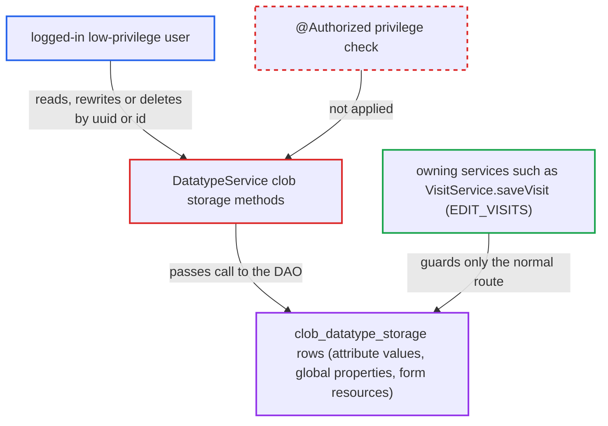

# DatatypeService clob storage read, overwrite and delete methods lack @Authorized checks

| Field | Value |
|---|---|
| ID | `find_016e5qrCKg7LNB3mgTY41HVf` |
| Severity | **High** |
| Status | open |
| CWE | CWE-862 — Missing authorization |
| Created | 2026-10-21T23:00:40.186885Z |
| Claude Security | https://claude.ai/security/findings/find_016e5qrCKg7LNB3mgTY41HVf |

## Description

A low-privilege user on the internal network can read, rewrite or delete the stored long-text content of attributes, global properties and form resources. They do not need the privilege of the object that owns the content. The methods on `DatatypeService` that handle `ClobDatatypeStorage` carry no `@Authorized` annotation, so `AuthorizationAdvice.before` checks nothing for them.

1. **logged-in low-privilege user** sends a request that a module passes on to `DatatypeService`. Core `web/` has no servlet that calls these methods. The report names the REST module's clob data resource (out of view) as an example of a module that does this.
2. **the attacker** picks a clob row to target by uuid or by integer id. The uuid can be read from the `valueReference` of an attribute on an object the attacker may view. Integer ids are sequential, so `getClobDatatypeStorage(Integer)` lets every row be enumerated. ([`api/src/main/java/org/openmrs/customdatatype/datatype/LongFreeTextDatatype.java:38-65`](https://github.com/cx-benchmark/openmrs-core/blob/e6a1b3374ef040e8821dbe4bacc1bdcb50fa4d29/api/src/main/java/org/openmrs/customdatatype/datatype/LongFreeTextDatatype.java#L38-L65))
3. **the interceptor `AuthorizationAdvice.before`** lets the call through without a privilege check. It takes privileges only from an `@Authorized` annotation, and the `ClobDatatypeStorage` methods have none. It also does not require `Context.isAuthenticated()`. ([`api/src/main/java/org/openmrs/aop/AuthorizationAdvice.java:58-99`](https://github.com/cx-benchmark/openmrs-core/blob/e6a1b3374ef040e8821dbe4bacc1bdcb50fa4d29/api/src/main/java/org/openmrs/aop/AuthorizationAdvice.java#L58-L99))
4. **`DatatypeServiceImpl` and `HibernateDatatypeDAO`** load, update or delete the named row. The implementation passes each call straight to the DAO. The DAO does `session().get`, a uuid lookup, `saveOrUpdate` or `delete` on whatever row the caller names or supplies. ([`api/src/main/java/org/openmrs/api/db/hibernate/HibernateDatatypeDAO.java:50-79`](https://github.com/cx-benchmark/openmrs-core/blob/e6a1b3374ef040e8821dbe4bacc1bdcb50fa4d29/api/src/main/java/org/openmrs/api/db/hibernate/HibernateDatatypeDAO.java#L50-L79))
5. **the attacker** overwrites the value with `setValue` and `saveClobDatatypeStorage`, or removes the row with `deleteClobDatatypeStorage`. `saveOrUpdate` updates when the object carries an existing `id`. A deleted row leaves the owning attribute dangling, and `fromReferenceString` then throws a `NullPointerException` when the value is loaded. ([`api/src/main/java/org/openmrs/api/DatatypeService.java:63-92`](https://github.com/cx-benchmark/openmrs-core/blob/e6a1b3374ef040e8821dbe4bacc1bdcb50fa4d29/api/src/main/java/org/openmrs/api/DatatypeService.java#L63-L92))

## Assessment

The attacker is a logged-in, low-privilege user on the internal network. The report says the system is not reachable from the internet. A module must pass the user's request to `DatatypeService`. The attacker takes a `valueReference` uuid from an object they may view, or walks sequential clob ids. No victim action is needed. The report also says these methods require neither a privilege nor authentication, but it describes the attacker as logged in.

Impact: The attacker can rewrite or delete the stored content of long-free-text attribute values, global properties and form resources. This covers visit and patient-program attributes, and it bypasses the owning object's edit or delete privilege. They can also read clob content without the owning object's view privilege. What that exposes depends on which attribute types an admin configured, so the report rates the reading as limited. Deleted rows make the affected objects fail to load, but the service stays up.

## Recommendation

The `ClobDatatypeStorage` methods of `DatatypeService` have no `@Authorized`. Any caller can read, rewrite and delete the rows that hold attribute content. This bypasses the privileges of the object that owns the value.

Fix criteria: Every direct read, write and delete of a `ClobDatatypeStorage` requires a privilege. That can be a dedicated clob privilege or the view/edit privilege of the domain that owns the row. A caller who is unauthenticated or lacks the privilege gets `APIAuthenticationException` before any DAO call. Owning services such as `saveVisit` can still save long-text attributes for users who hold their own privileges. To verify, call each method as a user holding only `GET_VISITS`, by uuid and by integer id. Confirm that nothing is returned, changed or deleted.

## Evidence

**https://github.com/cx-benchmark/openmrs-core**

- [`api/src/main/java/org/openmrs/api/DatatypeService.java:63-92`](https://github.com/cx-benchmark/openmrs-core/blob/e6a1b3374ef040e8821dbe4bacc1bdcb50fa4d29/api/src/main/java/org/openmrs/api/DatatypeService.java#L63-L92)
- [`api/src/main/java/org/openmrs/api/impl/DatatypeServiceImpl.java:205-234`](https://github.com/cx-benchmark/openmrs-core/blob/e6a1b3374ef040e8821dbe4bacc1bdcb50fa4d29/api/src/main/java/org/openmrs/api/impl/DatatypeServiceImpl.java#L205-L234)
- [`api/src/main/java/org/openmrs/api/db/hibernate/HibernateDatatypeDAO.java:50-79`](https://github.com/cx-benchmark/openmrs-core/blob/e6a1b3374ef040e8821dbe4bacc1bdcb50fa4d29/api/src/main/java/org/openmrs/api/db/hibernate/HibernateDatatypeDAO.java#L50-L79)
- [`api/src/main/java/org/openmrs/aop/AuthorizationAdvice.java:58-99`](https://github.com/cx-benchmark/openmrs-core/blob/e6a1b3374ef040e8821dbe4bacc1bdcb50fa4d29/api/src/main/java/org/openmrs/aop/AuthorizationAdvice.java#L58-L99)
- [`api/src/main/resources/applicationContext-service.xml:458-464`](https://github.com/cx-benchmark/openmrs-core/blob/e6a1b3374ef040e8821dbe4bacc1bdcb50fa4d29/api/src/main/resources/applicationContext-service.xml#L458-L464)
- [`api/src/main/java/org/openmrs/customdatatype/datatype/LongFreeTextDatatype.java:38-65`](https://github.com/cx-benchmark/openmrs-core/blob/e6a1b3374ef040e8821dbe4bacc1bdcb50fa4d29/api/src/main/java/org/openmrs/customdatatype/datatype/LongFreeTextDatatype.java#L38-L65)
- [`api/src/main/java/org/openmrs/customdatatype/CustomDatatypeUtil.java:225-254`](https://github.com/cx-benchmark/openmrs-core/blob/e6a1b3374ef040e8821dbe4bacc1bdcb50fa4d29/api/src/main/java/org/openmrs/customdatatype/CustomDatatypeUtil.java#L225-L254)

