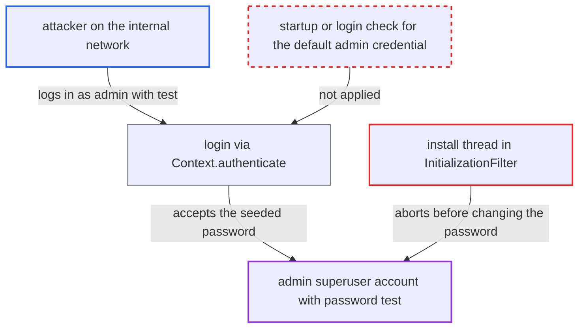

# Failed late install step leaves seeded admin/test superuser password active

| Field | Value |
|---|---|
| ID | `find_01AN4hex5xXVVw7Qnb8wrz9a` |
| Severity | **High** |
| Status | open |
| CWE | CWE-1393 — Use of default password |
| Created | 2026-10-21T23:18:11.795866Z |
| Claude Security | https://claude.ai/security/findings/find_01AN4hex5xXVVw7Qnb8wrz9a |

## Description

Anyone on the internal network can log in as the `admin` superuser with the publicly known password `test` and take full control of the OpenMRS system. This happens only after an install that aborted late and was then restarted. The install thread in `InitializationFilter` changes the seeded password last, after steps that can fail and `return`, and nothing afterwards checks for the default password.

1. **the core data** seeds the `admin` account with password `test`. The core-data file creates the user with a hash that matches `test`, and the wizard itself logs in as `admin`/`test` to change it later. ([`api/src/main/resources/org/openmrs/liquibase/snapshots/core-data/liquibase-core-data-2.5.x.xml:38-45`](https://github.com/cx-benchmark/openmrs-core/blob/e6a1b3374ef040e8821dbe4bacc1bdcb50fa4d29/api/src/main/resources/org/openmrs/liquibase/snapshots/core-data/liquibase-core-data-2.5.x.xml#L38-L45))
2. **the install thread in `InitializationFilter`** writes the runtime properties file before the risky steps. The database is already migrated and the properties file already exists, so the system can start even if the install stops here. ([`web/src/main/java/org/openmrs/web/filter/initialization/InitializationFilter.java:1718-1724`](https://github.com/cx-benchmark/openmrs-core/blob/e6a1b3374ef040e8821dbe4bacc1bdcb50fa4d29/web/src/main/java/org/openmrs/web/filter/initialization/InitializationFilter.java#L1718-L1724))
3. **the optional implementation-ID step** throws and makes the install thread return. It fails when an ID is entered without a description or passphrase, when `https://implementation.openmrs.org` cannot be reached, or when the remote rejects the ID. The password-change block is then never reached. ([`web/src/main/java/org/openmrs/web/filter/initialization/InitializationFilter.java:1750-1772`](https://github.com/cx-benchmark/openmrs-core/blob/e6a1b3374ef040e8821dbe4bacc1bdcb50fa4d29/web/src/main/java/org/openmrs/web/filter/initialization/InitializationFilter.java#L1750-L1772))
4. **the password-change block** aborts on any error other than `ContextAuthenticationException`. A script-supplied `admin_user_password` that fails the password policy makes `updatePassword` throw a `PasswordException`. The outer catch reports an error and returns, and the password stays `test`. ([`web/src/main/java/org/openmrs/web/filter/initialization/InitializationFilter.java:1781-1814`](https://github.com/cx-benchmark/openmrs-core/blob/e6a1b3374ef040e8821dbe4bacc1bdcb50fa4d29/web/src/main/java/org/openmrs/web/filter/initialization/InitializationFilter.java#L1781-L1814))
5. **`InitializationFilter.init()` and `Listener.setupNeeded()`** treat the half-finished install as complete on the next start. The database is not empty and no updates are pending, so the wizard is skipped and OpenMRS starts normally. Nothing records that the install was incomplete. ([`web/src/main/java/org/openmrs/web/filter/initialization/InitializationFilter.java:1075-1087`](https://github.com/cx-benchmark/openmrs-core/blob/e6a1b3374ef040e8821dbe4bacc1bdcb50fa4d29/web/src/main/java/org/openmrs/web/filter/initialization/InitializationFilter.java#L1075-L1087))
6. **the attacker** logs in as `admin` with password `test`. The login accepts the seeded hash, and the attacker holds the System Developer superuser role. ([`web/src/main/java/org/openmrs/web/Listener.java:315-326`](https://github.com/cx-benchmark/openmrs-core/blob/e6a1b3374ef040e8821dbe4bacc1bdcb50fa4d29/web/src/main/java/org/openmrs/web/Listener.java#L315-L326))

## Assessment

The attacker needs network access to the OpenMRS server. The report's threat model says the server is reachable only from an internal network. No account or user interaction is needed. The attack depends on an install that stopped before the password change and was then restarted. That happens when the implementation-ID step fails (an ID entered with a blank description or passphrase, no outbound access, or a remote rejection). It also happens when a script or Docker install supplies an `admin_user_password` (from `OPENMRS_INSTALLATION_SCRIPT` or `OMRS_ADMIN_USER_PASSWORD`) that fails the password policy, because the script path never validates it. Re-running the wizard against the existing tables is no way out. It skips the admin-password page and the password block, so it also ends with `admin`/`test`. The installer sees only an implementation-ID or generic startup error and is never told the default password remains. The documented `admin`/`Admin123` default of the simple install and Docker is shown to the operator and is not part of this finding.

Impact: The attacker gets the System Developer superuser role. That allows reading and changing all patient data, managing users, roles and privileges, and editing global properties. With the wizard default `module.allow_web_admin=true`, the attacker can also upload a module and run code on the server.

## Recommendation

(1) The install thread does optional work that can fail (implementation-ID registration) and an unvalidated password change after the database and runtime properties are already complete. On failure it returns without reverting, so the seeded `admin`/`test` credential survives in a system that can start.

Fix criteria: The admin password is replaced, or validated and seeded, before any optional step. Script-supplied passwords are validated before any work begins. If the password change does not succeed, the install does not leave the system startable and tells the installer. Force `setImplementationId` to throw, and separately supply a policy-failing `admin_user_password`, then restart. In both cases `admin`/`test` must be rejected or setup must still be required.

(2) Nothing at startup or login detects that `admin` still has the well-known core-data password hash, so a failed or skipped password change goes unnoticed.

Fix criteria: On startup or first login the default `admin` credential is detected, and a password change is forced before any other authenticated action. A database holding the core-data admin row cannot be used for normal operation until the password is changed.

## Evidence

**https://github.com/cx-benchmark/openmrs-core**

- [`web/src/main/java/org/openmrs/web/filter/initialization/InitializationFilter.java:1750-1772`](https://github.com/cx-benchmark/openmrs-core/blob/e6a1b3374ef040e8821dbe4bacc1bdcb50fa4d29/web/src/main/java/org/openmrs/web/filter/initialization/InitializationFilter.java#L1750-L1772)
- [`web/src/main/java/org/openmrs/web/filter/initialization/InitializationFilter.java:1781-1814`](https://github.com/cx-benchmark/openmrs-core/blob/e6a1b3374ef040e8821dbe4bacc1bdcb50fa4d29/web/src/main/java/org/openmrs/web/filter/initialization/InitializationFilter.java#L1781-L1814)
- [`web/src/main/java/org/openmrs/web/filter/initialization/InitializationFilter.java:1718-1724`](https://github.com/cx-benchmark/openmrs-core/blob/e6a1b3374ef040e8821dbe4bacc1bdcb50fa4d29/web/src/main/java/org/openmrs/web/filter/initialization/InitializationFilter.java#L1718-L1724)
- [`web/src/main/java/org/openmrs/web/filter/initialization/InitializationFilter.java:1075-1087`](https://github.com/cx-benchmark/openmrs-core/blob/e6a1b3374ef040e8821dbe4bacc1bdcb50fa4d29/web/src/main/java/org/openmrs/web/filter/initialization/InitializationFilter.java#L1075-L1087)
- [`web/src/main/java/org/openmrs/web/Listener.java:315-326`](https://github.com/cx-benchmark/openmrs-core/blob/e6a1b3374ef040e8821dbe4bacc1bdcb50fa4d29/web/src/main/java/org/openmrs/web/Listener.java#L315-L326)
- [`api/src/main/resources/org/openmrs/liquibase/snapshots/core-data/liquibase-core-data-2.5.x.xml:38-45`](https://github.com/cx-benchmark/openmrs-core/blob/e6a1b3374ef040e8821dbe4bacc1bdcb50fa4d29/api/src/main/resources/org/openmrs/liquibase/snapshots/core-data/liquibase-core-data-2.5.x.xml#L38-L45)
- [`api/src/main/java/org/openmrs/api/impl/AdministrationServiceImpl.java:459-497`](https://github.com/cx-benchmark/openmrs-core/blob/e6a1b3374ef040e8821dbe4bacc1bdcb50fa4d29/api/src/main/java/org/openmrs/api/impl/AdministrationServiceImpl.java#L459-L497)
- [`web/src/main/java/org/openmrs/web/filter/initialization/InitializationFilter.java:353`](https://github.com/cx-benchmark/openmrs-core/blob/e6a1b3374ef040e8821dbe4bacc1bdcb50fa4d29/web/src/main/java/org/openmrs/web/filter/initialization/InitializationFilter.java#L353)
- [`api/src/main/java/org/openmrs/api/impl/UserServiceImpl.java:653-661`](https://github.com/cx-benchmark/openmrs-core/blob/e6a1b3374ef040e8821dbe4bacc1bdcb50fa4d29/api/src/main/java/org/openmrs/api/impl/UserServiceImpl.java#L653-L661)
- [`web/src/main/java/org/openmrs/web/filter/initialization/InitializationFilter.java:619-623`](https://github.com/cx-benchmark/openmrs-core/blob/e6a1b3374ef040e8821dbe4bacc1bdcb50fa4d29/web/src/main/java/org/openmrs/web/filter/initialization/InitializationFilter.java#L619-L623)

