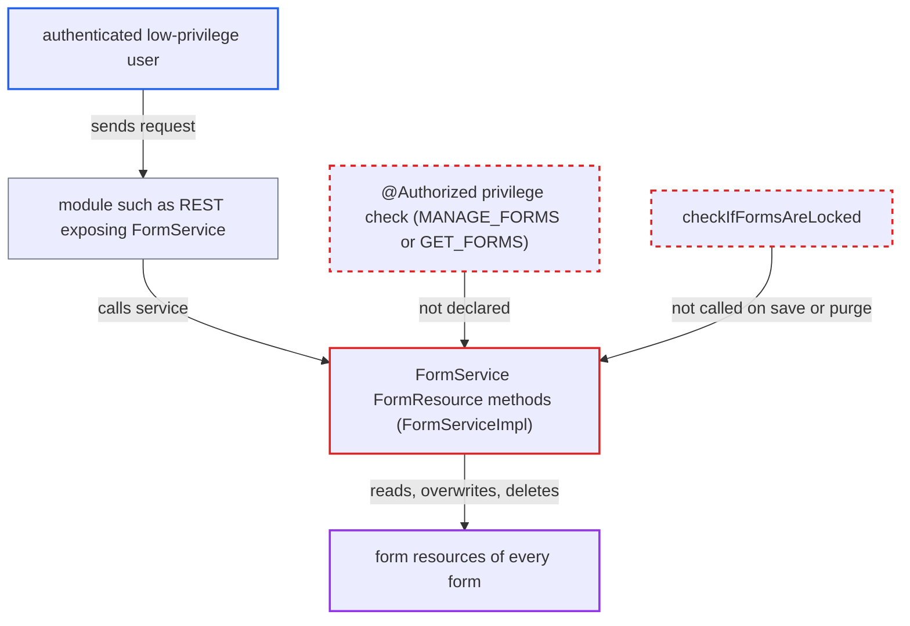

# FormService FormResource read, save and purge methods lack @Authorized privilege checks

| Field | Value |
|---|---|
| ID | `find_012uuZzkUhoknRjPzvAQC9wU` |
| Severity | **High** |
| Status | open |
| CWE | CWE-862 — Missing Authorization |
| Created | 2026-10-21T22:56:10.734249Z |
| Claude Security | https://claude.ai/security/findings/find_012uuZzkUhoknRjPzvAQC9wU |

## Description

A logged-in user without the `MANAGE_FORMS` privilege can overwrite or delete the resources attached to any form. A user without `GET_FORMS` can read them. The attacker must be authenticated and on the internal network, and must reach `FormService` through a module such as REST. The six `FormResource` methods in `FormService` have no `@Authorized` annotation, so no privilege check runs.

1. **the attacker** sends a request to a module that exposes `FormService`. The request names an existing form and resource name with the attacker's own value, or asks for a resource to be purged. The report gives REST as an example of such a module.
2. **the `FormService` interface** declares the six `FormResource` methods without `@Authorized`. The methods are `getFormResource(Integer)`, `getFormResourceByUuid`, `getFormResource(Form, String)`, `getFormResourcesForForm`, `saveFormResource` and `purgeFormResource`. Every other form read and write in the interface is annotated. ([`api/src/main/java/org/openmrs/api/FormService.java:588-635`](https://github.com/cx-benchmark/openmrs-core/blob/e6a1b3374ef040e8821dbe4bacc1bdcb50fa4d29/api/src/main/java/org/openmrs/api/FormService.java#L588-L635))
3. **`AuthorizationAdvice.before`** lets the call through without checking anything. It reads privileges only from the method annotation. With none present it checks no privilege and does not require `Context.isAuthenticated()`. ([`api/src/main/java/org/openmrs/aop/AuthorizationAdvice.java:46-99`](https://github.com/cx-benchmark/openmrs-core/blob/e6a1b3374ef040e8821dbe4bacc1bdcb50fa4d29/api/src/main/java/org/openmrs/aop/AuthorizationAdvice.java#L46-L99))
4. **`FormServiceImpl.saveFormResource`** overwrites the existing resource with the caller's values. It finds the resource with the same `(form, name)` and copies over it the caller's `value`, `datatypeClassname`, `datatypeConfig` and `preferredHandlerClassname`. It never calls `checkIfFormsAreLocked()`. ([`api/src/main/java/org/openmrs/api/impl/FormServiceImpl.java:724-755`](https://github.com/cx-benchmark/openmrs-core/blob/e6a1b3374ef040e8821dbe4bacc1bdcb50fa4d29/api/src/main/java/org/openmrs/api/impl/FormServiceImpl.java#L724-L755))
5. **`HibernateFormDAO`** persists the change with a plain `saveOrUpdate`, or deletes the resource for `purgeFormResource`. The DAO adds no further checks, so the attacker's data replaces the stored resource or the resource is removed. ([`api/src/main/java/org/openmrs/api/db/hibernate/HibernateFormDAO.java:620-631`](https://github.com/cx-benchmark/openmrs-core/blob/e6a1b3374ef040e8821dbe4bacc1bdcb50fa4d29/api/src/main/java/org/openmrs/api/db/hibernate/HibernateFormDAO.java#L620-L631))

## Assessment

The attacker is an authenticated low-privilege user on the internal network. The report says the system is not reachable from the internet. No core servlet in `web/` calls these methods. The attacker reaches them through a module that exposes `FormService`, such as REST, which relies on the service layer for privilege enforcement. The attacker needs no victim action. The attacker submits a `FormResource` for an existing form and resource name, or asks for a purge. The same gap lets a user without `GET_FORMS` read resources. As a side effect, the caller-chosen `datatypeClassname` is loaded and instantiated with a no-arg constructor. The report says the finding does not rely on this.

Impact: The attacker can create, overwrite and delete the resources of every form without `MANAGE_FORMS`, and can bypass the forms lock. These resources hold the form definitions that form engines use, so data capture built on them can be altered or broken. Reading resources without `GET_FORMS` is a limited loss, because they are form metadata and not patient data. The service stays up.

## Recommendation

(1) The six `FormResource` methods of `FormService` have no `@Authorized` annotation. The privilege check that guards every other form read and write is skipped for them.

Fix criteria: `saveFormResource` and `purgeFormResource` require `MANAGE_FORMS`, and the four getters require `GET_FORMS`. An unauthenticated caller, or one without the privilege, gets `APIAuthenticationException` before any DAO or datatype code runs. Calling each method through `Context.getFormService()` as such a user reads, writes and deletes nothing.

(2) `saveFormResource` and `purgeFormResource` do not call `checkIfFormsAreLocked()`, which `saveForm` and `purgeForm` do. Locked forms can still have their definitions changed.

Fix criteria: With the forms-locked global property set, saving or purging a form resource raises `FormsLockedException`, just as saving or purging a form does.

## Evidence

**https://github.com/cx-benchmark/openmrs-core**

- [`api/src/main/java/org/openmrs/api/FormService.java:588-635`](https://github.com/cx-benchmark/openmrs-core/blob/e6a1b3374ef040e8821dbe4bacc1bdcb50fa4d29/api/src/main/java/org/openmrs/api/FormService.java#L588-L635)
- [`api/src/main/java/org/openmrs/api/impl/FormServiceImpl.java:724-755`](https://github.com/cx-benchmark/openmrs-core/blob/e6a1b3374ef040e8821dbe4bacc1bdcb50fa4d29/api/src/main/java/org/openmrs/api/impl/FormServiceImpl.java#L724-L755)
- [`api/src/main/java/org/openmrs/aop/AuthorizationAdvice.java:46-99`](https://github.com/cx-benchmark/openmrs-core/blob/e6a1b3374ef040e8821dbe4bacc1bdcb50fa4d29/api/src/main/java/org/openmrs/aop/AuthorizationAdvice.java#L46-L99)
- [`api/src/main/java/org/openmrs/api/impl/FormServiceImpl.java:513-514`](https://github.com/cx-benchmark/openmrs-core/blob/e6a1b3374ef040e8821dbe4bacc1bdcb50fa4d29/api/src/main/java/org/openmrs/api/impl/FormServiceImpl.java#L513-L514)
- [`api/src/main/java/org/openmrs/api/db/hibernate/HibernateFormDAO.java:620-631`](https://github.com/cx-benchmark/openmrs-core/blob/e6a1b3374ef040e8821dbe4bacc1bdcb50fa4d29/api/src/main/java/org/openmrs/api/db/hibernate/HibernateFormDAO.java#L620-L631)
- [`api/src/main/java/org/openmrs/customdatatype/CustomDatatypeUtil.java:237-253`](https://github.com/cx-benchmark/openmrs-core/blob/e6a1b3374ef040e8821dbe4bacc1bdcb50fa4d29/api/src/main/java/org/openmrs/customdatatype/CustomDatatypeUtil.java#L237-L253)

