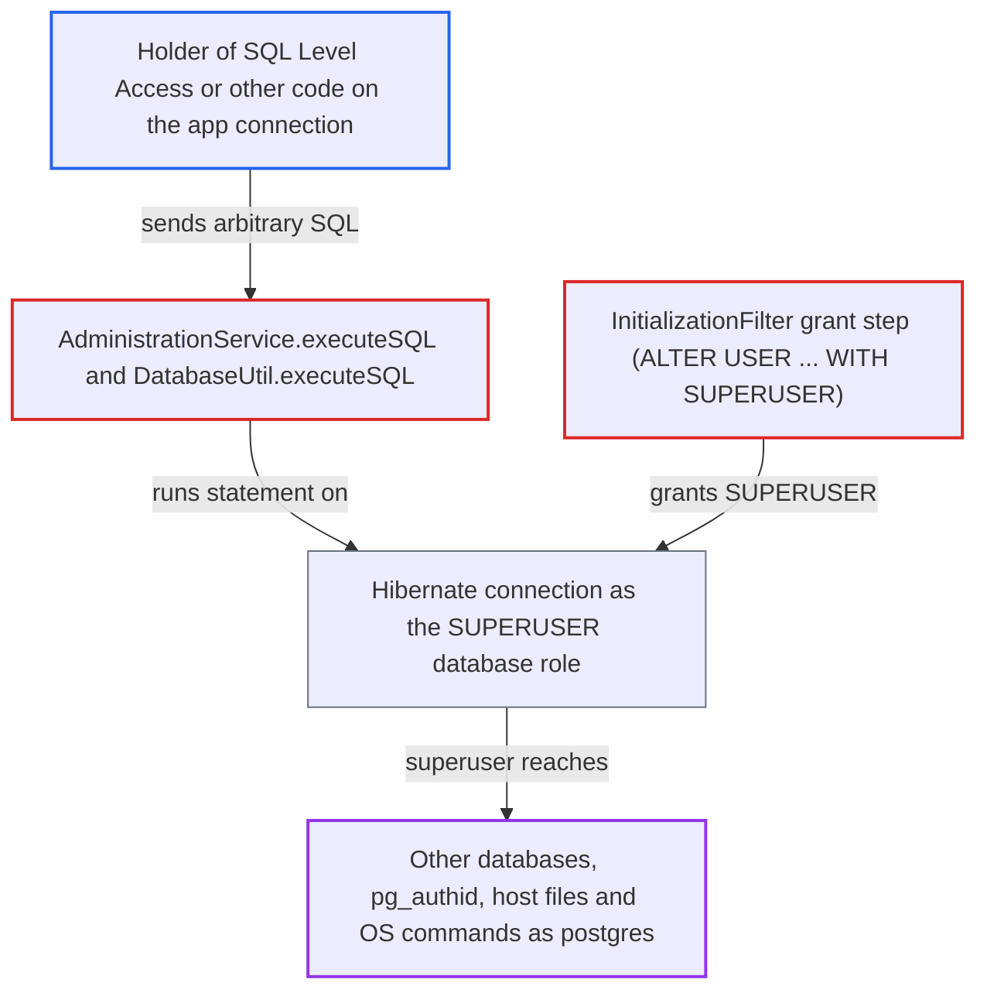

# Install wizard grants the OpenMRS PostgreSQL application role cluster SUPERUSER

| Field | Value |
|---|---|
| ID | `find_01DmKnKWMpV7bu21xC3mHH75` |
| Severity | **High** |
| Status | open |
| CWE | CWE-250 — Excessive privilege |
| Created | 2026-10-21T23:18:20.372378Z |
| Claude Security | https://claude.ai/security/findings/find_01DmKnKWMpV7bu21xC3mHH75 |

## Description

On PostgreSQL installs, the OpenMRS database account is a cluster-wide superuser. Anyone who can run SQL on the application's connection can read and write files and run OS commands on the database host. They can also read and change every other database in the cluster. This needs an account with `SQL Level Access` (by default only superusers) or other code running on that connection. The cause is `InitializationFilter` running `ALTER USER "<db>_user" WITH SUPERUSER`.

1. **the install wizard `InitializationFilter`** creates the application database user. When `createDatabaseUser` is true, it creates `<databaseName>_user` using the installer-supplied PostgreSQL admin credentials, and those credentials let the later grant succeed. ([`web/src/main/java/org/openmrs/web/filter/initialization/InitializationFilter.java:1410-1458`](https://github.com/cx-benchmark/openmrs-core/blob/e6a1b3374ef040e8821dbe4bacc1bdcb50fa4d29/web/src/main/java/org/openmrs/web/filter/initialization/InitializationFilter.java#L1410-L1458))
2. **the install wizard `InitializationFilter`** runs `ALTER USER "<db>_user" WITH SUPERUSER` on PostgreSQL. The MySQL branch grants only `ALL ON <db>.*`, but the PostgreSQL branch grants superuser on the whole cluster, and the log still says "all privileges to database". ([`web/src/main/java/org/openmrs/web/filter/initialization/InitializationFilter.java:1462-1480`](https://github.com/cx-benchmark/openmrs-core/blob/e6a1b3374ef040e8821dbe4bacc1bdcb50fa4d29/web/src/main/java/org/openmrs/web/filter/initialization/InitializationFilter.java#L1462-L1480))
3. **the install wizard `InitializationFilter`** stores the new role as the permanent runtime credentials. The role and its password are written as `connection.username` and `connection.password` and persisted to the runtime properties file. ([`web/src/main/java/org/openmrs/web/filter/initialization/InitializationFilter.java:1505-1510`](https://github.com/cx-benchmark/openmrs-core/blob/e6a1b3374ef040e8821dbe4bacc1bdcb50fa4d29/web/src/main/java/org/openmrs/web/filter/initialization/InitializationFilter.java#L1505-L1510))
4. **`HibernateSessionFactoryBean`** uses those credentials for every session. Each runtime property is copied into the Hibernate configuration as `hibernate.<prop>`. `DatabaseUpdater` uses the same `hibernate.connection.*` values for Liquibase. ([`api/src/main/java/org/openmrs/api/db/hibernate/HibernateSessionFactoryBean.java:128-139`](https://github.com/cx-benchmark/openmrs-core/blob/e6a1b3374ef040e8821dbe4bacc1bdcb50fa4d29/api/src/main/java/org/openmrs/api/db/hibernate/HibernateSessionFactoryBean.java#L128-L139))
5. **an attacker holding `SQL Level Access`** calls `AdministrationService.executeSQL` with a dangerous statement. For example `executeSQL("SELECT pg_read_file('/etc/passwd')", true)` or a `COPY ... TO PROGRAM` statement. `DatabaseUtil.executeSQL` does not block these statements, because they are not in its prefix list. ([`api/src/main/java/org/openmrs/util/DatabaseUtil.java:87-138`](https://github.com/cx-benchmark/openmrs-core/blob/e6a1b3374ef040e8821dbe4bacc1bdcb50fa4d29/api/src/main/java/org/openmrs/util/DatabaseUtil.java#L87-L138))
6. **PostgreSQL** runs the statement as a superuser. The statement runs on the Hibernate connection, which is authenticated as the superuser role, so the server allows file access, OS commands and access to all databases. ([`api/src/main/java/org/openmrs/util/DatabaseUtil.java:87-138`](https://github.com/cx-benchmark/openmrs-core/blob/e6a1b3374ef040e8821dbe4bacc1bdcb50fa4d29/api/src/main/java/org/openmrs/util/DatabaseUtil.java#L87-L138))

## Assessment

The attacker needs an OpenMRS account holding `SQL Level Access`, which by default only superuser accounts have. Any other code that can run SQL on the application connection also works, including modules and any code-execution flaw in the OpenMRS process. The install must be PostgreSQL, and the wizard must have created the database user. That happens on the advanced path when the operator does not supply an existing user, on the simple path always, and on the scripted path with `create_database_user=true`. The Docker image is not affected by default, because it sets `create_database_user=false`. MySQL installs are not affected. No low-privilege SQL injection in core reaches this connection on PostgreSQL today. The program-attribute injection in `HibernateProgramWorkflowDAO` uses MySQL-only `group_concat(... SEPARATOR ...)` before the injection point.

Impact: The attacker has superuser control of the OpenMRS database. That means all patient data, the `users` hashes and the global properties can be read and changed, the schema can be altered, and the database can be dropped. A `SQL Level Access` holder could already reach the OpenMRS schema, so most of the extra reach is beyond it.

Subsequent-system impact: Superuser status reaches past the OpenMRS schema. `COPY ... TO/FROM PROGRAM` runs OS commands on the database host as the `postgres` service account. `pg_read_file`, `lo_import` and `lo_export` read and write host files. Every other database in the cluster and `pg_authid` become readable and writable. The limit is the OS privilege of the `postgres` account.

## Recommendation

(1) `InitializationFilter` grants the PostgreSQL application role `SUPERUSER` instead of privileges scoped to the OpenMRS database. This breaks least privilege for the credentials used for every query. It also contradicts the database-scoped MySQL grant and the wizard's own log message.

Fix criteria: After a wizard-driven PostgreSQL install, the application role has `rolsuper = false` and no `CREATEROLE`, `CREATEDB` or `BYPASSRLS`. It owns or holds all privileges on the OpenMRS database and schema. The `CREATE EXTENSION` and `CREATE FUNCTION` change sets still apply, either run with the installer's admin credentials during install or satisfied through database ownership and trusted extensions. `SELECT rolsuper FROM pg_roles WHERE rolname = current_user` returns false over the app connection. `executeSQL("SELECT pg_read_file('/etc/passwd')", true)` fails with a permission error.

(2) PostgreSQL installs already provisioned by the wizard keep a superuser application role. Nothing in OpenMRS detects or reports that it connects as a superuser.

Fix criteria: Existing deployments have a documented or automated way to demote `<db>_user` after ownership of the OpenMRS database is transferred. The application logs a clear startup warning when `current_user` is a superuser. Starting against a superuser role shows the warning. Starting against the demoted role runs normally.

## Evidence

**https://github.com/cx-benchmark/openmrs-core**

- [`web/src/main/java/org/openmrs/web/filter/initialization/InitializationFilter.java:1462-1480`](https://github.com/cx-benchmark/openmrs-core/blob/e6a1b3374ef040e8821dbe4bacc1bdcb50fa4d29/web/src/main/java/org/openmrs/web/filter/initialization/InitializationFilter.java#L1462-L1480)
- [`web/src/main/java/org/openmrs/web/filter/initialization/InitializationFilter.java:1410-1458`](https://github.com/cx-benchmark/openmrs-core/blob/e6a1b3374ef040e8821dbe4bacc1bdcb50fa4d29/web/src/main/java/org/openmrs/web/filter/initialization/InitializationFilter.java#L1410-L1458)
- [`web/src/main/java/org/openmrs/web/filter/initialization/InitializationFilter.java:1505-1510`](https://github.com/cx-benchmark/openmrs-core/blob/e6a1b3374ef040e8821dbe4bacc1bdcb50fa4d29/web/src/main/java/org/openmrs/web/filter/initialization/InitializationFilter.java#L1505-L1510)
- [`api/src/main/java/org/openmrs/api/db/hibernate/HibernateSessionFactoryBean.java:128-139`](https://github.com/cx-benchmark/openmrs-core/blob/e6a1b3374ef040e8821dbe4bacc1bdcb50fa4d29/api/src/main/java/org/openmrs/api/db/hibernate/HibernateSessionFactoryBean.java#L128-L139)
- [`web/src/main/java/org/openmrs/web/filter/initialization/InitializationFilter.java:586-596`](https://github.com/cx-benchmark/openmrs-core/blob/e6a1b3374ef040e8821dbe4bacc1bdcb50fa4d29/web/src/main/java/org/openmrs/web/filter/initialization/InitializationFilter.java#L586-L596)
- [`api/src/main/java/org/openmrs/util/DatabaseUtil.java:87-138`](https://github.com/cx-benchmark/openmrs-core/blob/e6a1b3374ef040e8821dbe4bacc1bdcb50fa4d29/api/src/main/java/org/openmrs/util/DatabaseUtil.java#L87-L138)
- [`api/src/main/resources/org/openmrs/liquibase/updates/liquibase-update-to-latest-2.6.x.xml:119-130`](https://github.com/cx-benchmark/openmrs-core/blob/e6a1b3374ef040e8821dbe4bacc1bdcb50fa4d29/api/src/main/resources/org/openmrs/liquibase/updates/liquibase-update-to-latest-2.6.x.xml#L119-L130)
- [`pom.xml:400-405`](https://github.com/cx-benchmark/openmrs-core/blob/e6a1b3374ef040e8821dbe4bacc1bdcb50fa4d29/pom.xml#L400-L405)

