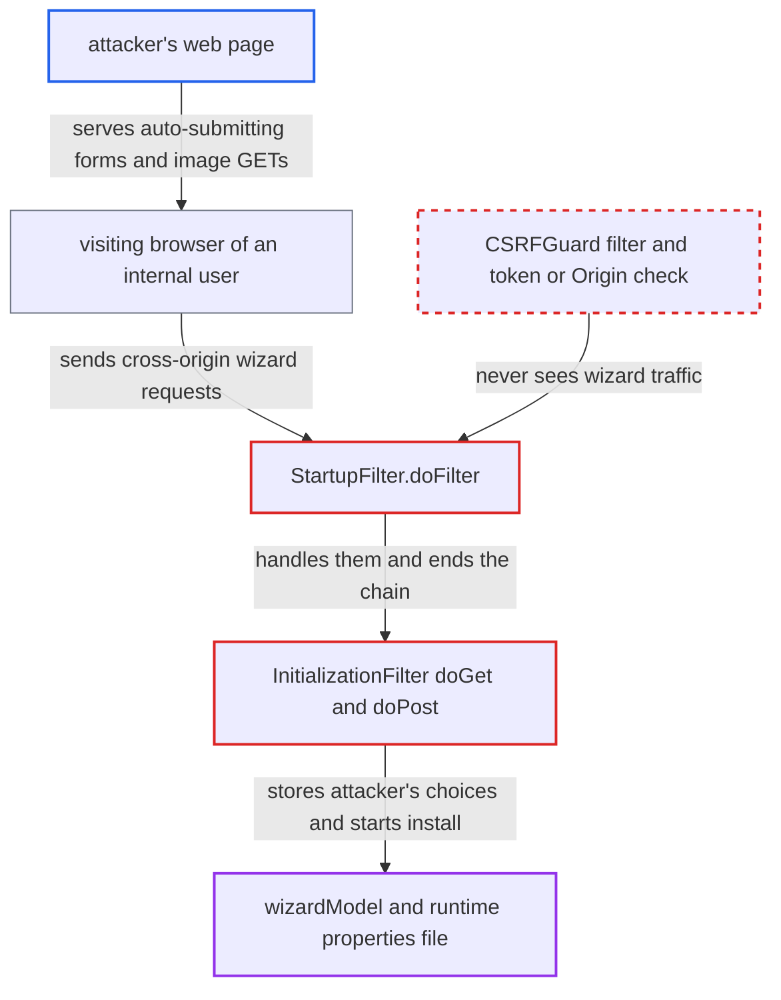

# Install wizard lacks CSRF protection, letting any web page drive a pending installation

| Field | Value |
|---|---|
| ID | `find_01SKYJAa6XsTSxtg9TY7c59M` |
| Severity | **High** |
| Status | open |
| CWE | CWE-352 — Cross-site request forgery |
| Created | 2026-10-21T23:02:15.285672Z |
| Claude Security | https://claude.ai/security/findings/find_01SKYJAa6XsTSxtg9TY7c59M |

## Description

A web page on any origin can make a visiting browser run the OpenMRS install wizard. This lets an attacker choose the database, the admin password and other settings. It works only while setup is still pending and the victim's browser can reach the internal server. `StartupFilter.doFilter` handles wizard requests itself, so `CSRFGuard` never sees them, and the wizard handlers check no token, `Origin` or `Referer`.

1. **attacker** hosts a page that a user on the internal network visits while setup is pending. The page auto-submits cross-origin form POSTs to `/openmrs/initialsetup`, or loads an image pointing at `/openmrs/auto_run_openmrs`; neither needs a CORS preflight.
2. **the handler `StartupFilter.doFilter`** takes the wizard request and sends GETs to `doGet` and POSTs to `doPost`. It never calls `chain.doFilter`, so the later `CSRFGuard` filter never runs on this traffic, and `csrfguard.properties` also lists `%servletContext%/initialsetup` as unprotected. ([`web/src/main/java/org/openmrs/web/filter/StartupFilter.java:108-167`](https://github.com/cx-benchmark/openmrs-core/blob/e6a1b3374ef040e8821dbe4bacc1bdcb50fa4d29/web/src/main/java/org/openmrs/web/filter/StartupFilter.java#L108-L167))
3. **the handler `InitializationFilter.doPost`** accepts any wizard step from any origin, in any order. It reads only the `page` parameter to pick a handler and checks no token, nonce, `Origin` or `Referer`. ([`web/src/main/java/org/openmrs/web/filter/initialization/InitializationFilter.java:372-391`](https://github.com/cx-benchmark/openmrs-core/blob/e6a1b3374ef040e8821dbe4bacc1bdcb50fa4d29/web/src/main/java/org/openmrs/web/filter/initialization/InitializationFilter.java#L372-L391))
4. **the forged POSTs** set the database and the admin password in the shared `wizardModel`. The `databasesetup.vm` step copies `database_connection` and `database_driver` from the request, and the `adminusersetup.vm` step takes `new_admin_password`. ([`web/src/main/java/org/openmrs/web/filter/initialization/InitializationFilter.java:506-523`](https://github.com/cx-benchmark/openmrs-core/blob/e6a1b3374ef040e8821dbe4bacc1bdcb50fa4d29/web/src/main/java/org/openmrs/web/filter/initialization/InitializationFilter.java#L506-L523))
5. **the forged `page=wizardcomplete.vm` POST** calls `startInstallation()`. The install thread then writes the chosen connection settings to the runtime properties file and starts OpenMRS with them. ([`web/src/main/java/org/openmrs/web/filter/initialization/InitializationFilter.java:696-742`](https://github.com/cx-benchmark/openmrs-core/blob/e6a1b3374ef040e8821dbe4bacc1bdcb50fa4d29/web/src/main/java/org/openmrs/web/filter/initialization/InitializationFilter.java#L696-L742))
6. **the method `autoRunOpenMRS`** starts an installation from a single GET to `/openmrs/auto_run_openmrs`. It reads `database_root_password` and `database_user_name` from the query string, sets the admin password `Admin123` and demo data, and calls `startInstallation()` without checking the `errors` that `createSimpleSetup` recorded. ([`web/src/main/java/org/openmrs/web/filter/initialization/InitializationFilter.java:883-909`](https://github.com/cx-benchmark/openmrs-core/blob/e6a1b3374ef040e8821dbe4bacc1bdcb50fa4d29/web/src/main/java/org/openmrs/web/filter/initialization/InitializationFilter.java#L883-L909))

## Assessment

The attacker needs no account. They host a page on any origin and get a user on the internal network to open it while a deployment is waiting for setup. The wizard stays open until someone completes setup, so a WAR deployment is exposed until then. The shipped Docker `startup.sh` sets `OPENMRS_INSTALLATION_SCRIPT` and triggers an automatic install about 15 s after Tomcat starts, so Docker deployments leave only a short window. There are two request shapes. One is a plain GET to `/openmrs/auto_run_openmrs`. The other is a set of auto-submitted form POSTs to `/openmrs/initialsetup` that set `install_method`, `database_connection`, database users, `new_admin_password`, `module_web_admin` or `remoteUrl`, and end with `page=wizardcomplete.vm`. A failed auto-run resets `isInstallationStarted`, so the attacker can retry with other guesses. The attack assumes the browser sends cross-origin form POSTs and image GETs to a private address. Some browsers block public-to-private requests with local-network-access checks and others do not.

Impact: The attacker decides how the server is installed: the database endpoint and credentials, the admin password, `module.allow_web_admin` and demo data. If `database_connection` points at a database the attacker controls and the server can reach, OpenMRS runs on it. The attacker then controls the users, privileges and data it serves, can read patient records entered later, and can affect whether it stays up. This works only against an instance that has not finished setup.

## Recommendation

(1) `StartupFilter.doFilter` and the `InitializationFilter` handlers accept every state-changing wizard request without an anti-forgery token or origin check. This covers all `doPost` steps and the `auto_run_openmrs` GET. They also run before, and instead of, `CSRFGuard`.

Fix criteria: Every state-changing wizard request carries an unpredictable token bound to the installer's session, or is rejected unless `Origin` or `Referer` matches the server. Installation never starts from a GET. A cross-origin auto-submitted form to `/openmrs/initialsetup` is rejected. So is an image request to `/openmrs/auto_run_openmrs`. After either, `wizardModel` and `isInstallationStarted` are unchanged.

(2) `auto_run_openmrs` is reachable by servlet path alone in every build. `autoRunOpenMRS` starts the installation even when `createSimpleSetup` recorded missing-input errors.

Fix criteria: Auto-run works only when the server explicitly enables it, for example with `OPENMRS_INSTALLATION_SCRIPT` and `install_method=auto`. It aborts when required inputs are missing. On a default WAR with no installation script, `GET /openmrs/auto_run_openmrs` does not start an installation.

## Evidence

**https://github.com/cx-benchmark/openmrs-core**

- [`web/src/main/java/org/openmrs/web/filter/StartupFilter.java:108-167`](https://github.com/cx-benchmark/openmrs-core/blob/e6a1b3374ef040e8821dbe4bacc1bdcb50fa4d29/web/src/main/java/org/openmrs/web/filter/StartupFilter.java#L108-L167)
- [`web/src/main/java/org/openmrs/web/filter/initialization/InitializationFilter.java:246-251`](https://github.com/cx-benchmark/openmrs-core/blob/e6a1b3374ef040e8821dbe4bacc1bdcb50fa4d29/web/src/main/java/org/openmrs/web/filter/initialization/InitializationFilter.java#L246-L251)
- [`web/src/main/java/org/openmrs/web/filter/initialization/InitializationFilter.java:883-909`](https://github.com/cx-benchmark/openmrs-core/blob/e6a1b3374ef040e8821dbe4bacc1bdcb50fa4d29/web/src/main/java/org/openmrs/web/filter/initialization/InitializationFilter.java#L883-L909)
- [`web/src/main/java/org/openmrs/web/filter/initialization/InitializationFilter.java:372-391`](https://github.com/cx-benchmark/openmrs-core/blob/e6a1b3374ef040e8821dbe4bacc1bdcb50fa4d29/web/src/main/java/org/openmrs/web/filter/initialization/InitializationFilter.java#L372-L391)
- [`web/src/main/java/org/openmrs/web/filter/initialization/InitializationFilter.java:506-523`](https://github.com/cx-benchmark/openmrs-core/blob/e6a1b3374ef040e8821dbe4bacc1bdcb50fa4d29/web/src/main/java/org/openmrs/web/filter/initialization/InitializationFilter.java#L506-L523)
- [`web/src/main/java/org/openmrs/web/filter/initialization/InitializationFilter.java:628-657`](https://github.com/cx-benchmark/openmrs-core/blob/e6a1b3374ef040e8821dbe4bacc1bdcb50fa4d29/web/src/main/java/org/openmrs/web/filter/initialization/InitializationFilter.java#L628-L657)
- [`web/src/main/java/org/openmrs/web/filter/initialization/InitializationFilter.java:696-742`](https://github.com/cx-benchmark/openmrs-core/blob/e6a1b3374ef040e8821dbe4bacc1bdcb50fa4d29/web/src/main/java/org/openmrs/web/filter/initialization/InitializationFilter.java#L696-L742)
- [`webapp/src/main/webapp/WEB-INF/web.xml:105-112`](https://github.com/cx-benchmark/openmrs-core/blob/e6a1b3374ef040e8821dbe4bacc1bdcb50fa4d29/webapp/src/main/webapp/WEB-INF/web.xml#L105-L112)
- [`webapp/src/main/webapp/WEB-INF/csrfguard.properties:219`](https://github.com/cx-benchmark/openmrs-core/blob/e6a1b3374ef040e8821dbe4bacc1bdcb50fa4d29/webapp/src/main/webapp/WEB-INF/csrfguard.properties#L219)
- [`web/src/main/java/org/openmrs/web/filter/initialization/InitializationWizardModel.java:41`](https://github.com/cx-benchmark/openmrs-core/blob/e6a1b3374ef040e8821dbe4bacc1bdcb50fa4d29/web/src/main/java/org/openmrs/web/filter/initialization/InitializationWizardModel.java#L41)

