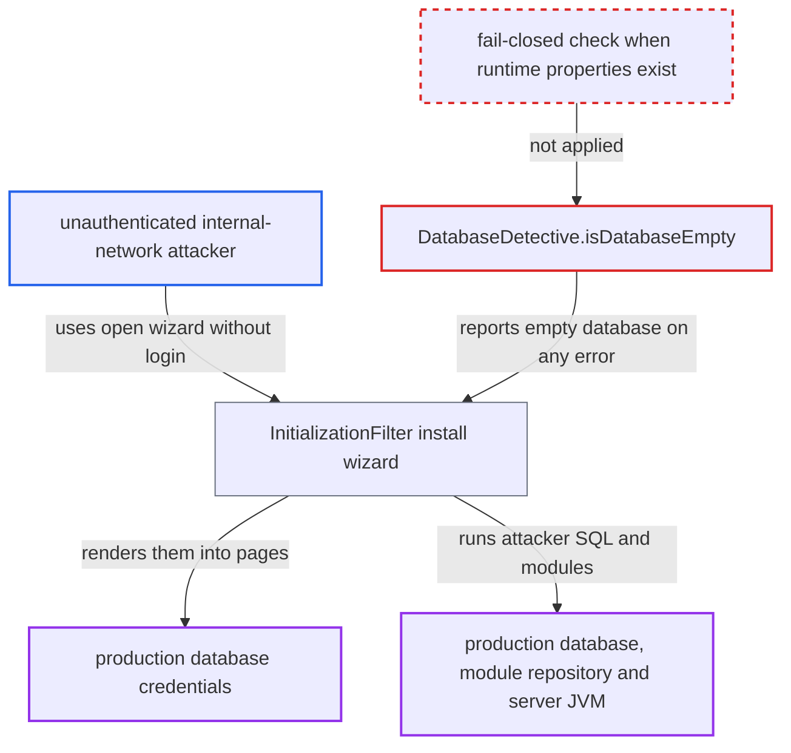

# Install wizard re-enabled on installed system when database is unreachable at startup

| Field | Value |
|---|---|
| ID | `find_01G5mijnTaEHbKA3t3ioJ3gk` |
| Severity | **High** |
| Status | open |
| CWE | CWE-636 — Failing open |
| Created | 2026-10-21T22:57:46.029453Z |
| Claude Security | https://claude.ai/security/findings/find_01G5mijnTaEHbKA3t3ioJ3gk |

## Description

An unauthenticated user on the internal network can read an installed OpenMRS server's database password and then take over the server. This works only if the webapp started while its database was unreachable. The cause is `DatabaseDetective.isDatabaseEmpty()`, which returns `true` on any exception. The install wizard then opens on a live system.

1. **the method `DatabaseDetective.isDatabaseEmpty()`** returns true when the database cannot be reached at startup. The `catch (Exception e)` treats driver errors, refused connections, timeouts, authentication failures and exhausted connections as an empty database. ([`web/src/main/java/org/openmrs/web/filter/initialization/DatabaseDetective.java:65-68`](https://github.com/cx-benchmark/openmrs-core/blob/e6a1b3374ef040e8821dbe4bacc1bdcb50fa4d29/web/src/main/java/org/openmrs/web/filter/initialization/DatabaseDetective.java#L65-L68))
2. **the filter `InitializationFilter`** sets `initializationComplete` to false and keeps the wizard open. `Listener.setupNeeded()` uses the same check and does not start OpenMRS. `skipFilter()` then lets no request through, so every URL goes to the unauthenticated wizard, and nothing re-checks the database later. ([`web/src/main/java/org/openmrs/web/filter/initialization/InitializationFilter.java:1075-1087`](https://github.com/cx-benchmark/openmrs-core/blob/e6a1b3374ef040e8821dbe4bacc1bdcb50fa4d29/web/src/main/java/org/openmrs/web/filter/initialization/InitializationFilter.java#L1075-L1087))
3. **the attacker** posts `page=chooselang.vm` to the wizard. Because the runtime properties file exists, the live `connection.url`, `connection.username` and `connection.password` are copied into the shared `wizardModel`. ([`web/src/main/java/org/openmrs/web/filter/initialization/InitializationFilter.java:410-422`](https://github.com/cx-benchmark/openmrs-core/blob/e6a1b3374ef040e8821dbe4bacc1bdcb50fa4d29/web/src/main/java/org/openmrs/web/filter/initialization/InitializationFilter.java#L410-L422))
4. **the attacker** posts `page=otherruntimeproperties.vm&back=Back` to read the credentials. The page `databasetablesanduser.vm` writes `${currentDatabaseUsername}` and `${currentDatabasePassword}` into input `value` attributes. ([`web/src/main/resources/org/openmrs/web/filter/initialization/databasetablesanduser.vm:38-40`](https://github.com/cx-benchmark/openmrs-core/blob/e6a1b3374ef040e8821dbe4bacc1bdcb50fa4d29/web/src/main/resources/org/openmrs/web/filter/initialization/databasetablesanduser.vm#L38-L40))
5. **the attacker** chooses the `testing` install method with a `remoteUrl` they host, once the database is back. `skipDatabaseSetupPage()` is true, so the wizard jumps to the finish page using the production connection and `databaseName=openmrs`. ([`web/src/main/java/org/openmrs/web/filter/initialization/InitializationFilter.java:781-792`](https://github.com/cx-benchmark/openmrs-core/blob/e6a1b3374ef040e8821dbe4bacc1bdcb50fa4d29/web/src/main/java/org/openmrs/web/filter/initialization/InitializationFilter.java#L781-L792))
6. **the install thread** downloads the attacker's SQL dump and `.omod` zip and runs them. The thread runs the dump against the production database with the production credentials. It empties the module repository and writes the attacker's modules there. It then calls `WebDaemon.startOpenmrs`, which starts those modules in the server JVM. ([`web/src/main/java/org/openmrs/web/filter/initialization/InitializationFilter.java:1604-1635`](https://github.com/cx-benchmark/openmrs-core/blob/e6a1b3374ef040e8821dbe4bacc1bdcb50fa4d29/web/src/main/java/org/openmrs/web/filter/initialization/InitializationFilter.java#L1604-L1635))

## Assessment

The attacker needs no login, only network access from the internal network. The webapp must have started while its database was unreachable, which the attacker does not control. The wizard then stays open until the install thread runs or the webapp restarts, even after the database returns. Reading the password needs only the wizard pages. Re-running installation with the `testing` method also needs the database to be reachable again, so that `verifyConnection` succeeds. The attacker must also host a `remoteUrl` that answers the release-testing-helper endpoints. A second route is the advanced method. The attacker points `database_connection` at a database they control, sets the admin password, and chooses `module.allow_web_admin`. The thread then overwrites the runtime properties and starts OpenMRS against that database, without needing the production database. Shipped Docker images wait only for the database TCP port (`startup.sh`, `wait-for-it.sh`). That makes the window shorter but does not close it.

Impact: The attacker learns the production JDBC URL, username and password. They can run arbitrary SQL against the production database with those credentials. They can also run their own modules as the servlet-container user, and the runtime properties file is rewritten with new encryption keys. Alternatively, they can re-point the system to a database and admin account they control.

## Recommendation

(1) `DatabaseDetective.isDatabaseEmpty()` returns `true` on any exception, so an unreachable database is treated as an uninstalled system and the wizard is enabled.

Fix criteria: A connection or metadata failure, when a runtime properties file with connection settings exists, no longer enables the wizard. It shows up as a startup error (`StartupErrorFilter`) or triggers a retry. `initializationComplete` is false only when the database is positively verified to contain no OpenMRS tables. Test: start the webapp with the database stopped. `/openmrs/initialsetup` must not render the wizard or any credential.

(2) The wizard copies the live `connection.password` from the runtime properties into the shared model and renders it back into HTML form fields.

Fix criteria: Stored connection passwords are never written into rendered pages. Password inputs are rendered empty, and the model does not expose them to templates. Test: no wizard page source contains the configured `connection.password`.

## Evidence

**https://github.com/cx-benchmark/openmrs-core**

- [`web/src/main/java/org/openmrs/web/filter/initialization/DatabaseDetective.java:65-68`](https://github.com/cx-benchmark/openmrs-core/blob/e6a1b3374ef040e8821dbe4bacc1bdcb50fa4d29/web/src/main/java/org/openmrs/web/filter/initialization/DatabaseDetective.java#L65-L68)
- [`web/src/main/java/org/openmrs/web/filter/initialization/InitializationFilter.java:1075-1087`](https://github.com/cx-benchmark/openmrs-core/blob/e6a1b3374ef040e8821dbe4bacc1bdcb50fa4d29/web/src/main/java/org/openmrs/web/filter/initialization/InitializationFilter.java#L1075-L1087)
- [`web/src/main/java/org/openmrs/web/filter/initialization/InitializationFilter.java:410-422`](https://github.com/cx-benchmark/openmrs-core/blob/e6a1b3374ef040e8821dbe4bacc1bdcb50fa4d29/web/src/main/java/org/openmrs/web/filter/initialization/InitializationFilter.java#L410-L422)
- [`web/src/main/resources/org/openmrs/web/filter/initialization/databasetablesanduser.vm:38-40`](https://github.com/cx-benchmark/openmrs-core/blob/e6a1b3374ef040e8821dbe4bacc1bdcb50fa4d29/web/src/main/resources/org/openmrs/web/filter/initialization/databasetablesanduser.vm#L38-L40)
- [`web/src/main/java/org/openmrs/web/filter/initialization/InitializationFilter.java:781-792`](https://github.com/cx-benchmark/openmrs-core/blob/e6a1b3374ef040e8821dbe4bacc1bdcb50fa4d29/web/src/main/java/org/openmrs/web/filter/initialization/InitializationFilter.java#L781-L792)
- [`web/src/main/java/org/openmrs/web/filter/initialization/InitializationFilter.java:1604-1635`](https://github.com/cx-benchmark/openmrs-core/blob/e6a1b3374ef040e8821dbe4bacc1bdcb50fa4d29/web/src/main/java/org/openmrs/web/filter/initialization/InitializationFilter.java#L1604-L1635)
- [`web/src/main/java/org/openmrs/web/Listener.java:315-326`](https://github.com/cx-benchmark/openmrs-core/blob/e6a1b3374ef040e8821dbe4bacc1bdcb50fa4d29/web/src/main/java/org/openmrs/web/Listener.java#L315-L326)

