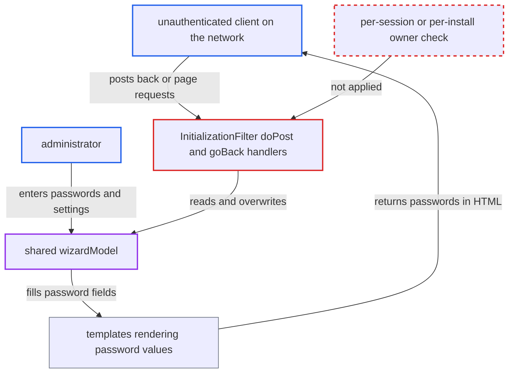

# Install wizard state is a single shared object, exposing installer's DB passwords to other clients

| Field | Value |
|---|---|
| ID | `find_01PuTNVrVrZop2HnEatHbjBM` |
| Severity | **High** |
| Status | open |
| CWE | CWE-488 — Data exposure to wrong session |
| Created | 2026-10-21T22:58:55.115714Z |
| Claude Security | https://claude.ai/security/findings/find_01PuTNVrVrZop2HnEatHbjBM |

## Description

An unauthenticated person on the same network can read the database passwords an administrator types into the OpenMRS install wizard. They can also change the administrator's pending settings. This works only while the wizard is in progress. The wizard keeps one shared `wizardModel` in `InitializationFilter` instead of per-session state, and its templates write stored passwords back into the page.

1. **administrator** enters database and admin answers in the install wizard. The answers, including the MySQL root password, are stored in the single `wizardModel` object owned by the one `InitializationFilter` instance. ([`web/src/main/java/org/openmrs/web/filter/initialization/InitializationFilter.java:170`](https://github.com/cx-benchmark/openmrs-core/blob/e6a1b3374ef040e8821dbe4bacc1bdcb50fa4d29/web/src/main/java/org/openmrs/web/filter/initialization/InitializationFilter.java#L170))
2. **administrator** has the root, database user and create-user passwords saved in the shared model. The values go into `databaseRootPassword`, `createDatabasePassword` and `createUserPassword`, with no link to the administrator's HTTP session. ([`web/src/main/java/org/openmrs/web/filter/initialization/InitializationFilter.java:462-476`](https://github.com/cx-benchmark/openmrs-core/blob/e6a1b3374ef040e8821dbe4bacc1bdcb50fa4d29/web/src/main/java/org/openmrs/web/filter/initialization/InitializationFilter.java#L462-L476))
3. **attacker** sends `POST /openmrs/initialsetup` with `page=wizardcomplete.vm&back=Back`. The `back` handling in `goBack()` has no ownership check, so it re-renders the earlier page for any caller. The report also names `page=otherruntimeproperties.vm&back=Back` and `page=databasetablesanduser.vm&back=Back` as working requests. ([`web/src/main/java/org/openmrs/web/filter/initialization/InitializationFilter.java:683-700`](https://github.com/cx-benchmark/openmrs-core/blob/e6a1b3374ef040e8821dbe4bacc1bdcb50fa4d29/web/src/main/java/org/openmrs/web/filter/initialization/InitializationFilter.java#L683-L700))
4. **templates such as `simplesetup.vm`** write the stored passwords into the returned HTML. For example `simplesetup.vm` renders `value="${databaseRootPassword}"`, and `databasetablesanduser.vm` renders `${currentDatabasePassword}` and `${createUserPassword}`, so the attacker reads them in clear text. ([`web/src/main/resources/org/openmrs/web/filter/initialization/simplesetup.vm:16`](https://github.com/cx-benchmark/openmrs-core/blob/e6a1b3374ef040e8821dbe4bacc1bdcb50fa4d29/web/src/main/resources/org/openmrs/web/filter/initialization/simplesetup.vm#L16))
5. **attacker** posts new answers to overwrite the pending configuration. For example `page=adminusersetup.vm` replaces `adminUserPassword`, and `page=databasesetup.vm` replaces `databaseConnection`. `clearPasswords()` runs only on a parameterless GET, so it does not stop this. ([`web/src/main/java/org/openmrs/web/filter/initialization/InitializationFilter.java:635-657`](https://github.com/cx-benchmark/openmrs-core/blob/e6a1b3374ef040e8821dbe4bacc1bdcb50fa4d29/web/src/main/java/org/openmrs/web/filter/initialization/InitializationFilter.java#L635-L657))

## Assessment

The attacker needs no login. They must be on the internal network and able to reach `/openmrs/initialsetup`. The wizard must be running, which means a pre-install state, and an administrator must be part-way through it. The attacker can poll the endpoint until passwords are stored. They can also overwrite answers such as `adminUserPassword`, `database_connection` or `module_web_admin`. Or they can trigger `startInstallation()` themselves with `page=wizardcomplete.vm`.

Impact: The attacker reads the MySQL root password and the OpenMRS database user passwords in clear text. They can also silently change what the administrator installs, including the admin password, the JDBC target and the web-admin flag. The report says there is no availability impact beyond what an installer can already do.

Subsequent-system impact: A leaked MySQL root password gives full control of the database server hosting OpenMRS, and of any other schemas on it. That server lies outside the web application's own boundary.

## Recommendation

(1) Wizard answers live in one filter-wide `InitializationWizardModel` (`wizardModel`) with no tie to the HTTP session that started the wizard. Any client can read or change another installer's in-progress data.

Fix criteria: Wizard state is scoped to the session that started it, or protected by a per-install secret. A second concurrent client is refused or gets its own isolated state. Test it by running the wizard in one browser and sending the `back` POSTs from another. No password values from the first browser may appear.

(2) Templates such as `simplesetup.vm`, `databasetablesanduser.vm` and `databasesetup.vm` write previously entered passwords into the `value` attributes of password inputs.

Fix criteria: Password fields are always rendered empty, and no secret is echoed to any client. Check that the page source of every wizard page never contains an entered password.

## Evidence

**https://github.com/cx-benchmark/openmrs-core**

- [`web/src/main/java/org/openmrs/web/filter/initialization/InitializationFilter.java:170`](https://github.com/cx-benchmark/openmrs-core/blob/e6a1b3374ef040e8821dbe4bacc1bdcb50fa4d29/web/src/main/java/org/openmrs/web/filter/initialization/InitializationFilter.java#L170)
- [`web/src/main/java/org/openmrs/web/filter/initialization/InitializationFilter.java:462-476`](https://github.com/cx-benchmark/openmrs-core/blob/e6a1b3374ef040e8821dbe4bacc1bdcb50fa4d29/web/src/main/java/org/openmrs/web/filter/initialization/InitializationFilter.java#L462-L476)
- [`web/src/main/java/org/openmrs/web/filter/initialization/InitializationFilter.java:683-700`](https://github.com/cx-benchmark/openmrs-core/blob/e6a1b3374ef040e8821dbe4bacc1bdcb50fa4d29/web/src/main/java/org/openmrs/web/filter/initialization/InitializationFilter.java#L683-L700)
- [`web/src/main/resources/org/openmrs/web/filter/initialization/simplesetup.vm:16`](https://github.com/cx-benchmark/openmrs-core/blob/e6a1b3374ef040e8821dbe4bacc1bdcb50fa4d29/web/src/main/resources/org/openmrs/web/filter/initialization/simplesetup.vm#L16)
- [`web/src/main/resources/org/openmrs/web/filter/initialization/databasetablesanduser.vm:40-50`](https://github.com/cx-benchmark/openmrs-core/blob/e6a1b3374ef040e8821dbe4bacc1bdcb50fa4d29/web/src/main/resources/org/openmrs/web/filter/initialization/databasetablesanduser.vm#L40-L50)
- [`web/src/main/java/org/openmrs/web/filter/initialization/InitializationFilter.java:635-657`](https://github.com/cx-benchmark/openmrs-core/blob/e6a1b3374ef040e8821dbe4bacc1bdcb50fa4d29/web/src/main/java/org/openmrs/web/filter/initialization/InitializationFilter.java#L635-L657)

