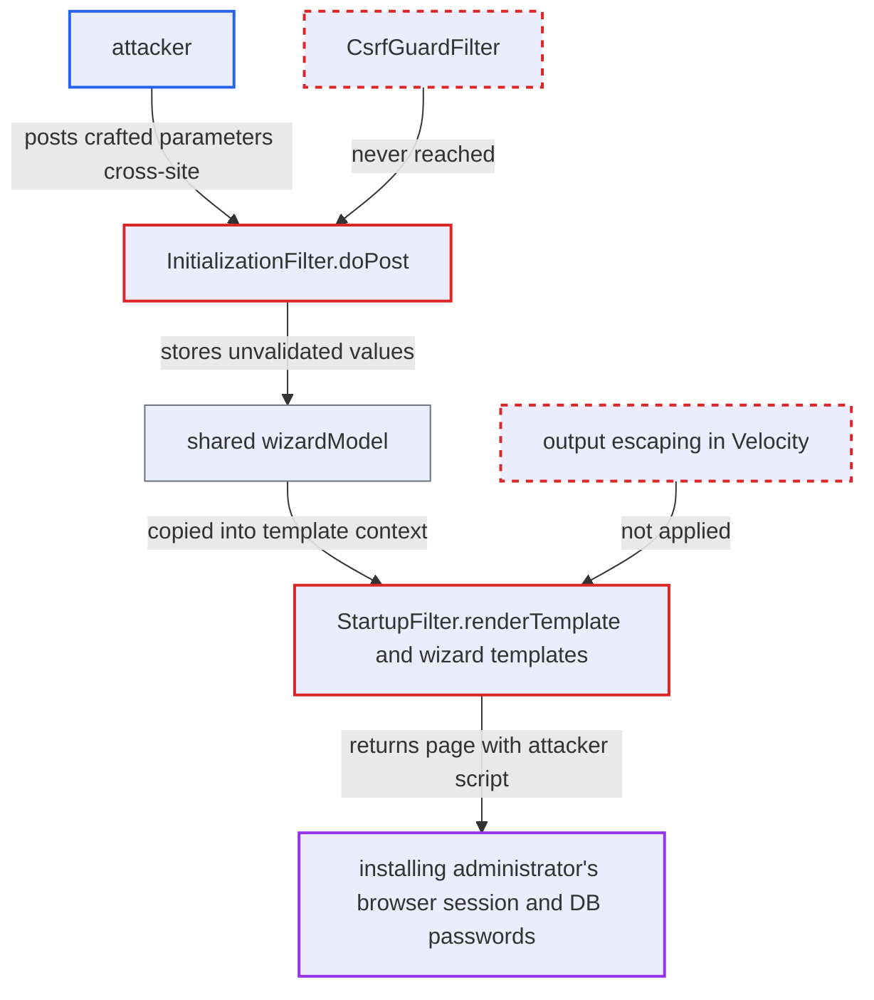

# Install wizard templates echo request parameters unescaped into HTML and JavaScript (XSS)

| Field | Value |
|---|---|
| ID | `find_01P87U52a1ytaf5XiMsPXV96` |
| Severity | **High** |
| Status | open |
| CWE | CWE-79 — Cross-site scripting |
| Created | 2026-10-21T23:00:47.818849Z |
| Claude Security | https://claude.ai/security/findings/find_01P87U52a1ytaf5XiMsPXV96 |

## Description

An attacker can run script in the browser of the administrator who is installing OpenMRS. The script can steal database passwords from the wizard pages and change how the system is installed. The attack works only while the install wizard is active. `initializeVelocity()` registers no escaping, so the wizard templates write request parameters such as `remoteUrl` into the page unescaped.

1. **attacker** hosts a page that auto-submits a cross-site POST to `/openmrs/initialsetup`. The POST carries `page=remotedetails.vm` and a `remoteUrl` holding a script payload. No CSRF token is checked, because `StartupFilter.doFilter` never passes the request on to `CsrfGuardFilter`. ([`web/src/main/java/org/openmrs/web/filter/StartupFilter.java:150-164`](https://github.com/cx-benchmark/openmrs-core/blob/e6a1b3374ef040e8821dbe4bacc1bdcb50fa4d29/web/src/main/java/org/openmrs/web/filter/StartupFilter.java#L150-L164))
2. **the installing administrator's browser** loads the attacker's page and sends the POST. The administrator's browser can reach the internal OpenMRS server, which the attacker's machine may not be able to do.
3. **`InitializationFilter.doPost`** takes `remoteUrl` from the request unchecked and tests the connection. A value that is not a URL makes `TestInstallUtil.testConnection` fail. The raw value is then added to `errors` as the MessageFormat argument of `install.testing.invalidProductionUrl`, and `remotedetails.vm` is rendered again in the same response. ([`web/src/main/java/org/openmrs/web/filter/initialization/InitializationFilter.java:744-811`](https://github.com/cx-benchmark/openmrs-core/blob/e6a1b3374ef040e8821dbe4bacc1bdcb50fa4d29/web/src/main/java/org/openmrs/web/filter/initialization/InitializationFilter.java#L744-L811))
4. **`StartupFilter.renderTemplate`** copies every wizard model field and the `errors` and `msgs` maps into the Velocity context. All request-derived strings therefore reach the templates. ([`web/src/main/java/org/openmrs/web/filter/StartupFilter.java:241-265`](https://github.com/cx-benchmark/openmrs-core/blob/e6a1b3374ef040e8821dbe4bacc1bdcb50fa4d29/web/src/main/java/org/openmrs/web/filter/StartupFilter.java#L241-L265))
5. **the templates `remotedetails.vm` and `header.vm`** write the payload into the page without encoding. `value="${remoteUrl}"` lets a `"` close the attribute. `header.vm` also inserts the raw value into HTML text through `.insert()`. ([`web/src/main/resources/org/openmrs/web/filter/initialization/remotedetails.vm:13-19`](https://github.com/cx-benchmark/openmrs-core/blob/e6a1b3374ef040e8821dbe4bacc1bdcb50fa4d29/web/src/main/resources/org/openmrs/web/filter/initialization/remotedetails.vm#L13-L19))
6. **the attacker's script** runs in the administrator's browser on the OpenMRS origin. It can read password inputs that templates such as `simplesetup.vm` fill in from the model, and read whatever the administrator types. It can also submit wizard steps itself. ([`web/src/main/resources/org/openmrs/web/filter/initialization/simplesetup.vm:16-25`](https://github.com/cx-benchmark/openmrs-core/blob/e6a1b3374ef040e8821dbe4bacc1bdcb50fa4d29/web/src/main/resources/org/openmrs/web/filter/initialization/simplesetup.vm#L16-L25))

## Assessment

The wizard must be active, meaning `initializationRequired()` is true. The attacker needs no account. In the main route, the attacker lures the installing administrator to a page that sends the cross-site POST. This lets an attacker outside the network reach the internal-only wizard through the administrator's browser. A second route is for an attacker on the internal network to POST `database_connection`, or `locale` together with `remember`, directly. The wizard model is shared by all clients, so the value is stored and replayed into pages shown to the administrator later. Other parameters are also echoed unescaped: `implementation_name`, `pass_phrase`, `description`, `openmrs_*_database_name` and `create_database_username`. The raw `locale` is stored as `localeToSave` and ends up in `wizardcomplete.vm` and in a double-quoted JavaScript string in `progress.vm`.

Impact: The attacker runs script on the OpenMRS origin in the administrator's browser during installation. The script can read the database passwords the pages pre-fill and anything the administrator types. It can also rewrite `database_connection` and choose the admin password, so the attacker controls how the system is installed. The report says availability is not affected by the script itself.

## Recommendation

(1) Request-derived model fields, error keys and MessageFormat arguments are written by Velocity into the wizard templates without encoding for HTML text, attribute or JavaScript-string context.

Fix criteria: Every dynamic value the wizard templates emit is encoded for its output context. This is done either globally in the wizard's Velocity engine or per reference, and it includes arguments inserted into localized messages. Posting `">` as `remoteUrl`, `database_connection`, `implementation_name`, `description` and `locale` (with `remember`) gives entity-escaped or JS-escaped output on every page that echoes them, including `progress.vm`.

(2) The `locale` request parameter is stored in the session and in `localeToSave` without checking that it is a supported locale. Arbitrary text can therefore reach a JavaScript string.

Fix criteria: Only locales from the wizard's supported list can be stored in the session or in `localeToSave`. Any other value is rejected or replaced by the default. A crafted `locale` never appears in the output of `progress.vm` or `wizardcomplete.vm`.

## Evidence

**https://github.com/cx-benchmark/openmrs-core**

- [`web/src/main/java/org/openmrs/web/filter/StartupFilter.java:175-199`](https://github.com/cx-benchmark/openmrs-core/blob/e6a1b3374ef040e8821dbe4bacc1bdcb50fa4d29/web/src/main/java/org/openmrs/web/filter/StartupFilter.java#L175-L199)
- [`web/src/main/java/org/openmrs/web/filter/initialization/InitializationFilter.java:744-811`](https://github.com/cx-benchmark/openmrs-core/blob/e6a1b3374ef040e8821dbe4bacc1bdcb50fa4d29/web/src/main/java/org/openmrs/web/filter/initialization/InitializationFilter.java#L744-L811)
- [`web/src/main/resources/org/openmrs/web/filter/initialization/remotedetails.vm:13-19`](https://github.com/cx-benchmark/openmrs-core/blob/e6a1b3374ef040e8821dbe4bacc1bdcb50fa4d29/web/src/main/resources/org/openmrs/web/filter/initialization/remotedetails.vm#L13-L19)
- [`web/src/main/java/org/openmrs/web/filter/StartupFilter.java:241-265`](https://github.com/cx-benchmark/openmrs-core/blob/e6a1b3374ef040e8821dbe4bacc1bdcb50fa4d29/web/src/main/java/org/openmrs/web/filter/StartupFilter.java#L241-L265)
- [`web/src/main/resources/org/openmrs/web/filter/initialization/header.vm:93-104`](https://github.com/cx-benchmark/openmrs-core/blob/e6a1b3374ef040e8821dbe4bacc1bdcb50fa4d29/web/src/main/resources/org/openmrs/web/filter/initialization/header.vm#L93-L104)
- [`web/src/main/java/org/openmrs/web/filter/initialization/InitializationFilter.java:918-945`](https://github.com/cx-benchmark/openmrs-core/blob/e6a1b3374ef040e8821dbe4bacc1bdcb50fa4d29/web/src/main/java/org/openmrs/web/filter/initialization/InitializationFilter.java#L918-L945)
- [`web/src/main/resources/org/openmrs/web/filter/initialization/progress.vm:10`](https://github.com/cx-benchmark/openmrs-core/blob/e6a1b3374ef040e8821dbe4bacc1bdcb50fa4d29/web/src/main/resources/org/openmrs/web/filter/initialization/progress.vm#L10)
- [`web/src/main/resources/org/openmrs/web/filter/initialization/simplesetup.vm:16-25`](https://github.com/cx-benchmark/openmrs-core/blob/e6a1b3374ef040e8821dbe4bacc1bdcb50fa4d29/web/src/main/resources/org/openmrs/web/filter/initialization/simplesetup.vm#L16-L25)
- [`web/src/main/resources/org/openmrs/web/filter/initialization/wizardcomplete.vm:19-94`](https://github.com/cx-benchmark/openmrs-core/blob/e6a1b3374ef040e8821dbe4bacc1bdcb50fa4d29/web/src/main/resources/org/openmrs/web/filter/initialization/wizardcomplete.vm#L19-L94)
- [`web/src/main/resources/org/openmrs/web/filter/initialization/implementationidsetup.vm:14-29`](https://github.com/cx-benchmark/openmrs-core/blob/e6a1b3374ef040e8821dbe4bacc1bdcb50fa4d29/web/src/main/resources/org/openmrs/web/filter/initialization/implementationidsetup.vm#L14-L29)
- [`web/src/main/java/org/openmrs/web/filter/initialization/InitializationFilter.java:170`](https://github.com/cx-benchmark/openmrs-core/blob/e6a1b3374ef040e8821dbe4bacc1bdcb50fa4d29/web/src/main/java/org/openmrs/web/filter/initialization/InitializationFilter.java#L170)
- [`web/src/main/java/org/openmrs/web/filter/StartupFilter.java:150-164`](https://github.com/cx-benchmark/openmrs-core/blob/e6a1b3374ef040e8821dbe4bacc1bdcb50fa4d29/web/src/main/java/org/openmrs/web/filter/StartupFilter.java#L150-L164)

