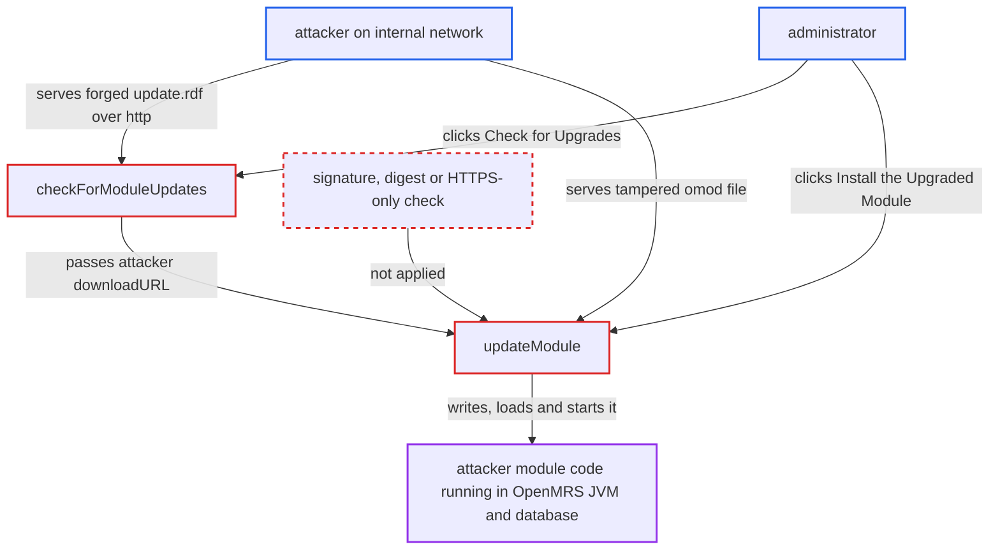

# Module upgrade downloads and starts .omod over unauthenticated transport without integrity check

| Field | Value |
|---|---|
| ID | `find_01Cf9QzmoTgHg8WDympPhqqp` |
| Severity | **High** |
| Status | open |
| CWE | CWE-494 — Download of code without integrity check |
| Created | 2026-10-21T22:57:07.719428Z |
| Claude Security | https://claude.ai/security/findings/find_01Cf9QzmoTgHg8WDympPhqqp |

## Description

Someone who can answer a server's plaintext HTTP requests on the internal network can make OpenMRS install and run a module of their choosing. That gives them arbitrary Java and SQL inside OpenMRS. It needs a module with an `http://` `updateURL` (or an update server that returns an `http://` `downloadURL`) and an administrator who clicks the upgrade buttons. `ModuleUtil.checkForModuleUpdates()` and `ModuleFactory.updateModule(Module)` never check where the update came from or whether it was tampered with.

1. **attacker on the internal network** answers the server's plaintext request for a module's `update.rdf`. `getURLStream` opens whatever scheme the `updateURL` names with a plain `URLConnection`, and nothing requires HTTPS, so the attacker can supply the document, for example through DNS or ARP spoofing or a compromised proxy. ([`api/src/main/java/org/openmrs/module/ModuleUtil.java:650-713`](https://github.com/cx-benchmark/openmrs-core/blob/e6a1b3374ef040e8821dbe4bacc1bdcb50fa4d29/api/src/main/java/org/openmrs/module/ModuleUtil.java#L650-L713))
2. **administrator** clicks "Check for Upgrades", which runs `checkForModuleUpdates`. The method copies the forged document's `downloadURL` and a higher `currentVersion` onto the `Module`, because the only checks are that the URL ends in `update.rdf`, that the version is higher and that the module id matches. ([`api/src/main/java/org/openmrs/module/ModuleUtil.java:765-816`](https://github.com/cx-benchmark/openmrs-core/blob/e6a1b3374ef040e8821dbe4bacc1bdcb50fa4d29/api/src/main/java/org/openmrs/module/ModuleUtil.java#L765-L816))
3. **administrator** clicks "Install the Upgraded Module", which runs `updateModule`. `updateModule` opens the attacker's `downloadURL` with any scheme and receives the attacker's `.omod` file. ([`api/src/main/java/org/openmrs/module/ModuleFactory.java:1474-1507`](https://github.com/cx-benchmark/openmrs-core/blob/e6a1b3374ef040e8821dbe4bacc1bdcb50fa4d29/api/src/main/java/org/openmrs/module/ModuleFactory.java#L1474-L1507))
4. **`updateModule`** writes the file into the module repository, then loads and starts it. It calls `ModuleUtil.insertModuleFile`, `loadModule` and `startModule` with no signature, digest, publisher, HTTPS or module-id check in between. ([`api/src/main/java/org/openmrs/module/ModuleFactory.java:1474-1507`](https://github.com/cx-benchmark/openmrs-core/blob/e6a1b3374ef040e8821dbe4bacc1bdcb50fa4d29/api/src/main/java/org/openmrs/module/ModuleFactory.java#L1474-L1507))
5. **`ModuleFileParser.parse`** accepts the downloaded archive. It only checks for the `.omod` suffix and a parsable `config.xml`, so there is no archive signature or checksum verification on the load path. ([`api/src/main/java/org/openmrs/module/ModuleFileParser.java:211-215`](https://github.com/cx-benchmark/openmrs-core/blob/e6a1b3374ef040e8821dbe4bacc1bdcb50fa4d29/api/src/main/java/org/openmrs/module/ModuleFileParser.java#L211-L215))
6. **`startModuleInternal`** runs the module's code in the OpenMRS JVM. It runs `sqldiff.xml` under `SQL_LEVEL_ACCESS`, then the liquibase changesets, then the activator's `willStart()` in a Daemon thread, so the attacker's Java and SQL both execute. ([`api/src/main/java/org/openmrs/module/ModuleFactory.java:639-767`](https://github.com/cx-benchmark/openmrs-core/blob/e6a1b3374ef040e8821dbe4bacc1bdcb50fa4d29/api/src/main/java/org/openmrs/module/ModuleFactory.java#L639-L767))

## Assessment

The attacker is unauthenticated but on the internal network. They can answer the server's outbound plaintext HTTP request, for example by DNS or ARP spoofing or through a compromised proxy. The target must have a module whose `updateURL` is `http://`, or whose update server returns an `http://` `downloadURL`. An administrator must click "Check for Upgrades" and then "Install the Upgraded Module" on the module administration page. That page belongs to the legacyui module, outside this repository, and the defect is in the core API it calls. If both URLs are `https://`, the JVM's default certificate and hostname validation protects the channel. An on-path party also cannot forge the `https`-to-`http` redirect that `openConnectionCheckRedirects` would follow, which matters only if the legitimate server issues it. Having no scheme restriction (`file:`, `jar:`) on `downloadURL` adds nothing beyond the plaintext case, because whoever controls `update.rdf` already controls the module bytes.

Impact: The substituted module's activator runs arbitrary Java in the OpenMRS JVM, and its `sqldiff.xml` runs arbitrary SQL under `SQL_LEVEL_ACCESS`. The attacker gets full read and write access to patient health data and credentials, persistence in the module repository, and the ability to stop the service. No sandbox constrains module code.

## Recommendation

(1) `ModuleFactory.updateModule` writes, loads and starts whatever bytes `downloadURL` returns. That URL comes from an unauthenticated remote document, so the module's authenticity and integrity are never verified.

Fix criteria: Before `insertModuleFile`, `loadModule` and `startModule`, a downloaded module is verified against trusted material. That is either a publisher signature checked against a configured key, or a digest obtained over an authenticated channel. The downloaded module must also have the same module id as the module being upgraded. Serving a tampered `.omod` for an otherwise valid `downloadURL` shows it is never started and does not remain in the module repository.

(2) `checkForModuleUpdates` and `updateModule` fetch update metadata and module archives over whatever transport the URL names (`getURLStream`, `openConnectionCheckRedirects`). That includes plaintext `http` and `http` redirect targets, so an on-path party can substitute both the metadata and the code.

Fix criteria: Update checks and module downloads use authenticated TLS only. An `http://` or non-HTTP `updateURL` or `downloadURL`, or a redirect to one, fails closed before any content is used. A module declaring an `http://` `updateURL` produces no upgrade offer and no download. An `update.rdf` returning an `http://` `downloadURL` also produces no upgrade offer and no download.

## Evidence

**https://github.com/cx-benchmark/openmrs-core**

- [`api/src/main/java/org/openmrs/module/ModuleFactory.java:1474-1507`](https://github.com/cx-benchmark/openmrs-core/blob/e6a1b3374ef040e8821dbe4bacc1bdcb50fa4d29/api/src/main/java/org/openmrs/module/ModuleFactory.java#L1474-L1507)
- [`api/src/main/java/org/openmrs/module/ModuleUtil.java:765-816`](https://github.com/cx-benchmark/openmrs-core/blob/e6a1b3374ef040e8821dbe4bacc1bdcb50fa4d29/api/src/main/java/org/openmrs/module/ModuleUtil.java#L765-L816)
- [`api/src/main/java/org/openmrs/module/ModuleUtil.java:650-713`](https://github.com/cx-benchmark/openmrs-core/blob/e6a1b3374ef040e8821dbe4bacc1bdcb50fa4d29/api/src/main/java/org/openmrs/module/ModuleUtil.java#L650-L713)
- [`api/src/main/java/org/openmrs/module/ModuleFactory.java:639-767`](https://github.com/cx-benchmark/openmrs-core/blob/e6a1b3374ef040e8821dbe4bacc1bdcb50fa4d29/api/src/main/java/org/openmrs/module/ModuleFactory.java#L639-L767)
- [`api/src/main/java/org/openmrs/module/ModuleFileParser.java:211-215`](https://github.com/cx-benchmark/openmrs-core/blob/e6a1b3374ef040e8821dbe4bacc1bdcb50fa4d29/api/src/main/java/org/openmrs/module/ModuleFileParser.java#L211-L215)
- [`api/src/main/resources/messages.properties:2227-2242`](https://github.com/cx-benchmark/openmrs-core/blob/e6a1b3374ef040e8821dbe4bacc1bdcb50fa4d29/api/src/main/resources/messages.properties#L2227-L2242)

