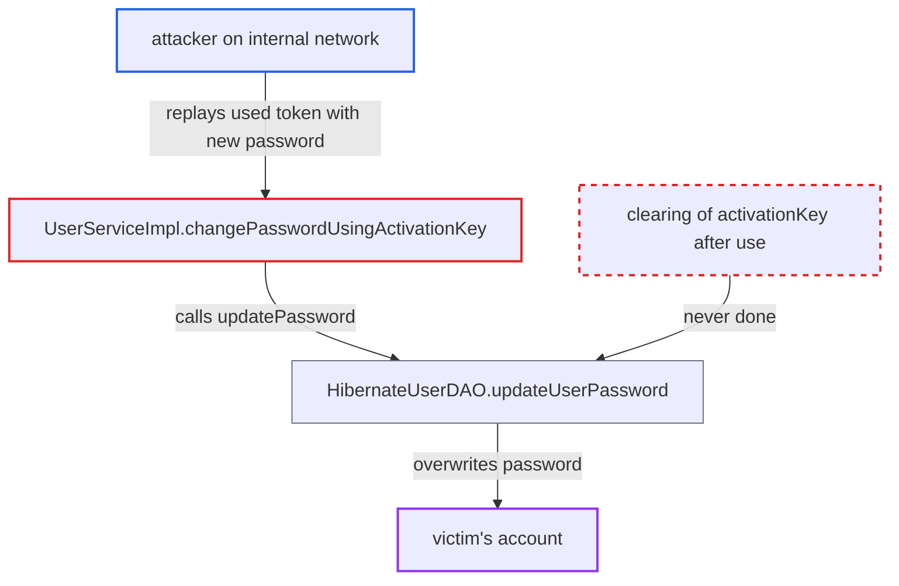

# Password-reset activation key stays valid after use until expiry

| Field | Value |
|---|---|
| ID | `find_016W9VhVwhgNxyEZEgECzHn8` |
| Severity | **High** |
| Status | open |
| CWE | CWE-640 — Weak password recovery |
| Created | 2026-10-21T22:57:45.897095Z |
| Claude Security | https://claude.ai/security/findings/find_016W9VhVwhgNxyEZEgECzHn8 |

## Description

An attacker on the internal network who has a reset token the victim already used can set a new password of their choosing on that victim's account. The victim can be any user with a reset email, including administrators. The attack only works until the token expires (10 minutes by default). The cause is that `changePasswordUsingActivationKey` never clears `activationKey` after the key is used.

1. **the victim** resets their own password with an emailed activation key. `UserServiceImpl.changePasswordUsingActivationKey` finds the user through the key and calls `updatePassword`. ([`api/src/main/java/org/openmrs/api/impl/UserServiceImpl.java:798-804`](https://github.com/cx-benchmark/openmrs-core/blob/e6a1b3374ef040e8821dbe4bacc1bdcb50fa4d29/api/src/main/java/org/openmrs/api/impl/UserServiceImpl.java#L798-L804))
2. **`updateUserPassword`** rewrites the password data but leaves the key in place. It updates the hash, salt, changedBy/dateChanged and lockout counters, but never clears `LoginCredential.activationKey`. ([`api/src/main/java/org/openmrs/api/db/hibernate/HibernateUserDAO.java:330-351`](https://github.com/cx-benchmark/openmrs-core/blob/e6a1b3374ef040e8821dbe4bacc1bdcb50fa4d29/api/src/main/java/org/openmrs/api/db/hibernate/HibernateUserDAO.java#L330-L351))
3. **the attacker** gets hold of the token the victim already used. The report names these sources: the URL in browser history on a shared clinical workstation, a mail or proxy log, or a shared inbox.
4. **the attacker** calls `changePasswordUsingActivationKey` with the used token and a password they choose. The method carries no `@Authorized`, so the token is the only gate and no login is needed. ([`api/src/main/java/org/openmrs/api/UserService.java:566-573`](https://github.com/cx-benchmark/openmrs-core/blob/e6a1b3374ef040e8821dbe4bacc1bdcb50fa4d29/api/src/main/java/org/openmrs/api/UserService.java#L566-L573))
5. **`getUserByActivationKey`** accepts the key again. It checks only that the hash prefix matches and that the embedded expiry has not passed. It tracks no use. ([`api/src/main/java/org/openmrs/api/impl/UserServiceImpl.java:709-718`](https://github.com/cx-benchmark/openmrs-core/blob/e6a1b3374ef040e8821dbe4bacc1bdcb50fa4d29/api/src/main/java/org/openmrs/api/impl/UserServiceImpl.java#L709-L718))
6. **the service** replaces the victim's new password with the attacker's. The attacker can repeat this any number of times until the key expires, and the victim is locked out. ([`api/src/main/java/org/openmrs/api/impl/UserServiceImpl.java:798-804`](https://github.com/cx-benchmark/openmrs-core/blob/e6a1b3374ef040e8821dbe4bacc1bdcb50fa4d29/api/src/main/java/org/openmrs/api/impl/UserServiceImpl.java#L798-L804))

## Assessment

The attacker needs no account but must be on the internal network. They must get a reset token that the victim has already used, and use it before it expires. The default validity is 600000 ms (10 minutes), set by `security.validTime`. An admin can change it to anything from 1 minute to 12 hours. The report names these sources for the token: the URL in browser history on a shared clinical workstation, a mail or proxy log, or a shared inbox. The victim only has to do a routine reset of their own.

Impact: The attacker takes over the targeted account with a password they choose, and the owner is locked out. If the victim is an administrator, the worst case is full access to patient health data and user management. Availability impact is limited to the victim's lockout.

## Recommendation

The activation key is not invalidated when it is used. A one-time recovery secret can therefore be replayed until it expires.

Fix criteria: A reset token is unusable after its first successful use and after any password change. `activationKey` is cleared or marked consumed in the same transaction as the password update. Calling `changePasswordUsingActivationKey` twice with the same token fails on the second call with `InvalidActivationKeyException`. `getUserByActivationKey` returns null after a reset.

## Evidence

**https://github.com/cx-benchmark/openmrs-core**

- [`api/src/main/java/org/openmrs/api/db/hibernate/HibernateUserDAO.java:330-351`](https://github.com/cx-benchmark/openmrs-core/blob/e6a1b3374ef040e8821dbe4bacc1bdcb50fa4d29/api/src/main/java/org/openmrs/api/db/hibernate/HibernateUserDAO.java#L330-L351)
- [`api/src/main/java/org/openmrs/api/impl/UserServiceImpl.java:798-804`](https://github.com/cx-benchmark/openmrs-core/blob/e6a1b3374ef040e8821dbe4bacc1bdcb50fa4d29/api/src/main/java/org/openmrs/api/impl/UserServiceImpl.java#L798-L804)
- [`api/src/main/java/org/openmrs/api/impl/UserServiceImpl.java:709-718`](https://github.com/cx-benchmark/openmrs-core/blob/e6a1b3374ef040e8821dbe4bacc1bdcb50fa4d29/api/src/main/java/org/openmrs/api/impl/UserServiceImpl.java#L709-L718)
- [`api/src/main/java/org/openmrs/api/UserService.java:566-573`](https://github.com/cx-benchmark/openmrs-core/blob/e6a1b3374ef040e8821dbe4bacc1bdcb50fa4d29/api/src/main/java/org/openmrs/api/UserService.java#L566-L573)
- [`api/src/main/java/org/openmrs/api/impl/UserServiceImpl.java:726-733`](https://github.com/cx-benchmark/openmrs-core/blob/e6a1b3374ef040e8821dbe4bacc1bdcb50fa4d29/api/src/main/java/org/openmrs/api/impl/UserServiceImpl.java#L726-L733)
- [`api/src/main/java/org/openmrs/util/OpenmrsConstants.java:878`](https://github.com/cx-benchmark/openmrs-core/blob/e6a1b3374ef040e8821dbe4bacc1bdcb50fa4d29/api/src/main/java/org/openmrs/util/OpenmrsConstants.java#L878)

