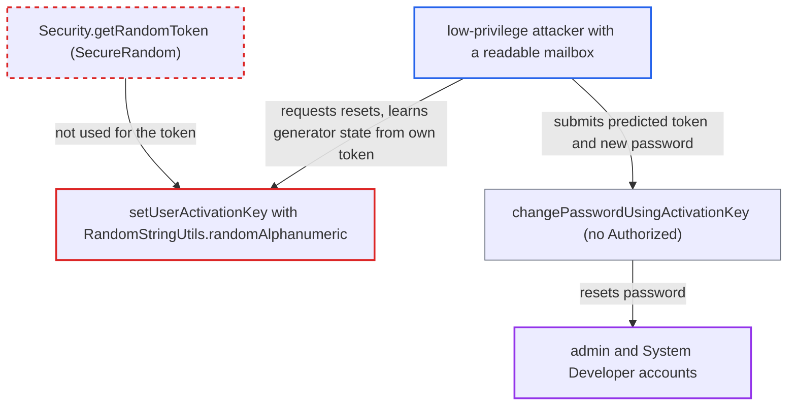

# Password-reset activation token generated with predictable java.util.Random

| Field | Value |
|---|---|
| ID | `find_01YBENpfLVquQRQWyXdVArEx` |
| Severity | **High** |
| Status | open |
| CWE | CWE-338 — Insecure randomness |
| Created | 2026-10-21T22:56:15.087078Z |
| Claude Security | https://claude.ai/security/findings/find_01YBENpfLVquQRQWyXdVArEx |

## Description

A low-privilege OpenMRS user on the internal network can take over any account, including `admin` and other System Developer accounts, by predicting its password-reset token. The attacker needs an account whose email they can read, and mail delivery must be configured. The weakness is in `UserServiceImpl.setUserActivationKey`, which builds the token with `RandomStringUtils.randomAlphanumeric(20)`, backed by the predictable `java.util.Random`.

1. **attacker** requests a password reset for their own account. The reset email delivers the first token, T1, to a mailbox the attacker reads. This needs mail delivery to be configured.
2. **the method `setUserActivationKey`** generates the token with `RandomStringUtils.randomAlphanumeric(20)`. This commons-lang 2.x class draws from one process-wide `java.util.Random`, a 48-bit generator that is not cryptographically secure. ([`api/src/main/java/org/openmrs/api/impl/UserServiceImpl.java:726-733`](https://github.com/cx-benchmark/openmrs-core/blob/e6a1b3374ef040e8821dbe4bacc1bdcb50fa4d29/api/src/main/java/org/openmrs/api/impl/UserServiceImpl.java#L726-L733))
3. **attacker** recovers the internal `java.util.Random` state offline from T1. A 20-character token exposes roughly 130 bits of output, far more than the 48-bit state, so the state can be found by exhaustive search or lattice methods. ([`api/src/main/java/org/openmrs/api/impl/UserServiceImpl.java:726-733`](https://github.com/cx-benchmark/openmrs-core/blob/e6a1b3374ef040e8821dbe4bacc1bdcb50fa4d29/api/src/main/java/org/openmrs/api/impl/UserServiceImpl.java#L726-L733))
4. **attacker** requests a password reset for `admin` or another System Developer. The victim's token is generated from the same generator and stored as a SHA-512 hash of the token plus expiry. The attacker computes the next 20-character output, T2, and can bracket it with a second reset of their own account to absorb other uses of the generator.
5. **attacker** calls `changePasswordUsingActivationKey(T2, newPw)`. This method has no `@Authorized` annotation, and the token lookup accepts any value whose hash matches, so the predicted token is enough. ([`api/src/main/java/org/openmrs/api/impl/UserServiceImpl.java:798-804`](https://github.com/cx-benchmark/openmrs-core/blob/e6a1b3374ef040e8821dbe4bacc1bdcb50fa4d29/api/src/main/java/org/openmrs/api/impl/UserServiceImpl.java#L798-L804))
6. **the method `HibernateUserDAO.changePassword`** sets the new password with no logged-in user. When there is no authenticated user, it substitutes the target user (`authUser == null` leads to `authUser = u`), so the reset completes without a session. ([`api/src/main/java/org/openmrs/api/db/hibernate/HibernateUserDAO.java:296-311`](https://github.com/cx-benchmark/openmrs-core/blob/e6a1b3374ef040e8821dbe4bacc1bdcb50fa4d29/api/src/main/java/org/openmrs/api/db/hibernate/HibernateUserDAO.java#L296-L311))

## Assessment

The attacker is a low-privilege OpenMRS user on the internal network. Their account has an email address they can read, and mail delivery is configured so they receive their own token. They reach the reset flow through a module that exposes `setUserActivationKey`, for example the REST `passwordreset` endpoint. No victim action is needed. The 10-minute default expiry (`DEFAULT_VALID_TIME`) does not help, because a predicted token is used at once. The victim's key is also committed if mail delivery to the victim fails. `MessageException` is a checked exception and the class-level `@Transactional` has no `rollbackFor`.

Impact: The attacker can take over any account by resetting its password, including `admin` and other System Developer accounts. That gives full read and write access to patient health data, user and role management, and module upload, which allows code execution. `admin` is spared only if the non-default `admin_password_locked` runtime property is set.

## Recommendation

The password-reset token comes from a non-cryptographic generator (`java.util.Random` via `RandomStringUtils`), so tokens can be predicted from earlier ones.

Fix criteria: Activation tokens come from a CSPRNG such as `java.security.SecureRandom`, for example by reusing `Security.getRandomToken()` or `RandomStringUtils.secure()`, and carry at least 128 bits of entropy. No default (insecure) `org.apache.commons.lang(.3).RandomStringUtils.random*` method produces a token anywhere in the reset flow. Two consecutively issued tokens have no recoverable relationship.

## Evidence

**https://github.com/cx-benchmark/openmrs-core**

- [`api/src/main/java/org/openmrs/api/impl/UserServiceImpl.java:726-733`](https://github.com/cx-benchmark/openmrs-core/blob/e6a1b3374ef040e8821dbe4bacc1bdcb50fa4d29/api/src/main/java/org/openmrs/api/impl/UserServiceImpl.java#L726-L733)
- [`api/src/main/java/org/openmrs/api/impl/UserServiceImpl.java:798-804`](https://github.com/cx-benchmark/openmrs-core/blob/e6a1b3374ef040e8821dbe4bacc1bdcb50fa4d29/api/src/main/java/org/openmrs/api/impl/UserServiceImpl.java#L798-L804)
- [`api/src/main/java/org/openmrs/api/db/hibernate/HibernateUserDAO.java:132-143`](https://github.com/cx-benchmark/openmrs-core/blob/e6a1b3374ef040e8821dbe4bacc1bdcb50fa4d29/api/src/main/java/org/openmrs/api/db/hibernate/HibernateUserDAO.java#L132-L143)
- [`api/src/main/java/org/openmrs/api/db/hibernate/HibernateUserDAO.java:296-311`](https://github.com/cx-benchmark/openmrs-core/blob/e6a1b3374ef040e8821dbe4bacc1bdcb50fa4d29/api/src/main/java/org/openmrs/api/db/hibernate/HibernateUserDAO.java#L296-L311)
- [`api/src/main/java/org/openmrs/util/Security.java:42`](https://github.com/cx-benchmark/openmrs-core/blob/e6a1b3374ef040e8821dbe4bacc1bdcb50fa4d29/api/src/main/java/org/openmrs/util/Security.java#L42)

