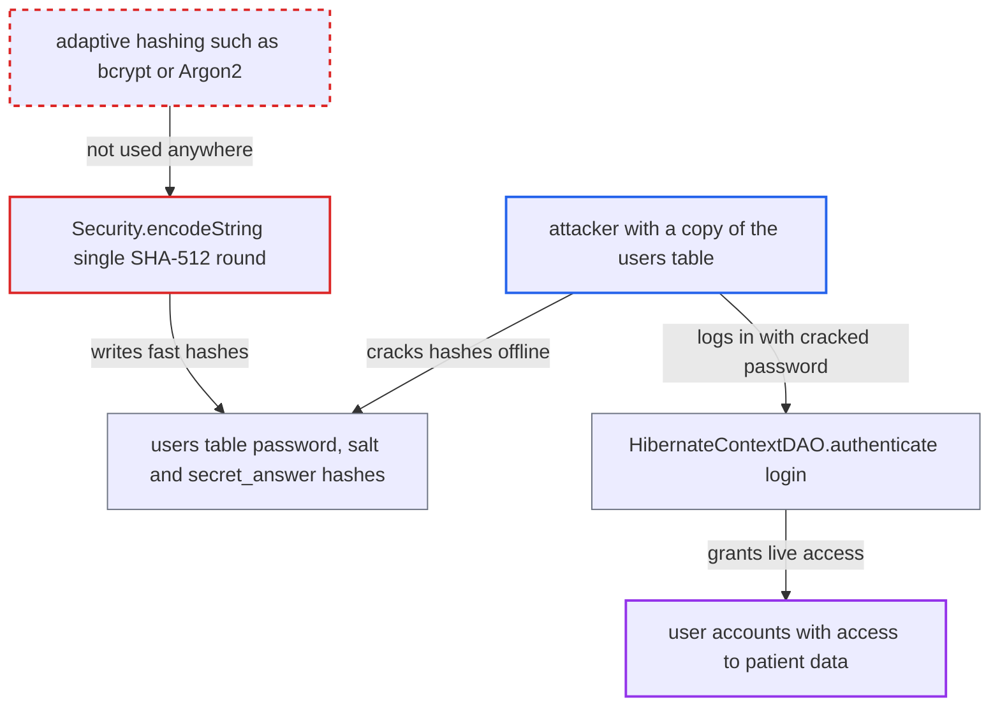

# Passwords stored as single-round salted SHA-512 with unmigrated legacy SHA-1 hashes

| Field | Value |
|---|---|
| ID | `find_014buzZ6DRy2KSJ1P3ycjtUA` |
| Severity | **High** |
| Status | open |
| CWE | CWE-916 — Weak password hashing |
| Created | 2026-10-21T22:58:55.177403Z |
| Claude Security | https://claude.ai/security/findings/find_014buzZ6DRy2KSJ1P3ycjtUA |

## Description

An attacker who has a read-only copy of the `users` table can crack many user passwords offline, administrators included. They can then log in as those users and read and change patient data under their identity. The copy could come from a backup, a replica or a leaked dump. The cause is `Security.encodeString`, which hashes `password + salt` with a single SHA-512 round. Legacy SHA-1 hashes are also still accepted and never upgraded.

1. **the OpenMRS code** stores each password as one SHA-512 digest of `password + salt`. `Security.encodeString` makes a single `MessageDigest` call with no iteration count, so each guess against a stolen hash costs one SHA-512. ([`api/src/main/java/org/openmrs/api/db/hibernate/HibernateUserDAO.java:86-93`](https://github.com/cx-benchmark/openmrs-core/blob/e6a1b3374ef040e8821dbe4bacc1bdcb50fa4d29/api/src/main/java/org/openmrs/api/db/hibernate/HibernateUserDAO.java#L86-L93))
2. **the verifier `Security.hashMatches`** keeps accepting legacy SHA-1 and malformed SHA-1 hashes. Login never re-hashes such a row after success, so on upgraded deployments the weaker hashes stay until the user changes their password. ([`api/src/main/java/org/openmrs/util/Security.java:62-83`](https://github.com/cx-benchmark/openmrs-core/blob/e6a1b3374ef040e8821dbe4bacc1bdcb50fa4d29/api/src/main/java/org/openmrs/util/Security.java#L62-L83))
3. **attacker** obtains a read-only copy of the `password`, `salt` and `secret_answer` columns of `users`. The report names a database backup or replica, a read-only SQL injection elsewhere, or a leaked dump. This happens outside the cited code and needs no OpenMRS account.
4. **attacker** runs an offline dictionary or mask attack on the hashes. Each guess costs one SHA-512, or one SHA-1 for legacy rows. The default policy in `OpenmrsUtil.validatePassword` still allows passwords found in common wordlists. ([`api/src/main/java/org/openmrs/util/Security.java:62-83`](https://github.com/cx-benchmark/openmrs-core/blob/e6a1b3374ef040e8821dbe4bacc1bdcb50fa4d29/api/src/main/java/org/openmrs/util/Security.java#L62-L83))
5. **attacker** logs in with a recovered password. `HibernateContextDAO.authenticate` verifies the password with `Security.hashMatches`, so the cracked cleartext works as a normal login. ([`api/src/main/java/org/openmrs/api/db/hibernate/HibernateContextDAO.java:167-176`](https://github.com/cx-benchmark/openmrs-core/blob/e6a1b3374ef040e8821dbe4bacc1bdcb50fa4d29/api/src/main/java/org/openmrs/api/db/hibernate/HibernateContextDAO.java#L167-L176))

## Assessment

The attacker first needs a read-only copy of the `password`, `salt` and `secret_answer` columns of `users`. The report names a database backup or replica, a read-only SQL injection elsewhere, or a leaked dump as ways to get it. No OpenMRS account is needed. Per the threat model the server is reachable only from the internal network, so the live login afterwards needs access to that network. The attack works best against upgraded deployments that still hold legacy SHA-1 rows. It also works against SHA-512 rows, and against secret recovery answers, which are hashed the same way and usually have less entropy. A fresh install is less exposed, because the install wizard replaces the seeded legacy `admin` hash through `changePassword`.

Impact: The attacker turns a one-time read of the hash table into ongoing authenticated access as any user whose password a wordlist covers. That means reading and changing patient health data under the victim's identity. For an administrator it also means full administration of users, roles and modules. The non-constant-time `String.equals` comparison is not exploitable on its own.

## Recommendation

(1) Passwords are hashed with a fast single-iteration SHA-512 on every write path in `HibernateUserDAO`. `Security.hashMatches` also keeps accepting legacy SHA-1 forms that are never upgraded, so stolen hashes can be brute-forced at full GPU speed.

Fix criteria: Passwords are stored with an adaptive hashing function (bcrypt, scrypt, Argon2 or high-iteration PBKDF2) whose parameters are recorded with the hash. A legacy SHA-512, SHA-1 or malformed SHA-1 row is re-hashed on the next successful login. Acceptance of legacy formats is time-boxed and then removed. New and changed passwords are written in the new format. Logging in with a legacy row upgrades it. An upgraded row no longer matches a raw SHA-512 or SHA-1 digest.

(2) Secret recovery answers use the same single-round SHA-512 (`HibernateUserDAO.changeQuestionAnswer` and `isSecretAnswer`). Low-entropy answers therefore fall even faster than passwords once the table leaks.

Fix criteria: Secret answers are stored with the same adaptive hashing function as passwords. Existing answers are migrated when next used or changed. The `secret_answer` column no longer holds a plain SHA-512 hex digest. After migration, `isSecretAnswer` validates only the new format.

## Evidence

**https://github.com/cx-benchmark/openmrs-core**

- [`api/src/main/java/org/openmrs/util/Security.java:62-83`](https://github.com/cx-benchmark/openmrs-core/blob/e6a1b3374ef040e8821dbe4bacc1bdcb50fa4d29/api/src/main/java/org/openmrs/util/Security.java#L62-L83)
- [`api/src/main/java/org/openmrs/util/Security.java:134-164`](https://github.com/cx-benchmark/openmrs-core/blob/e6a1b3374ef040e8821dbe4bacc1bdcb50fa4d29/api/src/main/java/org/openmrs/util/Security.java#L134-L164)
- [`api/src/main/java/org/openmrs/api/db/hibernate/HibernateUserDAO.java:86-93`](https://github.com/cx-benchmark/openmrs-core/blob/e6a1b3374ef040e8821dbe4bacc1bdcb50fa4d29/api/src/main/java/org/openmrs/api/db/hibernate/HibernateUserDAO.java#L86-L93)
- [`api/src/main/java/org/openmrs/api/db/hibernate/HibernateUserDAO.java:296-311`](https://github.com/cx-benchmark/openmrs-core/blob/e6a1b3374ef040e8821dbe4bacc1bdcb50fa4d29/api/src/main/java/org/openmrs/api/db/hibernate/HibernateUserDAO.java#L296-L311)
- [`api/src/main/java/org/openmrs/api/db/hibernate/HibernateUserDAO.java:357-371`](https://github.com/cx-benchmark/openmrs-core/blob/e6a1b3374ef040e8821dbe4bacc1bdcb50fa4d29/api/src/main/java/org/openmrs/api/db/hibernate/HibernateUserDAO.java#L357-L371)
- [`api/src/main/java/org/openmrs/api/db/hibernate/HibernateUserDAO.java:394-421`](https://github.com/cx-benchmark/openmrs-core/blob/e6a1b3374ef040e8821dbe4bacc1bdcb50fa4d29/api/src/main/java/org/openmrs/api/db/hibernate/HibernateUserDAO.java#L394-L421)
- [`api/src/main/java/org/openmrs/api/db/hibernate/HibernateContextDAO.java:167-176`](https://github.com/cx-benchmark/openmrs-core/blob/e6a1b3374ef040e8821dbe4bacc1bdcb50fa4d29/api/src/main/java/org/openmrs/api/db/hibernate/HibernateContextDAO.java#L167-L176)

