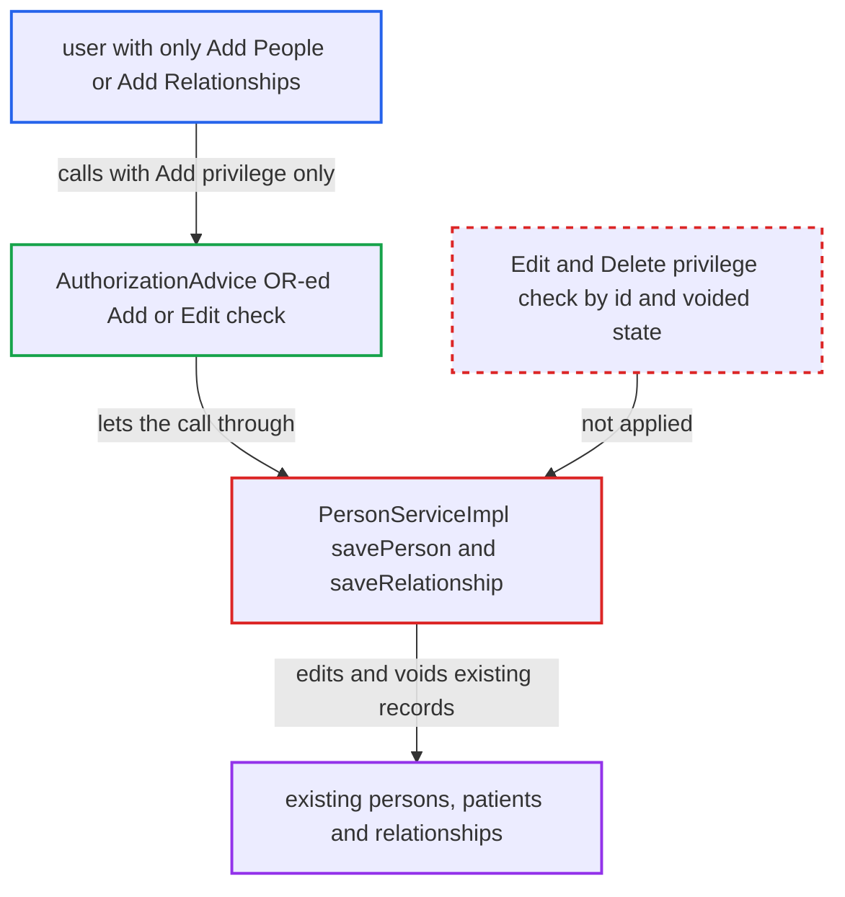

# PersonService.savePerson/saveRelationship let Add-only users edit and void existing records

| Field | Value |
|---|---|
| ID | `find_01CMWvbqJQNeKy3sAo5d44wE` |
| Severity | **High** |
| Status | open |
| CWE | CWE-863 — Incorrect authorization |
| Created | 2026-10-21T23:02:15.121250Z |
| Claude Security | https://claude.ai/security/findings/find_01CMWvbqJQNeKy3sAo5d44wE |

## Description

A logged-in user who holds only `Add People` or `Add Relationships` can edit and void existing people, patients and relationships. They can change names, gender, birthdate, death data and patient identifiers. They need no Edit or Delete privilege. `PersonServiceImpl.savePerson` and `saveRelationship` accept either the Add or the Edit privilege and never check whether the record already exists.

1. **attacker** loads an existing person, patient or relationship. The attacker holds only `Add People` or `Add Relationships` plus the default read privilege, which is enough to load the target.
2. **attacker** changes fields or sets the voided state on the loaded object. For a person this means demographics, names, addresses and attributes, or `personVoided` with a reason. For a relationship it means changed fields or `voided`/`voidReason`. A `Patient` can be passed in as well.
3. **attacker** calls `savePerson` or `saveRelationship`. The call can come through any module or REST path, and no victim interaction is needed. ([`api/src/main/java/org/openmrs/api/PersonService.java:567-568`](https://github.com/cx-benchmark/openmrs-core/blob/e6a1b3374ef040e8821dbe4bacc1bdcb50fa4d29/api/src/main/java/org/openmrs/api/PersonService.java#L567-L568))
4. **`AuthorizationAdvice`** lets the call through on the Add privilege alone. The annotation uses OR semantics (`requireAll` is false by default), so the first privilege the user holds is enough. ([`api/src/main/java/org/openmrs/aop/AuthorizationAdvice.java:75-79`](https://github.com/cx-benchmark/openmrs-core/blob/e6a1b3374ef040e8821dbe4bacc1bdcb50fa4d29/api/src/main/java/org/openmrs/aop/AuthorizationAdvice.java#L75-L79))
5. **`PersonServiceImpl.savePerson`** saves the object without separating new from existing or voided records. It only normalises the preferred name and address and calls the DAO. It has no `Context.requirePrivilege` that depends on the existing id or voided state. `saveRelationship` only checks that personA differs from personB. ([`api/src/main/java/org/openmrs/api/impl/PersonServiceImpl.java:300-304`](https://github.com/cx-benchmark/openmrs-core/blob/e6a1b3374ef040e8821dbe4bacc1bdcb50fa4d29/api/src/main/java/org/openmrs/api/impl/PersonServiceImpl.java#L300-L304))
6. **`HibernatePersonDAO.savePerson`** updates the existing row with `saveOrUpdate`. For a `Patient`, a joined subclass of `Person`, this also writes the cascaded identifiers and skips the `EDIT_PATIENTS` and `DELETE_PATIENTS` check in `PatientServiceImpl`. ([`api/src/main/java/org/openmrs/api/db/hibernate/HibernatePersonDAO.java:553-556`](https://github.com/cx-benchmark/openmrs-core/blob/e6a1b3374ef040e8821dbe4bacc1bdcb50fa4d29/api/src/main/java/org/openmrs/api/db/hibernate/HibernatePersonDAO.java#L553-L556))

## Assessment

The attacker is an authenticated user, such as a low-privilege clinical user, who has `Add People` and/or `Add Relationships` but not the Edit or Delete privileges. They also need the default read privilege to load the target. They call `savePerson` or `saveRelationship` through any module or REST path. No victim interaction is needed. The report notes that, per the threat model, the server is reachable from the internal network only. The behaviour matches upstream 2.6.2.

Impact: The attacker can rewrite the demographic record of any person or patient, including names, gender, birthdate, death status, addresses, attributes and patient identifiers. They can also void or unvoid persons, patients and relationships. This risks patient misidentification. Voiding hides records from normal searches, which is a limited effect that can be undone. Nothing is disclosed.

## Recommendation

(1) `PersonServiceImpl.savePerson` relies only on the OR-ed `{ADD_PERSONS, EDIT_PERSONS}` annotation and does no check inside the method. Create-only callers can update or void existing persons. When given a `Patient`, they also bypass the patient Edit/Delete split.

Fix criteria: Saving a person with an existing id requires `Edit People`. Setting or clearing the voided state through save requires the matching delete-tier privilege. A `Patient` saved through `savePerson` is held to at least the privileges `savePatient` requires. To verify, a user with only `Add People` who saves an existing person or patient with changed names or `personVoided=true` gets `APIAuthenticationException`, and the database row stays unchanged.

(2) `PersonServiceImpl.saveRelationship` relies only on the OR-ed `{ADD_RELATIONSHIPS, EDIT_RELATIONSHIPS}` annotation. Create-only callers can modify, void or unvoid existing relationships that `voidRelationship` and `unvoidRelationship` reserve for Delete or Edit holders.

Fix criteria: Saving a relationship with an existing id requires `Edit Relationships`. Changing its voided state through save requires the privilege that `voidRelationship` or `unvoidRelationship` requires. To verify, an Add-only user who saves an existing relationship with `voided=true` or changed fields gets `APIAuthenticationException`, and the relationship stays unchanged.

## Evidence

**https://github.com/cx-benchmark/openmrs-core**

- [`api/src/main/java/org/openmrs/api/impl/PersonServiceImpl.java:300-304`](https://github.com/cx-benchmark/openmrs-core/blob/e6a1b3374ef040e8821dbe4bacc1bdcb50fa4d29/api/src/main/java/org/openmrs/api/impl/PersonServiceImpl.java#L300-L304)
- [`api/src/main/java/org/openmrs/api/PersonService.java:567-568`](https://github.com/cx-benchmark/openmrs-core/blob/e6a1b3374ef040e8821dbe4bacc1bdcb50fa4d29/api/src/main/java/org/openmrs/api/PersonService.java#L567-L568)
- [`api/src/main/java/org/openmrs/aop/AuthorizationAdvice.java:75-79`](https://github.com/cx-benchmark/openmrs-core/blob/e6a1b3374ef040e8821dbe4bacc1bdcb50fa4d29/api/src/main/java/org/openmrs/aop/AuthorizationAdvice.java#L75-L79)
- [`api/src/main/java/org/openmrs/api/db/hibernate/HibernatePersonDAO.java:553-556`](https://github.com/cx-benchmark/openmrs-core/blob/e6a1b3374ef040e8821dbe4bacc1bdcb50fa4d29/api/src/main/java/org/openmrs/api/db/hibernate/HibernatePersonDAO.java#L553-L556)
- [`api/src/main/java/org/openmrs/api/PersonService.java:713-714`](https://github.com/cx-benchmark/openmrs-core/blob/e6a1b3374ef040e8821dbe4bacc1bdcb50fa4d29/api/src/main/java/org/openmrs/api/PersonService.java#L713-L714)
- [`api/src/main/java/org/openmrs/api/impl/PatientServiceImpl.java:139-148`](https://github.com/cx-benchmark/openmrs-core/blob/e6a1b3374ef040e8821dbe4bacc1bdcb50fa4d29/api/src/main/java/org/openmrs/api/impl/PatientServiceImpl.java#L139-L148)
- [`api/src/main/java/org/openmrs/api/impl/PersonServiceImpl.java:477-483`](https://github.com/cx-benchmark/openmrs-core/blob/e6a1b3374ef040e8821dbe4bacc1bdcb50fa4d29/api/src/main/java/org/openmrs/api/impl/PersonServiceImpl.java#L477-L483)
- [`api/src/main/java/org/openmrs/api/PersonService.java:519-553`](https://github.com/cx-benchmark/openmrs-core/blob/e6a1b3374ef040e8821dbe4bacc1bdcb50fa4d29/api/src/main/java/org/openmrs/api/PersonService.java#L519-L553)

