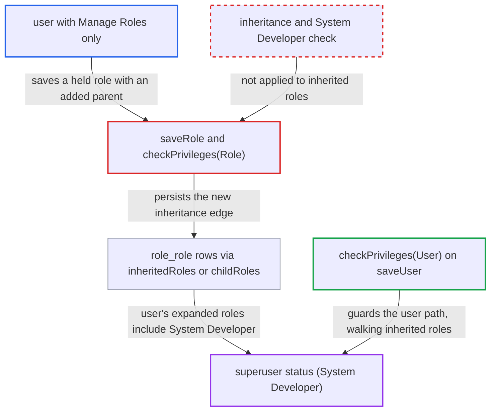

# Role inheritance bypasses saveRole privilege check, letting Manage Roles holders become superuser

| Field | Value |
|---|---|
| ID | `find_019Ae3AaCFMS69sByxVmhxco` |
| Severity | **High** |
| Status | open |
| CWE | CWE-269 — Privilege escalation |
| Created | 2026-10-21T22:53:48.463343Z |
| Claude Security | https://claude.ai/security/findings/find_019Ae3AaCFMS69sByxVmhxco |

## Description

A user who holds only `Manage Roles` can make themselves a full superuser. They edit a role they already hold so that it inherits `System Developer`, or a role with privileges they lack. The cause is `checkPrivileges(Role)` in `UserServiceImpl`. It checks only a role's direct privileges and ignores inherited roles.

1. **attacker with `Manage Roles`** fetches the `System Developer` role. `getRole(String)` and `getRoleByUuid` have no `@Authorized` restriction, so any caller can get the `Role` object to reference. ([`api/src/main/java/org/openmrs/api/UserService.java:233-234`](https://github.com/cx-benchmark/openmrs-core/blob/e6a1b3374ef040e8821dbe4bacc1bdcb50fa4d29/api/src/main/java/org/openmrs/api/UserService.java#L233-L234))
2. **attacker** adds `System Developer` to the `inheritedRoles` of a role they already hold, then calls `saveRole`. `saveRole` requires only `Manage Roles`. Its only other gates are the self-inheritance cycle check and `checkPrivileges(role)`. ([`api/src/main/java/org/openmrs/api/impl/UserServiceImpl.java:301-310`](https://github.com/cx-benchmark/openmrs-core/blob/e6a1b3374ef040e8821dbe4bacc1bdcb50fa4d29/api/src/main/java/org/openmrs/api/impl/UserServiceImpl.java#L301-L310))
3. **the check `checkPrivileges(Role)`** passes the change. It inspects only `role.getPrivileges()`. It never looks at `inheritedRoles`, never walks `getAllParentRoles()` and never calls `checkSuperUserPrivilege`, so no `Assign System Developer Role` check happens. ([`api/src/main/java/org/openmrs/api/impl/UserServiceImpl.java:517-527`](https://github.com/cx-benchmark/openmrs-core/blob/e6a1b3374ef040e8821dbe4bacc1bdcb50fa4d29/api/src/main/java/org/openmrs/api/impl/UserServiceImpl.java#L517-L527))
4. **Hibernate mapping** writes the new `role_role` row. Neither `inheritedRoles` nor `childRoles` is mapped `inverse`, so the caller-supplied edge is persisted. ([`api/src/main/resources/org/openmrs/api/db/hibernate/Role.hbm.xml:35-52`](https://github.com/cx-benchmark/openmrs-core/blob/e6a1b3374ef040e8821dbe4bacc1bdcb50fa4d29/api/src/main/resources/org/openmrs/api/db/hibernate/Role.hbm.xml#L35-L52))
5. **`User.getAllRoles()`** counts the inherited `System Developer` role as held by the attacker once the user is reloaded. It adds `getAllParentRoles()` of each held role, so a user holding the edited role effectively holds `System Developer`. The report gives re-login as an example of a reload. ([`api/src/main/java/org/openmrs/User.java:219-239`](https://github.com/cx-benchmark/openmrs-core/blob/e6a1b3374ef040e8821dbe4bacc1bdcb50fa4d29/api/src/main/java/org/openmrs/User.java#L219-L239))
6. **`User.isSuperUser()` and `hasPrivilege()`** grant every privilege to the attacker. `isSuperUser()` is true when the expanded role set contains `System Developer`, and `hasPrivilege()` then returns true for everything. `UserContext.hasPrivilege` delegates to it, so every `@Authorized` and `Context.requirePrivilege` check passes. ([`api/src/main/java/org/openmrs/User.java:101-124`](https://github.com/cx-benchmark/openmrs-core/blob/e6a1b3374ef040e8821dbe4bacc1bdcb50fa4d29/api/src/main/java/org/openmrs/User.java#L101-L124))

## Assessment

The attacker is an authenticated user with `Manage Roles` but without `Assign System Developer Role`, for example a delegated role administrator. They need any module surface that edits roles, such as REST or the legacy UI. They add `System Developer`, or any role carrying a privilege they lack such as `Edit User Passwords`, to `inheritedRoles` of a role they hold. A second route edits the `System Developer` role itself, which has no explicit privileges, and lists a held role in its `childRoles`. That writes the same `role_role` edge. The new access takes effect once the authenticated user is reloaded, for example at the next login. The report assumes an internal-network setting.

Impact: The attacker becomes an implicit `System Developer` superuser, so every `hasPrivilege` check returns true. That gives full read and write access to all patient health data, user and credential management, `SQL Level Access`, global properties and module administration. The report says this allows code execution on the server and a total loss of control of the OpenMRS instance.

## Recommendation

`checkPrivileges(Role)` enforces the rule that a caller may only assign what it holds over a role's direct privileges only. Privileges and the superuser role reached through `inheritedRoles`, or through `role_role` edges written via `childRoles`, escape the rule.

Fix criteria: `saveRole` fails unless the caller holds every privilege reachable through the saved role's full inheritance closure. Making any role inherit from `System Developer`, directly or transitively, requires `Assign System Developer Role`, matching `checkPrivileges(User)` and `checkSuperUserPrivilege`. Edges added through `childRoles` are checked the same way. Verify with a user who has only `Manage Roles`. If they save a held role whose `inheritedRoles` contains `System Developer`, or a role with a privilege they lack, they get an `APIException`. The same happens if they add their role to the `childRoles` of `System Developer`. In each case no `role_role` row is written and their `Context.hasPrivilege` results do not change.

## Evidence

**https://github.com/cx-benchmark/openmrs-core**

- [`api/src/main/java/org/openmrs/api/impl/UserServiceImpl.java:517-527`](https://github.com/cx-benchmark/openmrs-core/blob/e6a1b3374ef040e8821dbe4bacc1bdcb50fa4d29/api/src/main/java/org/openmrs/api/impl/UserServiceImpl.java#L517-L527)
- [`api/src/main/java/org/openmrs/api/impl/UserServiceImpl.java:301-310`](https://github.com/cx-benchmark/openmrs-core/blob/e6a1b3374ef040e8821dbe4bacc1bdcb50fa4d29/api/src/main/java/org/openmrs/api/impl/UserServiceImpl.java#L301-L310)
- [`api/src/main/resources/org/openmrs/api/db/hibernate/Role.hbm.xml:35-52`](https://github.com/cx-benchmark/openmrs-core/blob/e6a1b3374ef040e8821dbe4bacc1bdcb50fa4d29/api/src/main/resources/org/openmrs/api/db/hibernate/Role.hbm.xml#L35-L52)
- [`api/src/main/java/org/openmrs/User.java:219-239`](https://github.com/cx-benchmark/openmrs-core/blob/e6a1b3374ef040e8821dbe4bacc1bdcb50fa4d29/api/src/main/java/org/openmrs/User.java#L219-L239)
- [`api/src/main/java/org/openmrs/User.java:101-124`](https://github.com/cx-benchmark/openmrs-core/blob/e6a1b3374ef040e8821dbe4bacc1bdcb50fa4d29/api/src/main/java/org/openmrs/User.java#L101-L124)
- [`api/src/main/java/org/openmrs/api/context/UserContext.java:324-334`](https://github.com/cx-benchmark/openmrs-core/blob/e6a1b3374ef040e8821dbe4bacc1bdcb50fa4d29/api/src/main/java/org/openmrs/api/context/UserContext.java#L324-L334)
- [`api/src/main/java/org/openmrs/api/impl/UserServiceImpl.java:388-404`](https://github.com/cx-benchmark/openmrs-core/blob/e6a1b3374ef040e8821dbe4bacc1bdcb50fa4d29/api/src/main/java/org/openmrs/api/impl/UserServiceImpl.java#L388-L404)
- [`api/src/main/java/org/openmrs/api/UserService.java:233-234`](https://github.com/cx-benchmark/openmrs-core/blob/e6a1b3374ef040e8821dbe4bacc1bdcb50fa4d29/api/src/main/java/org/openmrs/api/UserService.java#L233-L234)

