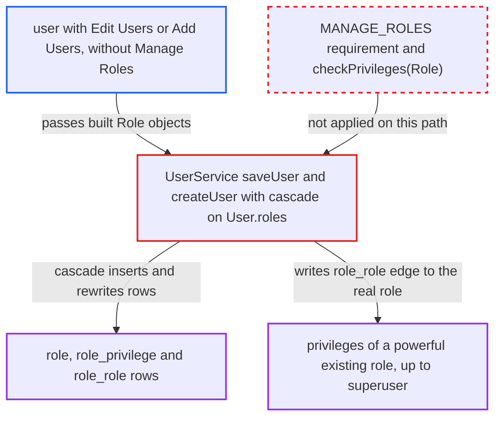

# saveUser/createUser cascade persists caller-built Role state without Manage Roles

| Field | Value |
|---|---|
| ID | `find_01UFsr1SPWq6ueB379ZqpPTv` |
| Severity | **High** |
| Status | open |
| CWE | CWE-862 — Missing authorization |
| Created | 2026-10-21T23:20:34.617519Z |
| Claude Security | https://claude.ai/security/findings/find_01UFsr1SPWq6ueB379ZqpPTv |

## Description

A user who holds `Edit Users` or `Add Users` but not `Manage Roles` can create roles and rewrite existing ones. They can also give their own account the privileges of any existing role, up to superuser. Saving a user cascades into `Role` rows, and the only check, `checkPrivileges(User)`, looks at the caller's in-memory objects and never requires `MANAGE_ROLES`. Over HTTP this needs a module or client binding that builds `Role` objects.

1. **the attacker** calls `saveUser` or `createUser` with a `User` carrying hand-built `Role` objects. `saveUser` needs only `EDIT_USERS` and `createUser` only `ADD_USERS`; neither requires `MANAGE_ROLES`, and the roles can be a new role whose `inheritedRoles` holds an empty stand-in for a powerful role. ([`api/src/main/java/org/openmrs/api/impl/UserServiceImpl.java:161-176`](https://github.com/cx-benchmark/openmrs-core/blob/e6a1b3374ef040e8821dbe4bacc1bdcb50fa4d29/api/src/main/java/org/openmrs/api/impl/UserServiceImpl.java#L161-L176))
2. **the guard `checkPrivileges(User)`** checks only the in-memory role graph and passes. It never reloads roles from the database, so a stand-in with empty `privileges` and `inheritedRoles` shows nothing, and only a role literally named `System Developer` is refused. ([`api/src/main/java/org/openmrs/api/impl/UserServiceImpl.java:388-404`](https://github.com/cx-benchmark/openmrs-core/blob/e6a1b3374ef040e8821dbe4bacc1bdcb50fa4d29/api/src/main/java/org/openmrs/api/impl/UserServiceImpl.java#L388-L404))
3. **the DAO `HibernateUserDAO`** persists the user with `session.saveOrUpdate(user)`. This hands the caller-built object graph to Hibernate unchanged. ([`api/src/main/java/org/openmrs/api/db/hibernate/HibernateUserDAO.java:72-78`](https://github.com/cx-benchmark/openmrs-core/blob/e6a1b3374ef040e8821dbe4bacc1bdcb50fa4d29/api/src/main/java/org/openmrs/api/db/hibernate/HibernateUserDAO.java#L72-L78))
4. **Hibernate** cascades the save into every `Role` in `user.getRoles()`. `User.roles` is mapped with `cascade="save-update"`, so the roles are written together with the user. ([`api/src/main/resources/org/openmrs/api/db/hibernate/User.hbm.xml:68-76`](https://github.com/cx-benchmark/openmrs-core/blob/e6a1b3374ef040e8821dbe4bacc1bdcb50fa4d29/api/src/main/resources/org/openmrs/api/db/hibernate/User.hbm.xml#L68-L76))
5. **Hibernate** inserts unknown roles and updates known ones, rewriting their join rows. `Role` has an assigned id and no `unsaved-value`, so an unknown name is INSERTed and a detached existing role is UPDATEd, with its `privileges`, `inheritedRoles` and `childRoles` rows recreated from the in-memory sets; the `inheritedRoles` stand-in only gets a `role_role` row pointing to the real role. ([`api/src/main/resources/org/openmrs/api/db/hibernate/Role.hbm.xml:22-62`](https://github.com/cx-benchmark/openmrs-core/blob/e6a1b3374ef040e8821dbe4bacc1bdcb50fa4d29/api/src/main/resources/org/openmrs/api/db/hibernate/Role.hbm.xml#L22-L62))
6. **`User.hasPrivilege`** grants the real privileges of the linked role once the user is reloaded. It resolves roles through `getAllRoles()` on the database copy, so the attacker gets every privilege of the real role, and superuser status if it inherits `System Developer`. ([`api/src/main/java/org/openmrs/User.java:113-134`](https://github.com/cx-benchmark/openmrs-core/blob/e6a1b3374ef040e8821dbe4bacc1bdcb50fa4d29/api/src/main/java/org/openmrs/User.java#L113-L134))

## Assessment

The attacker is an authenticated user with `Edit Users` or `Add Users` but without `Manage Roles`, on the internal network. They need a client or module binding, for example REST (not shown in the report), that turns request data into `Role` objects and passes them to `saveUser` or `createUser`. Core's own bindings (`RoleEditor`, `Daemon.createUser`, `MigrationHelper`, `PatientServiceImpl.changeUserAssociations`) pass persistent roles, so they do not expose it. The attacker has two routes. One is to attach to their own account a new role that inherits a stand-in for a powerful existing role. The other is to pass a stand-in for an existing role with chosen privileges. Roles already loaded in the session are not affected.

Impact: The attacker gains the role-administration power reserved for `Manage Roles`. They also get every privilege of any existing role, and superuser status if that role inherits `System Developer`, which means full read and write of patient health data and administration. They can also empty the privileges of shared roles such as `Provider`, which locks out all holders from clinical functions until an administrator rebuilds the roles.

## Recommendation

(1) `User.roles` cascades save-update, so saving a user also writes the caller-supplied `Role` state (new `role` rows, rewritten `role_privilege` and `role_role` rows). This skips the `Manage Roles` authorization that `saveRole` enforces.

Fix criteria: Saving or creating a user never inserts or modifies a `role`, `role_privilege` or `role_role` row; only `user_role` may change. `saveUser` with a `Role` whose name is unknown fails and creates no role. `saveUser` with a detached copy of an existing role carrying different privileges or parents leaves that role's rows unchanged.

(2) `checkPrivileges(User)` evaluates the privileges and parents of the in-memory `Role` objects the caller supplied, not the persisted roles. A stand-in role with empty collections therefore defeats the delegation check.

Fix criteria: The delegation check resolves each assigned role from the database by role name, with its transitive parents and their privileges, before comparing against the caller's privileges. It rejects roles that do not exist. Assigning a role whose persisted parents or privileges exceed the caller's is rejected even when the supplied object lists none.

## Evidence

**https://github.com/cx-benchmark/openmrs-core**

- [`api/src/main/resources/org/openmrs/api/db/hibernate/User.hbm.xml:68-76`](https://github.com/cx-benchmark/openmrs-core/blob/e6a1b3374ef040e8821dbe4bacc1bdcb50fa4d29/api/src/main/resources/org/openmrs/api/db/hibernate/User.hbm.xml#L68-L76)
- [`api/src/main/java/org/openmrs/api/impl/UserServiceImpl.java:388-404`](https://github.com/cx-benchmark/openmrs-core/blob/e6a1b3374ef040e8821dbe4bacc1bdcb50fa4d29/api/src/main/java/org/openmrs/api/impl/UserServiceImpl.java#L388-L404)
- [`api/src/main/java/org/openmrs/api/impl/UserServiceImpl.java:161-176`](https://github.com/cx-benchmark/openmrs-core/blob/e6a1b3374ef040e8821dbe4bacc1bdcb50fa4d29/api/src/main/java/org/openmrs/api/impl/UserServiceImpl.java#L161-L176)
- [`api/src/main/java/org/openmrs/api/db/hibernate/HibernateUserDAO.java:72-78`](https://github.com/cx-benchmark/openmrs-core/blob/e6a1b3374ef040e8821dbe4bacc1bdcb50fa4d29/api/src/main/java/org/openmrs/api/db/hibernate/HibernateUserDAO.java#L72-L78)
- [`api/src/main/resources/org/openmrs/api/db/hibernate/Role.hbm.xml:22-62`](https://github.com/cx-benchmark/openmrs-core/blob/e6a1b3374ef040e8821dbe4bacc1bdcb50fa4d29/api/src/main/resources/org/openmrs/api/db/hibernate/Role.hbm.xml#L22-L62)
- [`api/src/main/java/org/openmrs/User.java:113-134`](https://github.com/cx-benchmark/openmrs-core/blob/e6a1b3374ef040e8821dbe4bacc1bdcb50fa4d29/api/src/main/java/org/openmrs/User.java#L113-L134)
- [`api/src/main/java/org/openmrs/api/impl/UserServiceImpl.java:301-311`](https://github.com/cx-benchmark/openmrs-core/blob/e6a1b3374ef040e8821dbe4bacc1bdcb50fa4d29/api/src/main/java/org/openmrs/api/impl/UserServiceImpl.java#L301-L311)
- [`api/src/test/java/org/openmrs/api/UserServiceTest.java:138-145`](https://github.com/cx-benchmark/openmrs-core/blob/e6a1b3374ef040e8821dbe4bacc1bdcb50fa4d29/api/src/test/java/org/openmrs/api/UserServiceTest.java#L138-L145)
- [`api/src/main/java/org/openmrs/propertyeditor/RoleEditor.java:41-62`](https://github.com/cx-benchmark/openmrs-core/blob/e6a1b3374ef040e8821dbe4bacc1bdcb50fa4d29/api/src/main/java/org/openmrs/propertyeditor/RoleEditor.java#L41-L62)

