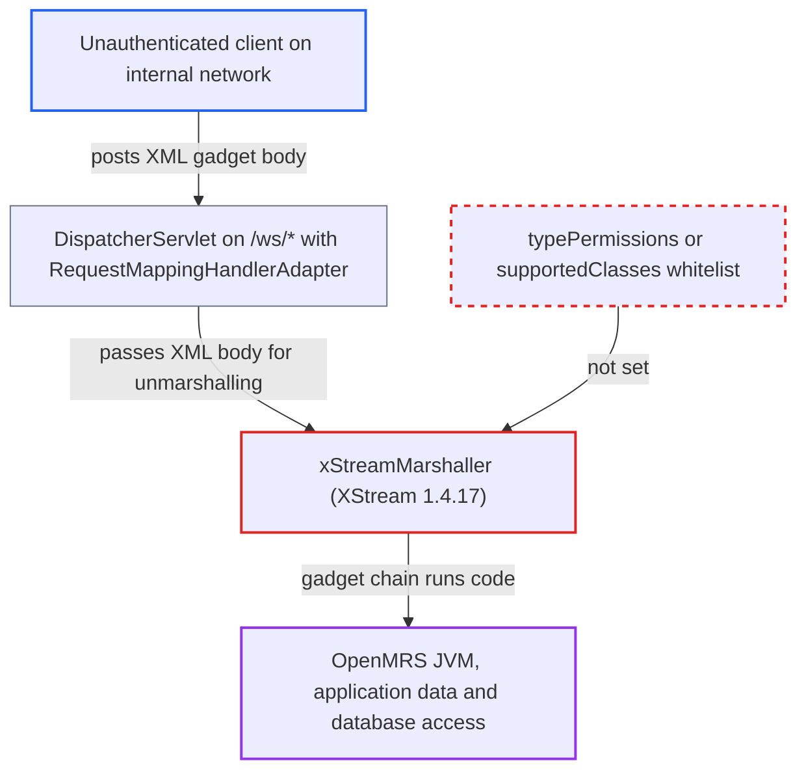

# Unrestricted XStream 1.4.17 registered as Spring MVC request-body unmarshaller for all /ws/* controllers

| Field | Value |
|---|---|
| ID | `find_013xfNxWcYAU9TijA7oBvr7V` |
| Severity | **High** |
| Status | open |
| CWE | CWE-502 — Deserialization of untrusted data |
| Created | 2026-10-21T23:03:51.209359Z |
| Claude Security | https://claude.ai/security/findings/find_013xfNxWcYAU9TijA7oBvr7V |

## Description

An unauthenticated client on the internal network can run arbitrary code in the OpenMRS server by posting a crafted XML body to a `/ws/*` endpoint. This works only if an installed module exposes a `@RequestBody` or `HttpEntity` handler that does not reject XML. The cause is `xStreamMarshaller` in `openmrs-servlet.xml`. It has no type restrictions and runs on XStream `1.4.17`, whose deny-list can be bypassed.

1. **Attacker** posts an XML gadget document to a module endpoint under `/ws/*`. The request uses `Content-Type: application/xml`, and the `openmrs` `DispatcherServlet` is mapped to `/ws/*`, so it handles module controllers. ([`webapp/src/main/webapp/WEB-INF/web.xml:316-319`](https://github.com/cx-benchmark/openmrs-core/blob/e6a1b3374ef040e8821dbe4bacc1bdcb50fa4d29/webapp/src/main/webapp/WEB-INF/web.xml#L316-L319))
2. **the filter `OpenmrsFilter`** attaches an anonymous `UserContext` and passes the request on. No core filter authenticates `/ws/*` or rejects XML bodies, and CSRFGuard exempts the path, so no token is needed. ([`web/src/main/java/org/openmrs/web/filter/OpenmrsFilter.java:72-114`](https://github.com/cx-benchmark/openmrs-core/blob/e6a1b3374ef040e8821dbe4bacc1bdcb50fa4d29/web/src/main/java/org/openmrs/web/filter/OpenmrsFilter.java#L72-L114))
3. **the `RequestMappingHandlerAdapter`** selects `xmlMarshallingHttpMessageConverter` for the request body. It is listed among the converters, and it handles XML content types for any `@RequestBody` or `HttpEntity` type other than `byte[]`, `String`, `MultiValueMap` or `Source`. ([`web/src/main/resources/openmrs-servlet.xml:117-131`](https://github.com/cx-benchmark/openmrs-core/blob/e6a1b3374ef040e8821dbe4bacc1bdcb50fa4d29/web/src/main/resources/openmrs-servlet.xml#L117-L131))
4. **the bean `xStreamMarshaller`** unmarshals the document and instantiates the class the document names. It sets no `supportedClasses` or `typePermissions`, and XStream `1.4.17` only has a deny-list, which the CVE-2021-39139 to CVE-2021-39154 gadget chains bypass. ([`web/src/main/resources/openmrs-servlet.xml:82-87`](https://github.com/cx-benchmark/openmrs-core/blob/e6a1b3374ef040e8821dbe4bacc1bdcb50fa4d29/web/src/main/resources/openmrs-servlet.xml#L82-L87))
5. **Spring argument resolution** finishes building the object graph before the controller method runs. `MarshallingHttpMessageConverter.readFromSource` unmarshals first and checks the result type afterwards, so the chain runs before the handler and before any `@Authorized` check.

## Assessment

The attacker is an unauthenticated client who can reach the server from the internal network. The deployment must run a module that exposes a `@RequestBody` or `HttpEntity` handler under `/ws/*`. That handler must not restrict `consumes` and must not reject XML itself. The report names the `webservices.rest` module's `MainResourceController` (`@RequestBody SimpleObject`) as the vector of CVE-2018-19276 through this same core configuration. That module's later fix is reportedly a filter that rejects XML on `/ws/rest/*`. The report did not see that filter, and says a separate matching defect (for example `/ws;x/rest/...`) would let a client skip it. The production image runs Java 8.

Impact: The gadget chain runs arbitrary code in the OpenMRS JVM as the Tomcat user. The attacker can read and modify all application data, including patient health information, through the application's own database connection and runtime properties. The attacker can also change code and stop the service.

## Recommendation

(1) `openmrs-servlet.xml` hands every XML request body to an `XStreamMarshaller` that may instantiate any class. It sets no `typePermissions` or `supportedClasses`, so untrusted input controls object construction before authorization.

Fix criteria: XML request bodies are no longer deserialised by an unrestricted XStream. Either `xmlMarshallingHttpMessageConverter` is removed from the `RequestMappingHandlerAdapter` message converters, or the marshaller is limited to an explicit whitelist of DTO classes through `typePermissions` or `supportedClasses`. With a whitelist, a document naming any other class is rejected with `ForbiddenClassException` before instantiation. To check, post an XML body whose root names an arbitrary JDK class to a `@RequestBody` endpoint. It must be refused with a 4xx status, and the class must not be instantiated.

(2) `pom.xml` pins XStream to `1.4.17`. Its default security policy is a deny-list only, and known code-execution bypasses exist.

Fix criteria: The dependency is XStream `1.4.18` or later, whose default policy is a whitelist, so any remaining XStream use fails closed for unexpected types. The resolved version in the built WAR is checked and is `1.4.18` or later. Unmarshalling an unknown type without an explicit allow rule throws.

## Evidence

**https://github.com/cx-benchmark/openmrs-core**

- [`web/src/main/resources/openmrs-servlet.xml:82-87`](https://github.com/cx-benchmark/openmrs-core/blob/e6a1b3374ef040e8821dbe4bacc1bdcb50fa4d29/web/src/main/resources/openmrs-servlet.xml#L82-L87)
- [`web/src/main/resources/openmrs-servlet.xml:117-131`](https://github.com/cx-benchmark/openmrs-core/blob/e6a1b3374ef040e8821dbe4bacc1bdcb50fa4d29/web/src/main/resources/openmrs-servlet.xml#L117-L131)
- [`pom.xml:357-359`](https://github.com/cx-benchmark/openmrs-core/blob/e6a1b3374ef040e8821dbe4bacc1bdcb50fa4d29/pom.xml#L357-L359)
- [`webapp/src/main/webapp/WEB-INF/web.xml:21-29`](https://github.com/cx-benchmark/openmrs-core/blob/e6a1b3374ef040e8821dbe4bacc1bdcb50fa4d29/webapp/src/main/webapp/WEB-INF/web.xml#L21-L29)
- [`webapp/src/main/webapp/WEB-INF/web.xml:316-319`](https://github.com/cx-benchmark/openmrs-core/blob/e6a1b3374ef040e8821dbe4bacc1bdcb50fa4d29/webapp/src/main/webapp/WEB-INF/web.xml#L316-L319)
- [`web/src/main/java/org/openmrs/web/filter/OpenmrsFilter.java:72-114`](https://github.com/cx-benchmark/openmrs-core/blob/e6a1b3374ef040e8821dbe4bacc1bdcb50fa4d29/web/src/main/java/org/openmrs/web/filter/OpenmrsFilter.java#L72-L114)
- [`webapp/src/main/webapp/WEB-INF/csrfguard.properties:220-221`](https://github.com/cx-benchmark/openmrs-core/blob/e6a1b3374ef040e8821dbe4bacc1bdcb50fa4d29/webapp/src/main/webapp/WEB-INF/csrfguard.properties#L220-L221)

