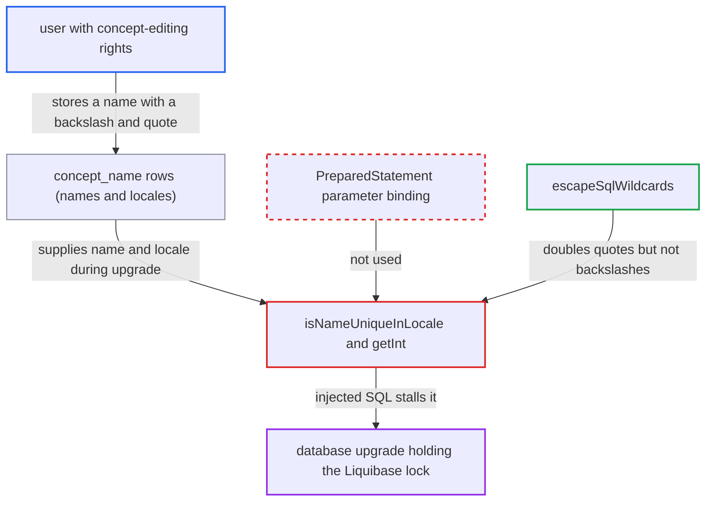

# Backslash in concept name escapes quote doubling, injecting SQL in legacy upgrade change set

| Field | Value |
|---|---|
| ID | `find_01XBnmvKhvDWUPd92RPKCKSX` |
| Severity | **Medium** |
| Status | open |
| CWE | CWE-89 — SQL injection |
| Created | 2026-10-21T23:04:51.409068Z |
| Claude Security | https://claude.ai/security/findings/find_01XBnmvKhvDWUPd92RPKCKSX |

## Description

A user who can edit concepts on an OpenMRS 1.6 or earlier database can stall the upgrade to this release indefinitely, and can leak a little data through query timing. It only works when an administrator later upgrades that database on MySQL or MariaDB. `isNameUniqueInLocale` puts stored concept names and locales into SQL text, and `escapeSqlWildcards` leaves backslashes unescaped.

1. **the attacker with concept-editing rights** saves a concept name containing a backslash and a quote. The report's example is `\' OR SLEEP(999999)#`, stored on an OpenMRS 1.6 or earlier instance, and nothing in the code restricts which characters a name may contain.
2. **the administrator** upgrades the old database with this release. When `ChangeLogDetective` cannot match a snapshot it falls back to `1.9.x` and runs every unrecorded change set in the 2.0.x file and later files. ([`api/src/main/java/org/openmrs/liquibase/ChangeLogDetective.java:116-139`](https://github.com/cx-benchmark/openmrs-core/blob/e6a1b3374ef040e8821dbe4bacc1bdcb50fa4d29/api/src/main/java/org/openmrs/liquibase/ChangeLogDetective.java#L116-L139))
3. **the Liquibase change sets** run `20100607-1550f` and then `20100607-1550h`, which calls `ConceptValidatorChangeSet`. `20100607-1550f` marks legacy preferred names as fully specified or locale-preferred, which puts them on the path to the vulnerable call. ([`api/src/main/resources/org/openmrs/liquibase/updates/liquibase-update-to-latest-2.0.x.xml:3605-3611`](https://github.com/cx-benchmark/openmrs-core/blob/e6a1b3374ef040e8821dbe4bacc1bdcb50fa4d29/api/src/main/resources/org/openmrs/liquibase/updates/liquibase-update-to-latest-2.0.x.xml#L3605-L3611))
4. **the class `ConceptValidatorChangeSet`** reads names and locales from `concept_name` and passes each fully-specified or locale-preferred name to `isNameUniqueInLocale`. The values are user-authored data, and `LocaleUtility.fromSpecification` keeps arbitrary text after the second `_` as the variant, so the locale can carry a payload too. ([`api/src/main/java/org/openmrs/util/databasechange/ConceptValidatorChangeSet.java:581-608`](https://github.com/cx-benchmark/openmrs-core/blob/e6a1b3374ef040e8821dbe4bacc1bdcb50fa4d29/api/src/main/java/org/openmrs/util/databasechange/ConceptValidatorChangeSet.java#L581-L608))
5. **the method `isNameUniqueInLocale`** concatenates the name and `Locale.toString()` into a `SELECT count(*)` string. The only treatment is `HibernateUtil.escapeSqlWildcards`. ([`api/src/main/java/org/openmrs/util/databasechange/ConceptValidatorChangeSet.java:478-490`](https://github.com/cx-benchmark/openmrs-core/blob/e6a1b3374ef040e8821dbe4bacc1bdcb50fa4d29/api/src/main/java/org/openmrs/util/databasechange/ConceptValidatorChangeSet.java#L478-L490))
6. **the helper `escapeSqlWildcards`** doubles the quote but leaves the backslash alone. On MySQL and MariaDB, `\'` becomes `\''`. The backslash escapes the first quote, the second quote closes the literal, and the rest of the name is parsed as SQL, with `#` commenting out the remainder. ([`api/src/main/java/org/openmrs/api/db/hibernate/HibernateUtil.java:124-143`](https://github.com/cx-benchmark/openmrs-core/blob/e6a1b3374ef040e8821dbe4bacc1bdcb50fa4d29/api/src/main/java/org/openmrs/api/db/hibernate/HibernateUtil.java#L124-L143))
7. **the method `getInt`** runs the text with `Statement.executeQuery` and no query timeout. An injected `OR SLEEP(999999)` or a cross-product condition keeps the upgrade stuck while it holds the Liquibase lock. A malformed payload only makes `getInt` swallow the `SQLException` and return `0`. ([`api/src/main/java/org/openmrs/util/databasechange/ConceptValidatorChangeSet.java:742-777`](https://github.com/cx-benchmark/openmrs-core/blob/e6a1b3374ef040e8821dbe4bacc1bdcb50fa4d29/api/src/main/java/org/openmrs/util/databasechange/ConceptValidatorChangeSet.java#L742-L777))

## Assessment

The attacker needs concept-editing privileges on an OpenMRS 1.6 or earlier instance. They save a default or preferred concept name such as `\' OR SLEEP(999999)#`. A locale value carrying a payload also reaches the sink. The attack fires later, when an administrator upgrades that database with this release, through the update wizard or with `auto_update_database=true`. It only works if the database does not already have change set `20100607-1550h` recorded. Databases created by 1.7 or later, or from a snapshot, already have it recorded. It relies on MySQL or MariaDB treating backslash as an escape, which is the case unless `NO_BACKSLASH_ESCAPES` is set. Neither the default `sql_mode` nor the shipped JDBC URLs set it. On PostgreSQL the quote doubling holds. The report's threat model has the server reachable only from an internal network. The injected tail also passes through `escapeSqlWildcards`, so payloads must avoid `_`, `%` and `*` and use double-quoted strings or hex literals.

Impact: The attacker can stall the upgrade without limit, and it stalls again on every retry until an admin finds and edits the name, so the system cannot start on the new release. Data can leak only through timing, because the count only feeds admin-facing warnings. Stacked statements are not possible and the default account lacks `FILE`.

## Recommendation

(1) `isNameUniqueInLocale` builds its `SELECT count(*)` by putting the stored concept name and locale into the SQL text. `escapeSqlWildcards` does not stop backslash escapes on MySQL, so stored data runs as SQL during the upgrade.

Fix criteria: The uniqueness probe binds the name, locale and concept id as `PreparedStatement` parameters, or compares in memory. A name or locale containing `\'`, `#`, `--`, `_` or `%` is compared literally. An upgrade over a concept named `\' OR SLEEP(999999)#` completes normally, with the name treated only as data.

(2) `HibernateUtil.escapeSqlWildcards` escapes LIKE wildcards and doubles `'` but leaves backslash escaping open. That invites callers to use it as a general SQL string-literal escaper.

Fix criteria: No caller uses the helper to build inline SQL string literals, and such callers bind parameters instead. The helper's documented contract says it only escapes LIKE wildcards in values that are themselves bound.

## Evidence

**https://github.com/cx-benchmark/openmrs-core**

- [`api/src/main/java/org/openmrs/util/databasechange/ConceptValidatorChangeSet.java:478-490`](https://github.com/cx-benchmark/openmrs-core/blob/e6a1b3374ef040e8821dbe4bacc1bdcb50fa4d29/api/src/main/java/org/openmrs/util/databasechange/ConceptValidatorChangeSet.java#L478-L490)
- [`api/src/main/java/org/openmrs/api/db/hibernate/HibernateUtil.java:124-143`](https://github.com/cx-benchmark/openmrs-core/blob/e6a1b3374ef040e8821dbe4bacc1bdcb50fa4d29/api/src/main/java/org/openmrs/api/db/hibernate/HibernateUtil.java#L124-L143)
- [`api/src/main/java/org/openmrs/util/databasechange/ConceptValidatorChangeSet.java:742-777`](https://github.com/cx-benchmark/openmrs-core/blob/e6a1b3374ef040e8821dbe4bacc1bdcb50fa4d29/api/src/main/java/org/openmrs/util/databasechange/ConceptValidatorChangeSet.java#L742-L777)
- [`api/src/main/java/org/openmrs/util/databasechange/ConceptValidatorChangeSet.java:581-608`](https://github.com/cx-benchmark/openmrs-core/blob/e6a1b3374ef040e8821dbe4bacc1bdcb50fa4d29/api/src/main/java/org/openmrs/util/databasechange/ConceptValidatorChangeSet.java#L581-L608)
- [`api/src/main/java/org/openmrs/util/databasechange/ConceptValidatorChangeSet.java:227-228`](https://github.com/cx-benchmark/openmrs-core/blob/e6a1b3374ef040e8821dbe4bacc1bdcb50fa4d29/api/src/main/java/org/openmrs/util/databasechange/ConceptValidatorChangeSet.java#L227-L228)
- [`api/src/main/resources/org/openmrs/liquibase/updates/liquibase-update-to-latest-2.0.x.xml:3605-3611`](https://github.com/cx-benchmark/openmrs-core/blob/e6a1b3374ef040e8821dbe4bacc1bdcb50fa4d29/api/src/main/resources/org/openmrs/liquibase/updates/liquibase-update-to-latest-2.0.x.xml#L3605-L3611)
- [`api/src/main/java/org/openmrs/liquibase/ChangeLogDetective.java:116-139`](https://github.com/cx-benchmark/openmrs-core/blob/e6a1b3374ef040e8821dbe4bacc1bdcb50fa4d29/api/src/main/java/org/openmrs/liquibase/ChangeLogDetective.java#L116-L139)
- [`web/src/main/java/org/openmrs/web/filter/initialization/InitializationFilter.java:1464`](https://github.com/cx-benchmark/openmrs-core/blob/e6a1b3374ef040e8821dbe4bacc1bdcb50fa4d29/web/src/main/java/org/openmrs/web/filter/initialization/InitializationFilter.java#L1464)

