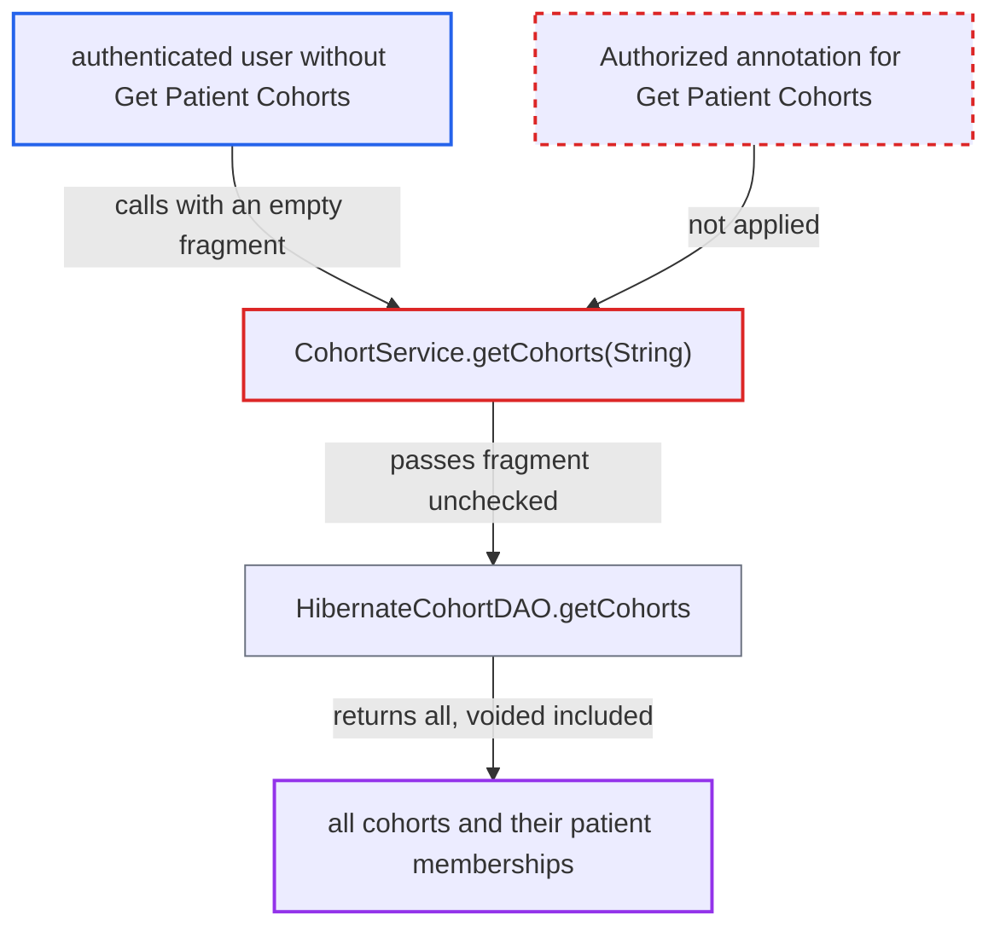

# CohortService.getCohorts(nameFragment) lists all cohorts and memberships with no @Authorized

| Field | Value |
|---|---|
| ID | `find_01CVUsfxhJqzm1ewfA7abpWd` |
| Severity | **Medium** |
| Status | open |
| CWE | CWE-862 — Missing authorization |
| Created | 2026-10-21T22:53:09.769607Z |
| Claude Security | https://claude.ai/security/findings/find_01CVUsfxhJqzm1ewfA7abpWd |

## Description

A user who lacks the `Get Patient Cohorts` privilege can list every cohort, voided ones included, and read each cohort's members (patient ids and dates). This is protected health information. The report says even an unauthenticated context passes the check. The cause is that `CohortService.getCohorts(String nameFragment)` has no `@Authorized` annotation, so `AuthorizationAdvice` runs no check.

1. **authenticated user without `Get Patient Cohorts`** calls `getCohorts` with an empty fragment. The call is `Context.getCohortService().getCohorts("")`, made through any consumer of the service API, such as a module or a REST search. ([`api/src/main/java/org/openmrs/api/CohortService.java:134-144`](https://github.com/cx-benchmark/openmrs-core/blob/e6a1b3374ef040e8821dbe4bacc1bdcb50fa4d29/api/src/main/java/org/openmrs/api/CohortService.java#L134-L144))
2. **the advice `AuthorizationAdvice.before`** lets the call through without any check. It reads `@Authorized` from the invoked interface method. The method has none, so no privilege or authentication check runs. ([`api/src/main/java/org/openmrs/aop/AuthorizationAdvice.java:58-99`](https://github.com/cx-benchmark/openmrs-core/blob/e6a1b3374ef040e8821dbe4bacc1bdcb50fa4d29/api/src/main/java/org/openmrs/aop/AuthorizationAdvice.java#L58-L99))
3. **the service `CohortServiceImpl.getCohorts`** passes the fragment straight to the DAO. It does not call `Context.requirePrivilege` either. ([`api/src/main/java/org/openmrs/api/impl/CohortServiceImpl.java:155-159`](https://github.com/cx-benchmark/openmrs-core/blob/e6a1b3374ef040e8821dbe4bacc1bdcb50fa4d29/api/src/main/java/org/openmrs/api/impl/CohortServiceImpl.java#L155-L159))
4. **the DAO `HibernateCohortDAO.getCohorts`** returns every cohort entity. It runs `ilike(name, fragment, ANYWHERE)` with no `voided` filter, so `""` or `"%"` matches all cohorts, voided ones included. ([`api/src/main/java/org/openmrs/api/db/hibernate/HibernateCohortDAO.java:115-120`](https://github.com/cx-benchmark/openmrs-core/blob/e6a1b3374ef040e8821dbe4bacc1bdcb50fa4d29/api/src/main/java/org/openmrs/api/db/hibernate/HibernateCohortDAO.java#L115-L120))
5. **the attacker** reads the members of each returned cohort. Each `Cohort` has a lazy `memberships` set with patient ids and start/end dates, and `getMemberIds()` exposes them too. In web requests `OpenSessionInViewFilter` keeps the session open, so the set can be loaded and serialized. ([`api/src/main/resources/org/openmrs/api/db/hibernate/Cohort.hbm.xml:33-36`](https://github.com/cx-benchmark/openmrs-core/blob/e6a1b3374ef040e8821dbe4bacc1bdcb50fa4d29/api/src/main/resources/org/openmrs/api/db/hibernate/Cohort.hbm.xml#L33-L36))

## Assessment

The attacker is an authenticated user with partial privileges who lacks `Get Patient Cohorts`. The report also says an unauthenticated context is let through, because the advice checks nothing when no annotation is present. They need no user interaction. They call the service through any consumer of the service API, such as a module or a REST search, and then read `getMemberships()` or `getMemberIds()` on each result. The threat model says the server is reachable only from an internal network. A `null` fragment does not work, because it becomes `%null%` and does not match everything, despite what the Javadoc says.

Impact: The attacker reads the name, description and full membership (patient ids and dates) of every cohort, voided ones included. This discloses which patients belong to which clinical groups. The attack is read-only and changes nothing.

## Recommendation

`CohortService.getCohorts(String)` lacks the `@Authorized(GET_PATIENT_COHORTS)` annotation that every other cohort read carries. `AuthorizationAdvice` therefore enforces nothing for it.

Fix criteria: `getCohorts(String)` requires `Get Patient Cohorts`. A caller without the privilege, or an unauthenticated one, gets `APIAuthenticationException` before the DAO query runs and receives no cohort or membership data. A caller with the privilege sees unchanged results.

## Evidence

**https://github.com/cx-benchmark/openmrs-core**

- [`api/src/main/java/org/openmrs/api/CohortService.java:134-144`](https://github.com/cx-benchmark/openmrs-core/blob/e6a1b3374ef040e8821dbe4bacc1bdcb50fa4d29/api/src/main/java/org/openmrs/api/CohortService.java#L134-L144)
- [`api/src/main/java/org/openmrs/aop/AuthorizationAdvice.java:58-99`](https://github.com/cx-benchmark/openmrs-core/blob/e6a1b3374ef040e8821dbe4bacc1bdcb50fa4d29/api/src/main/java/org/openmrs/aop/AuthorizationAdvice.java#L58-L99)
- [`api/src/main/java/org/openmrs/api/impl/CohortServiceImpl.java:155-159`](https://github.com/cx-benchmark/openmrs-core/blob/e6a1b3374ef040e8821dbe4bacc1bdcb50fa4d29/api/src/main/java/org/openmrs/api/impl/CohortServiceImpl.java#L155-L159)
- [`api/src/main/java/org/openmrs/api/db/hibernate/HibernateCohortDAO.java:115-120`](https://github.com/cx-benchmark/openmrs-core/blob/e6a1b3374ef040e8821dbe4bacc1bdcb50fa4d29/api/src/main/java/org/openmrs/api/db/hibernate/HibernateCohortDAO.java#L115-L120)
- [`api/src/main/resources/org/openmrs/api/db/hibernate/Cohort.hbm.xml:33-36`](https://github.com/cx-benchmark/openmrs-core/blob/e6a1b3374ef040e8821dbe4bacc1bdcb50fa4d29/api/src/main/resources/org/openmrs/api/db/hibernate/Cohort.hbm.xml#L33-L36)

