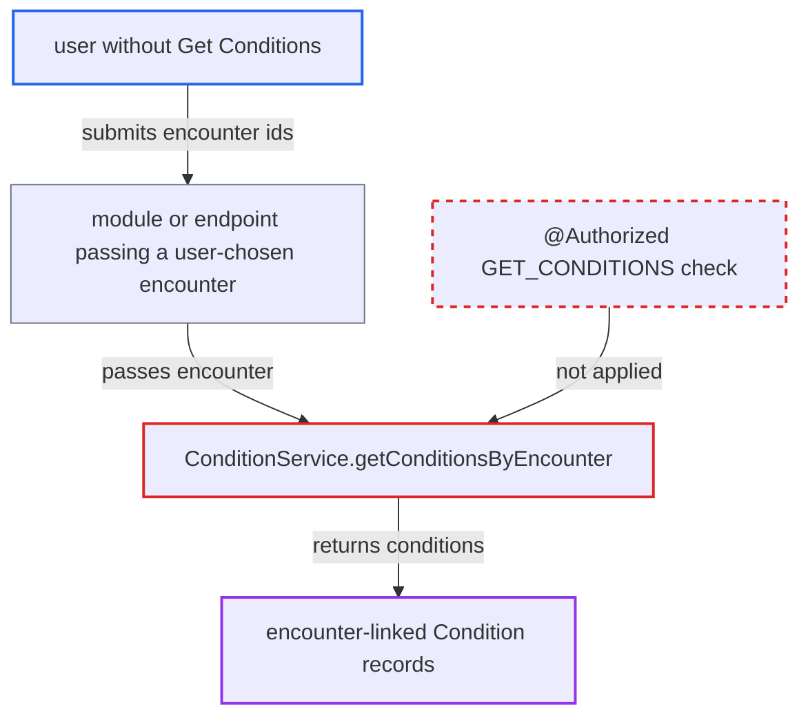

# ConditionService.getConditionsByEncounter returns patient conditions without any privilege check

| Field | Value |
|---|---|
| ID | `find_01Y3bLPPQKBq4kd5yQYC8GTK` |
| Severity | **Medium** |
| Status | open |
| CWE | CWE-862 — Missing authorization |
| Created | 2026-10-21T22:55:31.361018Z |
| Claude Security | https://claude.ai/security/findings/find_01Y3bLPPQKBq4kd5yQYC8GTK |

## Description

Any caller, including a logged-in user without `Get Conditions` or `Get Encounters`, can read the non-voided condition records of any encounter id. The records hold the diagnosis, clinical status, onset and linked patient. Core has no caller of the method, so this needs a module that passes a user-chosen encounter to it. The cause is that `ConditionService.getConditionsByEncounter` has no `@Authorized` annotation.

1. **attacker** submits encounter ids one by one to a module or endpoint that passes the requested encounter to the service. The report says core has no such caller, so this depends on a module in the deployment. A bare `new Encounter(id)` is enough, and the encounter does not have to be loaded through `EncounterService`.
2. **the interface `ConditionService`** declares `getConditionsByEncounter(Encounter)` without `@Authorized`. The neighbouring getters require `GET_CONDITIONS`, but this one requires nothing. ([`api/src/main/java/org/openmrs/api/ConditionService.java:58-66`](https://github.com/cx-benchmark/openmrs-core/blob/e6a1b3374ef040e8821dbe4bacc1bdcb50fa4d29/api/src/main/java/org/openmrs/api/ConditionService.java#L58-L66))
3. **the advice `AuthorizationAdvice.before`** lets the call through without any check. It enforces only annotations on the invoked interface method. With no annotation it does not even require an authenticated user. ([`api/src/main/java/org/openmrs/aop/AuthorizationAdvice.java:58-99`](https://github.com/cx-benchmark/openmrs-core/blob/e6a1b3374ef040e8821dbe4bacc1bdcb50fa4d29/api/src/main/java/org/openmrs/aop/AuthorizationAdvice.java#L58-L99))
4. **the implementation `ConditionServiceImpl.getConditionsByEncounter`** passes the call straight to the DAO. It makes no `Context.requirePrivilege` call and no view-privilege check for the encounter's type. ([`api/src/main/java/org/openmrs/api/impl/ConditionServiceImpl.java:93-96`](https://github.com/cx-benchmark/openmrs-core/blob/e6a1b3374ef040e8821dbe4bacc1bdcb50fa4d29/api/src/main/java/org/openmrs/api/impl/ConditionServiceImpl.java#L93-L96))
5. **the DAO `HibernateConditionDAO.getConditionsByEncounter`** queries conditions by encounter id and returns them. The query filters only on `encounter.getId()`, so the caller gets the conditions of whatever encounter id was supplied. ([`api/src/main/java/org/openmrs/api/db/hibernate/HibernateConditionDAO.java:76-81`](https://github.com/cx-benchmark/openmrs-core/blob/e6a1b3374ef040e8821dbe4bacc1bdcb50fa4d29/api/src/main/java/org/openmrs/api/db/hibernate/HibernateConditionDAO.java#L76-L81))

## Assessment

The attacker is a logged-in user without `Get Conditions`, for example one with only partial privileges. The report places the attacker on the internal network. It also lists users without `Get Encounters` and users barred from the encounter's type, whose `getEncounter` call would throw. The attack needs a module or endpoint that passes a requested encounter to `ConditionService.getConditionsByEncounter`. Core has no such caller. The attacker then tries encounter ids one by one. Because no annotation is present, `AuthorizationAdvice.before` does not even require an authenticated user. A user who holds `Get Encounters` and can view the encounter can already read the same data through the lazily loaded `Encounter.getConditions()` collection.

Impact: The attacker can read the non-voided condition records of every encounter id they enumerate. This bypasses both `Get Conditions` and the encounter-type view privileges. Conditions recorded without an encounter are not exposed, and nothing can be modified.

## Recommendation

`ConditionService.getConditionsByEncounter` has none of the privilege enforcement that every other condition read carries. It also does not apply the encounter's view privilege.

Fix criteria: The method requires `Get Conditions`, like the other condition getters. It refuses, or returns nothing, for encounters whose type's view privilege the caller lacks, consistent with `EncounterService.getEncounter`. A user without `Get Conditions` gets `APIAuthenticationException` when calling it with a valid encounter id. An unauthenticated context gets the same exception.

## Evidence

**https://github.com/cx-benchmark/openmrs-core**

- [`api/src/main/java/org/openmrs/api/ConditionService.java:58-66`](https://github.com/cx-benchmark/openmrs-core/blob/e6a1b3374ef040e8821dbe4bacc1bdcb50fa4d29/api/src/main/java/org/openmrs/api/ConditionService.java#L58-L66)
- [`api/src/main/java/org/openmrs/api/impl/ConditionServiceImpl.java:93-96`](https://github.com/cx-benchmark/openmrs-core/blob/e6a1b3374ef040e8821dbe4bacc1bdcb50fa4d29/api/src/main/java/org/openmrs/api/impl/ConditionServiceImpl.java#L93-L96)
- [`api/src/main/java/org/openmrs/aop/AuthorizationAdvice.java:58-99`](https://github.com/cx-benchmark/openmrs-core/blob/e6a1b3374ef040e8821dbe4bacc1bdcb50fa4d29/api/src/main/java/org/openmrs/aop/AuthorizationAdvice.java#L58-L99)
- [`api/src/main/java/org/openmrs/api/db/hibernate/HibernateConditionDAO.java:76-81`](https://github.com/cx-benchmark/openmrs-core/blob/e6a1b3374ef040e8821dbe4bacc1bdcb50fa4d29/api/src/main/java/org/openmrs/api/db/hibernate/HibernateConditionDAO.java#L76-L81)
- [`api/src/main/java/org/openmrs/api/DiagnosisService.java:83-84`](https://github.com/cx-benchmark/openmrs-core/blob/e6a1b3374ef040e8821dbe4bacc1bdcb50fa4d29/api/src/main/java/org/openmrs/api/DiagnosisService.java#L83-L84)

