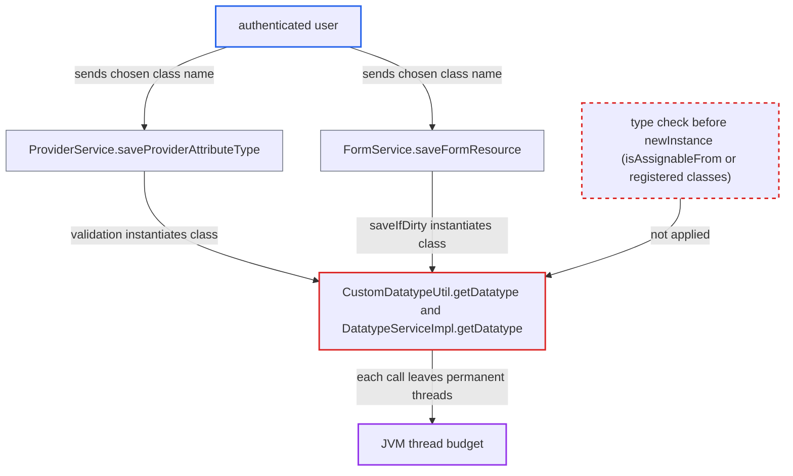

# Datatype class names instantiated before type check let users leak permanent JVM threads

| Field | Value |
|---|---|
| ID | `find_01EY3zVe8AiTWiYffS88FDmv` |
| Severity | **Medium** |
| Status | open |
| CWE | CWE-470 — Unsafe reflection |
| Created | 2026-10-21T23:25:28.064449Z |
| Claude Security | https://claude.ai/security/findings/find_01EY3zVe8AiTWiYffS88FDmv |

## Description

An authenticated user can leave permanent background threads running in the OpenMRS server, one or two per request. A scripted loop exhausts the thread budget and stops OpenMRS for every user until restart. No data is read or changed. The attacker needs a login and a module that forwards API calls. `CustomDatatypeUtil.getDatatype` and `getHandler` create an object from a caller-supplied class name before checking its type.

1. **authenticated user** calls a save method with a chosen class name. The call is `ProviderService.saveProviderAttributeType` or `FormService.saveFormResource`, with `datatypeClassname` set to `sun.print.UnixPrintServiceLookup` on JDK 8. Neither method has `@Authorized`. ([`api/src/main/java/org/openmrs/api/ProviderService.java:254-261`](https://github.com/cx-benchmark/openmrs-core/blob/e6a1b3374ef040e8821dbe4bacc1bdcb50fa4d29/api/src/main/java/org/openmrs/api/ProviderService.java#L254-L261))
2. **the interceptor `RequiredDataAdvice`** validates the save argument before the method body runs. For `ProviderAttributeType`, validation reaches `BaseAttributeTypeValidator`, which instantiates the datatype at line 71 and again at line 86. When the datatype is valid, it instantiates the handler at line 87 instead. ([`api/src/main/java/org/openmrs/validator/BaseAttributeTypeValidator.java:67-95`](https://github.com/cx-benchmark/openmrs-core/blob/e6a1b3374ef040e8821dbe4bacc1bdcb50fa4d29/api/src/main/java/org/openmrs/validator/BaseAttributeTypeValidator.java#L67-L95))
3. **the method `FormServiceImpl.saveFormResource`** reaches the same code through `CustomDatatypeUtil.saveIfDirty`. This second entry point uses the resource's own `datatypeClassname` and instantiates it once per call. ([`api/src/main/java/org/openmrs/api/impl/FormServiceImpl.java:724-747`](https://github.com/cx-benchmark/openmrs-core/blob/e6a1b3374ef040e8821dbe4bacc1bdcb50fa4d29/api/src/main/java/org/openmrs/api/impl/FormServiceImpl.java#L724-L747))
4. **the method `CustomDatatypeUtil.getDatatype`** loads the named class with `Context.loadClass`. No `isAssignableFrom(CustomDatatype)` check and no allow-list of registered datatype classes comes first. `OpenmrsClassLoader` falls back to the web container loader, so JDK classes resolve by name. ([`api/src/main/java/org/openmrs/customdatatype/CustomDatatypeUtil.java:53-66`](https://github.com/cx-benchmark/openmrs-core/blob/e6a1b3374ef040e8821dbe4bacc1bdcb50fa4d29/api/src/main/java/org/openmrs/customdatatype/CustomDatatypeUtil.java#L53-L66))
5. **the method `DatatypeServiceImpl.getDatatype`** calls `clazz.newInstance()` on the loaded class. The generic is erased, so the cast to `CustomDatatype` happens only after the static initialiser and constructor have run. The `UnixPrintServiceLookup` constructor starts a daemon `PrinterChangeListener` thread. ([`api/src/main/java/org/openmrs/api/impl/DatatypeServiceImpl.java:101-110`](https://github.com/cx-benchmark/openmrs-core/blob/e6a1b3374ef040e8821dbe4bacc1bdcb50fa4d29/api/src/main/java/org/openmrs/api/impl/DatatypeServiceImpl.java#L101-L110))
6. **the `PrinterChangeListener` thread** keeps running after the request ends. It loops, running `refreshServices()` (which forks `lpc`/`lpstat` shell pipelines) and sleeping 120 s, and stops only on an exception. The cast then fails and the caller gets only a validation error or `CustomDatatypeException`. Nothing is persisted, so the call can be repeated.

## Assessment

The attacker is an authenticated user with no special privilege. The report says the server is reachable only from the internal network. They need a module that forwards API calls, such as REST. Two entry points are named: `ProviderService.saveProviderAttributeType`, and `FormService.saveFormResource` with the resource's own `datatypeClassname`. A third route is order and order-group attribute types, writable with `Add Orders`. They have no validator, so the name is stored and instantiated later, when values of that type are saved or decoded. `preferredHandlerClassname` goes through `CustomDatatypeUtil.getHandler` the same way, but a failure there is only logged and the default handler is used. The thread leak depends on the JDK. `sun.print.UnixPrintServiceLookup` is used on JDK 8, the shipped `tomcat:8.5-jdk8-corretto` image. JDK 11 has `sun.print.PrintServiceLookupProvider`, reachable under the default `--illegal-access=permit`. The leak does not happen if `sun.java2d.print.polling=false` is set. JDK 16+ encapsulation blocks this class. The report calls the JDK behaviour an assumption, checked against JDK 21 bytecode. No victim action is needed.

Impact: The attacker can exhaust the process or container thread and memory budget. Tomcat then cannot create threads, and OpenMRS stops serving every user until restart. The instance is dropped at the failed cast, so no data is read or modified and no code execution is established.

## Recommendation

`CustomDatatypeUtil.getDatatype`, `CustomDatatypeUtil.getHandler` and `DatatypeServiceImpl.getDatatype` instantiate a class chosen by a caller-supplied name before checking that it is a `CustomDatatype` or `CustomDatatypeHandler`. Arbitrary constructors and static initialisers on the classpath therefore run, including the one that starts permanent `PrinterChangeListener` threads.

Fix criteria: No constructor or static initialiser of a class outside the registered datatype or handler classes runs because of a name supplied through the API. The type is checked on the `Class` object before `newInstance()`, using `isAssignableFrom` or membership in `getAllDatatypeClasses()` or `getAllHandlerClasses()`. Saving a provider attribute type or form resource named `sun.print.UnixPrintServiceLookup` is rejected. The JVM thread count stays unchanged across repeated attempts.

## Evidence

**https://github.com/cx-benchmark/openmrs-core**

- [`api/src/main/java/org/openmrs/api/impl/DatatypeServiceImpl.java:101-110`](https://github.com/cx-benchmark/openmrs-core/blob/e6a1b3374ef040e8821dbe4bacc1bdcb50fa4d29/api/src/main/java/org/openmrs/api/impl/DatatypeServiceImpl.java#L101-L110)
- [`api/src/main/java/org/openmrs/customdatatype/CustomDatatypeUtil.java:53-66`](https://github.com/cx-benchmark/openmrs-core/blob/e6a1b3374ef040e8821dbe4bacc1bdcb50fa4d29/api/src/main/java/org/openmrs/customdatatype/CustomDatatypeUtil.java#L53-L66)
- [`api/src/main/java/org/openmrs/customdatatype/CustomDatatypeUtil.java:96-112`](https://github.com/cx-benchmark/openmrs-core/blob/e6a1b3374ef040e8821dbe4bacc1bdcb50fa4d29/api/src/main/java/org/openmrs/customdatatype/CustomDatatypeUtil.java#L96-L112)
- [`api/src/main/java/org/openmrs/validator/BaseAttributeTypeValidator.java:67-95`](https://github.com/cx-benchmark/openmrs-core/blob/e6a1b3374ef040e8821dbe4bacc1bdcb50fa4d29/api/src/main/java/org/openmrs/validator/BaseAttributeTypeValidator.java#L67-L95)
- [`api/src/main/java/org/openmrs/validator/ProviderAttributeTypeValidator.java:21-22`](https://github.com/cx-benchmark/openmrs-core/blob/e6a1b3374ef040e8821dbe4bacc1bdcb50fa4d29/api/src/main/java/org/openmrs/validator/ProviderAttributeTypeValidator.java#L21-L22)
- [`api/src/main/java/org/openmrs/aop/RequiredDataAdvice.java:110-128`](https://github.com/cx-benchmark/openmrs-core/blob/e6a1b3374ef040e8821dbe4bacc1bdcb50fa4d29/api/src/main/java/org/openmrs/aop/RequiredDataAdvice.java#L110-L128)
- [`api/src/main/java/org/openmrs/api/ProviderService.java:254-261`](https://github.com/cx-benchmark/openmrs-core/blob/e6a1b3374ef040e8821dbe4bacc1bdcb50fa4d29/api/src/main/java/org/openmrs/api/ProviderService.java#L254-L261)
- [`api/src/main/java/org/openmrs/api/impl/FormServiceImpl.java:724-747`](https://github.com/cx-benchmark/openmrs-core/blob/e6a1b3374ef040e8821dbe4bacc1bdcb50fa4d29/api/src/main/java/org/openmrs/api/impl/FormServiceImpl.java#L724-L747)
- [`api/src/main/java/org/openmrs/util/OpenmrsClassLoader.java:142-175`](https://github.com/cx-benchmark/openmrs-core/blob/e6a1b3374ef040e8821dbe4bacc1bdcb50fa4d29/api/src/main/java/org/openmrs/util/OpenmrsClassLoader.java#L142-L175)
- [`Dockerfile:95`](https://github.com/cx-benchmark/openmrs-core/blob/e6a1b3374ef040e8821dbe4bacc1bdcb50fa4d29/Dockerfile#L95)
- [`.github/workflows/build.yaml:25-27`](https://github.com/cx-benchmark/openmrs-core/blob/e6a1b3374ef040e8821dbe4bacc1bdcb50fa4d29/.github/workflows/build.yaml#L25-L27)

