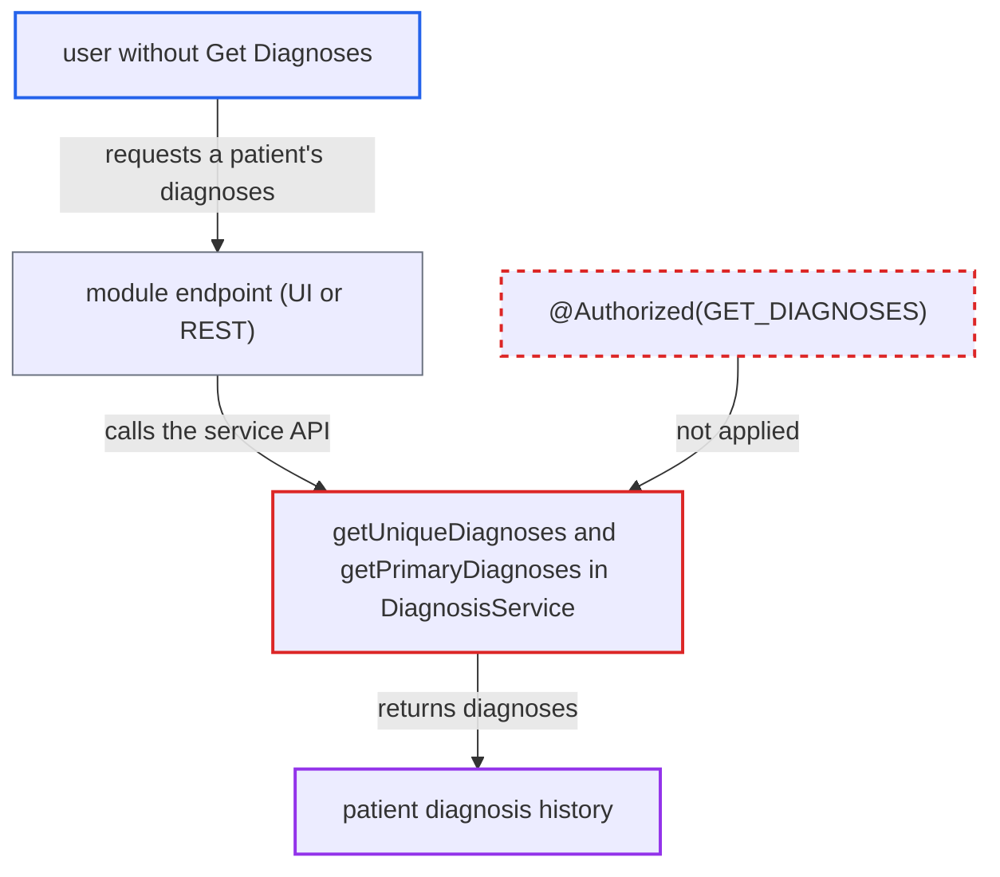

# DiagnosisService exposes patient diagnoses through two methods lacking @Authorized

| Field | Value |
|---|---|
| ID | `find_01S1X1UQbAcCQ9jSYdiJNCpb` |
| Severity | **Medium** |
| Status | open |
| CWE | CWE-862 — Missing authorization |
| Created | 2026-10-21T22:53:04.208731Z |
| Claude Security | https://claude.ai/security/findings/find_01S1X1UQbAcCQ9jSYdiJNCpb |

## Description

A logged-in user without the `Get Diagnoses` privilege can read any patient's diagnosis history, which is sensitive health data. The attack only works if a deployed module exposes a call to the affected methods, because core has none. The cause is that `getUniqueDiagnoses` and `getPrimaryDiagnoses` in `DiagnosisService` carry no `@Authorized` annotation.

1. **attacker** reaches a module endpoint that calls the diagnosis service. The endpoint calls `Context.getDiagnosisService().getUniqueDiagnoses(patient, null)` or `getPrimaryDiagnoses(encounter)`. Core has no caller of either method, so a deployed module (UI or REST) must expose it.
2. **the interface `DiagnosisService`** declares two getters with no `@Authorized` annotation. `getPrimaryDiagnoses(Encounter)` and `getUniqueDiagnoses(Patient, Date)` have no annotation, while the neighbouring getters require `GET_DIAGNOSES`. ([`api/src/main/java/org/openmrs/api/DiagnosisService.java:102-118`](https://github.com/cx-benchmark/openmrs-core/blob/e6a1b3374ef040e8821dbe4bacc1bdcb50fa4d29/api/src/main/java/org/openmrs/api/DiagnosisService.java#L102-L118))
3. **the advice `AuthorizationAdvice.before`** lets the call through without any check. It reads only method-level `@Authorized` attributes. With none present it checks no privilege and does not require authentication. ([`api/src/main/java/org/openmrs/aop/AuthorizationAdvice.java:57-98`](https://github.com/cx-benchmark/openmrs-core/blob/e6a1b3374ef040e8821dbe4bacc1bdcb50fa4d29/api/src/main/java/org/openmrs/aop/AuthorizationAdvice.java#L57-L98))
4. **the implementation `DiagnosisServiceImpl`** fetches the diagnoses and returns them. `getUniqueDiagnoses` calls `getDiagnoses(patient, fromDate)` on `this`, so the call skips the proxy and the `GET_DIAGNOSES` check on `getDiagnoses` never runs. `getPrimaryDiagnoses` calls `diagnosisDAO.getDiagnosesByEncounter` directly. ([`api/src/main/java/org/openmrs/api/impl/DiagnosisServiceImpl.java:111-131`](https://github.com/cx-benchmark/openmrs-core/blob/e6a1b3374ef040e8821dbe4bacc1bdcb50fa4d29/api/src/main/java/org/openmrs/api/impl/DiagnosisServiceImpl.java#L111-L131))

## Assessment

The attacker is an authenticated user on the internal network who lacks `Get Diagnoses`, such as a low-privilege clinical user or one holding only `Get Patients`. The report also says an unauthenticated context passes, because no check runs. A deployed module must expose a call to `getUniqueDiagnoses(patient, null)` or `getPrimaryDiagnoses(encounter)`. That module is the second way in beside the service API itself, because core has no caller.

Impact: The attacker can read any patient's non-voided diagnosis history through `getUniqueDiagnoses`, or an encounter's primary diagnoses through `getPrimaryDiagnoses`. The encounter variant gives less, because a holder of an `Encounter` can already read its diagnoses through `Encounter.getDiagnoses()`. The access is read-only.

## Recommendation

`getPrimaryDiagnoses` and `getUniqueDiagnoses` lack `@Authorized(GET_DIAGNOSES)`. `getUniqueDiagnoses` also relies on a self-invoked annotated method, which the AOP proxy never intercepts.

Fix criteria: Both methods require the same privilege as the other diagnosis getters, enforced on the interface method itself and not through an internal call. A user without `Get Diagnoses` gets `APIAuthenticationException` from each method.

## Evidence

**https://github.com/cx-benchmark/openmrs-core**

- [`api/src/main/java/org/openmrs/api/DiagnosisService.java:102-118`](https://github.com/cx-benchmark/openmrs-core/blob/e6a1b3374ef040e8821dbe4bacc1bdcb50fa4d29/api/src/main/java/org/openmrs/api/DiagnosisService.java#L102-L118)
- [`api/src/main/java/org/openmrs/api/impl/DiagnosisServiceImpl.java:111-131`](https://github.com/cx-benchmark/openmrs-core/blob/e6a1b3374ef040e8821dbe4bacc1bdcb50fa4d29/api/src/main/java/org/openmrs/api/impl/DiagnosisServiceImpl.java#L111-L131)
- [`api/src/main/java/org/openmrs/aop/AuthorizationAdvice.java:57-98`](https://github.com/cx-benchmark/openmrs-core/blob/e6a1b3374ef040e8821dbe4bacc1bdcb50fa4d29/api/src/main/java/org/openmrs/aop/AuthorizationAdvice.java#L57-L98)

