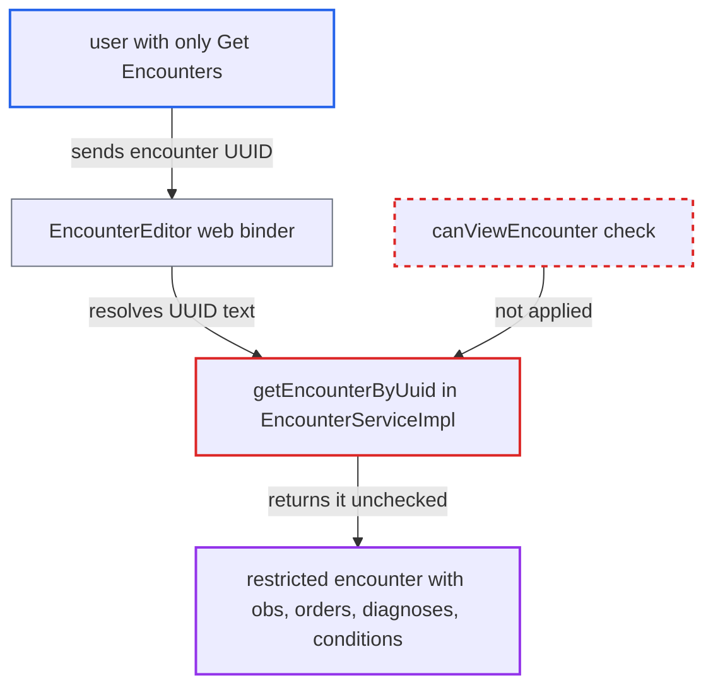

# Encounter lookup by UUID skips the encounter-type view privilege check

| Field | Value |
|---|---|
| ID | `find_01K1UErXxsPTHVeZyQ8wn5Az` |
| Severity | **Medium** |
| Status | open |
| CWE | CWE-862 — Missing authorization |
| Created | 2026-10-21T22:53:48.402043Z |
| Claude Security | https://claude.ai/security/findings/find_01K1UErXxsPTHVeZyQ8wn5Az |

## Description

A signed-in user with only the `Get Encounters` privilege can read encounters of a restricted type, with their observations, orders, diagnoses and conditions, by asking for the encounter's UUID. This matters only where an encounter type has a `viewPrivilege`, which is not the default. The cause is `getEncounterByUuid` in `EncounterServiceImpl`, which skips the `canViewEncounter` check that `getEncounter(Integer)` applies.

1. **authenticated clinical user** learns the UUID of a restricted encounter. The UUID shows up in objects the user can already read, such as `Visit.encounters`, `Obs.encounter` and `Order.encounter`, and none of these are filtered by encounter type.
2. **authenticated clinical user** sends the UUID as a request parameter that binds to an `Encounter`. `EncounterEditor` is registered for every Spring MVC binder, so any controller that takes an `Encounter` parameter accepts it. ([`web/src/main/java/org/openmrs/web/OpenmrsBindingInitializer.java:106`](https://github.com/cx-benchmark/openmrs-core/blob/e6a1b3374ef040e8821dbe4bacc1bdcb50fa4d29/web/src/main/java/org/openmrs/web/OpenmrsBindingInitializer.java#L106))
3. **the property editor `OpenmrsPropertyEditor`** sends the UUID text to `getEncounterByUuid`. Integer text goes to the checked `getEncounter`, but any other text goes to the by-UUID getter, so the same parameter is denied by id and allowed by UUID. ([`api/src/main/java/org/openmrs/propertyeditor/OpenmrsPropertyEditor.java:35-46`](https://github.com/cx-benchmark/openmrs-core/blob/e6a1b3374ef040e8821dbe4bacc1bdcb50fa4d29/api/src/main/java/org/openmrs/propertyeditor/OpenmrsPropertyEditor.java#L35-L46))
4. **the service method `getEncounterByUuid`** returns the encounter straight from `dao.getEncounterByUuid(uuid)`. It never calls `canViewEncounter`, so `EncounterType.viewPrivilege` is not consulted. Only the generic `Get Encounters` privilege is required. ([`api/src/main/java/org/openmrs/api/impl/EncounterServiceImpl.java:630-632`](https://github.com/cx-benchmark/openmrs-core/blob/e6a1b3374ef040e8821dbe4bacc1bdcb50fa4d29/api/src/main/java/org/openmrs/api/impl/EncounterServiceImpl.java#L630-L632))
5. **authenticated clinical user** receives the full `Encounter` entity. The entity includes its lazily loaded `obs`, `orders`, `diagnoses` and `conditions`, although `getEncounter(Integer)` would have refused this user. ([`api/src/main/java/org/openmrs/api/impl/EncounterServiceImpl.java:305-315`](https://github.com/cx-benchmark/openmrs-core/blob/e6a1b3374ef040e8821dbe4bacc1bdcb50fa4d29/api/src/main/java/org/openmrs/api/impl/EncounterServiceImpl.java#L305-L315))

## Assessment

The attacker is an authenticated clinical user who has `Get Encounters` but lacks the `viewPrivilege` set on a sensitive encounter type. The deployment must have set a view privilege on at least one encounter type, and none is set by default. The attacker gets the encounter's UUID from an object they can read, then requests the encounter by UUID through a consumer of `EncounterService`. One consumer is the web binder through `EncounterEditor`. The other is the REST module's `encounter/{uuid}` resource, which is out of view of the report and assumed to use the same getter. The report's threat model says the system is not reachable from the internet, only from an internal network.

Impact: The attacker can read restricted encounters and their observations, orders, diagnoses and conditions. These are the records the encounter-type privilege exists to protect. Data is not modified and availability is not affected.

## Recommendation

`getEncounterByUuid` returns the encounter without evaluating `EncounterType.viewPrivilege`, unlike `getEncounter(Integer)`. The per-type confidentiality control is therefore enforced inconsistently across the single-encounter getters.

Fix criteria: Every single-encounter getter (`getEncounter`, `getEncounterByUuid` and any future variant) applies the same `canViewEncounter` decision. A user who lacks a type's view privilege is denied that encounter whichever identifier is used. To verify, request a restricted encounter by UUID as a user with only `Get Encounters`, both directly and through `EncounterEditor` binding. Confirm it is refused just as `getEncounter(Integer)` refuses it.

## Evidence

**https://github.com/cx-benchmark/openmrs-core**

- [`api/src/main/java/org/openmrs/api/impl/EncounterServiceImpl.java:630-632`](https://github.com/cx-benchmark/openmrs-core/blob/e6a1b3374ef040e8821dbe4bacc1bdcb50fa4d29/api/src/main/java/org/openmrs/api/impl/EncounterServiceImpl.java#L630-L632)
- [`api/src/main/java/org/openmrs/api/impl/EncounterServiceImpl.java:305-315`](https://github.com/cx-benchmark/openmrs-core/blob/e6a1b3374ef040e8821dbe4bacc1bdcb50fa4d29/api/src/main/java/org/openmrs/api/impl/EncounterServiceImpl.java#L305-L315)
- [`api/src/main/java/org/openmrs/api/impl/EncounterServiceImpl.java:855-873`](https://github.com/cx-benchmark/openmrs-core/blob/e6a1b3374ef040e8821dbe4bacc1bdcb50fa4d29/api/src/main/java/org/openmrs/api/impl/EncounterServiceImpl.java#L855-L873)
- [`api/src/main/java/org/openmrs/api/EncounterService.java:80-101`](https://github.com/cx-benchmark/openmrs-core/blob/e6a1b3374ef040e8821dbe4bacc1bdcb50fa4d29/api/src/main/java/org/openmrs/api/EncounterService.java#L80-L101)
- [`api/src/main/java/org/openmrs/propertyeditor/OpenmrsPropertyEditor.java:35-46`](https://github.com/cx-benchmark/openmrs-core/blob/e6a1b3374ef040e8821dbe4bacc1bdcb50fa4d29/api/src/main/java/org/openmrs/propertyeditor/OpenmrsPropertyEditor.java#L35-L46)
- [`web/src/main/java/org/openmrs/web/OpenmrsBindingInitializer.java:106`](https://github.com/cx-benchmark/openmrs-core/blob/e6a1b3374ef040e8821dbe4bacc1bdcb50fa4d29/web/src/main/java/org/openmrs/web/OpenmrsBindingInitializer.java#L106)

