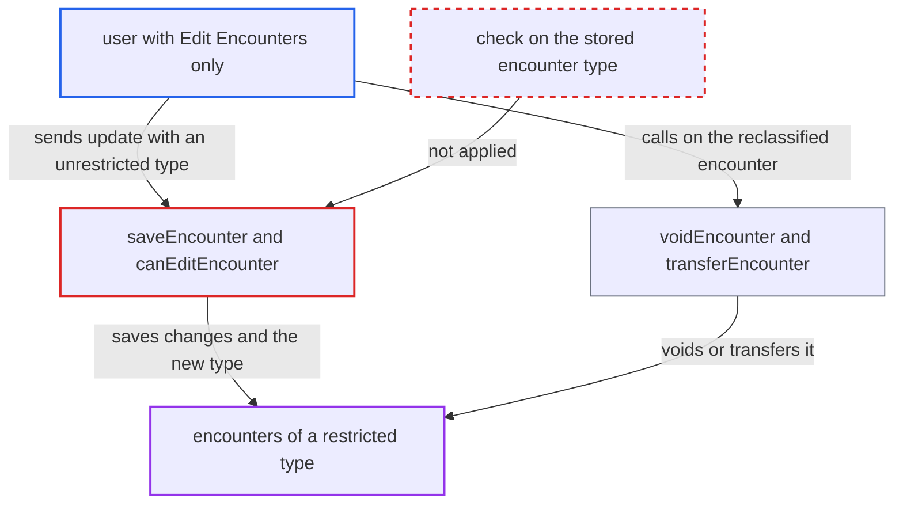

# Encounter-type edit privilege checked against caller-supplied new type, allowing reclassification bypass

| Field | Value |
|---|---|
| ID | `find_016ArLo18CZdKFbeNVf4WRDy` |
| Severity | **Medium** |
| Status | open |
| CWE | CWE-807 — Untrusted input in security decision |
| Created | 2026-10-21T22:54:33.315251Z |
| Claude Security | https://claude.ai/security/findings/find_016ArLo18CZdKFbeNVf4WRDy |

## Description

A logged-in user with the generic `Edit Encounters` privilege can change, void, unvoid or transfer encounters of a restricted type, even without that type's own edit privilege. This works only if the deployment has set an `editPrivilege` on some encounter type (the default is null). The edit check in `saveEncounter` reads the type from the object the caller supplies, so the caller can first switch it to an unrestricted type.

1. **attacker** takes the UUID of an encounter of a restricted type. The attacker holds `Edit Encounters` but not that type's `editPrivilege`. The UUID may be visible through a view-only privilege or obtained otherwise, because `getEncounterByUuid` does no view check.
2. **attacker** submits an update that sets `encounterType` to an unrestricted type. The update also carries any other changes. The report assumes the REST module applies a client-supplied `encounterType` to the loaded entity before calling `saveEncounter`, but that module is not in this repository.
3. **the method `saveEncounter`** runs the per-type edit check on the in-memory encounter. `failIfDeniedToEdit` calls `canEditEncounter`, which reads `encounter.getEncounterType().getEditPrivilege()` from the object passed in, not from the stored encounter. The stored type is never re-read, only `encounterDatetime` and `location`. ([`api/src/main/java/org/openmrs/api/impl/EncounterServiceImpl.java:95-166`](https://github.com/cx-benchmark/openmrs-core/blob/e6a1b3374ef040e8821dbe4bacc1bdcb50fa4d29/api/src/main/java/org/openmrs/api/impl/EncounterServiceImpl.java#L95-L166))
4. **the method `userHasEncounterPrivilege`** returns true for the new type. A null `editPrivilege` counts as allowed. `requirePrivilege` then asks only for `Edit Encounters`, which the attacker holds. ([`api/src/main/java/org/openmrs/api/impl/EncounterServiceImpl.java:958-965`](https://github.com/cx-benchmark/openmrs-core/blob/e6a1b3374ef040e8821dbe4bacc1bdcb50fa4d29/api/src/main/java/org/openmrs/api/impl/EncounterServiceImpl.java#L958-L965))
5. **the method `saveOrUpdate` in `HibernateEncounterDAO`** writes the encounter with the new type and all other changes. `encounter_type` is an ordinary updatable `@ManyToOne`, and `EncounterValidator` only requires the type to be non-null. ([`api/src/main/java/org/openmrs/api/db/hibernate/HibernateEncounterDAO.java:72-75`](https://github.com/cx-benchmark/openmrs-core/blob/e6a1b3374ef040e8821dbe4bacc1bdcb50fa4d29/api/src/main/java/org/openmrs/api/db/hibernate/HibernateEncounterDAO.java#L72-L75))
6. **attacker** voids, unvoids or transfers the reclassified encounter. `voidEncounter` and the similar methods use the same in-memory type check, which now passes because the type is unrestricted. The encounter is also no longer filtered out of searches by the old type's `viewPrivilege`. ([`api/src/main/java/org/openmrs/api/impl/EncounterServiceImpl.java:409-416`](https://github.com/cx-benchmark/openmrs-core/blob/e6a1b3374ef040e8821dbe4bacc1bdcb50fa4d29/api/src/main/java/org/openmrs/api/impl/EncounterServiceImpl.java#L409-L416))

## Assessment

The attacker is an authenticated user who holds `Edit Encounters` but not the `editPrivilege` of a restricted encounter type. They need the encounter's UUID, which they may see through a view-only privilege or get otherwise. They also need an API consumer that passes a changed `encounterType` into `saveEncounter`. The report assumes this is the REST encounter update, which is outside this repository. The deployment must have set an `editPrivilege` on some type. The report's threat model says the server is reachable only from the internal network.

Impact: The attacker can make any change to encounters that were limited to specific roles: fields, obs, orders, diagnoses and patient. They can then void, unvoid or transfer them, and the type's restriction is silently removed. The record also shows up in filtered searches for every user. The attacker must already be able to reach the record. Voiding is reversible, so availability is not seriously affected.

## Recommendation

`failIfDeniedToEdit` and `canEditEncounter`, and the void, unvoid and purge checks, decide edit permission on the `encounterType` the caller supplies, not on the type stored for an existing encounter. Changing the type in the same call therefore bypasses the per-type edit privilege.

Fix criteria: For an existing encounter, the edit decision uses the persisted encounter type read from the database. When the type changes, the user must hold the edit privilege of both the old and the new type. To verify, take a user who lacks a restricted type's edit privilege. Load such an encounter, set an unrestricted type, and call `saveEncounter`, `voidEncounter` and `transferEncounter`. Each call must be refused, and the stored type must stay unchanged.

## Evidence

**https://github.com/cx-benchmark/openmrs-core**

- [`api/src/main/java/org/openmrs/api/impl/EncounterServiceImpl.java:223-228`](https://github.com/cx-benchmark/openmrs-core/blob/e6a1b3374ef040e8821dbe4bacc1bdcb50fa4d29/api/src/main/java/org/openmrs/api/impl/EncounterServiceImpl.java#L223-L228)
- [`api/src/main/java/org/openmrs/api/impl/EncounterServiceImpl.java:95-166`](https://github.com/cx-benchmark/openmrs-core/blob/e6a1b3374ef040e8821dbe4bacc1bdcb50fa4d29/api/src/main/java/org/openmrs/api/impl/EncounterServiceImpl.java#L95-L166)
- [`api/src/main/java/org/openmrs/api/impl/EncounterServiceImpl.java:912-927`](https://github.com/cx-benchmark/openmrs-core/blob/e6a1b3374ef040e8821dbe4bacc1bdcb50fa4d29/api/src/main/java/org/openmrs/api/impl/EncounterServiceImpl.java#L912-L927)
- [`api/src/main/java/org/openmrs/api/impl/EncounterServiceImpl.java:958-965`](https://github.com/cx-benchmark/openmrs-core/blob/e6a1b3374ef040e8821dbe4bacc1bdcb50fa4d29/api/src/main/java/org/openmrs/api/impl/EncounterServiceImpl.java#L958-L965)
- [`api/src/main/java/org/openmrs/api/impl/EncounterServiceImpl.java:409-416`](https://github.com/cx-benchmark/openmrs-core/blob/e6a1b3374ef040e8821dbe4bacc1bdcb50fa4d29/api/src/main/java/org/openmrs/api/impl/EncounterServiceImpl.java#L409-L416)
- [`api/src/main/java/org/openmrs/api/db/hibernate/HibernateEncounterDAO.java:72-75`](https://github.com/cx-benchmark/openmrs-core/blob/e6a1b3374ef040e8821dbe4bacc1bdcb50fa4d29/api/src/main/java/org/openmrs/api/db/hibernate/HibernateEncounterDAO.java#L72-L75)
- [`api/src/main/java/org/openmrs/Encounter.java:82-84`](https://github.com/cx-benchmark/openmrs-core/blob/e6a1b3374ef040e8821dbe4bacc1bdcb50fa4d29/api/src/main/java/org/openmrs/Encounter.java#L82-L84)
- [`api/src/main/java/org/openmrs/validator/EncounterValidator.java:75-76`](https://github.com/cx-benchmark/openmrs-core/blob/e6a1b3374ef040e8821dbe4bacc1bdcb50fa4d29/api/src/main/java/org/openmrs/validator/EncounterValidator.java#L75-L76)

