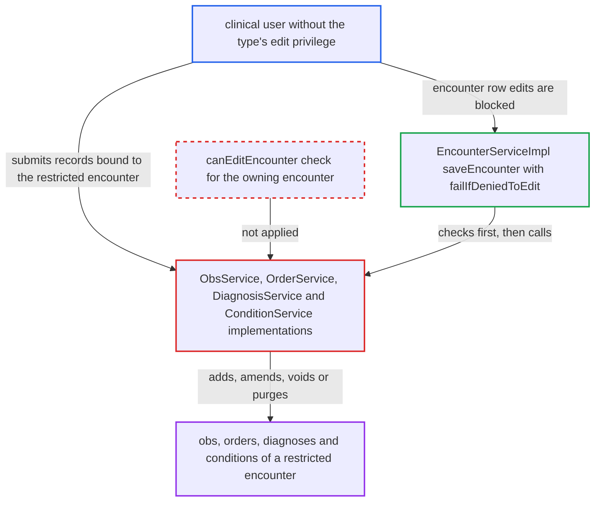

# Encounter-type edit privilege not enforced on obs, order, diagnosis and condition writes

| Field | Value |
|---|---|
| ID | `find_01LQRtV8ugN5DQNnTuyUnXNa` |
| Severity | **Medium** |
| Status | open |
| CWE | CWE-863 — Incorrect authorization |
| Created | 2026-10-21T23:16:50.552697Z |
| Claude Security | https://claude.ai/security/findings/find_01LQRtV8ugN5DQNnTuyUnXNa |

## Description

A clinical user who lacks an encounter type's edit privilege can still add, change, void, unvoid or purge the obs, orders, diagnoses and conditions of a restricted encounter. This only matters where an administrator has set `editPrivilege` on an encounter type, which is not the default. The child-record services check only their generic privileges, and only `EncounterServiceImpl` enforces `editPrivilege`.

1. **administrator** sets `editPrivilege` on an encounter type. The help text says this is the privilege needed to edit encounters of this type, so the restriction is meant to protect them. ([`api/src/main/resources/messages.properties:1130-1131`](https://github.com/cx-benchmark/openmrs-core/blob/e6a1b3374ef040e8821dbe4bacc1bdcb50fa4d29/api/src/main/resources/messages.properties#L1130-L1131))
2. **`EncounterServiceImpl`** enforces the privilege only at its own entry points. `failIfDeniedToEdit` and the inline `canEditEncounter` checks in `saveEncounter`, `voidEncounter`, `unvoidEncounter` and `purgeEncounter` are the only readers of the type's edit privilege in `api/src/main` and `web/src/main`. ([`api/src/main/java/org/openmrs/api/impl/EncounterServiceImpl.java:223-228`](https://github.com/cx-benchmark/openmrs-core/blob/e6a1b3374ef040e8821dbe4bacc1bdcb50fa4d29/api/src/main/java/org/openmrs/api/impl/EncounterServiceImpl.java#L223-L228))
3. **clinical user** submits an obs, order, diagnosis or condition bound to the restricted encounter. The user has the ordinary clinical privileges but not the type's edit privilege, and goes through a module that calls the public service API for them, such as the REST module. The record can be loaded legitimately with view rights, obtained through unfiltered getters, or built against the encounter.
4. **`ObsServiceImpl`** accepts the obs write after a generic privilege check. `saveObs` asks only for `ADD_OBS` or `EDIT_OBS`, `voidObs` and `unvoidObs` need `EDIT_OBS`, and `purgeObs` needs `DELETE_OBS`. None looks at the owning encounter's type. ([`api/src/main/java/org/openmrs/api/impl/ObsServiceImpl.java:91-116`](https://github.com/cx-benchmark/openmrs-core/blob/e6a1b3374ef040e8821dbe4bacc1bdcb50fa4d29/api/src/main/java/org/openmrs/api/impl/ObsServiceImpl.java#L91-L116))
5. **`OrderServiceImpl`** accepts order writes without an encounter-type check. `saveOrder` and `saveRetrospectiveOrder` can add REVISE or DISCONTINUE orders, and `discontinueOrder` sets `dateStopped` on an existing order. `voidOrder` and `unvoidOrder` need only `DELETE_ORDERS`. ([`api/src/main/java/org/openmrs/api/impl/OrderServiceImpl.java:777-813`](https://github.com/cx-benchmark/openmrs-core/blob/e6a1b3374ef040e8821dbe4bacc1bdcb50fa4d29/api/src/main/java/org/openmrs/api/impl/OrderServiceImpl.java#L777-L813))
6. **`DiagnosisServiceImpl` and `ConditionServiceImpl`** persist the diagnosis or condition under generic privileges. `save` and `voidDiagnosis` need `EDIT_DIAGNOSES`, and `saveCondition` needs `EDIT_CONDITIONS`. Neither checks the encounter type. ([`api/src/main/java/org/openmrs/api/impl/DiagnosisServiceImpl.java:43-58`](https://github.com/cx-benchmark/openmrs-core/blob/e6a1b3374ef040e8821dbe4bacc1bdcb50fa4d29/api/src/main/java/org/openmrs/api/impl/DiagnosisServiceImpl.java#L43-L58))
7. **`saveEncounter`** is the only caller that checks the gate before writing child records. It checks the edit privilege at line 98 and then calls the same child services. Calling those services directly skips that gate. ([`api/src/main/java/org/openmrs/api/impl/EncounterServiceImpl.java:95-210`](https://github.com/cx-benchmark/openmrs-core/blob/e6a1b3374ef040e8821dbe4bacc1bdcb50fa4d29/api/src/main/java/org/openmrs/api/impl/EncounterServiceImpl.java#L95-L210))

## Assessment

The attacker is an authenticated clinical user on the internal network. They hold the generic privileges such as `Add Obs` or `Edit Obs`, or the order, diagnosis or condition equivalents. They do not hold the `editPrivilege` of the restricted encounter type. Core's `web/` and `webapp/` contain no caller of these services. Exposure comes through modules that call the public service API for a user, such as the REST module's obs, order, diagnosis and condition resources. The report assumes, but did not see, that these pass through to the service methods. The deployment must have set an `editPrivilege` on at least one encounter type. None is set by default.

Impact: The attacker can add false observations, orders, diagnoses or conditions to encounters restricted to a smaller group. They can also amend, void, stop or purge the existing ones. Obs and condition edits leave version history, but voids, purges and new false entries change the clinical record. The restriction protects only the encounter row itself (datetime, location, provider, type). The report does not rate reading of this data here and treats it as a separate issue.

## Recommendation

Encounter-type edit authorization exists only at the `EncounterService` entry points. `ObsService`, `OrderService`, `DiagnosisService` and `ConditionService` write encounter content without checking the owning encounter's `editPrivilege`.

Fix criteria: Every service operation that creates, modifies, voids, unvoids or purges an obs, order, order group, diagnosis or condition attached to an encounter fails unless the user satisfies `canEditEncounter` for that encounter. When a record is moved between encounters, both encounters are checked. Test: with an encounter type whose `editPrivilege` the caller lacks, `saveObs`, `voidObs`, `purgeObs`, `saveOrder`, `voidOrder`, `discontinueOrder`, `save(Diagnosis)` and `saveCondition` on records of that encounter throw. The same calls made from `saveEncounter` by an authorized user still succeed.

## Evidence

**https://github.com/cx-benchmark/openmrs-core**

- [`api/src/main/java/org/openmrs/api/impl/ObsServiceImpl.java:91-116`](https://github.com/cx-benchmark/openmrs-core/blob/e6a1b3374ef040e8821dbe4bacc1bdcb50fa4d29/api/src/main/java/org/openmrs/api/impl/ObsServiceImpl.java#L91-L116)
- [`api/src/main/java/org/openmrs/api/impl/EncounterServiceImpl.java:223-228`](https://github.com/cx-benchmark/openmrs-core/blob/e6a1b3374ef040e8821dbe4bacc1bdcb50fa4d29/api/src/main/java/org/openmrs/api/impl/EncounterServiceImpl.java#L223-L228)
- [`api/src/main/java/org/openmrs/api/impl/EncounterServiceImpl.java:95-210`](https://github.com/cx-benchmark/openmrs-core/blob/e6a1b3374ef040e8821dbe4bacc1bdcb50fa4d29/api/src/main/java/org/openmrs/api/impl/EncounterServiceImpl.java#L95-L210)
- [`api/src/main/java/org/openmrs/api/impl/OrderServiceImpl.java:777-813`](https://github.com/cx-benchmark/openmrs-core/blob/e6a1b3374ef040e8821dbe4bacc1bdcb50fa4d29/api/src/main/java/org/openmrs/api/impl/OrderServiceImpl.java#L777-L813)
- [`api/src/main/java/org/openmrs/api/impl/OrderServiceImpl.java:487-514`](https://github.com/cx-benchmark/openmrs-core/blob/e6a1b3374ef040e8821dbe4bacc1bdcb50fa4d29/api/src/main/java/org/openmrs/api/impl/OrderServiceImpl.java#L487-L514)
- [`api/src/main/java/org/openmrs/api/impl/DiagnosisServiceImpl.java:43-58`](https://github.com/cx-benchmark/openmrs-core/blob/e6a1b3374ef040e8821dbe4bacc1bdcb50fa4d29/api/src/main/java/org/openmrs/api/impl/DiagnosisServiceImpl.java#L43-L58)
- [`api/src/main/java/org/openmrs/api/impl/ConditionServiceImpl.java:105-140`](https://github.com/cx-benchmark/openmrs-core/blob/e6a1b3374ef040e8821dbe4bacc1bdcb50fa4d29/api/src/main/java/org/openmrs/api/impl/ConditionServiceImpl.java#L105-L140)
- [`api/src/main/resources/messages.properties:1130-1131`](https://github.com/cx-benchmark/openmrs-core/blob/e6a1b3374ef040e8821dbe4bacc1bdcb50fa4d29/api/src/main/resources/messages.properties#L1130-L1131)
- [`api/src/main/java/org/openmrs/EncounterType.java:105-119`](https://github.com/cx-benchmark/openmrs-core/blob/e6a1b3374ef040e8821dbe4bacc1bdcb50fa4d29/api/src/main/java/org/openmrs/EncounterType.java#L105-L119)

