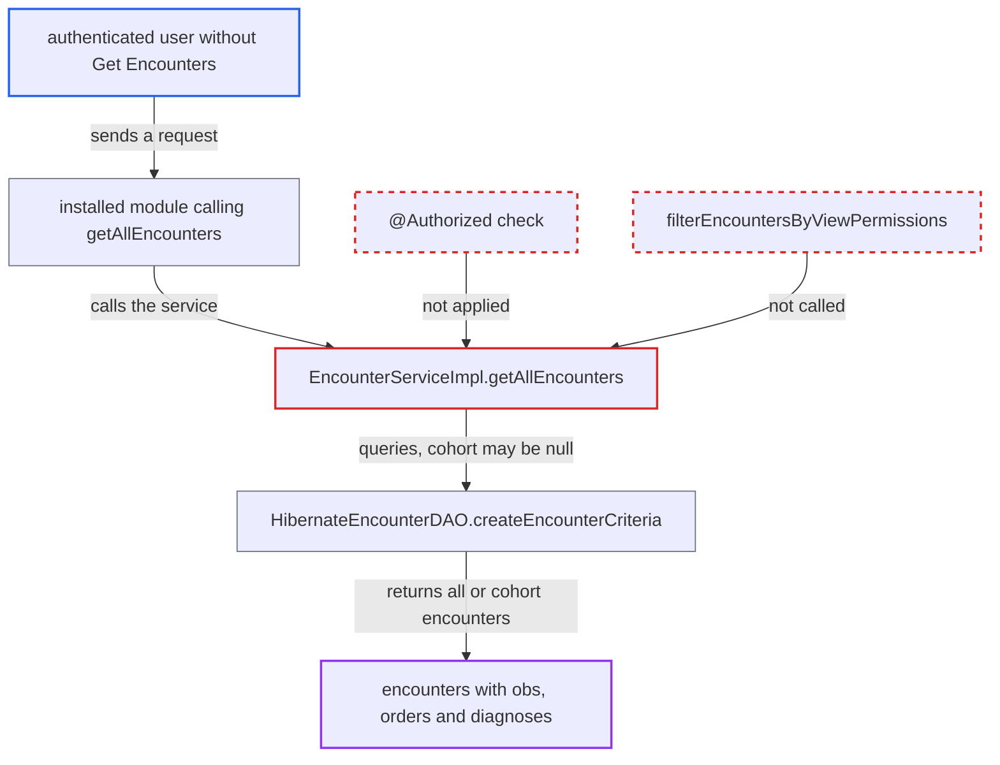

# EncounterService.getAllEncounters(Cohort) returns encounters without privilege or view-type checks

| Field | Value |
|---|---|
| ID | `find_018673DzBhVefBpurJNi4DWp` |
| Severity | **Medium** |
| Status | open |
| CWE | CWE-862 — Missing authorization |
| Created | 2026-10-21T22:53:58.250566Z |
| Claude Security | https://claude.ai/security/findings/find_018673DzBhVefBpurJNi4DWp |

## Description

An authenticated user who lacks `Get Encounters` can read patient encounters, including encounter types restricted by view privilege. With a null cohort this reaches every non-voided encounter in the database. It needs an installed module or consumer that calls `getAllEncounters(Cohort)` for the user's request. The method has no `@Authorized` annotation, and its implementation skips the view-type filter.

1. **authenticated user** sends a request that reaches a module calling `getAllEncounters(Cohort)`. The user holds neither `Get Encounters` nor the view privilege of a restricted encounter type, and core ships no caller, so an installed module or consumer must make the call.
2. **the advice `AuthorizationAdvice.before`** lets the call through without any check. The method has no `@Authorized` annotation, so the advice finds no privileges and enforces neither a privilege nor authentication. ([`api/src/main/java/org/openmrs/aop/AuthorizationAdvice.java:46-99`](https://github.com/cx-benchmark/openmrs-core/blob/e6a1b3374ef040e8821dbe4bacc1bdcb50fa4d29/api/src/main/java/org/openmrs/aop/AuthorizationAdvice.java#L46-L99))
3. **the service method `EncounterServiceImpl.getAllEncounters`** returns `dao.getAllEncounters(patients)` unfiltered. It skips `filterEncountersByViewPermissions`, which the other encounter getters apply, so encounter-type view privileges are ignored. ([`api/src/main/java/org/openmrs/api/impl/EncounterServiceImpl.java:644-650`](https://github.com/cx-benchmark/openmrs-core/blob/e6a1b3374ef040e8821dbe4bacc1bdcb50fa4d29/api/src/main/java/org/openmrs/api/impl/EncounterServiceImpl.java#L644-L650))
4. **the DAO method `createEncounterCriteria`** selects encounters for the cohort, or all of them. It restricts by patient only `if (patients != null)`, so a null cohort selects every non-voided encounter. ([`api/src/main/java/org/openmrs/api/db/hibernate/HibernateEncounterDAO.java:341-356`](https://github.com/cx-benchmark/openmrs-core/blob/e6a1b3374ef040e8821dbe4bacc1bdcb50fa4d29/api/src/main/java/org/openmrs/api/db/hibernate/HibernateEncounterDAO.java#L341-L356))
5. **caller** receives a map from patient id to that patient's `Encounter` list. Each encounter's obs, orders and diagnoses can be reached through lazy collections. ([`api/src/main/java/org/openmrs/api/EncounterService.java:437-445`](https://github.com/cx-benchmark/openmrs-core/blob/e6a1b3374ef040e8821dbe4bacc1bdcb50fa4d29/api/src/main/java/org/openmrs/api/EncounterService.java#L437-L445))

## Assessment

The attacker is an authenticated user on the internal network. They hold neither `Get Encounters` nor the view privilege of a restricted encounter type. Their request must reach an installed module or consumer that calls `Context.getEncounterService().getAllEncounters(cohort)`, because core has no caller outside tests. The call can pass a cohort or a null cohort. The threat model says the server is reachable only from an internal network.

Impact: The caller gets bulk disclosure of encounters, and through their collections the obs, orders and diagnoses, for any cohort or the whole database. This includes encounter types the deployment restricted by view privilege. The method only reads data, so nothing is modified.

## Recommendation

(1) `EncounterService.getAllEncounters(Cohort)` has no `@Authorized` annotation. The authorization advice therefore applies neither a privilege check nor an authentication check to a method that returns patient encounters.

Fix criteria: Calling the method without `Get Encounters`, or without being authenticated, raises `APIAuthenticationException`. The method is guarded like the other encounter getters.

(2) `EncounterServiceImpl.getAllEncounters` returns the DAO results without applying encounter-type view privileges, unlike every other encounter getter.

Fix criteria: A user who lacks an encounter type's `viewPrivilege` does not receive encounters of that type in any patient's list in the returned map. This is verified with a cohort containing patients who have encounters of a restricted type.

## Evidence

**https://github.com/cx-benchmark/openmrs-core**

- [`api/src/main/java/org/openmrs/api/EncounterService.java:437-445`](https://github.com/cx-benchmark/openmrs-core/blob/e6a1b3374ef040e8821dbe4bacc1bdcb50fa4d29/api/src/main/java/org/openmrs/api/EncounterService.java#L437-L445)
- [`api/src/main/java/org/openmrs/api/impl/EncounterServiceImpl.java:644-650`](https://github.com/cx-benchmark/openmrs-core/blob/e6a1b3374ef040e8821dbe4bacc1bdcb50fa4d29/api/src/main/java/org/openmrs/api/impl/EncounterServiceImpl.java#L644-L650)
- [`api/src/main/java/org/openmrs/api/db/hibernate/HibernateEncounterDAO.java:341-356`](https://github.com/cx-benchmark/openmrs-core/blob/e6a1b3374ef040e8821dbe4bacc1bdcb50fa4d29/api/src/main/java/org/openmrs/api/db/hibernate/HibernateEncounterDAO.java#L341-L356)
- [`api/src/main/java/org/openmrs/aop/AuthorizationAdvice.java:46-99`](https://github.com/cx-benchmark/openmrs-core/blob/e6a1b3374ef040e8821dbe4bacc1bdcb50fa4d29/api/src/main/java/org/openmrs/aop/AuthorizationAdvice.java#L46-L99)
- [`api/src/main/java/org/openmrs/api/impl/EncounterServiceImpl.java:855-873`](https://github.com/cx-benchmark/openmrs-core/blob/e6a1b3374ef040e8821dbe4bacc1bdcb50fa4d29/api/src/main/java/org/openmrs/api/impl/EncounterServiceImpl.java#L855-L873)

