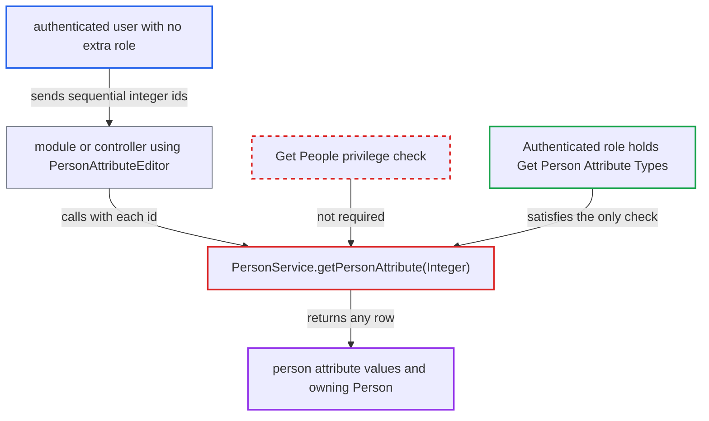

# getPersonAttribute(Integer) guarded by metadata privilege held by every authenticated user

| Field | Value |
|---|---|
| ID | `find_01PHVRd4GU2Q9iVtcy4sEEuj` |
| Severity | **Medium** |
| Status | open |
| CWE | CWE-863 — Incorrect authorization |
| Created | 2026-10-21T22:54:03.773082Z |
| Claude Security | https://claude.ai/security/findings/find_01PHVRd4GU2Q9iVtcy4sEEuj |

## Description

Any logged-in user can read every person attribute value, such as phone number, birthplace, civil status and mother's name, plus the owning person. This does not need `Get People`. It needs an installed module or controller that calls `getPersonAttribute(Integer)` or binds a `PersonAttribute` parameter. The method is guarded only by the metadata privilege `Get Person Attribute Types`, which the `Authenticated` role holds by default. Access is read only.

1. **authenticated user** sends sequential integer ids to a module or controller that reaches `getPersonAttribute(Integer)`. Core maps no HTTP endpoint that calls it, so this goes through a module, or a controller that binds a `PersonAttribute` parameter through `PersonAttributeEditor`, which resolves a numeric value with `getPersonAttribute(id)`. ([`api/src/main/java/org/openmrs/propertyeditor/PersonAttributeEditor.java:26-33`](https://github.com/cx-benchmark/openmrs-core/blob/e6a1b3374ef040e8821dbe4bacc1bdcb50fa4d29/api/src/main/java/org/openmrs/propertyeditor/PersonAttributeEditor.java#L26-L33))
2. **the method `getPersonAttribute(Integer id)`** requires only `Get Person Attribute Types`. This is a metadata privilege for attribute types, not for person data, and the shipped core data grants it to the built-in `Authenticated` role. ([`api/src/main/java/org/openmrs/api/PersonService.java:277-278`](https://github.com/cx-benchmark/openmrs-core/blob/e6a1b3374ef040e8821dbe4bacc1bdcb50fa4d29/api/src/main/java/org/openmrs/api/PersonService.java#L277-L278))
3. **`UserContext.hasPrivilege`** returns true for the user through the `Authenticated` role. Every logged-in user gets that role's privileges, so a user with no assigned role passes. ([`api/src/main/java/org/openmrs/api/context/UserContext.java:324-333`](https://github.com/cx-benchmark/openmrs-core/blob/e6a1b3374ef040e8821dbe4bacc1bdcb50fa4d29/api/src/main/java/org/openmrs/api/context/UserContext.java#L324-L333))
4. **`AuthorizationAdvice.before`** lets the call through. The advice passes when the user holds any one of the listed privileges, so the metadata privilege is enough. ([`api/src/main/java/org/openmrs/aop/AuthorizationAdvice.java:58-80`](https://github.com/cx-benchmark/openmrs-core/blob/e6a1b3374ef040e8821dbe4bacc1bdcb50fa4d29/api/src/main/java/org/openmrs/aop/AuthorizationAdvice.java#L58-L80))
5. **`PersonServiceImpl.getPersonAttribute`** returns `dao.getPersonAttribute(id)` with no further check. `HibernatePersonDAO.getPersonAttribute` runs `session.get(PersonAttribute.class, id)`, which returns the row with its `value` and its owning `Person` for any integer id. ([`api/src/main/java/org/openmrs/api/impl/PersonServiceImpl.java:251-253`](https://github.com/cx-benchmark/openmrs-core/blob/e6a1b3374ef040e8821dbe4bacc1bdcb50fa4d29/api/src/main/java/org/openmrs/api/impl/PersonServiceImpl.java#L251-L253))

## Assessment

The attacker is any authenticated user. No assigned role is needed, because the default `Authenticated` role already carries `Get Person Attribute Types`. The attacker needs a consumer of `PersonService.getPersonAttribute(Integer)`. That is either module code that calls it, or a controller that binds a `PersonAttribute` parameter through the shared `PersonAttributeEditor`. Core maps no HTTP endpoint that calls the method, so an installed module that exposes it is needed. The report's threat model is an internal network only. Because ids are sequential integers, the attacker can walk the whole `person_attribute` table. A UUID value goes through `getPersonAttributeByUuid`, which requires `Get People`, so only the numeric path is open.

Impact: Users who lack `Get People` can read every person attribute value and the owning `Person`, including names, gender and birthdate reachable through it. This is bulk disclosure of patient data. The access is read only, with no modification or denial of service.

## Recommendation

`PersonService.getPersonAttribute(Integer)` is guarded by the attribute-type metadata privilege. The default `Authenticated` role holds that privilege, so every logged-in user can read person attribute values and their owning person.

Fix criteria: Reading a `PersonAttribute` by integer id requires the same privilege as `getPersonAttributeByUuid`, which is `Get People`. A user whose only privileges come from the `Authenticated` role, or who holds only `Get Person Attribute Types`, gets `APIAuthenticationException` from `getPersonAttribute(id)`. Binding a numeric value through `PersonAttributeEditor` enforces the same privilege as binding a UUID.

## Evidence

**https://github.com/cx-benchmark/openmrs-core**

- [`api/src/main/java/org/openmrs/api/PersonService.java:277-278`](https://github.com/cx-benchmark/openmrs-core/blob/e6a1b3374ef040e8821dbe4bacc1bdcb50fa4d29/api/src/main/java/org/openmrs/api/PersonService.java#L277-L278)
- [`api/src/main/resources/org/openmrs/liquibase/snapshots/core-data/liquibase-core-data-2.5.x.xml:5054-5057`](https://github.com/cx-benchmark/openmrs-core/blob/e6a1b3374ef040e8821dbe4bacc1bdcb50fa4d29/api/src/main/resources/org/openmrs/liquibase/snapshots/core-data/liquibase-core-data-2.5.x.xml#L5054-L5057)
- [`api/src/main/java/org/openmrs/api/context/UserContext.java:324-333`](https://github.com/cx-benchmark/openmrs-core/blob/e6a1b3374ef040e8821dbe4bacc1bdcb50fa4d29/api/src/main/java/org/openmrs/api/context/UserContext.java#L324-L333)
- [`api/src/main/java/org/openmrs/aop/AuthorizationAdvice.java:58-80`](https://github.com/cx-benchmark/openmrs-core/blob/e6a1b3374ef040e8821dbe4bacc1bdcb50fa4d29/api/src/main/java/org/openmrs/aop/AuthorizationAdvice.java#L58-L80)
- [`api/src/main/java/org/openmrs/api/impl/PersonServiceImpl.java:251-253`](https://github.com/cx-benchmark/openmrs-core/blob/e6a1b3374ef040e8821dbe4bacc1bdcb50fa4d29/api/src/main/java/org/openmrs/api/impl/PersonServiceImpl.java#L251-L253)
- [`api/src/main/java/org/openmrs/api/db/hibernate/HibernatePersonDAO.java:343-345`](https://github.com/cx-benchmark/openmrs-core/blob/e6a1b3374ef040e8821dbe4bacc1bdcb50fa4d29/api/src/main/java/org/openmrs/api/db/hibernate/HibernatePersonDAO.java#L343-L345)
- [`api/src/main/java/org/openmrs/api/PersonService.java:610-644`](https://github.com/cx-benchmark/openmrs-core/blob/e6a1b3374ef040e8821dbe4bacc1bdcb50fa4d29/api/src/main/java/org/openmrs/api/PersonService.java#L610-L644)
- [`api/src/main/java/org/openmrs/propertyeditor/PersonAttributeEditor.java:26-33`](https://github.com/cx-benchmark/openmrs-core/blob/e6a1b3374ef040e8821dbe4bacc1bdcb50fa4d29/api/src/main/java/org/openmrs/propertyeditor/PersonAttributeEditor.java#L26-L33)

