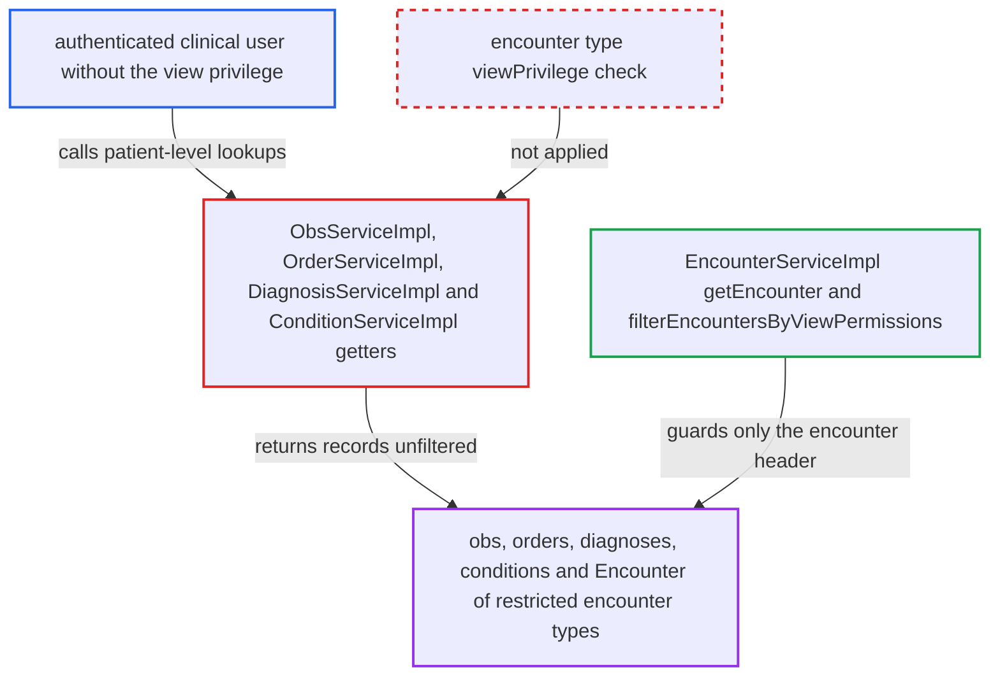

# Obs, order, diagnosis and condition getters ignore encounter-type view privileges

| Field | Value |
|---|---|
| ID | `find_012Z1h67fCaQpdvCeNMCG364` |
| Severity | **Medium** |
| Status | open |
| CWE | CWE-863 — Incorrect authorization |
| Created | 2026-10-21T22:58:55.242471Z |
| Claude Security | https://claude.ai/security/findings/find_012Z1h67fCaQpdvCeNMCG364 |

## Description

A logged-in clinical user who lacks an encounter type's view privilege can still read that type's observations, orders, diagnoses and conditions. They can also read the restricted `Encounter` itself. This matters only where an administrator has set `viewPrivilege` on an encounter type, which is not the default. The obs, order, diagnosis and condition services check only the generic privilege and never the encounter type's `viewPrivilege`.

1. **administrator** sets `viewPrivilege` on an encounter type. The type is something like an HIV clinic or mental health type. The help text says only users with that privilege can view encounters of this type. ([`api/src/main/resources/messages.properties:1128-1129`](https://github.com/cx-benchmark/openmrs-core/blob/e6a1b3374ef040e8821dbe4bacc1bdcb50fa4d29/api/src/main/resources/messages.properties#L1128-L1129))
2. **the encounter service `EncounterServiceImpl`** hides restricted encounters from users without the privilege. `getEncounter(Integer)` throws, and the list getters pass through `filterEncountersByViewPermissions`. Only encounter headers returned by this service are protected. ([`api/src/main/java/org/openmrs/api/impl/EncounterServiceImpl.java:855-873`](https://github.com/cx-benchmark/openmrs-core/blob/e6a1b3374ef040e8821dbe4bacc1bdcb50fa4d29/api/src/main/java/org/openmrs/api/impl/EncounterServiceImpl.java#L855-L873))
3. **authenticated clinical user** calls a patient-level lookup through a module that uses the service API. The user holds `Get Observations`, `Get Orders`, `Get Diagnoses` or `Get Conditions` but not the encounter type's view privilege. An example is `getObservationsByPerson(patient)` or its order, diagnosis and condition equivalents.
4. **the getters in `ObsServiceImpl`, `OrderServiceImpl`, `DiagnosisServiceImpl` and `ConditionServiceImpl`** pass the generic privilege check and return the DAO result unfiltered. No code drops records whose `encounter.encounterType.viewPrivilege` the caller lacks. The only interceptors on these services are authorization, required-data, logging and cache advice. ([`api/src/main/java/org/openmrs/api/impl/ObsServiceImpl.java:336-373`](https://github.com/cx-benchmark/openmrs-core/blob/e6a1b3374ef040e8821dbe4bacc1bdcb50fa4d29/api/src/main/java/org/openmrs/api/impl/ObsServiceImpl.java#L336-L373))
5. **authenticated clinical user** receives records from restricted encounters, with the `encounter` reference. Each returned `Obs`, `Order` and `Diagnosis` holds the mapped `encounter` association. The restricted `Encounter` entity therefore reaches the caller too. ([`api/src/main/java/org/openmrs/api/impl/OrderServiceImpl.java:555-584`](https://github.com/cx-benchmark/openmrs-core/blob/e6a1b3374ef040e8821dbe4bacc1bdcb50fa4d29/api/src/main/java/org/openmrs/api/impl/OrderServiceImpl.java#L555-L584))

## Assessment

The attacker is an authenticated clinical user on the internal network. They hold the generic read privileges (`Get Observations`, `Get Orders`, `Get Diagnoses`, `Get Conditions`) but not the view privilege of a restricted encounter type. At least one encounter type must have a `viewPrivilege` set, and none has one by default. Core's `web/` module has no caller of these getters. The exposure comes through modules that call this public service API for users, such as the REST module's obs and order resources. The report assumes those resources call the getters without their own filtering. A caller can also pass a restricted `Encounter`, or a bare `new Encounter(id)`, as the `encounters` filter. Single-record lookups such as `getObs`, `getObsByUuid`, `getOrder` and `getOrderByUuid` are also unchecked.

Impact: The attacker can read clinical content (observations, orders, diagnoses, conditions) and the `Encounter` entity of every encounter restricted by type, for any patient they can name. This is the protected health data the restriction exists to guard. The getters are read-only, so nothing is changed.

## Recommendation

Encounter-type view privileges are enforced only on `Encounter` objects returned by `EncounterService`. The obs, order, diagnosis and condition getters return encounter-bound records, and the `Encounter` they reference, without applying the same rule.

Fix criteria: Every obs, order, diagnosis and condition getter, list and single-entity alike, excludes records whose encounter's type has a `viewPrivilege` the caller lacks, or refuses the call, consistently with `EncounterService.getEncounter`. A user without a type's view privilege gets no obs, orders, diagnoses or conditions from encounters of that type through patient-scoped, encounter-scoped, criteria-based or by-id/uuid lookups. A user who holds the privilege still receives them.

## Evidence

**https://github.com/cx-benchmark/openmrs-core**

- [`api/src/main/java/org/openmrs/api/impl/ObsServiceImpl.java:336-373`](https://github.com/cx-benchmark/openmrs-core/blob/e6a1b3374ef040e8821dbe4bacc1bdcb50fa4d29/api/src/main/java/org/openmrs/api/impl/ObsServiceImpl.java#L336-L373)
- [`api/src/main/java/org/openmrs/api/impl/ObsServiceImpl.java:265-271`](https://github.com/cx-benchmark/openmrs-core/blob/e6a1b3374ef040e8821dbe4bacc1bdcb50fa4d29/api/src/main/java/org/openmrs/api/impl/ObsServiceImpl.java#L265-L271)
- [`api/src/main/java/org/openmrs/api/impl/OrderServiceImpl.java:555-584`](https://github.com/cx-benchmark/openmrs-core/blob/e6a1b3374ef040e8821dbe4bacc1bdcb50fa4d29/api/src/main/java/org/openmrs/api/impl/OrderServiceImpl.java#L555-L584)
- [`api/src/main/java/org/openmrs/api/impl/DiagnosisServiceImpl.java:75-101`](https://github.com/cx-benchmark/openmrs-core/blob/e6a1b3374ef040e8821dbe4bacc1bdcb50fa4d29/api/src/main/java/org/openmrs/api/impl/DiagnosisServiceImpl.java#L75-L101)
- [`api/src/main/java/org/openmrs/api/impl/ConditionServiceImpl.java:72-96`](https://github.com/cx-benchmark/openmrs-core/blob/e6a1b3374ef040e8821dbe4bacc1bdcb50fa4d29/api/src/main/java/org/openmrs/api/impl/ConditionServiceImpl.java#L72-L96)
- [`api/src/main/java/org/openmrs/api/impl/EncounterServiceImpl.java:855-873`](https://github.com/cx-benchmark/openmrs-core/blob/e6a1b3374ef040e8821dbe4bacc1bdcb50fa4d29/api/src/main/java/org/openmrs/api/impl/EncounterServiceImpl.java#L855-L873)
- [`api/src/main/resources/messages.properties:1128-1129`](https://github.com/cx-benchmark/openmrs-core/blob/e6a1b3374ef040e8821dbe4bacc1bdcb50fa4d29/api/src/main/resources/messages.properties#L1128-L1129)
- [`api/src/main/resources/applicationContext-service.xml:545-550`](https://github.com/cx-benchmark/openmrs-core/blob/e6a1b3374ef040e8821dbe4bacc1bdcb50fa4d29/api/src/main/resources/applicationContext-service.xml#L545-L550)

