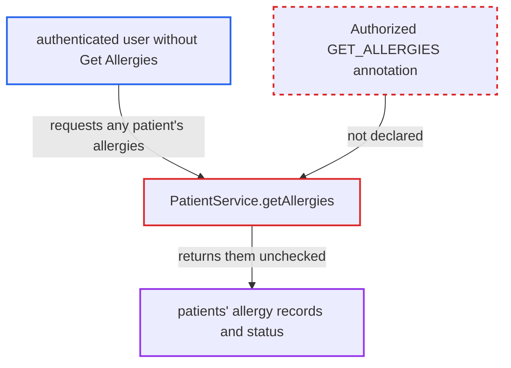

# PatientService.getAllergies returns any patient's allergies without Get Allergies privilege

| Field | Value |
|---|---|
| ID | `find_019ZeQkvGtnzwB9vizACL3RZ` |
| Severity | **Medium** |
| Status | open |
| CWE | CWE-862 — Missing authorization |
| Created | 2026-10-21T22:53:48.342549Z |
| Claude Security | https://claude.ai/security/findings/find_019ZeQkvGtnzwB9vizACL3RZ |

## Description

A logged-in user who lacks the `Get Allergies` privilege can read any patient's full allergy list, including allergens, reactions, severity, comments and the `No known allergies` status. The attacker needs to be able to name a patient, for example by holding `Get Patients`. The cause is that `PatientService.getAllergies(Patient)` has no `@Authorized` annotation, so no privilege is checked.

1. **authenticated low-privilege user** requests a patient's allergy list through a module endpoint. The user holds `Get Patients` but not `Get Allergies`. The endpoint calls `Context.getPatientService().getAllergies(patient)`, and the report assumes the REST patient allergy sub-resource does this but says it is out of view.
2. **the interface `PatientService`** declares `getAllergies` with no `@Authorized`. The sibling reads `getAllergy(Integer)` and `getAllergyByUuid(String)` require `PrivilegeConstants.GET_ALLERGIES`, and the interface has no class-level annotation either. ([`api/src/main/java/org/openmrs/api/PatientService.java:716`](https://github.com/cx-benchmark/openmrs-core/blob/e6a1b3374ef040e8821dbe4bacc1bdcb50fa4d29/api/src/main/java/org/openmrs/api/PatientService.java#L716))
3. **the advice `AuthorizationAdvice.before`** lets the call through without any check. It reads `@Authorized` only from the invoked interface method. With no annotation, it requires neither a privilege nor an authenticated user. ([`api/src/main/java/org/openmrs/aop/AuthorizationAdvice.java:65-99`](https://github.com/cx-benchmark/openmrs-core/blob/e6a1b3374ef040e8821dbe4bacc1bdcb50fa4d29/api/src/main/java/org/openmrs/aop/AuthorizationAdvice.java#L65-L99))
4. **the implementation `PatientServiceImpl.getAllergies`** returns the DAO result with no `Context.requirePrivilege`. When the list is empty, it returns the `allergy_status` from `dao.getAllergyStatus(patient)`. ([`api/src/main/java/org/openmrs/api/impl/PatientServiceImpl.java:1411-1427`](https://github.com/cx-benchmark/openmrs-core/blob/e6a1b3374ef040e8821dbe4bacc1bdcb50fa4d29/api/src/main/java/org/openmrs/api/impl/PatientServiceImpl.java#L1411-L1427))
5. **the DAO `HibernatePatientDAO`** selects the allergy rows for the supplied patient. It returns every non-voided `Allergy` row and uses only the patient's id, so any `Patient` reference the caller supplies picks the victim. ([`api/src/main/java/org/openmrs/api/db/hibernate/HibernatePatientDAO.java:934-950`](https://github.com/cx-benchmark/openmrs-core/blob/e6a1b3374ef040e8821dbe4bacc1bdcb50fa4d29/api/src/main/java/org/openmrs/api/db/hibernate/HibernatePatientDAO.java#L934-L950))

## Assessment

The attacker is an authenticated user with low privileges. They hold `Get Patients` but not `Get Allergies`. They call any module endpoint that reaches `Context.getPatientService().getAllergies(patient)`, and they can repeat the call for many patients. Module code that passes `new Patient(id)` gets the same result. No victim action is needed. The report says the server is not reachable from the internet, only from an internal network.

Impact: The attacker reads the non-voided allergy records and the allergy status of any patient they choose. This is protected clinical data that a dedicated privilege is meant to guard. The method only reads, so nothing is modified.

## Recommendation

The interface method `getAllergies(Patient)` lacks the `@Authorized(GET_ALLERGIES)` annotation that the other allergy read methods carry. The privilege model is therefore not enforced for the list read.

Fix criteria: A caller without `Get Allergies`, and an unauthenticated caller, receives `APIAuthenticationException` from `PatientService.getAllergies` before the DAO is queried. A test confirms that a user lacking the privilege is refused. The same test confirms that a user holding the privilege still receives the list.

## Evidence

**https://github.com/cx-benchmark/openmrs-core**

- [`api/src/main/java/org/openmrs/api/PatientService.java:716`](https://github.com/cx-benchmark/openmrs-core/blob/e6a1b3374ef040e8821dbe4bacc1bdcb50fa4d29/api/src/main/java/org/openmrs/api/PatientService.java#L716)
- [`api/src/main/java/org/openmrs/aop/AuthorizationAdvice.java:65-99`](https://github.com/cx-benchmark/openmrs-core/blob/e6a1b3374ef040e8821dbe4bacc1bdcb50fa4d29/api/src/main/java/org/openmrs/aop/AuthorizationAdvice.java#L65-L99)
- [`api/src/main/java/org/openmrs/api/impl/PatientServiceImpl.java:1411-1427`](https://github.com/cx-benchmark/openmrs-core/blob/e6a1b3374ef040e8821dbe4bacc1bdcb50fa4d29/api/src/main/java/org/openmrs/api/impl/PatientServiceImpl.java#L1411-L1427)
- [`api/src/main/java/org/openmrs/api/db/hibernate/HibernatePatientDAO.java:934-950`](https://github.com/cx-benchmark/openmrs-core/blob/e6a1b3374ef040e8821dbe4bacc1bdcb50fa4d29/api/src/main/java/org/openmrs/api/db/hibernate/HibernatePatientDAO.java#L934-L950)

