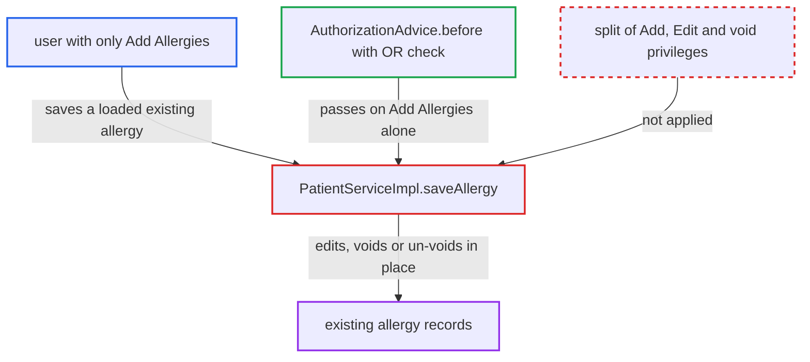

# PatientService.saveAllergy lets Add-only users edit or void existing allergies

| Field | Value |
|---|---|
| ID | `find_01E3AiZ64kkxHgsD2TKG2TWU` |
| Severity | **Medium** |
| Status | open |
| CWE | CWE-863 — Incorrect authorization |
| Created | 2026-10-21T23:02:15.202824Z |
| Claude Security | https://claude.ai/security/findings/find_01E3AiZ64kkxHgsD2TKG2TWU |

## Description

A user who holds only the `Add Allergies` privilege can change or void existing allergy records of any patient. They can also un-void voided ones. Exploitation needs a UI or REST module that loads an existing allergy and calls `saveAllergy`. The cause is that `PatientServiceImpl.saveAllergy` relies on an OR-ed `@Authorized` check and never separates new allergies from existing or voided ones.

1. **a user with only `Add Allergies`** loads an existing allergy through a deployed UI or REST module. The module uses `getAllergyByUuid` (needs `Get Allergies`) or the unannotated `getAllergies`, so the allergy is persistent in the caller's Hibernate session.
2. **the module on that user's behalf** applies the request's changes or `voided=true` and calls `saveAllergy`. The allergen, severity, reactions or comment can be rewritten, or the allergy voided or un-voided. ([`api/src/main/java/org/openmrs/api/PatientService.java:772-795`](https://github.com/cx-benchmark/openmrs-core/blob/e6a1b3374ef040e8821dbe4bacc1bdcb50fa4d29/api/src/main/java/org/openmrs/api/PatientService.java#L772-L795))
3. **the advice `AuthorizationAdvice.before`** lets the call through on `Add Allergies` alone. `requireAll` is false by default, so holding any one of `Add Allergies` or `Edit Allergies` passes. ([`api/src/main/java/org/openmrs/aop/AuthorizationAdvice.java:59-91`](https://github.com/cx-benchmark/openmrs-core/blob/e6a1b3374ef040e8821dbe4bacc1bdcb50fa4d29/api/src/main/java/org/openmrs/aop/AuthorizationAdvice.java#L59-L91))
4. **the method `PatientServiceImpl.saveAllergy`** passes the allergy straight to `dao.saveAllergy`. It does not check whether the allergy already exists or is voided, and calls no `Context.requirePrivilege`. ([`api/src/main/java/org/openmrs/api/impl/PatientServiceImpl.java:1523-1526`](https://github.com/cx-benchmark/openmrs-core/blob/e6a1b3374ef040e8821dbe4bacc1bdcb50fa4d29/api/src/main/java/org/openmrs/api/impl/PatientServiceImpl.java#L1523-L1526))
5. **the handler `VoidSaveHandler`** fills in or clears the void fields. It sets `voidedBy` and `dateVoided` when `voided` is true and clears them when false, so a void or un-void takes effect. ([`api/src/main/java/org/openmrs/api/handler/VoidSaveHandler.java:62-84`](https://github.com/cx-benchmark/openmrs-core/blob/e6a1b3374ef040e8821dbe4bacc1bdcb50fa4d29/api/src/main/java/org/openmrs/api/handler/VoidSaveHandler.java#L62-L84))
6. **the method `HibernatePatientDAO.saveAllergy`** calls `session.save(allergy)`, which writes the change to the existing row. The allergy is already persistent in the session, so Hibernate updates it in place. ([`api/src/main/java/org/openmrs/api/db/hibernate/HibernatePatientDAO.java:994-997`](https://github.com/cx-benchmark/openmrs-core/blob/e6a1b3374ef040e8821dbe4bacc1bdcb50fa4d29/api/src/main/java/org/openmrs/api/db/hibernate/HibernatePatientDAO.java#L994-L997))

## Assessment

The attacker is an authenticated internal user whose role grants `Add Allergies` but not `Edit Allergies` or `Remove Allergies`. The report says the system is not reachable from the internet, only from an internal network. Core ships no caller of `saveAllergy` in its `web/` layer. A UI or REST module has to load an allergy, apply the request's changes and call `saveAllergy`, relying on its `@Authorized` check. The allergy must be persistent in the caller's Hibernate session, and the webapp runs `OpenSessionInViewFilter`. The user can get one through `getAllergyByUuid` or `getAllergy` (`Get Allergies`), or through the unannotated `getAllergies`. A detached object built with an existing id does not work. `session.save()` would insert a new row instead (the report assumes Hibernate 5.6.14.Final `save` semantics).

Impact: A user trusted only to add allergies can rewrite existing allergy records of any patient in place, overwriting the original values. They can also void or un-void them. Nothing is disclosed beyond what the user can already read, and availability is unaffected.

## Recommendation

`PatientServiceImpl.saveAllergy` relies on the OR-ed `{Add Allergies, Edit Allergies}` annotation and has no check of its own. As a result, `Add Allergies` authorises updates, voids and un-voids of existing allergies.

Fix criteria: Saving an allergy that already has an id requires `Edit Allergies`, and only a new allergy passes with `Add Allergies` alone. Voiding or un-voiding through save requires at least the privilege that the dedicated `removeAllergy` and `voidAllergy` path requires. A test shows that a user holding only `Add Allergies` who loads an existing allergy, changes its severity or sets `voided=true`, and calls `saveAllergy` gets `APIAuthenticationException` and leaves the row unchanged. The same test shows that creating a new allergy still succeeds.

## Evidence

**https://github.com/cx-benchmark/openmrs-core**

- [`api/src/main/java/org/openmrs/api/impl/PatientServiceImpl.java:1523-1526`](https://github.com/cx-benchmark/openmrs-core/blob/e6a1b3374ef040e8821dbe4bacc1bdcb50fa4d29/api/src/main/java/org/openmrs/api/impl/PatientServiceImpl.java#L1523-L1526)
- [`api/src/main/java/org/openmrs/api/PatientService.java:772-795`](https://github.com/cx-benchmark/openmrs-core/blob/e6a1b3374ef040e8821dbe4bacc1bdcb50fa4d29/api/src/main/java/org/openmrs/api/PatientService.java#L772-L795)
- [`api/src/main/java/org/openmrs/aop/AuthorizationAdvice.java:59-91`](https://github.com/cx-benchmark/openmrs-core/blob/e6a1b3374ef040e8821dbe4bacc1bdcb50fa4d29/api/src/main/java/org/openmrs/aop/AuthorizationAdvice.java#L59-L91)
- [`api/src/main/java/org/openmrs/api/impl/PatientServiceImpl.java:139-147`](https://github.com/cx-benchmark/openmrs-core/blob/e6a1b3374ef040e8821dbe4bacc1bdcb50fa4d29/api/src/main/java/org/openmrs/api/impl/PatientServiceImpl.java#L139-L147)
- [`api/src/main/java/org/openmrs/api/handler/VoidSaveHandler.java:62-84`](https://github.com/cx-benchmark/openmrs-core/blob/e6a1b3374ef040e8821dbe4bacc1bdcb50fa4d29/api/src/main/java/org/openmrs/api/handler/VoidSaveHandler.java#L62-L84)
- [`api/src/main/java/org/openmrs/api/db/hibernate/HibernatePatientDAO.java:994-997`](https://github.com/cx-benchmark/openmrs-core/blob/e6a1b3374ef040e8821dbe4bacc1bdcb50fa4d29/api/src/main/java/org/openmrs/api/db/hibernate/HibernatePatientDAO.java#L994-L997)

