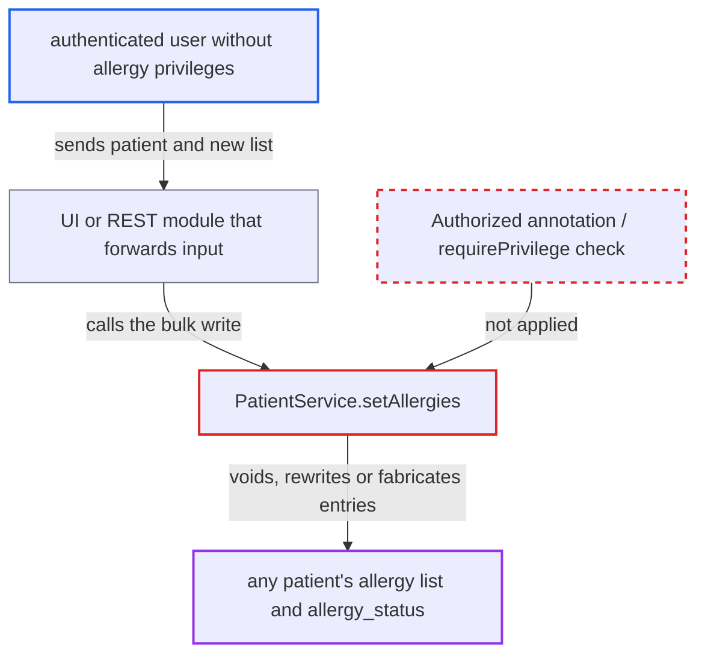

# PatientService.setAllergies modifies any patient's allergy list without any privilege check

| Field | Value |
|---|---|
| ID | `find_01DwRBc7FEmdji6uZ5EUpNAV` |
| Severity | **Medium** |
| Status | open |
| CWE | CWE-862 — Missing authorization |
| Created | 2026-10-21T22:53:48.278036Z |
| Claude Security | https://claude.ai/security/findings/find_01DwRBc7FEmdji6uZ5EUpNAV |

## Description

Any logged-in user can erase, rewrite or invent a patient's allergy list, or mark the patient as `No known allergies`, for any patient. No allergy privilege is needed. The method `PatientService.setAllergies` has no `@Authorized` annotation, and `PatientServiceImpl.setAllergies` never calls `Context.requirePrivilege`. The report limits the attack to an internal network, and it needs a module that passes the caller's input to this method.

1. **authenticated user** sends a patient and a new allergy list through a deployed module (UI or REST). The user holds none of `Add Allergies`, `Edit Allergies` or `Remove Allergies`. The list can be empty, can call `confirmNoKnownAllergies()`, or can hold made-up entries.
2. **the module** calls `setAllergies(Patient, Allergies)` on the patient service. The method is declared on the interface with no `@Authorized` annotation, unlike `saveAllergy`, `removeAllergy` and `voidAllergy`. ([`api/src/main/java/org/openmrs/api/PatientService.java:739`](https://github.com/cx-benchmark/openmrs-core/blob/e6a1b3374ef040e8821dbe4bacc1bdcb50fa4d29/api/src/main/java/org/openmrs/api/PatientService.java#L739))
3. **`AuthorizationAdvice.before`** lets the call through without any check. It enforces only method-level `@Authorized`. With no annotation it checks no privilege and does not even require a login. ([`api/src/main/java/org/openmrs/aop/AuthorizationAdvice.java:46-99`](https://github.com/cx-benchmark/openmrs-core/blob/e6a1b3374ef040e8821dbe4bacc1bdcb50fa4d29/api/src/main/java/org/openmrs/aop/AuthorizationAdvice.java#L46-L99))
4. **`PatientServiceImpl.setAllergies`** voids every stored allergy that is missing or changed in the supplied list. It loads the stored list with `getAllergies` and calls the private `voidAllergy(Allergy)`, which writes through `dao.saveAllergy` directly. It never calls `Context.requirePrivilege`. ([`api/src/main/java/org/openmrs/api/impl/PatientServiceImpl.java:1434-1486`](https://github.com/cx-benchmark/openmrs-core/blob/e6a1b3374ef040e8821dbe4bacc1bdcb50fa4d29/api/src/main/java/org/openmrs/api/impl/PatientServiceImpl.java#L1434-L1486))
5. **`HibernatePatientDAO.saveAllergies`** overwrites the patient's allergy status and saves the supplied entries. A native `update patient set allergy_status = ...` runs for the chosen patient, and `session.save()` is called on each supplied `Allergy`. The caller can pick the patient with `new Patient(id)`, which needs no `Get Patients` privilege. ([`api/src/main/java/org/openmrs/api/db/hibernate/HibernatePatientDAO.java:957-970`](https://github.com/cx-benchmark/openmrs-core/blob/e6a1b3374ef040e8821dbe4bacc1bdcb50fa4d29/api/src/main/java/org/openmrs/api/db/hibernate/HibernatePatientDAO.java#L957-L970))

## Assessment

The attacker is an authenticated user on the internal network who holds none of `Add Allergies`, `Edit Allergies` or `Remove Allergies`. The report says the system is not reachable from the internet. Core ships no caller of `setAllergies` in its `web/` layer. The attack therefore needs a deployed module (UI or REST) that passes a patient and an `Allergies` list to `Context.getPatientService().setAllergies(...)`. Such modules rely on the core service layer's `@Authorized` checks, so the missing check is not caught elsewhere.

Impact: The attacker can void, rewrite or fabricate the allergy list of any patient, and can set `allergy_status` such as `No known allergies`. This changes clinical safety data that drives prescribing. The report finds no disclosure, because the method returns only the caller's own list, and no effect on availability.

## Recommendation

The interface method `setAllergies` has no `@Authorized` annotation and the implementation never calls `Context.requirePrivilege`. The allergy privileges (`Add Allergies`, `Edit Allergies`, `Remove Allergies`) are therefore not enforced on the bulk write path.

Fix criteria: A call to `PatientService.setAllergies` by a user without the right allergy privileges throws `APIAuthenticationException` before any DAO write. The privileges are `Edit Allergies`, plus `Remove Allergies` when existing allergies are voided, and `Add Allergies` when new ones are created. Unauthenticated callers are rejected. A test shows that an authenticated user with no allergy privileges calling `setAllergies` is refused, and that the patient's allergy rows and `allergy_status` are unchanged.

## Evidence

**https://github.com/cx-benchmark/openmrs-core**

- [`api/src/main/java/org/openmrs/api/PatientService.java:739`](https://github.com/cx-benchmark/openmrs-core/blob/e6a1b3374ef040e8821dbe4bacc1bdcb50fa4d29/api/src/main/java/org/openmrs/api/PatientService.java#L739)
- [`api/src/main/java/org/openmrs/api/impl/PatientServiceImpl.java:1434-1486`](https://github.com/cx-benchmark/openmrs-core/blob/e6a1b3374ef040e8821dbe4bacc1bdcb50fa4d29/api/src/main/java/org/openmrs/api/impl/PatientServiceImpl.java#L1434-L1486)
- [`api/src/main/java/org/openmrs/api/db/hibernate/HibernatePatientDAO.java:957-970`](https://github.com/cx-benchmark/openmrs-core/blob/e6a1b3374ef040e8821dbe4bacc1bdcb50fa4d29/api/src/main/java/org/openmrs/api/db/hibernate/HibernatePatientDAO.java#L957-L970)
- [`api/src/main/java/org/openmrs/aop/AuthorizationAdvice.java:46-99`](https://github.com/cx-benchmark/openmrs-core/blob/e6a1b3374ef040e8821dbe4bacc1bdcb50fa4d29/api/src/main/java/org/openmrs/aop/AuthorizationAdvice.java#L46-L99)

