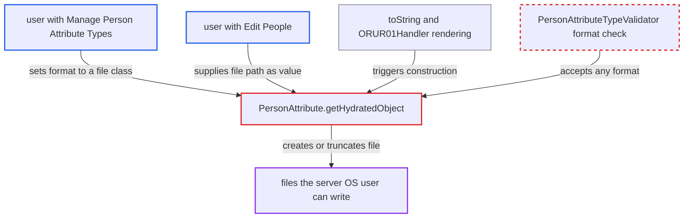

# PersonAttribute hydration instantiates arbitrary class named by attribute-type format with user value

| Field | Value |
|---|---|
| ID | `find_01JZbtB36Q4meayyP37mVoqW` |
| Severity | **Medium** |
| Status | open |
| CWE | CWE-470 — Unsafe reflection |
| Created | 2026-10-21T23:00:47.743889Z |
| Claude Security | https://claude.ai/security/findings/find_01JZbtB36Q4meayyP37mVoqW |

## Description

A user who can manage person attribute types can make the server create or empty any file its OS user can write. That includes runtime properties, module files, patient attachments and search indexes, so data is destroyed and the EMR can go down. The attack needs the `Manage Person Attribute Types` privilege. The cause is `PersonAttribute.getHydratedObject()`, which builds whatever class `format` names, using the attribute `value`.

1. **attacker with `Manage Person Attribute Types`** saves a person attribute type whose `format` is `java.io.FileOutputStream`. `PersonAttributeTypeValidator` only checks that `format` is non-blank and fits the column, so any class name is stored. ([`api/src/main/java/org/openmrs/validator/PersonAttributeTypeValidator.java:48-58`](https://github.com/cx-benchmark/openmrs-core/blob/e6a1b3374ef040e8821dbe4bacc1bdcb50fa4d29/api/src/main/java/org/openmrs/validator/PersonAttributeTypeValidator.java#L48-L58))
2. **attacker, or any user with `Edit People`** sets an attribute of that type with a server file path as its `value`. The value is free text of up to 50 characters, and no core validator compares it with the type's `format`. ([`api/src/main/java/org/openmrs/api/PersonService.java:567-568`](https://github.com/cx-benchmark/openmrs-core/blob/e6a1b3374ef040e8821dbe4bacc1bdcb50fa4d29/api/src/main/java/org/openmrs/api/PersonService.java#L567-L568))
3. **attribute display code** renders the attribute through `toString()` or a direct call to `getHydratedObject()`. `toString()` delegates to `getHydratedObject()`, so merely showing, logging or concatenating the attribute triggers the next step. The attacker can do this by viewing the record. ([`api/src/main/java/org/openmrs/PersonAttribute.java:211-221`](https://github.com/cx-benchmark/openmrs-core/blob/e6a1b3374ef040e8821dbe4bacc1bdcb50fa4d29/api/src/main/java/org/openmrs/PersonAttribute.java#L211-L221))
4. **`ORUR01Handler`** concatenates the `Health Center` attribute into a `log.debug` message while processing an ORU^R01 discharge-to-location message. This is a trigger inside core: the concatenation runs whatever the log level, when the patient's `Health Center` value differs. ([`api/src/main/java/org/openmrs/hl7/handler/ORUR01Handler.java:1262-1267`](https://github.com/cx-benchmark/openmrs-core/blob/e6a1b3374ef040e8821dbe4bacc1bdcb50fa4d29/api/src/main/java/org/openmrs/hl7/handler/ORUR01Handler.java#L1262-L1267))
5. **`getHydratedObject()`** loads the class named by `format` and constructs it with the attribute `value`. `Class.newInstance()` fails because `FileOutputStream` has no nullary constructor, so the code calls its public `(String)` constructor. The `Attributable` check comes only after the object exists. ([`api/src/main/java/org/openmrs/PersonAttribute.java:246-276`](https://github.com/cx-benchmark/openmrs-core/blob/e6a1b3374ef040e8821dbe4bacc1bdcb50fa4d29/api/src/main/java/org/openmrs/PersonAttribute.java#L246-L276))
6. **`FileOutputStream`** creates or truncates the file at the given path. The file is opened as the server's OS user and the handle is leaked. The attacker cannot choose the file contents.

## Assessment

The attacker needs `Manage Person Attribute Types`, which in the shipped core data only the `System Developer` superuser holds. That role can already install modules. The issue matters where an implementation gives the privilege to a metadata role that lacks `Manage Modules`. Choosing the class and supplying its argument can be split between two users: one sets the type's `format`, another with `Edit People` sets the `value`. Besides the UI and REST display, HL7 discharge processing in `ORUR01Handler` triggers it. The owner says the server is reachable only from the internal network. The same path works with `FileWriter`, `PrintWriter` and `PrintStream`. Classes with a no-arg constructor, such as Spring `ClassPathXmlApplicationContext`, never reach the String path, so the report shows no code-execution gadget.

Impact: The attacker can create or truncate to zero length any file the OpenMRS process can write. Examples are `/openmrs/data/openmrs-runtime.properties`, `.omod` module files, complex-obs attachments, Lucene indexes and logs. This destroys data and takes the EMR down, at once or on restart. File contents cannot be chosen and nothing is read back, so the report finds no data disclosure.

## Recommendation

(1) `PersonAttribute.getHydratedObject()` instantiates a class chosen by a stored string. It passes user-supplied data to that class's `(String)` constructor without limiting the class to the intended value types.

Fix criteria: Only classes implementing `Attributable`, or an explicit allow-list such as `java.lang.String`, `java.lang.Integer` and `java.lang.Double`, can be instantiated. The check runs before any constructor or static initialiser. An attribute type with `format` set to `java.io.FileOutputStream` neither creates a file nor throws out of `toString()`. `getHydratedObject()` falls back to returning the raw value.

(2) `PersonAttributeTypeValidator` accepts any non-blank `format`, so unsafe class names are saved as metadata.

Fix criteria: Saving a `PersonAttributeType` whose `format` is not a permitted value type is rejected with a validation error. A test confirms that `savePersonAttributeType` fails for `format = java.io.FileOutputStream`.

## Evidence

**https://github.com/cx-benchmark/openmrs-core**

- [`api/src/main/java/org/openmrs/PersonAttribute.java:246-276`](https://github.com/cx-benchmark/openmrs-core/blob/e6a1b3374ef040e8821dbe4bacc1bdcb50fa4d29/api/src/main/java/org/openmrs/PersonAttribute.java#L246-L276)
- [`api/src/main/java/org/openmrs/PersonAttribute.java:211-221`](https://github.com/cx-benchmark/openmrs-core/blob/e6a1b3374ef040e8821dbe4bacc1bdcb50fa4d29/api/src/main/java/org/openmrs/PersonAttribute.java#L211-L221)
- [`api/src/main/java/org/openmrs/hl7/handler/ORUR01Handler.java:1262-1267`](https://github.com/cx-benchmark/openmrs-core/blob/e6a1b3374ef040e8821dbe4bacc1bdcb50fa4d29/api/src/main/java/org/openmrs/hl7/handler/ORUR01Handler.java#L1262-L1267)
- [`api/src/main/java/org/openmrs/validator/PersonAttributeTypeValidator.java:48-58`](https://github.com/cx-benchmark/openmrs-core/blob/e6a1b3374ef040e8821dbe4bacc1bdcb50fa4d29/api/src/main/java/org/openmrs/validator/PersonAttributeTypeValidator.java#L48-L58)
- [`api/src/main/java/org/openmrs/api/PersonService.java:128-129`](https://github.com/cx-benchmark/openmrs-core/blob/e6a1b3374ef040e8821dbe4bacc1bdcb50fa4d29/api/src/main/java/org/openmrs/api/PersonService.java#L128-L129)
- [`api/src/main/java/org/openmrs/api/PersonService.java:567-568`](https://github.com/cx-benchmark/openmrs-core/blob/e6a1b3374ef040e8821dbe4bacc1bdcb50fa4d29/api/src/main/java/org/openmrs/api/PersonService.java#L567-L568)

