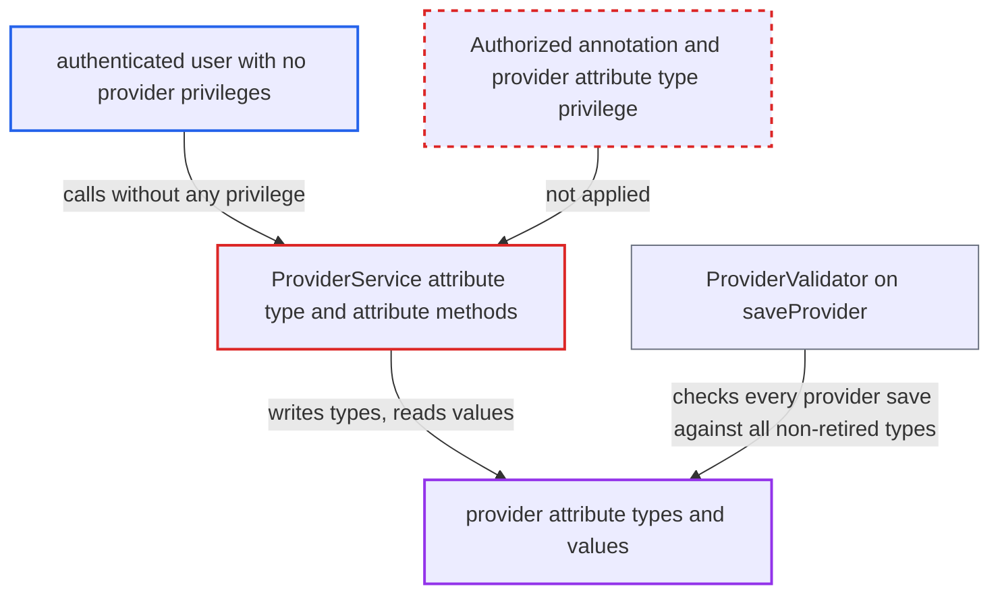

# Provider attribute type writes and provider attribute reads have no authorization check

| Field | Value |
|---|---|
| ID | `find_018TDPHMxRey4Zaigvwy9HBv` |
| Severity | **Medium** |
| Status | open |
| CWE | CWE-862 — Missing authorization |
| Created | 2026-10-21T23:02:33.090921Z |
| Claude Security | https://claude.ai/security/findings/find_018TDPHMxRey4Zaigvwy9HBv |

## Description

A logged-in user with no provider privileges can create, change, retire and purge provider attribute types, and can read provider attribute values. A bad type can make every later provider save fail. The attacker needs only an authenticated account. `ProviderService` has no `@Authorized` on these methods, so `AuthorizationAdvice` checks nothing.

1. **authenticated user without provider privileges** calls the provider attribute-type methods through `Context.getProviderService()`. The calls are `saveProviderAttributeType`, `retireProviderAttributeType`, `unretireProviderAttributeType` and `purgeProviderAttributeType`. None of them has an `@Authorized` annotation, and the report found no provider-attribute-type privilege in `PrivilegeConstants`. ([`api/src/main/java/org/openmrs/api/ProviderService.java:255-288`](https://github.com/cx-benchmark/openmrs-core/blob/e6a1b3374ef040e8821dbe4bacc1bdcb50fa4d29/api/src/main/java/org/openmrs/api/ProviderService.java#L255-L288))
2. **the advice `AuthorizationAdvice.before`** lets the call through without any check. It checks only privileges listed in an annotation, and it requires authentication only when `@Authorized` is present. An unannotated method gets no check at all. ([`api/src/main/java/org/openmrs/aop/AuthorizationAdvice.java:58-99`](https://github.com/cx-benchmark/openmrs-core/blob/e6a1b3374ef040e8821dbe4bacc1bdcb50fa4d29/api/src/main/java/org/openmrs/aop/AuthorizationAdvice.java#L58-L99))
3. **the service `ProviderServiceImpl`** writes straight to the DAO. It calls `dao.saveProviderAttributeType` or `dao.deleteProviderAttributeType` without `Context.requirePrivilege`. ([`api/src/main/java/org/openmrs/api/impl/ProviderServiceImpl.java:240-267`](https://github.com/cx-benchmark/openmrs-core/blob/e6a1b3374ef040e8821dbe4bacc1bdcb50fa4d29/api/src/main/java/org/openmrs/api/impl/ProviderServiceImpl.java#L240-L267))
4. **authenticated user without provider privileges** reads provider attribute values and attribute types. `getProviderAttribute(Integer)` and `getProviderAttributeByUuid` return values without `Get Providers`, while `getProvider` requires that privilege. The attribute-type getters are unannotated too. ([`api/src/main/java/org/openmrs/api/ProviderService.java:198-252`](https://github.com/cx-benchmark/openmrs-core/blob/e6a1b3374ef040e8821dbe4bacc1bdcb50fa4d29/api/src/main/java/org/openmrs/api/ProviderService.java#L198-L252))
5. **the validator `BaseCustomizableValidator`** rejects provider saves that lack a value for an attacker-made required type. `ProviderValidator.java:88` passes all non-retired types to it. A type with `minOccurs` of 1 or more makes every `saveProvider` fail until an administrator repairs it. ([`api/src/main/java/org/openmrs/validator/BaseCustomizableValidator.java:35-57`](https://github.com/cx-benchmark/openmrs-core/blob/e6a1b3374ef040e8821dbe4bacc1bdcb50fa4d29/api/src/main/java/org/openmrs/validator/BaseCustomizableValidator.java#L35-L57))
6. **the type validator** loads and instantiates the class named in `datatypeClassname` or the handler class. The path is `BaseAttributeTypeValidator.java:71,86-87` to `CustomDatatypeUtil.getDatatype`/`getHandler`, then `Context.loadClass` and `newInstance()`. So the caller picks which classes the server instantiates. ([`api/src/main/java/org/openmrs/customdatatype/CustomDatatypeUtil.java:53-66`](https://github.com/cx-benchmark/openmrs-core/blob/e6a1b3374ef040e8821dbe4bacc1bdcb50fa4d29/api/src/main/java/org/openmrs/customdatatype/CustomDatatypeUtil.java#L53-L66))

## Assessment

The attacker is an authenticated user who holds no provider privileges. They reach `Context.getProviderService()` through a module or a REST consumer of the API. The report's threat model says the server is reachable only from the internal network. No user interaction is needed. The attacker can call the four write methods, or read attribute values with `getProviderAttribute(id)` or `getProviderAttributeByUuid`. The default `Authenticated` role does not hold `Get Providers`.

Impact: The attacker can create, change, retire, unretire and purge provider attribute-type metadata, and can read provider attribute values and type metadata without `Get Providers`. Purge works only for types with no stored values, because the foreign key `provider_attribute_attribute_type_id_fk` is `RESTRICT` and `ProviderAttribute.hbm.xml:31` has no cascade. A required type makes every `saveProvider` fail. A changed datatype on an in-use type breaks decoding of stored values. Both last until an administrator repairs it. The data is staff attribute data, not patient data. The attacker can also make the server run the no-arg constructor or static initializer of any class on the classpath. The report found no gadget that gives code execution, so it does not rate that as code execution.

## Recommendation

(1) `saveProviderAttributeType`, `retireProviderAttributeType`, `unretireProviderAttributeType` and `purgeProviderAttributeType` have no `@Authorized`, and no privilege for them exists. `AuthorizationAdvice` therefore applies neither an authorization check nor an authentication check.

Fix criteria: Writing provider attribute types requires an administrative privilege, like `Manage/Purge Visit Attribute Types`. A user without that privilege gets `APIAuthenticationException` from each of the four methods. So does an unauthenticated context. No row is created, changed or deleted in either case.

(2) `getProviderAttribute(Integer)` and `getProviderAttributeByUuid` return provider attribute values without the `Get Providers` privilege that guards the providers themselves. The attribute-type reads are unauthenticated too.

Fix criteria: Reading provider attributes requires `Get Providers`. Reading attribute types requires at least authentication or a read privilege. Users who hold `Manage Providers` can still save providers, because `ProviderValidator` lists all attribute types. A user without `Get Providers` is refused by the attribute getters.

## Evidence

**https://github.com/cx-benchmark/openmrs-core**

- [`api/src/main/java/org/openmrs/api/ProviderService.java:255-288`](https://github.com/cx-benchmark/openmrs-core/blob/e6a1b3374ef040e8821dbe4bacc1bdcb50fa4d29/api/src/main/java/org/openmrs/api/ProviderService.java#L255-L288)
- [`api/src/main/java/org/openmrs/aop/AuthorizationAdvice.java:58-99`](https://github.com/cx-benchmark/openmrs-core/blob/e6a1b3374ef040e8821dbe4bacc1bdcb50fa4d29/api/src/main/java/org/openmrs/aop/AuthorizationAdvice.java#L58-L99)
- [`api/src/main/java/org/openmrs/api/impl/ProviderServiceImpl.java:240-267`](https://github.com/cx-benchmark/openmrs-core/blob/e6a1b3374ef040e8821dbe4bacc1bdcb50fa4d29/api/src/main/java/org/openmrs/api/impl/ProviderServiceImpl.java#L240-L267)
- [`api/src/main/java/org/openmrs/api/ProviderService.java:198-252`](https://github.com/cx-benchmark/openmrs-core/blob/e6a1b3374ef040e8821dbe4bacc1bdcb50fa4d29/api/src/main/java/org/openmrs/api/ProviderService.java#L198-L252)
- [`api/src/main/java/org/openmrs/validator/BaseCustomizableValidator.java:35-57`](https://github.com/cx-benchmark/openmrs-core/blob/e6a1b3374ef040e8821dbe4bacc1bdcb50fa4d29/api/src/main/java/org/openmrs/validator/BaseCustomizableValidator.java#L35-L57)
- [`api/src/main/java/org/openmrs/customdatatype/CustomDatatypeUtil.java:53-66`](https://github.com/cx-benchmark/openmrs-core/blob/e6a1b3374ef040e8821dbe4bacc1bdcb50fa4d29/api/src/main/java/org/openmrs/customdatatype/CustomDatatypeUtil.java#L53-L66)

