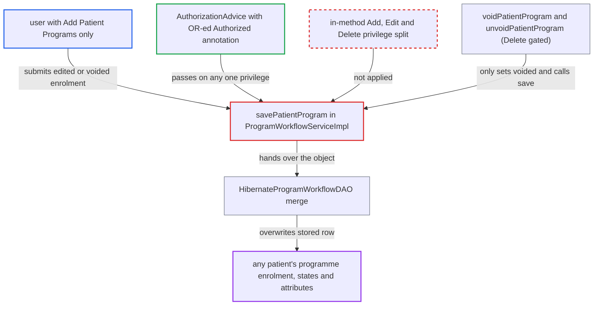

# savePatientProgram lets Add-only users edit or void any patient's programme enrolment

| Field | Value |
|---|---|
| ID | `find_016LpGb8tRMWKG3NT8hJnLcz` |
| Severity | **Medium** |
| Status | open |
| CWE | CWE-863 — Incorrect authorization |
| Created | 2026-10-21T23:02:14.941455Z |
| Claude Security | https://claude.ai/security/findings/find_016LpGb8tRMWKG3NT8hJnLcz |

## Description

A user who holds only `Add Patient Programs` can change or void any patient's programme enrolment. That covers its dates, outcome, location, workflow states and attributes. It needs a deployed module, such as REST `programenrollment`, that passes requests to the service. The cause is `savePatientProgram`, which accepts any one of its two listed privileges and has no check inside the method.

1. **attacker with `Add Patient Programs` only** loads an existing `PatientProgram` through a module and edits it or sets `voided=true`. Core ships no web endpoint for this method, so a module such as REST `programenrollment` or the legacy UI must be deployed and must call the service as the logged-in user.
2. **the advice `AuthorizationAdvice.before`** lets the call through on the first privilege the user holds. `@Authorized({ADD_PATIENT_PROGRAMS, EDIT_PATIENT_PROGRAMS})` leaves `requireAll` at its default of false, so the Add privilege alone passes for new, existing and voided enrolments. ([`api/src/main/java/org/openmrs/aop/AuthorizationAdvice.java:58-95`](https://github.com/cx-benchmark/openmrs-core/blob/e6a1b3374ef040e8821dbe4bacc1bdcb50fa4d29/api/src/main/java/org/openmrs/aop/AuthorizationAdvice.java#L58-L95))
3. **the service method `savePatientProgram`** accepts the changed enrolment without asking whether it is new, existing or voided. It only checks that patient and program are set, and it copies `voided` and `voidReason` to every `PatientState`. ([`api/src/main/java/org/openmrs/api/impl/ProgramWorkflowServiceImpl.java:241-276`](https://github.com/cx-benchmark/openmrs-core/blob/e6a1b3374ef040e8821dbe4bacc1bdcb50fa4d29/api/src/main/java/org/openmrs/api/impl/ProgramWorkflowServiceImpl.java#L241-L276))
4. **the DAO `HibernateProgramWorkflowDAO.savePatientProgram`** merges the object over the stored row and saves its attributes. The old dates, location, outcome, states and attributes are overwritten with no further check and no history. ([`api/src/main/java/org/openmrs/api/db/hibernate/HibernateProgramWorkflowDAO.java:146-156`](https://github.com/cx-benchmark/openmrs-core/blob/e6a1b3374ef040e8821dbe4bacc1bdcb50fa4d29/api/src/main/java/org/openmrs/api/db/hibernate/HibernateProgramWorkflowDAO.java#L146-L156))

## Assessment

The attacker is an authenticated user whose role grants `Add Patient Programs` but not `Edit Patient Programs` or `Delete Patient Programs`. The report assumes they can reach the server from the internal network. A module that forwards requests to the service must be deployed, for example REST `programenrollment` or the legacy UI, because core has no endpoint of its own. The attacker can change an enrolment's fields, or void it. Voiding works because `voidPatientProgram` and `unvoidPatientProgram` only call `setVoided(...)` and then `savePatientProgram`. `VoidSaveHandler` then fills `voidedBy` and `dateVoided` as for a sanctioned void.

Impact: A user allowed only to create enrolments can overwrite or soft-delete the programme enrolment, workflow-state history and attributes of any patient. Overwritten values leave no history. The report finds no data disclosure beyond what the user may already read, and no denial of service.

## Recommendation

`savePatientProgram` relies on the OR-ed `@Authorized({ADD, EDIT})` and has no check inside the method. The Add privilege therefore authorises updates of existing enrolments and voids or unvoids, which the project otherwise gates with Edit and Delete.

Fix criteria: Saving a `PatientProgram` without an id requires `Add Patient Programs`. Saving one that already has an id requires `Edit Patient Programs`. A save that changes the voided state requires `Delete Patient Programs`, consistent with `PatientServiceImpl.savePatient`. A user holding only `Add Patient Programs` gets `APIAuthenticationException` when saving an existing or voided enrolment, and the stored row is unchanged. `voidPatientProgram` and `unvoidPatientProgram` still work for holders of the Delete privilege.

## Evidence

**https://github.com/cx-benchmark/openmrs-core**

- [`api/src/main/java/org/openmrs/api/ProgramWorkflowService.java:236-237`](https://github.com/cx-benchmark/openmrs-core/blob/e6a1b3374ef040e8821dbe4bacc1bdcb50fa4d29/api/src/main/java/org/openmrs/api/ProgramWorkflowService.java#L236-L237)
- [`api/src/main/java/org/openmrs/api/impl/ProgramWorkflowServiceImpl.java:241-276`](https://github.com/cx-benchmark/openmrs-core/blob/e6a1b3374ef040e8821dbe4bacc1bdcb50fa4d29/api/src/main/java/org/openmrs/api/impl/ProgramWorkflowServiceImpl.java#L241-L276)
- [`api/src/main/java/org/openmrs/aop/AuthorizationAdvice.java:58-95`](https://github.com/cx-benchmark/openmrs-core/blob/e6a1b3374ef040e8821dbe4bacc1bdcb50fa4d29/api/src/main/java/org/openmrs/aop/AuthorizationAdvice.java#L58-L95)
- [`api/src/main/java/org/openmrs/api/ProgramWorkflowService.java:324-336`](https://github.com/cx-benchmark/openmrs-core/blob/e6a1b3374ef040e8821dbe4bacc1bdcb50fa4d29/api/src/main/java/org/openmrs/api/ProgramWorkflowService.java#L324-L336)
- [`api/src/main/java/org/openmrs/api/db/hibernate/HibernateProgramWorkflowDAO.java:146-156`](https://github.com/cx-benchmark/openmrs-core/blob/e6a1b3374ef040e8821dbe4bacc1bdcb50fa4d29/api/src/main/java/org/openmrs/api/db/hibernate/HibernateProgramWorkflowDAO.java#L146-L156)
- [`api/src/main/java/org/openmrs/api/impl/PatientServiceImpl.java:139-147`](https://github.com/cx-benchmark/openmrs-core/blob/e6a1b3374ef040e8821dbe4bacc1bdcb50fa4d29/api/src/main/java/org/openmrs/api/impl/PatientServiceImpl.java#L139-L147)

