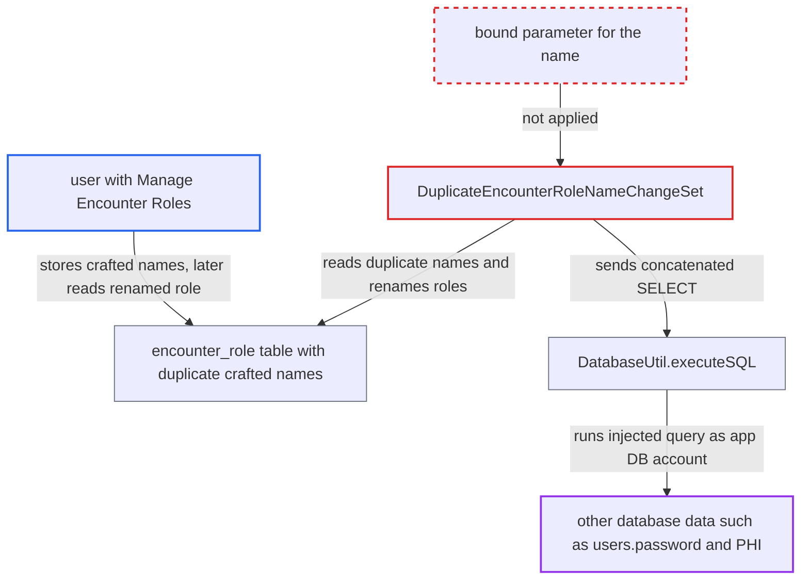

# Second-order SQL injection via encounter role names in upgrade change set

| Field | Value |
|---|---|
| ID | `find_01V88zi9uPyi12VotzfDudgb` |
| Severity | **Medium** |
| Status | open |
| CWE | CWE-89 — SQL injection |
| Created | 2026-10-21T23:02:41.150295Z |
| Claude Security | https://claude.ai/security/findings/find_01V88zi9uPyi12VotzfDudgb |

## Description

A user with the `Manage Encounter Roles` privilege on an OpenMRS 1.9.x install can read database values, such as password hashes and patient data, or hang a later upgrade. The attack needs two encounter roles with the same crafted name, followed by an upgrade with this code. The cause is `DuplicateEncounterRoleNameChangeSet`, which concatenates stored role names into a SELECT without quoting or binding.

1. **attacker with `Manage Encounter Roles`** saves two encounter roles with the same crafted name. `saveEncounterRole` needs only this non-administrative privilege. ([`api/src/main/java/org/openmrs/api/EncounterService.java:503-504`](https://github.com/cx-benchmark/openmrs-core/blob/e6a1b3374ef040e8821dbe4bacc1bdcb50fa4d29/api/src/main/java/org/openmrs/api/EncounterService.java#L503-L504))
2. **1.9.x schema and validator** accept the duplicate names. The 1.9.x `encounter_role` table has no unique index on `name`, and the validator's duplicate check relies on `getEncounterRoleByName`, which is `@since 1.10`. ([`api/src/main/resources/org/openmrs/liquibase/snapshots/schema-only/liquibase-schema-only-1.9.x.xml:2392-2414`](https://github.com/cx-benchmark/openmrs-core/blob/e6a1b3374ef040e8821dbe4bacc1bdcb50fa4d29/api/src/main/resources/org/openmrs/liquibase/snapshots/schema-only/liquibase-schema-only-1.9.x.xml#L2392-L2414))
3. **administrator** upgrades the database with this code, through the upgrade wizard or with `auto_update_database`. `ChangeLogDetective` falls back to snapshot `1.9.x` and runs every unrecorded change set of the 2.0.x file, including the duplicate-role change set. ([`api/src/main/java/org/openmrs/liquibase/ChangeLogDetective.java:134-139`](https://github.com/cx-benchmark/openmrs-core/blob/e6a1b3374ef040e8821dbe4bacc1bdcb50fa4d29/api/src/main/java/org/openmrs/liquibase/ChangeLogDetective.java#L134-L139))
4. **the change set `DuplicateEncounterRoleNameChangeSet`** loads every `encounter_role.name` that occurs more than once. The names are read unfiltered, so the attacker's stored text is used as trusted input. ([`api/src/main/java/org/openmrs/util/databasechange/DuplicateEncounterRoleNameChangeSet.java:88-108`](https://github.com/cx-benchmark/openmrs-core/blob/e6a1b3374ef040e8821dbe4bacc1bdcb50fa4d29/api/src/main/java/org/openmrs/util/databasechange/DuplicateEncounterRoleNameChangeSet.java#L88-L108))
5. **the change set `DuplicateEncounterRoleNameChangeSet`** builds a probe SELECT by concatenating the stored name plus `_N` into the `where name = '...'` clause. The crafted name closes the quote and controls the rest of the query. ([`api/src/main/java/org/openmrs/util/databasechange/DuplicateEncounterRoleNameChangeSet.java:116-134`](https://github.com/cx-benchmark/openmrs-core/blob/e6a1b3374ef040e8821dbe4bacc1bdcb50fa4d29/api/src/main/java/org/openmrs/util/databasechange/DuplicateEncounterRoleNameChangeSet.java#L116-L134))
6. **`DatabaseUtil.executeSQL`** runs the probe text unchanged on a connection opened with the application's DB credentials. With `selectOnly` set, it rejects only text that starts with a DML or DDL keyword, so injected text inside the SELECT passes. ([`api/src/main/java/org/openmrs/util/DatabaseUtil.java:103-138`](https://github.com/cx-benchmark/openmrs-core/blob/e6a1b3374ef040e8821dbe4bacc1bdcb50fa4d29/api/src/main/java/org/openmrs/util/DatabaseUtil.java#L103-L138))
7. **the change set loop** raises `N` until the probe returns no rows, then renames the role with that suffix. A name that makes the query empty only when `N` equals a selected value writes that value into the role name, where the attacker can read it. A name ending in an always-true condition never ends, so the upgrade hangs. ([`api/src/main/java/org/openmrs/util/databasechange/DuplicateEncounterRoleNameChangeSet.java:116-134`](https://github.com/cx-benchmark/openmrs-core/blob/e6a1b3374ef040e8821dbe4bacc1bdcb50fa4d29/api/src/main/java/org/openmrs/util/databasechange/DuplicateEncounterRoleNameChangeSet.java#L116-L134))

## Assessment

The attacker is an internal-network user who holds `Manage Encounter Roles` on an OpenMRS 1.9.x install. The server is not reachable from the internet. The attacker creates two encounter roles with the same crafted name. Duplicates can exist only on databases that predate the change set. The attack then waits for an administrator to upgrade that database with this code, through the upgrade wizard or with `auto_update_database`. The probe runs as the application's DB account, which owns the schema. Stacked statements are not available with the pinned Connector/J 8.0.30 and the default URL (no `allowMultiQueries`), which is an assumption about that driver version. The same pattern exists in `DuplicateEncounterTypeNameChangeSet` and `DuplicateLocationAttributeTypeNameChangeSet`.

Impact: The attacker can read any value the DB account can read, such as PHI and `users.password` or `salt`, one value per duplicate pair with no limit on pairs. The attacker can also trap the upgrade in an endless loop while it holds the Liquibase lock, so the system cannot start until the data is repaired by hand. Without stacked queries there is no direct data modification.

## Recommendation

(1) `DuplicateEncounterRoleNameChangeSet` concatenates a name read from the database into the probe SQL, so stored data is executed as SQL during the upgrade.

Fix criteria: The probe binds the candidate name as a parameter, or the free suffix is computed in memory from the names already loaded. A role named `x' OR 1=1#`, or one ending in `<> '`, is renamed to its literal name plus `_1`. The upgrade terminates, and no part of the name is interpreted as SQL.

(2) `DatabaseUtil.executeSQL(…, selectOnly=true)` checks only the leading keyword, so it gives no protection against text injected inside a SELECT.

Fix criteria: No change set passes data-derived text to `DatabaseUtil.executeSQL`. Remaining callers pass constant SQL with bound parameters. The `selectOnly` flag is not relied on as an injection control.

## Evidence

**https://github.com/cx-benchmark/openmrs-core**

- [`api/src/main/java/org/openmrs/util/databasechange/DuplicateEncounterRoleNameChangeSet.java:116-134`](https://github.com/cx-benchmark/openmrs-core/blob/e6a1b3374ef040e8821dbe4bacc1bdcb50fa4d29/api/src/main/java/org/openmrs/util/databasechange/DuplicateEncounterRoleNameChangeSet.java#L116-L134)
- [`api/src/main/java/org/openmrs/util/databasechange/DuplicateEncounterRoleNameChangeSet.java:88-108`](https://github.com/cx-benchmark/openmrs-core/blob/e6a1b3374ef040e8821dbe4bacc1bdcb50fa4d29/api/src/main/java/org/openmrs/util/databasechange/DuplicateEncounterRoleNameChangeSet.java#L88-L108)
- [`api/src/main/java/org/openmrs/util/DatabaseUtil.java:103-138`](https://github.com/cx-benchmark/openmrs-core/blob/e6a1b3374ef040e8821dbe4bacc1bdcb50fa4d29/api/src/main/java/org/openmrs/util/DatabaseUtil.java#L103-L138)
- [`api/src/main/java/org/openmrs/util/DatabaseUpdater.java:446-461`](https://github.com/cx-benchmark/openmrs-core/blob/e6a1b3374ef040e8821dbe4bacc1bdcb50fa4d29/api/src/main/java/org/openmrs/util/DatabaseUpdater.java#L446-L461)
- [`api/src/main/resources/org/openmrs/liquibase/updates/liquibase-update-to-latest-2.0.x.xml:7311-7324`](https://github.com/cx-benchmark/openmrs-core/blob/e6a1b3374ef040e8821dbe4bacc1bdcb50fa4d29/api/src/main/resources/org/openmrs/liquibase/updates/liquibase-update-to-latest-2.0.x.xml#L7311-L7324)
- [`api/src/main/java/org/openmrs/liquibase/ChangeLogDetective.java:134-139`](https://github.com/cx-benchmark/openmrs-core/blob/e6a1b3374ef040e8821dbe4bacc1bdcb50fa4d29/api/src/main/java/org/openmrs/liquibase/ChangeLogDetective.java#L134-L139)
- [`api/src/main/resources/org/openmrs/liquibase/snapshots/schema-only/liquibase-schema-only-1.9.x.xml:2392-2414`](https://github.com/cx-benchmark/openmrs-core/blob/e6a1b3374ef040e8821dbe4bacc1bdcb50fa4d29/api/src/main/resources/org/openmrs/liquibase/snapshots/schema-only/liquibase-schema-only-1.9.x.xml#L2392-L2414)
- [`api/src/main/java/org/openmrs/api/EncounterService.java:552-560`](https://github.com/cx-benchmark/openmrs-core/blob/e6a1b3374ef040e8821dbe4bacc1bdcb50fa4d29/api/src/main/java/org/openmrs/api/EncounterService.java#L552-L560)
- [`api/src/main/java/org/openmrs/api/EncounterService.java:503-504`](https://github.com/cx-benchmark/openmrs-core/blob/e6a1b3374ef040e8821dbe4bacc1bdcb50fa4d29/api/src/main/java/org/openmrs/api/EncounterService.java#L503-L504)

