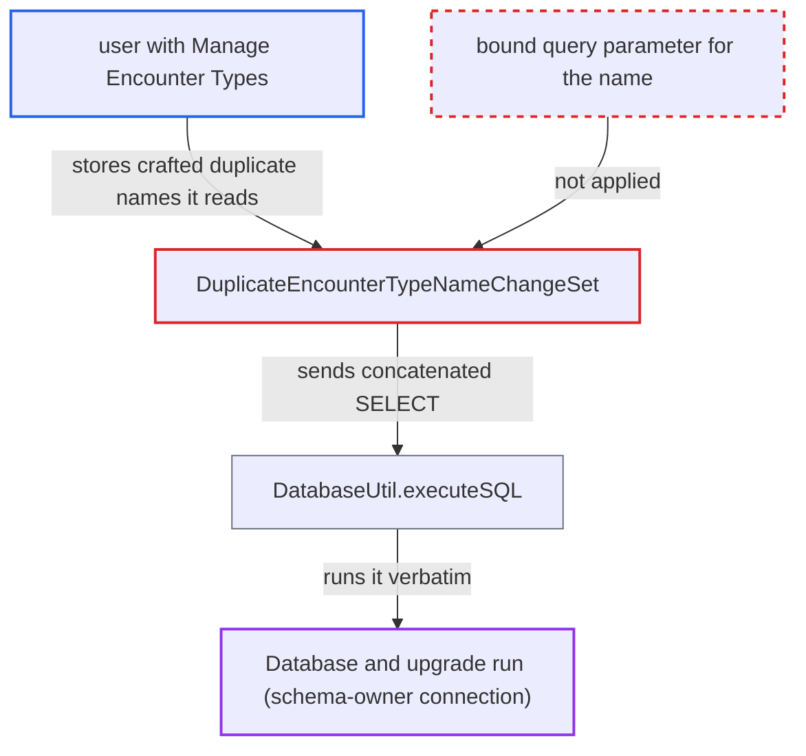

# Second-order SQL injection via encounter type names in upgrade change set

| Field | Value |
|---|---|
| ID | `find_019tgpRhym9hhauom9sgwodv` |
| Severity | **Medium** |
| Status | open |
| CWE | CWE-89 — SQL injection |
| Created | 2026-10-21T23:02:33.159384Z |
| Claude Security | https://claude.ai/security/findings/find_019tgpRhym9hhauom9sgwodv |

## Description

A user who holds the `Manage Encounter Types` privilege can plant an encounter type name that runs as SQL when an administrator later upgrades an old database. This can hang the upgrade indefinitely or abort it, and it leaks data through a blind yes/no signal. It needs a database that predates the unique key on `encounter_type.name`. The cause is `DuplicateEncounterTypeNameChangeSet`, which concatenates the stored name into a SELECT.

1. **attacker with `Manage Encounter Types`** creates two encounter types with the same name, such as `x' OR 1=1#`. The privilege is a non-administrative metadata privilege, and nothing restricts `'`, `#` or `--` in a name; if a duplicate-name validator objects, the attacker retires the first one before creating the second. ([`api/src/main/java/org/openmrs/api/EncounterService.java:246-247`](https://github.com/cx-benchmark/openmrs-core/blob/e6a1b3374ef040e8821dbe4bacc1bdcb50fa4d29/api/src/main/java/org/openmrs/api/EncounterService.java#L246-L247))
2. **administrator** upgrades the old database with this code base. For a pre-2.x database, all update files newer than the detected snapshot are run, including the 2.0.x file, through `DatabaseUpdater.executeChangelog()`. ([`api/src/main/java/org/openmrs/liquibase/ChangeLogDetective.java:136-139`](https://github.com/cx-benchmark/openmrs-core/blob/e6a1b3374ef040e8821dbe4bacc1bdcb50fa4d29/api/src/main/java/org/openmrs/liquibase/ChangeLogDetective.java#L136-L139))
3. **change set `20130809-TRUNK-4044-duplicateEncounterTypeChangeSet`** runs when `encounter_type` is non-empty and reads every name that occurs more than once. The names come straight from the table, and nothing filters quote or comment characters. ([`api/src/main/java/org/openmrs/util/databasechange/DuplicateEncounterTypeNameChangeSet.java:81-100`](https://github.com/cx-benchmark/openmrs-core/blob/e6a1b3374ef040e8821dbe4bacc1bdcb50fa4d29/api/src/main/java/org/openmrs/util/databasechange/DuplicateEncounterTypeNameChangeSet.java#L81-L100))
4. **`DuplicateEncounterTypeNameChangeSet`** builds a probe query by concatenating the stored name plus `_N` into SQL text. The probe is `select * from encounter_type where name = '` followed by the name and a closing quote, so the attacker's text becomes part of the query. ([`api/src/main/java/org/openmrs/util/databasechange/DuplicateEncounterTypeNameChangeSet.java:116-124`](https://github.com/cx-benchmark/openmrs-core/blob/e6a1b3374ef040e8821dbe4bacc1bdcb50fa4d29/api/src/main/java/org/openmrs/util/databasechange/DuplicateEncounterTypeNameChangeSet.java#L116-L124))
5. **`DatabaseUtil.executeSQL`** passes the text through its `selectOnly` guard and runs it verbatim. The guard only rejects strings that start with `insert`, `update`, `delete`, `alter`, `drop`, `create` or `rename`, and the query is run with no bound parameters. ([`api/src/main/java/org/openmrs/util/DatabaseUtil.java:103-133`](https://github.com/cx-benchmark/openmrs-core/blob/e6a1b3374ef040e8821dbe4bacc1bdcb50fa4d29/api/src/main/java/org/openmrs/util/DatabaseUtil.java#L103-L133))
6. **the upgrade connection** executes the injected query as the schema-owning database account. The connection is built from the application's `hibernate.connection.username` and `password`; with `x' OR 1=1#` the probe always returns rows, so the `do … while (duplicateName)` loop never ends while the Liquibase lock is held. ([`api/src/main/java/org/openmrs/util/DatabaseUpdater.java:446-461`](https://github.com/cx-benchmark/openmrs-core/blob/e6a1b3374ef040e8821dbe4bacc1bdcb50fa4d29/api/src/main/java/org/openmrs/util/DatabaseUpdater.java#L446-L461))

## Assessment

The attacker is an internal-network user with the `Manage Encounter Types` privilege. The target must be an OpenMRS database that predates change set `20130809-TRUNK-4044`, where `encounter_type.name` has no unique key. Newer schemas have that key, so duplicates cannot exist there. The attacker creates two encounter types with the same name, retiring the first if a validator objects, because the shipped `EncounterTypeValidator` ignores retired duplicates. The payload fires when an administrator later upgrades that database, either through the routine upgrade wizard or through `auto_update_database`. The report assumes a server reachable only from an internal network.

Impact: The attacker controls the tail of one SELECT run as the schema-owning database account. An always-true predicate traps the upgrade in an endless loop while the Liquibase lock is held, and a stray quote aborts it. Either way the system stays down until an administrator repairs the rows by hand. Sub-selects give only a blind boolean oracle over any table, seen in whether the upgrade completes or in the final `_N` suffix. Stacked statements are blocked with Connector/J 8.0.30 and no `allowMultiQueries`, and file read/write would need the MySQL `FILE` privilege, which the setup wizard's user lacks, so no write is claimed.

## Recommendation

(1) `DuplicateEncounterTypeNameChangeSet` puts a database-stored encounter type name straight into SQL text, so stored data is executed as code during the upgrade.

Fix criteria: The duplicate-name probe binds the candidate name as a `PreparedStatement` parameter, or avoids the probe by computing the new name from the names already loaded. A name containing `'`, `#`, `--` or `\` is only ever compared as data. An encounter type named `x' OR 1=1#` is renamed normally and the upgrade terminates.

(2) `DatabaseUtil.executeSQL` with `selectOnly=true` is relied on as a safety net, but it only checks the leading keyword. It gives no protection against injected text inside a SELECT.

Fix criteria: Custom change sets no longer send user-derived text through `DatabaseUtil.executeSQL`. Any remaining callers pass only constant SQL. The method's documentation and guard are not treated as an injection control.

## Evidence

**https://github.com/cx-benchmark/openmrs-core**

- [`api/src/main/java/org/openmrs/util/databasechange/DuplicateEncounterTypeNameChangeSet.java:116-124`](https://github.com/cx-benchmark/openmrs-core/blob/e6a1b3374ef040e8821dbe4bacc1bdcb50fa4d29/api/src/main/java/org/openmrs/util/databasechange/DuplicateEncounterTypeNameChangeSet.java#L116-L124)
- [`api/src/main/java/org/openmrs/util/databasechange/DuplicateEncounterTypeNameChangeSet.java:81-100`](https://github.com/cx-benchmark/openmrs-core/blob/e6a1b3374ef040e8821dbe4bacc1bdcb50fa4d29/api/src/main/java/org/openmrs/util/databasechange/DuplicateEncounterTypeNameChangeSet.java#L81-L100)
- [`api/src/main/java/org/openmrs/util/DatabaseUtil.java:103-133`](https://github.com/cx-benchmark/openmrs-core/blob/e6a1b3374ef040e8821dbe4bacc1bdcb50fa4d29/api/src/main/java/org/openmrs/util/DatabaseUtil.java#L103-L133)
- [`api/src/main/java/org/openmrs/util/DatabaseUpdater.java:446-461`](https://github.com/cx-benchmark/openmrs-core/blob/e6a1b3374ef040e8821dbe4bacc1bdcb50fa4d29/api/src/main/java/org/openmrs/util/DatabaseUpdater.java#L446-L461)
- [`api/src/main/resources/org/openmrs/liquibase/updates/liquibase-update-to-latest-2.0.x.xml:7336-7349`](https://github.com/cx-benchmark/openmrs-core/blob/e6a1b3374ef040e8821dbe4bacc1bdcb50fa4d29/api/src/main/resources/org/openmrs/liquibase/updates/liquibase-update-to-latest-2.0.x.xml#L7336-L7349)
- [`api/src/main/java/org/openmrs/liquibase/ChangeLogDetective.java:136-139`](https://github.com/cx-benchmark/openmrs-core/blob/e6a1b3374ef040e8821dbe4bacc1bdcb50fa4d29/api/src/main/java/org/openmrs/liquibase/ChangeLogDetective.java#L136-L139)
- [`api/src/main/java/org/openmrs/api/EncounterService.java:246-247`](https://github.com/cx-benchmark/openmrs-core/blob/e6a1b3374ef040e8821dbe4bacc1bdcb50fa4d29/api/src/main/java/org/openmrs/api/EncounterService.java#L246-L247)

