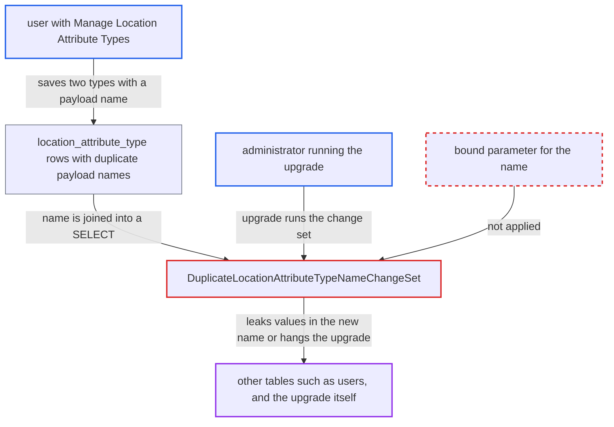

# Second-order SQL injection via location attribute type names in upgrade change set

| Field | Value |
|---|---|
| ID | `find_019g56uSiFK3v9wEZqAx8PUk` |
| Severity | **Medium** |
| Status | open |
| CWE | CWE-89 — SQL injection |
| Created | 2026-10-21T23:03:08.057385Z |
| Claude Security | https://claude.ai/security/findings/find_019g56uSiFK3v9wEZqAx8PUk |

## Description

A user who can manage location attribute types can make an OpenMRS 1.9.x database run their text as SQL when an administrator upgrades it. The attacker can leak values from any table, such as password hashes, or stop the upgrade from ever finishing. The cause is `DuplicateLocationAttributeTypeNameChangeSet`, which concatenates a stored `location_attribute_type.name` into a SELECT without binding or escaping it.

1. **attacker with `Manage Location Attribute Types`** saves two location attribute types with the same payload name. `saveLocationAttributeType` needs only that privilege, and on 1.9.x nothing rejects duplicate names or quotes and comment markers. ([`api/src/main/java/org/openmrs/api/LocationService.java:446-447`](https://github.com/cx-benchmark/openmrs-core/blob/e6a1b3374ef040e8821dbe4bacc1bdcb50fa4d29/api/src/main/java/org/openmrs/api/LocationService.java#L446-L447))
2. **administrator** upgrades the database through the update wizard or with `auto_update_database=true`. `ChangeLogDetective` falls back to snapshot `1.9.x` and runs every newer update file with unrun change sets, which includes the 2.0.x file with this change set. ([`api/src/main/java/org/openmrs/liquibase/ChangeLogDetective.java:134-155`](https://github.com/cx-benchmark/openmrs-core/blob/e6a1b3374ef040e8821dbe4bacc1bdcb50fa4d29/api/src/main/java/org/openmrs/liquibase/ChangeLogDetective.java#L134-L155))
3. **`DuplicateLocationAttributeTypeNameChangeSet`** loads every name that occurs more than once. The names come straight from `location_attribute_type` rows and are not filtered. ([`api/src/main/java/org/openmrs/util/databasechange/DuplicateLocationAttributeTypeNameChangeSet.java:86-103`](https://github.com/cx-benchmark/openmrs-core/blob/e6a1b3374ef040e8821dbe4bacc1bdcb50fa4d29/api/src/main/java/org/openmrs/util/databasechange/DuplicateLocationAttributeTypeNameChangeSet.java#L86-L103))
4. **`DuplicateLocationAttributeTypeNameChangeSet`** builds a probe query by concatenating the stored name into `select * from location_attribute_type where name = '...'`. The candidate is `newName` (the stored name plus `_` and a number), and it is put into the SQL text as is. ([`api/src/main/java/org/openmrs/util/databasechange/DuplicateLocationAttributeTypeNameChangeSet.java:111-125`](https://github.com/cx-benchmark/openmrs-core/blob/e6a1b3374ef040e8821dbe4bacc1bdcb50fa4d29/api/src/main/java/org/openmrs/util/databasechange/DuplicateLocationAttributeTypeNameChangeSet.java#L111-L125))
5. **`DatabaseUtil.executeSQL`** runs the full text unchanged on the application's database connection. The `selectOnly` guard only rejects text that starts with a DML or DDL keyword, so injected text inside the SELECT passes. The connection comes from `DatabaseUpdater.getConnection()`. ([`api/src/main/java/org/openmrs/util/DatabaseUtil.java:103-138`](https://github.com/cx-benchmark/openmrs-core/blob/e6a1b3374ef040e8821dbe4bacc1bdcb50fa4d29/api/src/main/java/org/openmrs/util/DatabaseUtil.java#L103-L138))
6. **`DuplicateLocationAttributeTypeNameChangeSet`** loops until the probe returns no rows, then renames the row to the final `newName`. The injected predicate decides when the loop stops. The suffix at that point is saved in the renamed row, where the attacker can read it. An always-true predicate means the loop never stops. ([`api/src/main/java/org/openmrs/util/databasechange/DuplicateLocationAttributeTypeNameChangeSet.java:126-142`](https://github.com/cx-benchmark/openmrs-core/blob/e6a1b3374ef040e8821dbe4bacc1bdcb50fa4d29/api/src/main/java/org/openmrs/util/databasechange/DuplicateLocationAttributeTypeNameChangeSet.java#L126-L142))

## Assessment

The attacker is an authenticated user, reported as being on the internal network, who holds `Manage Location Attribute Types` on an OpenMRS 1.9.x instance. That version has no unique constraint on `location_attribute_type.name` and no duplicate-name check, so two types with the same payload name can be stored. The attack then waits for an administrator to upgrade that database with this code. The upgrade can be started from the update wizard or by `auto_update_database=true`. Connector/J 8.0.30 is pinned and `allowMultiQueries` is not set, so statements cannot be stacked. The attacker controls only the rest of the SELECT. Two payload shapes are given. `x' OR 1=1#` makes every probe return rows. A predicate such as `x' OR CONCAT('_',(SELECT ASCII(SUBSTRING(password,1,1)) FROM users WHERE user_id=1)) <> '` stops the loop when the suffix equals the secret value.

Impact: The attacker can read values from any table, such as password hashes or patient data, one value per planted pair of types, because the value ends up in the renamed row's name. The attacker can also keep the upgrade from finishing: the loop never ends while the Liquibase lock is held, and the system stays down until an admin repairs the data. Stacked queries are blocked, so the report does not describe any direct change to data.

## Recommendation

(1) `DuplicateLocationAttributeTypeNameChangeSet` builds the duplicate-probe SQL by concatenating a stored name that users wrote, so stored data is run as SQL during the upgrade.

Fix criteria: The probe binds the candidate name as a `PreparedStatement` parameter, or finds a free suffix in memory from the loaded names. A type named `x' OR 1=1#` (or one containing `\` or `--`) is renamed normally. The upgrade terminates. No part of the name is read as SQL.

(2) `DatabaseUtil.executeSQL` with `selectOnly=true` checks only the leading keyword and gives no protection against injected text inside a SELECT, yet change sets pass data-derived SQL through it.

Fix criteria: No caller passes SQL containing data-derived text to `DatabaseUtil.executeSQL`. The remaining callers pass constant SQL only. This is confirmed by reviewing all `executeSQL(Connection, …)` call sites in `org.openmrs.util.databasechange`.

## Evidence

**https://github.com/cx-benchmark/openmrs-core**

- [`api/src/main/java/org/openmrs/util/databasechange/DuplicateLocationAttributeTypeNameChangeSet.java:111-125`](https://github.com/cx-benchmark/openmrs-core/blob/e6a1b3374ef040e8821dbe4bacc1bdcb50fa4d29/api/src/main/java/org/openmrs/util/databasechange/DuplicateLocationAttributeTypeNameChangeSet.java#L111-L125)
- [`api/src/main/java/org/openmrs/util/databasechange/DuplicateLocationAttributeTypeNameChangeSet.java:86-103`](https://github.com/cx-benchmark/openmrs-core/blob/e6a1b3374ef040e8821dbe4bacc1bdcb50fa4d29/api/src/main/java/org/openmrs/util/databasechange/DuplicateLocationAttributeTypeNameChangeSet.java#L86-L103)
- [`api/src/main/java/org/openmrs/util/databasechange/DuplicateLocationAttributeTypeNameChangeSet.java:126-142`](https://github.com/cx-benchmark/openmrs-core/blob/e6a1b3374ef040e8821dbe4bacc1bdcb50fa4d29/api/src/main/java/org/openmrs/util/databasechange/DuplicateLocationAttributeTypeNameChangeSet.java#L126-L142)
- [`api/src/main/java/org/openmrs/util/DatabaseUtil.java:103-138`](https://github.com/cx-benchmark/openmrs-core/blob/e6a1b3374ef040e8821dbe4bacc1bdcb50fa4d29/api/src/main/java/org/openmrs/util/DatabaseUtil.java#L103-L138)
- [`api/src/main/java/org/openmrs/util/DatabaseUpdater.java:446-461`](https://github.com/cx-benchmark/openmrs-core/blob/e6a1b3374ef040e8821dbe4bacc1bdcb50fa4d29/api/src/main/java/org/openmrs/util/DatabaseUpdater.java#L446-L461)
- [`api/src/main/resources/org/openmrs/liquibase/updates/liquibase-update-to-latest-2.0.x.xml:8423-8448`](https://github.com/cx-benchmark/openmrs-core/blob/e6a1b3374ef040e8821dbe4bacc1bdcb50fa4d29/api/src/main/resources/org/openmrs/liquibase/updates/liquibase-update-to-latest-2.0.x.xml#L8423-L8448)
- [`api/src/main/java/org/openmrs/liquibase/ChangeLogDetective.java:134-155`](https://github.com/cx-benchmark/openmrs-core/blob/e6a1b3374ef040e8821dbe4bacc1bdcb50fa4d29/api/src/main/java/org/openmrs/liquibase/ChangeLogDetective.java#L134-L155)
- [`api/src/main/resources/org/openmrs/liquibase/snapshots/schema-only/liquibase-schema-only-1.9.x.xml:2176-2200`](https://github.com/cx-benchmark/openmrs-core/blob/e6a1b3374ef040e8821dbe4bacc1bdcb50fa4d29/api/src/main/resources/org/openmrs/liquibase/snapshots/schema-only/liquibase-schema-only-1.9.x.xml#L2176-L2200)
- [`api/src/main/java/org/openmrs/api/LocationService.java:446-447`](https://github.com/cx-benchmark/openmrs-core/blob/e6a1b3374ef040e8821dbe4bacc1bdcb50fa4d29/api/src/main/java/org/openmrs/api/LocationService.java#L446-L447)

