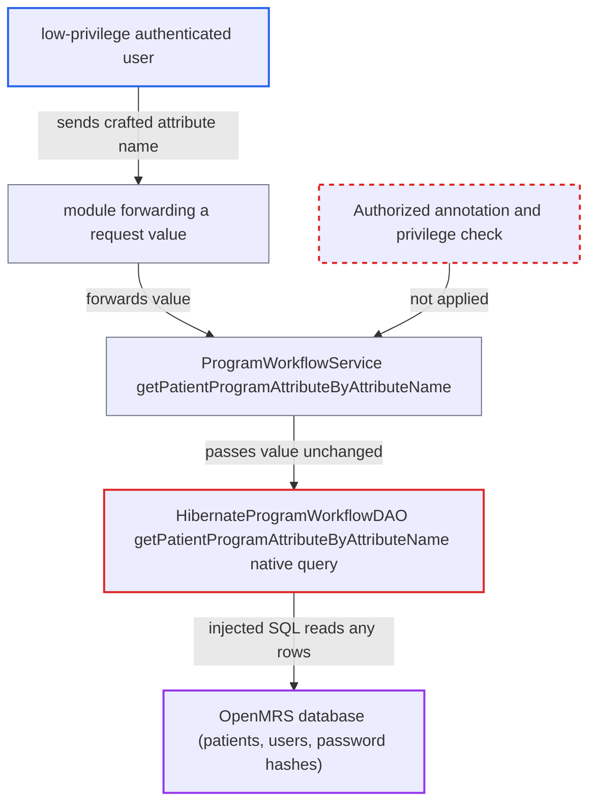

# SQL injection via attributeName in getPatientProgramAttributeByAttributeName native query

| Field | Value |
|---|---|
| ID | `find_01W9vNgGuzfDheL9Bci11fdp` |
| Severity | **Medium** |
| Status | open |
| CWE | CWE-89 — SQL injection |
| Created | 2026-10-21T22:53:04.131196Z |
| Claude Security | https://claude.ai/security/findings/find_01W9vNgGuzfDheL9Bci11fdp |

## Description

A low-privilege OpenMRS user on the internal network can read the whole database, including patient records and password hashes. The attack needs a deployed module that passes a request value to the service method, and core ships none. The DAO method `getPatientProgramAttributeByAttributeName` pastes `attributeName` into native SQL, and the service method has no `@Authorized` check.

1. **attacker** sends a crafted attribute name to a module that forwards it to the service. The value closes the quoted string and appends a UNION query, for example `x' GROUP BY p.patient_id UNION SELECT user_id, CONCAT(username,':',password,':',salt) FROM users -- `.
2. **the service method `ProgramWorkflowService.getPatientProgramAttributeByAttributeName`** accepts the call without any privilege check. The method has no `@Authorized` annotation, so `AuthorizationAdvice.before` finds no privilege list and checks nothing, not even that the caller is authenticated. ([`api/src/main/java/org/openmrs/api/ProgramWorkflowService.java:560`](https://github.com/cx-benchmark/openmrs-core/blob/e6a1b3374ef040e8821dbe4bacc1bdcb50fa4d29/api/src/main/java/org/openmrs/api/ProgramWorkflowService.java#L560))
3. **`AuthorizationAdvice.before`** lets the call through. It enforces privileges only when the method carries `@Authorized` attributes (the `if (!privileges.isEmpty())` test), and the authentication-only branch also needs the annotation. ([`api/src/main/java/org/openmrs/aop/AuthorizationAdvice.java:59-99`](https://github.com/cx-benchmark/openmrs-core/blob/e6a1b3374ef040e8821dbe4bacc1bdcb50fa4d29/api/src/main/java/org/openmrs/aop/AuthorizationAdvice.java#L59-L99))
4. **`ProgramWorkflowServiceImpl`** passes both arguments to the DAO unchanged. Nothing validates or limits `attributeName` on the way. ([`api/src/main/java/org/openmrs/api/impl/ProgramWorkflowServiceImpl.java:631-633`](https://github.com/cx-benchmark/openmrs-core/blob/e6a1b3374ef040e8821dbe4bacc1bdcb50fa4d29/api/src/main/java/org/openmrs/api/impl/ProgramWorkflowServiceImpl.java#L631-L633))
5. **the DAO method `getPatientProgramAttributeByAttributeName`** concatenates `attributeName` into a native SQL string and runs it. The value is placed between single quotes in the JOIN condition (`ppt.name ='" + attributeName + "'`, line 464) with no binding or escaping, so the attacker's text changes the query. ([`api/src/main/java/org/openmrs/api/db/hibernate/HibernateProgramWorkflowDAO.java:452-477`](https://github.com/cx-benchmark/openmrs-core/blob/e6a1b3374ef040e8821dbe4bacc1bdcb50fa4d29/api/src/main/java/org/openmrs/api/db/hibernate/HibernateProgramWorkflowDAO.java#L452-L477))
6. **MySQL** returns the attacker-chosen rows through the two `addScalar` columns. The columns are `person_id` (INTEGER) and `patientProgramAttributeValue` (STRING). Boolean-blind and `SLEEP()` time-based variants also work. ([`api/src/main/java/org/openmrs/api/db/hibernate/HibernateProgramWorkflowDAO.java:452-477`](https://github.com/cx-benchmark/openmrs-core/blob/e6a1b3374ef040e8821dbe4bacc1bdcb50fa4d29/api/src/main/java/org/openmrs/api/db/hibernate/HibernateProgramWorkflowDAO.java#L452-L477))

## Assessment

The attacker is an authenticated low-privilege OpenMRS user on the internal network. The report's threat model assumes the server is reachable only from there. A deployed module must pass a request value to `ProgramWorkflowService.getPatientProgramAttributeByAttributeName`. Core does not call this method. It is public service API, so it is reachable from the network only through such a module. No special database setting is needed. The default JDBC URLs (`InitializationWizardModel.databaseConnection` line 103, `hibernate.default.properties` line 7) do not set `allowMultiQueries`, so the injection is limited to SELECT statements. Even without injection, a caller who lacks `Get Patient Programs` can read patient-program attribute values for any patient ids.

Impact: The attacker can read the whole OpenMRS database. That includes patient data tables (patient, person, obs, encounter), `users.password` and `salt` hashes, and global properties. Stacked statements are unavailable by default, so the report says this gives no direct way to change data. `SLEEP()` or `BENCHMARK()` in the injected SQL can hold pooled connections and degrade the service.

## Recommendation

(1) `HibernateProgramWorkflowDAO.getPatientProgramAttributeByAttributeName` concatenates the caller-supplied `attributeName` into a native SQL statement, so the caller can change the structure of the query.

Fix criteria: The attribute name and the patient id list reach the database only as bound parameters (`setParameter` / `setParameterList`) or through a Criteria API query. No caller-supplied string is concatenated into the SQL text, and no `+ attributeName +` remains in the query construction. Calling the service with `attributeName` set to `x' OR 1=1 -- ` and to `x' UNION SELECT ... -- ` returns no rows, because the value is treated as a literal.

(2) `ProgramWorkflowService.getPatientProgramAttributeByAttributeName` has no `@Authorized` annotation, so `AuthorizationAdvice` performs no privilege check and any caller can read patient-program attribute values for arbitrary patients.

Fix criteria: The service method requires an appropriate privilege, at least `Get Patient Programs`, consistent with `getPatientProgramByAttributeNameAndValue`. A user without that privilege who calls it gets an `APIAuthenticationException`.

## Evidence

**https://github.com/cx-benchmark/openmrs-core**

- [`api/src/main/java/org/openmrs/api/db/hibernate/HibernateProgramWorkflowDAO.java:452-477`](https://github.com/cx-benchmark/openmrs-core/blob/e6a1b3374ef040e8821dbe4bacc1bdcb50fa4d29/api/src/main/java/org/openmrs/api/db/hibernate/HibernateProgramWorkflowDAO.java#L452-L477)
- [`api/src/main/java/org/openmrs/api/ProgramWorkflowService.java:560`](https://github.com/cx-benchmark/openmrs-core/blob/e6a1b3374ef040e8821dbe4bacc1bdcb50fa4d29/api/src/main/java/org/openmrs/api/ProgramWorkflowService.java#L560)
- [`api/src/main/java/org/openmrs/api/impl/ProgramWorkflowServiceImpl.java:631-633`](https://github.com/cx-benchmark/openmrs-core/blob/e6a1b3374ef040e8821dbe4bacc1bdcb50fa4d29/api/src/main/java/org/openmrs/api/impl/ProgramWorkflowServiceImpl.java#L631-L633)
- [`api/src/main/java/org/openmrs/aop/AuthorizationAdvice.java:59-99`](https://github.com/cx-benchmark/openmrs-core/blob/e6a1b3374ef040e8821dbe4bacc1bdcb50fa4d29/api/src/main/java/org/openmrs/aop/AuthorizationAdvice.java#L59-L99)

