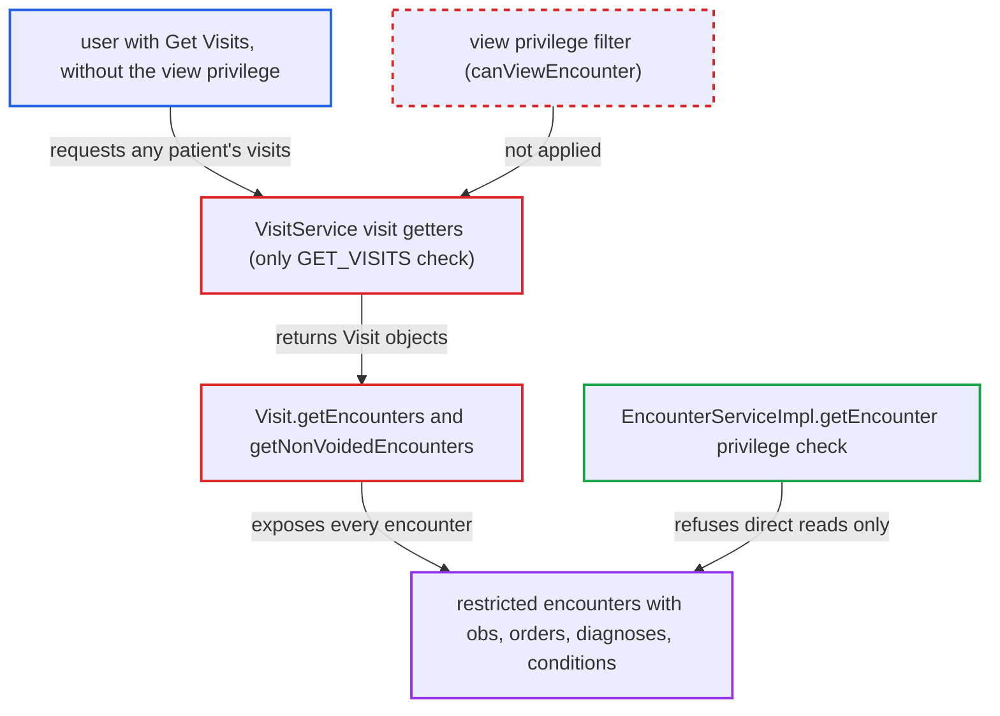

# Visit.getEncounters() exposes encounters of view-restricted types to Get Visits holders

| Field | Value |
|---|---|
| ID | `find_01XMnNWA4EZNn99bB6k4dvbJ` |
| Severity | **Medium** |
| Status | open |
| CWE | CWE-862 — Missing authorization |
| Created | 2026-10-21T23:18:11.730820Z |
| Claude Security | https://claude.ai/security/findings/find_01XMnNWA4EZNn99bB6k4dvbJ |

## Description

A user with the `Get Visits` privilege can read encounters that the deployment restricted to other users, including their obs, orders, diagnoses and conditions, for any patient whose visits they can list. It needs an encounter type with a `viewPrivilege` set (none is set by default) and a module that serves visits. The cause is that `VisitService` returns `Visit` objects whose `getEncounters()` is not filtered by encounter-type view privileges.

1. **attacker with `Get Visits`** asks a module that serves visits for a patient's visits. The report assumes the REST module's visit resource as such a module. Core `web/` has no caller that renders `visit.getEncounters()`.
2. **`VisitService` visit getters** accept the call after only the generic privilege check. The getters require `GET_VISITS` and nothing specific to encounter types. They do not require `Get Encounters` for the encounters a visit carries. ([`api/src/main/java/org/openmrs/api/VisitService.java:135-157`](https://github.com/cx-benchmark/openmrs-core/blob/e6a1b3374ef040e8821dbe4bacc1bdcb50fa4d29/api/src/main/java/org/openmrs/api/VisitService.java#L135-L157))
3. **`VisitServiceImpl`** returns the visits from the DAO unchanged. `getVisit`, `getVisitByUuid`, `getVisitsByPatient` and the other getters do not filter the visit's encounters by the caller's view privileges. ([`api/src/main/java/org/openmrs/api/impl/VisitServiceImpl.java:143-165`](https://github.com/cx-benchmark/openmrs-core/blob/e6a1b3374ef040e8821dbe4bacc1bdcb50fa4d29/api/src/main/java/org/openmrs/api/impl/VisitServiceImpl.java#L143-L165))
4. **`Visit.encounters`** loads every encounter of the visit whatever its type. The `@OneToMany(mappedBy = "visit")` mapping has no `@Where` or filter. ([`api/src/main/java/org/openmrs/Visit.java:73-75`](https://github.com/cx-benchmark/openmrs-core/blob/e6a1b3374ef040e8821dbe4bacc1bdcb50fa4d29/api/src/main/java/org/openmrs/Visit.java#L73-L75))
5. **`Visit.getEncounters()` and `getNonVoidedEncounters()`** hand back the full collection of encounters. The only filtering is on `voided`. These are the same `Encounter` objects that `EncounterServiceImpl.getEncounter(Integer)` refuses to give this user. ([`api/src/main/java/org/openmrs/Visit.java:238-260`](https://github.com/cx-benchmark/openmrs-core/blob/e6a1b3374ef040e8821dbe4bacc1bdcb50fa4d29/api/src/main/java/org/openmrs/Visit.java#L238-L260))
6. **the consuming module** serialises the visit's encounters and their content. `OpenSessionInViewFilter` keeps the Hibernate session open for the whole request, so the obs, orders, diagnoses and conditions can be lazily loaded. ([`webapp/src/main/webapp/WEB-INF/web.xml:141-150`](https://github.com/cx-benchmark/openmrs-core/blob/e6a1b3374ef040e8821dbe4bacc1bdcb50fa4d29/webapp/src/main/webapp/WEB-INF/web.xml#L141-L150))

## Assessment

The attacker is an authenticated clinical user on the internal network. They hold `Get Visits`, with or without `Get Encounters`, but not the `viewPrivilege` set on a sensitive encounter type. At least one encounter type must have a `viewPrivilege` configured, and none has one by default. A module that calls `VisitService` for users and serialises the visit's encounters must also be present. The report assumes the REST module's visit resource, which it did not inspect. Calls such as `VisitService.getVisitsByPatient` or `getVisit` pass the generic check and return visits for any patient.

Impact: The attacker can read the full clinical content of encounters the deployment deliberately restricted, for any patient whose visits they can list. The exposure is read-only, so nothing can be changed through this path.

## Recommendation

Encounter-type view authorization is enforced only inside `EncounterService` methods. `Visit` objects returned by `VisitService` carry an unfiltered `encounters` collection, so the restriction is bypassed by going through the visit.

Fix criteria: A caller without an encounter type's `viewPrivilege` cannot get encounters of that type, or their content, from any `VisitService` return value. Either the service returns visits whose encounter collection is filtered by `canViewEncounter`, or encounter access goes through the filtered `EncounterService.getEncountersByVisit`. To verify, configure a restricted type and call `getVisitsByPatient(...).get(0).getEncounters()` and `getNonVoidedEncounters()` as a caller without the privilege. Neither may contain an encounter of that type. An authorised caller must still see them.

## Evidence

**https://github.com/cx-benchmark/openmrs-core**

- [`api/src/main/java/org/openmrs/api/impl/VisitServiceImpl.java:143-165`](https://github.com/cx-benchmark/openmrs-core/blob/e6a1b3374ef040e8821dbe4bacc1bdcb50fa4d29/api/src/main/java/org/openmrs/api/impl/VisitServiceImpl.java#L143-L165)
- [`api/src/main/java/org/openmrs/api/impl/VisitServiceImpl.java:229-278`](https://github.com/cx-benchmark/openmrs-core/blob/e6a1b3374ef040e8821dbe4bacc1bdcb50fa4d29/api/src/main/java/org/openmrs/api/impl/VisitServiceImpl.java#L229-L278)
- [`api/src/main/java/org/openmrs/Visit.java:73-75`](https://github.com/cx-benchmark/openmrs-core/blob/e6a1b3374ef040e8821dbe4bacc1bdcb50fa4d29/api/src/main/java/org/openmrs/Visit.java#L73-L75)
- [`api/src/main/java/org/openmrs/Visit.java:238-260`](https://github.com/cx-benchmark/openmrs-core/blob/e6a1b3374ef040e8821dbe4bacc1bdcb50fa4d29/api/src/main/java/org/openmrs/Visit.java#L238-L260)
- [`api/src/main/java/org/openmrs/api/VisitService.java:135-157`](https://github.com/cx-benchmark/openmrs-core/blob/e6a1b3374ef040e8821dbe4bacc1bdcb50fa4d29/api/src/main/java/org/openmrs/api/VisitService.java#L135-L157)
- [`api/src/main/java/org/openmrs/api/impl/EncounterServiceImpl.java:305-315`](https://github.com/cx-benchmark/openmrs-core/blob/e6a1b3374ef040e8821dbe4bacc1bdcb50fa4d29/api/src/main/java/org/openmrs/api/impl/EncounterServiceImpl.java#L305-L315)
- [`api/src/main/java/org/openmrs/api/impl/EncounterServiceImpl.java:832-835`](https://github.com/cx-benchmark/openmrs-core/blob/e6a1b3374ef040e8821dbe4bacc1bdcb50fa4d29/api/src/main/java/org/openmrs/api/impl/EncounterServiceImpl.java#L832-L835)
- [`api/src/main/resources/messages.properties:1128-1129`](https://github.com/cx-benchmark/openmrs-core/blob/e6a1b3374ef040e8821dbe4bacc1bdcb50fa4d29/api/src/main/resources/messages.properties#L1128-L1129)
- [`webapp/src/main/webapp/WEB-INF/web.xml:141-150`](https://github.com/cx-benchmark/openmrs-core/blob/e6a1b3374ef040e8821dbe4bacc1bdcb50fa4d29/webapp/src/main/webapp/WEB-INF/web.xml#L141-L150)

