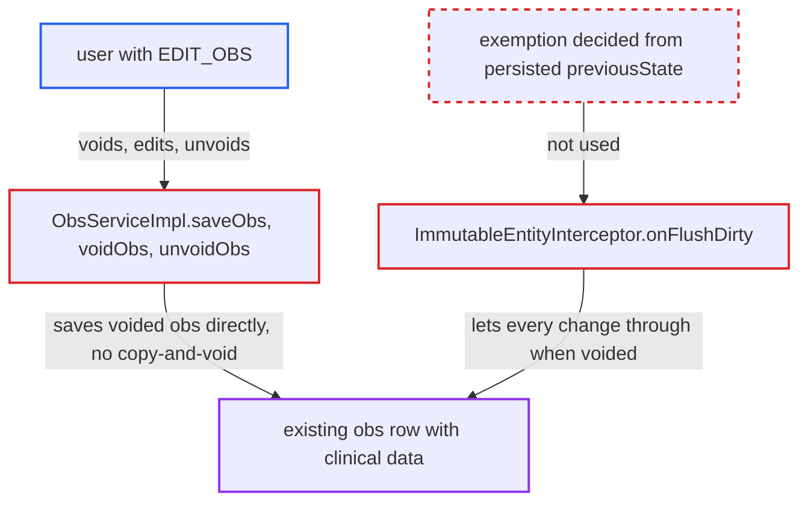

# Voided-obs immutability exemption lets EDIT_OBS users rewrite live obs without trace

| Field | Value |
|---|---|
| ID | `find_01UkLWq6eeSHfFfPEXGZe2Dm` |
| Severity | **Medium** |
| Status | open |
| CWE | CWE-471 — Modification of Assumed-Immutable Data |
| Created | 2026-10-21T23:00:40.254372Z |
| Claude Security | https://claude.ai/security/findings/find_01UkLWq6eeSHfFfPEXGZe2Dm |

## Description

A user with the `EDIT_OBS` privilege can silently rewrite any patient's clinical observation (obs) in place. The original value is destroyed, and the record still looks like the original clinician's entry. It needs no victim action. The cause is that `ImmutableObsInterceptor` and `ImmutableEntityInterceptor.onFlushDirty` skip the immutability check whenever the obs is voided, judged from its current in-memory state.

1. **attacker with `EDIT_OBS`** voids a live obs with `voidObs`. `voidObs` needs only `EDIT_OBS`, and the void handler sets `voided=true` before the service method runs. ([`api/src/main/java/org/openmrs/api/ObsService.java:139-151`](https://github.com/cx-benchmark/openmrs-core/blob/e6a1b3374ef040e8821dbe4bacc1bdcb50fa4d29/api/src/main/java/org/openmrs/api/ObsService.java#L139-L151))
2. **attacker** changes fields on the voided obs and calls `saveObs`. `saveObs` sends any voided obs straight to `dao.saveObs`, so the copy-and-void versioning in `saveExistingObs` never runs. ([`api/src/main/java/org/openmrs/api/impl/ObsServiceImpl.java:102-108`](https://github.com/cx-benchmark/openmrs-core/blob/e6a1b3374ef040e8821dbe4bacc1bdcb50fa4d29/api/src/main/java/org/openmrs/api/impl/ObsServiceImpl.java#L102-L108))
3. **the interceptor `ImmutableEntityInterceptor.onFlushDirty`** lets the changed values through. It reads `getVoided()` from the entity as it is now, not from `previousState`, and `ignoreVoidedOrRetiredObjects()` returns `true`, so every property is writable. ([`api/src/main/java/org/openmrs/api/db/hibernate/ImmutableEntityInterceptor.java:80-116`](https://github.com/cx-benchmark/openmrs-core/blob/e6a1b3374ef040e8821dbe4bacc1bdcb50fa4d29/api/src/main/java/org/openmrs/api/db/hibernate/ImmutableEntityInterceptor.java#L80-L116))
4. **attacker** calls `unvoidObs` on the edited obs. Only the `voided*` fields change in this flush, which the interceptor allows, so the edited values become the live obs again. ([`api/src/main/java/org/openmrs/api/impl/ObsServiceImpl.java:281-300`](https://github.com/cx-benchmark/openmrs-core/blob/e6a1b3374ef040e8821dbe4bacc1bdcb50fa4d29/api/src/main/java/org/openmrs/api/impl/ObsServiceImpl.java#L281-L300))
5. **the unvoid handler `BaseUnvoidHandler`** clears `voided`, `voidedBy`, `dateVoided` and `voidReason`. This erases `voided_by`, the only record of who voided the obs. ([`api/src/main/java/org/openmrs/api/handler/BaseUnvoidHandler.java:51-63`](https://github.com/cx-benchmark/openmrs-core/blob/e6a1b3374ef040e8821dbe4bacc1bdcb50fa4d29/api/src/main/java/org/openmrs/api/handler/BaseUnvoidHandler.java#L51-L63))
6. **the `obs` table row** keeps its identity but holds the new content. The row keeps its `obs_id`, original `creator` and `dateCreated`, has no `previous_version`, and the mapping has no `changedBy` or `dateChanged` columns, so nothing marks the change. ([`api/src/main/resources/org/openmrs/api/db/hibernate/Obs.hbm.xml:18-101`](https://github.com/cx-benchmark/openmrs-core/blob/e6a1b3374ef040e8821dbe4bacc1bdcb50fa4d29/api/src/main/resources/org/openmrs/api/db/hibernate/Obs.hbm.xml#L18-L101))

## Assessment

The attacker is an authenticated clinical user with `EDIT_OBS` who calls the public `ObsService` API through any client. No victim action is needed. The report says the server is reachable only from the internal network. There are two ways in. In the first, the attacker calls `voidObs`, edits the voided obs and calls `saveObs`, then calls `unvoidObs`. In the second, the attacker changes fields on a live obs and then calls `voidObs`. The void handler has already set `voided=true` when the interceptor runs, so the changes go out in the same flush. That goes beyond the documented exception, which covers only editing an obs that was already voided. `ObsValidator` also skips validation for voided obs.

Impact: The attacker can overwrite the recorded value, concept, `obsDatetime`, `person`, `encounter`, `creator` or `dateCreated` of any patient's obs and destroy the original. The rewritten obs stays attributed to the original clinician and date, with no version link, so it is indistinguishable from the original. This has the effect of a purge, which normally needs `DELETE_OBS`. The report names no effect on confidentiality or availability.

## Recommendation

(1) `ImmutableObsInterceptor` exempts voided obs from immutability wholesale, and `ImmutableEntityInterceptor` takes the exemption from the in-memory `voided` flag. Void, edit, unvoid (or edit, then void) therefore changes clinical content in place.

Fix criteria: No sequence of `voidObs`, `saveObs` and `unvoidObs` calls by an `EDIT_OBS` user can change a non-whitelisted property of an existing `obs` row. Such a change is either rejected with `UnchangeableObjectException` or produces a new obs row with `previousVersion` set and the original voided. Any remaining exemption for voided obs covers only the properties patient-merge needs (for example `person`, `encounter`) and is decided from the persisted `previousState`, not the current entity. Attempting the three-step sequence and the mutate-then-void variant leaves the original row's value unchanged.

(2) `ObsServiceImpl.saveObs` skips copy-and-void for any obs whose `voided` flag is set, and relies only on the interceptor exemption.

Fix criteria: Edits to voided obs through `saveObs` go through the same versioning as edits to live obs, or are refused, except for the narrowly defined merge path. Unvoiding is not possible for an obs whose content differs from what was voided.

## Evidence

**https://github.com/cx-benchmark/openmrs-core**

- [`api/src/main/java/org/openmrs/api/db/hibernate/ImmutableObsInterceptor.java:47-50`](https://github.com/cx-benchmark/openmrs-core/blob/e6a1b3374ef040e8821dbe4bacc1bdcb50fa4d29/api/src/main/java/org/openmrs/api/db/hibernate/ImmutableObsInterceptor.java#L47-L50)
- [`api/src/main/java/org/openmrs/api/db/hibernate/ImmutableEntityInterceptor.java:80-116`](https://github.com/cx-benchmark/openmrs-core/blob/e6a1b3374ef040e8821dbe4bacc1bdcb50fa4d29/api/src/main/java/org/openmrs/api/db/hibernate/ImmutableEntityInterceptor.java#L80-L116)
- [`api/src/main/java/org/openmrs/api/impl/ObsServiceImpl.java:102-108`](https://github.com/cx-benchmark/openmrs-core/blob/e6a1b3374ef040e8821dbe4bacc1bdcb50fa4d29/api/src/main/java/org/openmrs/api/impl/ObsServiceImpl.java#L102-L108)
- [`api/src/main/java/org/openmrs/api/impl/ObsServiceImpl.java:281-300`](https://github.com/cx-benchmark/openmrs-core/blob/e6a1b3374ef040e8821dbe4bacc1bdcb50fa4d29/api/src/main/java/org/openmrs/api/impl/ObsServiceImpl.java#L281-L300)
- [`api/src/main/java/org/openmrs/api/ObsService.java:139-151`](https://github.com/cx-benchmark/openmrs-core/blob/e6a1b3374ef040e8821dbe4bacc1bdcb50fa4d29/api/src/main/java/org/openmrs/api/ObsService.java#L139-L151)
- [`api/src/main/java/org/openmrs/aop/RequiredDataAdvice.java:159-173`](https://github.com/cx-benchmark/openmrs-core/blob/e6a1b3374ef040e8821dbe4bacc1bdcb50fa4d29/api/src/main/java/org/openmrs/aop/RequiredDataAdvice.java#L159-L173)
- [`api/src/main/java/org/openmrs/api/handler/BaseUnvoidHandler.java:51-63`](https://github.com/cx-benchmark/openmrs-core/blob/e6a1b3374ef040e8821dbe4bacc1bdcb50fa4d29/api/src/main/java/org/openmrs/api/handler/BaseUnvoidHandler.java#L51-L63)
- [`api/src/main/resources/org/openmrs/api/db/hibernate/Obs.hbm.xml:18-101`](https://github.com/cx-benchmark/openmrs-core/blob/e6a1b3374ef040e8821dbe4bacc1bdcb50fa4d29/api/src/main/resources/org/openmrs/api/db/hibernate/Obs.hbm.xml#L18-L101)
- [`api/src/main/java/org/openmrs/api/impl/PatientServiceImpl.java:726-731`](https://github.com/cx-benchmark/openmrs-core/blob/e6a1b3374ef040e8821dbe4bacc1bdcb50fa4d29/api/src/main/java/org/openmrs/api/impl/PatientServiceImpl.java#L726-L731)

