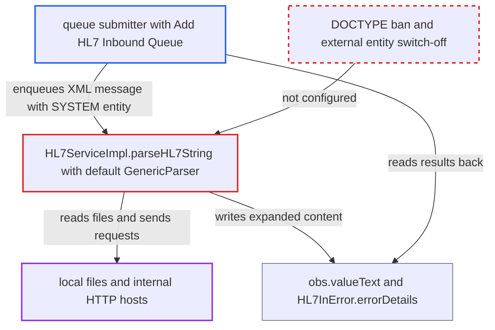

# XXE in HL7 inbound queue: HAPI 2.1 GenericParser parses XML-encoded messages with external entities enabled

| Field | Value |
|---|---|
| ID | `find_01K9bdBNUjQ9LogvKkQYJtLw` |
| Severity | **Medium** |
| Status | open |
| CWE | CWE-611 — XML external entity injection |
| Created | 2026-10-21T23:02:15.035731Z |
| Claude Security | https://claude.ai/security/findings/find_01K9bdBNUjQ9LogvKkQYJtLw |

## Description

A user who can add messages to the HL7 inbound queue can make the OpenMRS server read local files and send requests to internal hosts. Files must be well-formed XML text to be read. The attack needs the `Add HL7 Inbound Queue` privilege, internal network access and active queue processing. The cause is `GenericParser` in HAPI 2.1, which resolves external entities in XML-encoded messages passed to `parseHL7String`.

1. **attacker** enqueues an XML-encoded `ORU_R01` message with a DOCTYPE. The DOCTYPE declares a `SYSTEM` entity pointing at a `file:` or `http:` URL, and the entity is referenced in `OBX.5`. Queueing needs only `Add HL7 Inbound Queue` or `Update HL7 Inbound Queue`. ([`api/src/main/java/org/openmrs/hl7/HL7Service.java:103-104`](https://github.com/cx-benchmark/openmrs-core/blob/e6a1b3374ef040e8821dbe4bacc1bdcb50fa4d29/api/src/main/java/org/openmrs/hl7/HL7Service.java#L103-L104))
2. **queue processor `processHL7InQueue`** takes each queued row and parses its HL7 text. The text goes to the parser before any OpenMRS check, so nothing looks at the message first. ([`api/src/main/java/org/openmrs/hl7/impl/HL7ServiceImpl.java:703-732`](https://github.com/cx-benchmark/openmrs-core/blob/e6a1b3374ef040e8821dbe4bacc1bdcb50fa4d29/api/src/main/java/org/openmrs/hl7/impl/HL7ServiceImpl.java#L703-L732))
3. **`parseHL7String`** passes the raw text to `parser.parse` on a default `GenericParser`. A text that does not start with `MSH` but contains `<MSH.1`, `<MSH.2` and `</MSH>` is sent to HAPI's XML parser. No pre-check forces pipe encoding. ([`api/src/main/java/org/openmrs/hl7/impl/HL7ServiceImpl.java:790-806`](https://github.com/cx-benchmark/openmrs-core/blob/e6a1b3374ef040e8821dbe4bacc1bdcb50fa4d29/api/src/main/java/org/openmrs/hl7/impl/HL7ServiceImpl.java#L790-L806))
4. **HAPI 2.1 XML parser** expands the external entity while building the DOM. `XMLUtils.parse` sets only `element-content-whitespace`, `namespaces` and `validate-if-schema`. DOCTYPEs and external entities are therefore processed with default Xerces settings. The report states this as an assumption about HAPI 2.1. ([`pom.xml:317-320`](https://github.com/cx-benchmark/openmrs-core/blob/e6a1b3374ef040e8821dbe4bacc1bdcb50fa4d29/pom.xml#L317-L320))
5. **`ORUR01Handler.parseObs`** stores the expanded text as `obs.valueText`. An `ST` typed OBX-5 value is saved verbatim on the patient named in PID, so the file contents can be read back from the obs. ([`api/src/main/java/org/openmrs/hl7/handler/ORUR01Handler.java:789-796`](https://github.com/cx-benchmark/openmrs-core/blob/e6a1b3374ef040e8821dbe4bacc1bdcb50fa4d29/api/src/main/java/org/openmrs/hl7/handler/ORUR01Handler.java#L789-L796))
6. **error path in `ORUR01Handler` and `setFatalError`** copies the expanded OBX into `HL7InError.errorDetails` if the OBX fails. This happens, for example, with an unknown concept. The error details can be read with `Get HL7 Inbound Exception`. ([`api/src/main/java/org/openmrs/hl7/impl/HL7ServiceImpl.java:772-780`](https://github.com/cx-benchmark/openmrs-core/blob/e6a1b3374ef040e8821dbe4bacc1bdcb50fa4d29/api/src/main/java/org/openmrs/hl7/impl/HL7ServiceImpl.java#L772-L780))

## Assessment

The attacker holds `Add HL7 Inbound Queue`, typically through an HL7 feed or integration account. They are on the internal network, because the report says the server is not reachable from the internet. Queue processing must be active. Core does not schedule it by default, so an operator must schedule `ProcessHL7InQueueTask` or a module must call `processHL7InQueue`. Without any read privilege, the attacker can also use a parameter-entity payload that loads an external DTD from a host they run, which leaks file contents out-of-band. The attack relies on the stated behaviour of `hapi-base` 2.1.

Impact: The attacker can read any file the OpenMRS process can read, if its content is well-formed XML text. Examples are single-line secrets, keys, tokens, most plain-text config files and `/etc/passwd`. A file with a bare `&` or `<` aborts the parse, so the default `openmrs-runtime.properties` is probably not readable, because its JDBC URL contains `&`. A directory path returns a listing, so the filesystem can be enumerated. No data is changed by the parse.

Subsequent-system impact: `http://` entities make the server send GET requests to hosts on its internal network (SSRF). Well-formed responses can come back through the obs or error channels. This gives limited reads of internal unauthenticated HTTP services and no write capability.

## Recommendation

Untrusted HL7 queue text is parsed by HAPI 2.1's XML path, which resolves DTDs and external entities. The application neither restricts the encoding nor hardens the parser.

Fix criteria: XML-encoded HL7 is parsed with DOCTYPE declarations rejected and with external general and parameter entities and external DTD loading disabled. A HAPI release that does this, or forcing it in the parser setup, both qualify. Alternatively, the queue accepts only ER7 pipe encoding and rejects XML. To verify, enqueue an XML message with a `SYSTEM` `file:` or `http:` entity. Processing must fail with no file read and no outbound request. No entity content may appear in `obs` or `hl7_in_error`.

## Evidence

**https://github.com/cx-benchmark/openmrs-core**

- [`api/src/main/java/org/openmrs/hl7/impl/HL7ServiceImpl.java:790-806`](https://github.com/cx-benchmark/openmrs-core/blob/e6a1b3374ef040e8821dbe4bacc1bdcb50fa4d29/api/src/main/java/org/openmrs/hl7/impl/HL7ServiceImpl.java#L790-L806)
- [`api/src/main/resources/applicationContext-service.xml:333-336`](https://github.com/cx-benchmark/openmrs-core/blob/e6a1b3374ef040e8821dbe4bacc1bdcb50fa4d29/api/src/main/resources/applicationContext-service.xml#L333-L336)
- [`pom.xml:317-320`](https://github.com/cx-benchmark/openmrs-core/blob/e6a1b3374ef040e8821dbe4bacc1bdcb50fa4d29/pom.xml#L317-L320)
- [`api/pom.xml:203-205`](https://github.com/cx-benchmark/openmrs-core/blob/e6a1b3374ef040e8821dbe4bacc1bdcb50fa4d29/api/pom.xml#L203-L205)
- [`api/src/main/java/org/openmrs/hl7/impl/HL7ServiceImpl.java:703-732`](https://github.com/cx-benchmark/openmrs-core/blob/e6a1b3374ef040e8821dbe4bacc1bdcb50fa4d29/api/src/main/java/org/openmrs/hl7/impl/HL7ServiceImpl.java#L703-L732)
- [`api/src/main/java/org/openmrs/hl7/handler/ORUR01Handler.java:789-796`](https://github.com/cx-benchmark/openmrs-core/blob/e6a1b3374ef040e8821dbe4bacc1bdcb50fa4d29/api/src/main/java/org/openmrs/hl7/handler/ORUR01Handler.java#L789-L796)
- [`api/src/main/java/org/openmrs/hl7/handler/ORUR01Handler.java:350-355`](https://github.com/cx-benchmark/openmrs-core/blob/e6a1b3374ef040e8821dbe4bacc1bdcb50fa4d29/api/src/main/java/org/openmrs/hl7/handler/ORUR01Handler.java#L350-L355)
- [`api/src/main/java/org/openmrs/hl7/impl/HL7ServiceImpl.java:772-780`](https://github.com/cx-benchmark/openmrs-core/blob/e6a1b3374ef040e8821dbe4bacc1bdcb50fa4d29/api/src/main/java/org/openmrs/hl7/impl/HL7ServiceImpl.java#L772-L780)
- [`api/src/main/java/org/openmrs/hl7/HL7Service.java:103-104`](https://github.com/cx-benchmark/openmrs-core/blob/e6a1b3374ef040e8821dbe4bacc1bdcb50fa4d29/api/src/main/java/org/openmrs/hl7/HL7Service.java#L103-L104)

