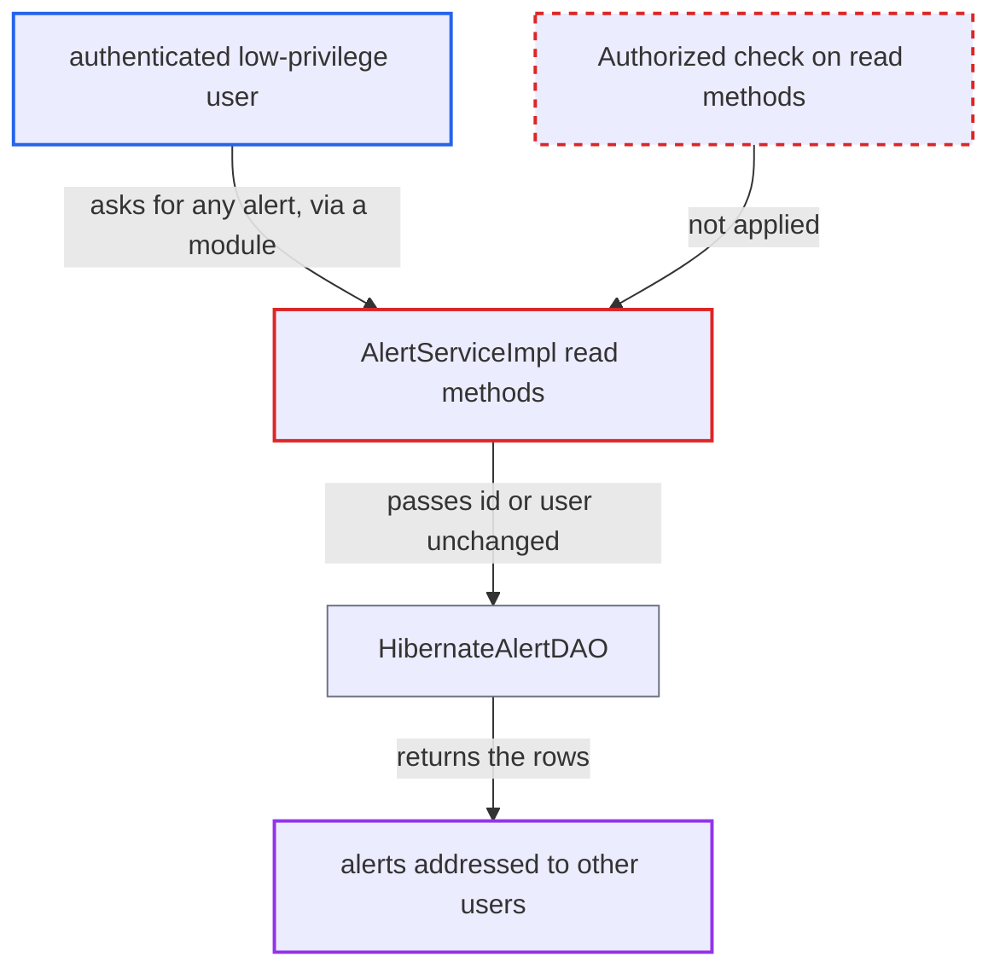

# AlertService read methods lack authorization, letting any caller read other users' alerts

| Field | Value |
|---|---|
| ID | `find_01DHsyiEZnn6XdZNjY7shrfX` |
| Severity | **Low** |
| Status | open |
| CWE | CWE-862 — Missing authorization |
| Created | 2026-10-21T22:56:39.825124Z |
| Claude Security | https://claude.ai/security/findings/find_01DHsyiEZnn6XdZNjY7shrfX |

## Description

Any authenticated user with few privileges can read alerts meant for other users, including superuser-only module-error alerts and administrator notices. The attack needs a deployed module that passes the caller's arguments to the alert read methods, because core ships no such endpoint. The cause is that the `AlertService` read methods have no `@Authorized` annotation and no ownership check.

1. **authenticated low-privilege user** triggers a deployed module that passes the user's own arguments to an alert read method. The report says core has no HTTP endpoint that does this, so a module must supply the path. The calls are `getAlert(id)`, `getAlerts(victim, true, true)` or `getAllAlerts(true)`.
2. **the `AlertService` interface** declares the read methods without `@Authorized`. `getAlert(Integer)`, `getAlerts(User, boolean, boolean)`, `getAllActiveAlerts(User)`, `getAlertsByUser(User)`, `getAllAlerts()` and `getAllAlerts(boolean)` carry no annotation. The write methods `saveAlert` and `purgeAlert` do require `Manage Alerts`. ([`api/src/main/java/org/openmrs/notification/AlertService.java:53-119`](https://github.com/cx-benchmark/openmrs-core/blob/e6a1b3374ef040e8821dbe4bacc1bdcb50fa4d29/api/src/main/java/org/openmrs/notification/AlertService.java#L53-L119))
3. **`AuthorizationAdvice`** lets the call through without any check. It reads privileges only from `@Authorized`. With no annotation the privilege list is empty and it returns without a privilege or authentication check. ([`api/src/main/java/org/openmrs/aop/AuthorizationAdvice.java:58-99`](https://github.com/cx-benchmark/openmrs-core/blob/e6a1b3374ef040e8821dbe4bacc1bdcb50fa4d29/api/src/main/java/org/openmrs/aop/AuthorizationAdvice.java#L58-L99))
4. **`AlertServiceImpl`** passes the caller's `User` or id unchanged to the DAO. Nothing checks that `user` is `Context.getAuthenticatedUser()` or that the caller holds a privilege. ([`api/src/main/java/org/openmrs/notification/impl/AlertServiceImpl.java:93-164`](https://github.com/cx-benchmark/openmrs-core/blob/e6a1b3374ef040e8821dbe4bacc1bdcb50fa4d29/api/src/main/java/org/openmrs/notification/impl/AlertServiceImpl.java#L93-L164))
5. **`HibernateAlertDAO`** returns the requested alerts. `getAlert` loads any row by id. `getAllAlerts` returns every `notification_alert` row, and `getAlerts` filters only by the recipient the caller named. The attacker receives the text, recipients, creator and read state of other users' alerts. ([`api/src/main/java/org/openmrs/notification/db/hibernate/HibernateAlertDAO.java:64-127`](https://github.com/cx-benchmark/openmrs-core/blob/e6a1b3374ef040e8821dbe4bacc1bdcb50fa4d29/api/src/main/java/org/openmrs/notification/db/hibernate/HibernateAlertDAO.java#L64-L127))

## Assessment

The attacker is an authenticated user with few privileges. The report's threat model puts the server on an internal network. A deployed module must pass the attacker's chosen id or user to `getAlert(id)`, `getAlerts(victim, true, true)` or `getAllAlerts(true)`, since core ships no such endpoint. The call goes through the `alertService` proxy, where `AuthorizationAdvice` finds no annotation. The only in-repo caller is the scheduled `AlertReminderTask`. For an anonymous context, `HibernateAlertDAO` returns an empty list for `getAlertsByUser(null)`. The project defines no read privilege for alerts, only `MANAGE_ALERTS`.

Impact: The attacker can read the text (up to 512 characters), recipients, creator and read state of alerts addressed to other users. In core this includes module start-up failure messages with stack frames sent to superusers, connectivity errors sent to `System Developer`, and free text written by administrators. The access is read-only, and `saveAlert` and `purgeAlert` stay protected. Core code does not show clinical data in alerts, though modules may add it.

## Recommendation

The `AlertService` read methods have no `@Authorized` annotation, and `AlertServiceImpl` has no ownership check. A caller can read alerts addressed to any user, look up any alert by id, or list every alert.

Fix criteria: Listing all alerts, reading an alert by id that is not addressed to the caller, and reading alerts for a user other than `Context.getAuthenticatedUser()` all require `Manage Alerts` or a dedicated read privilege. Reading one's own alerts still works. As a user without `Manage Alerts`, `getAllAlerts()`, `getAllAlerts(true)`, `getAlert(id)` for another user's alert and `getAlerts(otherUser, true, true)` throw `APIAuthenticationException`. `getAlertsByUser(null)` still returns the caller's own unread alerts. The scheduled `AlertReminderTask` still runs in the daemon context.

## Evidence

**https://github.com/cx-benchmark/openmrs-core**

- [`api/src/main/java/org/openmrs/notification/AlertService.java:53-119`](https://github.com/cx-benchmark/openmrs-core/blob/e6a1b3374ef040e8821dbe4bacc1bdcb50fa4d29/api/src/main/java/org/openmrs/notification/AlertService.java#L53-L119)
- [`api/src/main/java/org/openmrs/aop/AuthorizationAdvice.java:58-99`](https://github.com/cx-benchmark/openmrs-core/blob/e6a1b3374ef040e8821dbe4bacc1bdcb50fa4d29/api/src/main/java/org/openmrs/aop/AuthorizationAdvice.java#L58-L99)
- [`api/src/main/java/org/openmrs/notification/impl/AlertServiceImpl.java:93-164`](https://github.com/cx-benchmark/openmrs-core/blob/e6a1b3374ef040e8821dbe4bacc1bdcb50fa4d29/api/src/main/java/org/openmrs/notification/impl/AlertServiceImpl.java#L93-L164)
- [`api/src/main/java/org/openmrs/notification/db/hibernate/HibernateAlertDAO.java:64-127`](https://github.com/cx-benchmark/openmrs-core/blob/e6a1b3374ef040e8821dbe4bacc1bdcb50fa4d29/api/src/main/java/org/openmrs/notification/db/hibernate/HibernateAlertDAO.java#L64-L127)
- [`api/src/main/java/org/openmrs/notification/impl/AlertServiceImpl.java:170-207`](https://github.com/cx-benchmark/openmrs-core/blob/e6a1b3374ef040e8821dbe4bacc1bdcb50fa4d29/api/src/main/java/org/openmrs/notification/impl/AlertServiceImpl.java#L170-L207)
- [`api/src/main/resources/applicationContext-service.xml:489-494`](https://github.com/cx-benchmark/openmrs-core/blob/e6a1b3374ef040e8821dbe4bacc1bdcb50fa4d29/api/src/main/resources/applicationContext-service.xml#L489-L494)

