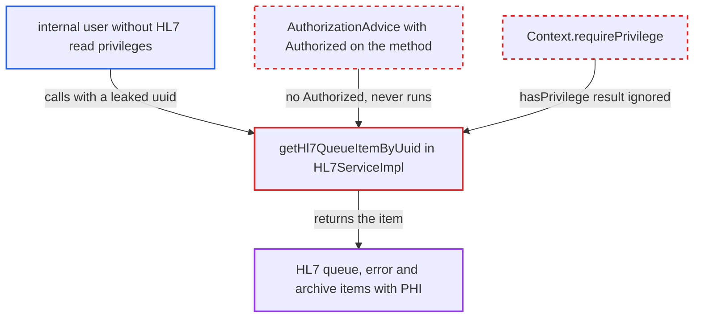

# getHl7QueueItemByUuid discards privilege check result, exposing HL7 messages without authorization

| Field | Value |
|---|---|
| ID | `find_01Eba2DRauUWQpESSTc1PwK8` |
| Severity | **Low** |
| Status | open |
| CWE | CWE-862 — Missing authorization |
| Created | 2026-10-21T22:56:27.411839Z |
| Claude Security | https://claude.ai/security/findings/find_01Eba2DRauUWQpESSTc1PwK8 |

## Description

A user who lacks every HL7 read privilege can read a full raw HL7 message, which contains patient identifiers, demographics and observations. For error items the user also gets the server stack trace. The user needs the uuid of an existing queue, error or archive item, and a module endpoint that exposes the service. The cause is `getHl7QueueItemByUuid`, which ignores the result of `Context.hasPrivilege(...)` and has no `@Authorized`.

1. **attacker** obtains the uuid of an HL7 queue, error or archive item. The report says the uuid must have leaked through REST responses, UI links or logs, because archive and error items get fresh random uuids.
2. **attacker** calls `HL7Service.getHl7QueueItemByUuid(uuid)` through a module endpoint that exposes the service. The attacker is a user on the internal network who holds none of the HL7 read privileges. ([`api/src/main/java/org/openmrs/hl7/HL7Service.java:508-519`](https://github.com/cx-benchmark/openmrs-core/blob/e6a1b3374ef040e8821dbe4bacc1bdcb50fa4d29/api/src/main/java/org/openmrs/hl7/HL7Service.java#L508-L519))
3. **`AuthorizationAdvice`** lets the call through without any check. The method has no `@Authorized`, so the advice neither checks privileges nor requires authentication. ([`api/src/main/java/org/openmrs/aop/AuthorizationAdvice.java:46-99`](https://github.com/cx-benchmark/openmrs-core/blob/e6a1b3374ef040e8821dbe4bacc1bdcb50fa4d29/api/src/main/java/org/openmrs/aop/AuthorizationAdvice.java#L46-L99))
4. **`getHl7QueueItemByUuid`** calls `Context.hasPrivilege(...)` and discards the boolean. `hasPrivilege` only returns true or false, and only `requirePrivilege` throws, so the item is returned whatever the result. ([`api/src/main/java/org/openmrs/hl7/impl/HL7ServiceImpl.java:1188-1208`](https://github.com/cx-benchmark/openmrs-core/blob/e6a1b3374ef040e8821dbe4bacc1bdcb50fa4d29/api/src/main/java/org/openmrs/hl7/impl/HL7ServiceImpl.java#L1188-L1208))
5. **the inner lookups in `HL7ServiceImpl`** run as self-calls on the target object. The calls skip the `hL7Service` proxy, so the `@Authorized` annotations on `getHL7InQueueByUuid`, `getHL7InErrorByUuid` and `getHL7InArchiveByUuid` never run. ([`api/src/main/resources/applicationContext-service.xml:503-508`](https://github.com/cx-benchmark/openmrs-core/blob/e6a1b3374ef040e8821dbe4bacc1bdcb50fa4d29/api/src/main/resources/applicationContext-service.xml#L503-L508))
6. **attacker** receives the `HL7QueueItem` with the full `hl7Data`. For error items the result also carries `error` and `errorDetails`. ([`api/src/main/java/org/openmrs/hl7/impl/HL7ServiceImpl.java:1188-1208`](https://github.com/cx-benchmark/openmrs-core/blob/e6a1b3374ef040e8821dbe4bacc1bdcb50fa4d29/api/src/main/java/org/openmrs/hl7/impl/HL7ServiceImpl.java#L1188-L1208))

## Assessment

The attacker is a user on the internal network, which is the only place the report says the server can be reached from. The user has none of the HL7 read privileges. The user needs the uuid of an existing HL7 queue, error or archive item. That uuid has to come from a leak such as REST responses, UI links or logs, which the attacker does not control. The attacker then calls `getHl7QueueItemByUuid` through any module endpoint that exposes the service. No caller exists in core. Modules such as REST or a UI consume the API.

Impact: The attacker can read the full raw HL7 message of any item whose uuid they hold. This exposes patient identifiers, names, birth dates and observations, and for error items the error text and a server stack trace. Exposure is limited to items whose uuid the attacker has. The method is read-only, so nothing can be changed.

## Recommendation

The privilege check in `getHl7QueueItemByUuid` does nothing, because the result of `Context.hasPrivilege(...)` is ignored. The method also has no `@Authorized`, so HL7 message contents are returned without any authorization.

Fix criteria: Each branch fails with `ContextAuthenticationException` or `APIAuthenticationException` when the caller lacks the matching `Get HL7 Inbound Queue`, `Get HL7 Inbound Exception` or `Get HL7 Inbound Archive` privilege. This can be done with `requirePrivilege`, or by routing the inner lookups through the proxy so their `@Authorized` applies. Test with a user who lacks those privileges: `getHl7QueueItemByUuid` for an existing item must throw and not return the item.

## Evidence

**https://github.com/cx-benchmark/openmrs-core**

- [`api/src/main/java/org/openmrs/hl7/impl/HL7ServiceImpl.java:1188-1208`](https://github.com/cx-benchmark/openmrs-core/blob/e6a1b3374ef040e8821dbe4bacc1bdcb50fa4d29/api/src/main/java/org/openmrs/hl7/impl/HL7ServiceImpl.java#L1188-L1208)
- [`api/src/main/java/org/openmrs/hl7/HL7Service.java:508-519`](https://github.com/cx-benchmark/openmrs-core/blob/e6a1b3374ef040e8821dbe4bacc1bdcb50fa4d29/api/src/main/java/org/openmrs/hl7/HL7Service.java#L508-L519)
- [`api/src/main/java/org/openmrs/aop/AuthorizationAdvice.java:46-99`](https://github.com/cx-benchmark/openmrs-core/blob/e6a1b3374ef040e8821dbe4bacc1bdcb50fa4d29/api/src/main/java/org/openmrs/aop/AuthorizationAdvice.java#L46-L99)
- [`api/src/main/java/org/openmrs/api/context/Context.java:730-737`](https://github.com/cx-benchmark/openmrs-core/blob/e6a1b3374ef040e8821dbe4bacc1bdcb50fa4d29/api/src/main/java/org/openmrs/api/context/Context.java#L730-L737)
- [`api/src/main/resources/applicationContext-service.xml:503-508`](https://github.com/cx-benchmark/openmrs-core/blob/e6a1b3374ef040e8821dbe4bacc1bdcb50fa4d29/api/src/main/resources/applicationContext-service.xml#L503-L508)

