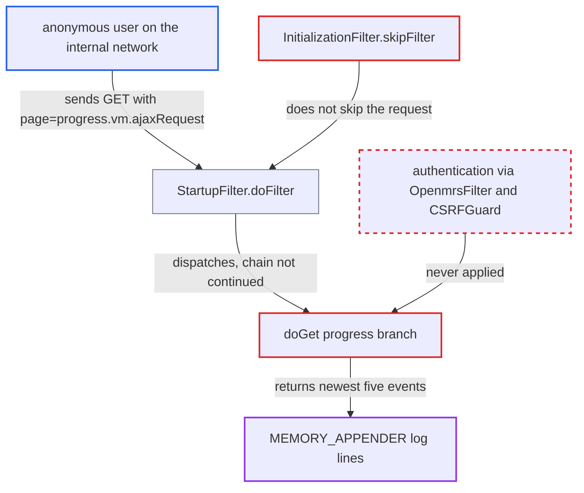

# Install wizard progress endpoint stays unauthenticated after installation and leaks server log lines

| Field | Value |
|---|---|
| ID | `find_01XhHNM3auRAvkr962uhw2D8` |
| Severity | **Low** |
| Status | open |
| CWE | CWE-497 — Information exposure |
| Created | 2026-10-21T23:01:13.636364Z |
| Claude Security | https://claude.ai/security/findings/find_01XhHNM3auRAvkr962uhw2D8 |

## Description

An anonymous user on the internal network can read a live tail of the server log from a running, fully installed OpenMRS. The log holds failed-login strings, stack traces and internal details. It works when the instance was installed through the web wizard or Docker auto-install since its last restart. The cause is `InitializationFilter.skipFilter()`, which never skips `page=progress.vm.ajaxRequest`, so the unauthenticated progress handler keeps answering.

1. **the install process** assigns the field `initJob` in `startInstallation()`. The field is never set back to null, so it stays set for the life of the JVM once any install has run. The Docker image's default `auto` install method does this on first boot. ([`web/src/main/java/org/openmrs/web/filter/initialization/InitializationFilter.java:815-821`](https://github.com/cx-benchmark/openmrs-core/blob/e6a1b3374ef040e8821dbe4bacc1bdcb50fa4d29/web/src/main/java/org/openmrs/web/filter/initialization/InitializationFilter.java#L815-L821))
2. **the install thread** finishes, sets `initializationComplete=true` and starts OpenMRS in the same JVM. The filter instance keeps the finished job, so the progress endpoint stays live while OpenMRS serves users. ([`web/src/main/java/org/openmrs/web/filter/initialization/InitializationFilter.java:1871-1880`](https://github.com/cx-benchmark/openmrs-core/blob/e6a1b3374ef040e8821dbe4bacc1bdcb50fa4d29/web/src/main/java/org/openmrs/web/filter/initialization/InitializationFilter.java#L1871-L1880))
3. **the attacker** sends `GET /openmrs/initialsetup?page=progress.vm.ajaxRequest` with no login. No session, credential or victim action is needed, and the request can be repeated as often as wanted.
4. **the filter `InitializationFilter.skipFilter()`** returns false for this request. It treats `page=progress.vm.ajaxRequest` as an exception, so the installed-state check is not applied to it. ([`web/src/main/java/org/openmrs/web/filter/initialization/InitializationFilter.java:1041-1046`](https://github.com/cx-benchmark/openmrs-core/blob/e6a1b3374ef040e8821dbe4bacc1bdcb50fa4d29/web/src/main/java/org/openmrs/web/filter/initialization/InitializationFilter.java#L1041-L1046))
5. **the filter `StartupFilter.doFilter`** sends the GET straight to `doGet` and does not continue the filter chain. `OpenmrsFilter`, CSRFGuard and any user context are therefore never involved. ([`web/src/main/java/org/openmrs/web/filter/StartupFilter.java:108-164`](https://github.com/cx-benchmark/openmrs-core/blob/e6a1b3374ef040e8821dbe4bacc1bdcb50fa4d29/web/src/main/java/org/openmrs/web/filter/StartupFilter.java#L108-L164))
6. **the progress branch of `doGet`** writes the job status and calls `addLogLinesToResponse(result)`. The branch checks no credential or session, and the log call runs even when `initializationComplete` is true. ([`web/src/main/java/org/openmrs/web/filter/initialization/InitializationFilter.java:221-245`](https://github.com/cx-benchmark/openmrs-core/blob/e6a1b3374ef040e8821dbe4bacc1bdcb50fa4d29/web/src/main/java/org/openmrs/web/filter/initialization/InitializationFilter.java#L221-L245))
7. **the method `addLogLinesToResponse`** returns the newest five formatted events of the memory appender as `logLines`. The appender receives WARN and ERROR events from the whole application, plus INFO events from `org.openmrs.api` and `liquibase`, including the failed-login line from `HibernateContextDAO`. ([`web/src/main/java/org/openmrs/web/filter/StartupFilter.java:328-342`](https://github.com/cx-benchmark/openmrs-core/blob/e6a1b3374ef040e8821dbe4bacc1bdcb50fa4d29/web/src/main/java/org/openmrs/web/filter/StartupFilter.java#L328-L342))

## Assessment

The attacker is unauthenticated and on the internal network. The threat model says the instance is not reachable from the internet. The instance must have been installed in this JVM since its last restart, through the web wizard or the Docker auto-install. The Docker image defaults to `install_method=auto`, and `startup.sh` requests the webapp, which triggers `autoRunOpenMRS` and `startInstallation`. A container that did its own first-boot install is therefore exposed for as long as it runs. The attacker polls `GET /openmrs/initialsetup?page=progress.vm.ajaxRequest` repeatedly. Any other URL with `?page=progress.vm.ajaxRequest` is only redirected to the setup page, which the report says has no security impact.

Impact: The attacker gets a read-only live view of the server log, five events per poll. It can show valid usernames from failed logins and sometimes passwords typed into the username field. It can also show exception messages, stack traces, SQL error fragments, internal paths and module details. The attacker cannot choose what is logged, and nothing can be changed or taken down this way.

## Recommendation

`InitializationFilter.skipFilter` exempts `page=progress.vm.ajaxRequest` from the installed-state check for the life of the process. The progress handler then returns in-memory server log lines with no authentication, because `initJob` is never cleared.

Fix criteria: Once initialization has completed, a `progress.vm.ajaxRequest` request either goes down the normal authenticated filter chain or gets a response with no job or log data. While installation runs, log content reaches only the session that started the wizard. To verify, on a container that performed its own install, `GET /openmrs/initialsetup?page=progress.vm.ajaxRequest` from a fresh client returns no `logLines` and no job message.

## Evidence

**https://github.com/cx-benchmark/openmrs-core**

- [`web/src/main/java/org/openmrs/web/filter/initialization/InitializationFilter.java:1041-1046`](https://github.com/cx-benchmark/openmrs-core/blob/e6a1b3374ef040e8821dbe4bacc1bdcb50fa4d29/web/src/main/java/org/openmrs/web/filter/initialization/InitializationFilter.java#L1041-L1046)
- [`web/src/main/java/org/openmrs/web/filter/initialization/InitializationFilter.java:221-245`](https://github.com/cx-benchmark/openmrs-core/blob/e6a1b3374ef040e8821dbe4bacc1bdcb50fa4d29/web/src/main/java/org/openmrs/web/filter/initialization/InitializationFilter.java#L221-L245)
- [`web/src/main/java/org/openmrs/web/filter/initialization/InitializationFilter.java:815-821`](https://github.com/cx-benchmark/openmrs-core/blob/e6a1b3374ef040e8821dbe4bacc1bdcb50fa4d29/web/src/main/java/org/openmrs/web/filter/initialization/InitializationFilter.java#L815-L821)
- [`web/src/main/java/org/openmrs/web/filter/initialization/InitializationFilter.java:1871-1880`](https://github.com/cx-benchmark/openmrs-core/blob/e6a1b3374ef040e8821dbe4bacc1bdcb50fa4d29/web/src/main/java/org/openmrs/web/filter/initialization/InitializationFilter.java#L1871-L1880)
- [`web/src/main/java/org/openmrs/web/filter/StartupFilter.java:108-164`](https://github.com/cx-benchmark/openmrs-core/blob/e6a1b3374ef040e8821dbe4bacc1bdcb50fa4d29/web/src/main/java/org/openmrs/web/filter/StartupFilter.java#L108-L164)
- [`web/src/main/java/org/openmrs/web/filter/StartupFilter.java:328-342`](https://github.com/cx-benchmark/openmrs-core/blob/e6a1b3374ef040e8821dbe4bacc1bdcb50fa4d29/web/src/main/java/org/openmrs/web/filter/StartupFilter.java#L328-L342)
- [`webapp/src/main/resources/log4j2.xml:38-66`](https://github.com/cx-benchmark/openmrs-core/blob/e6a1b3374ef040e8821dbe4bacc1bdcb50fa4d29/webapp/src/main/resources/log4j2.xml#L38-L66)
- [`api/src/main/java/org/openmrs/api/db/hibernate/HibernateContextDAO.java:224`](https://github.com/cx-benchmark/openmrs-core/blob/e6a1b3374ef040e8821dbe4bacc1bdcb50fa4d29/api/src/main/java/org/openmrs/api/db/hibernate/HibernateContextDAO.java#L224)
- [`startup-init.sh:36`](https://github.com/cx-benchmark/openmrs-core/blob/e6a1b3374ef040e8821dbe4bacc1bdcb50fa4d29/startup-init.sh#L36)

