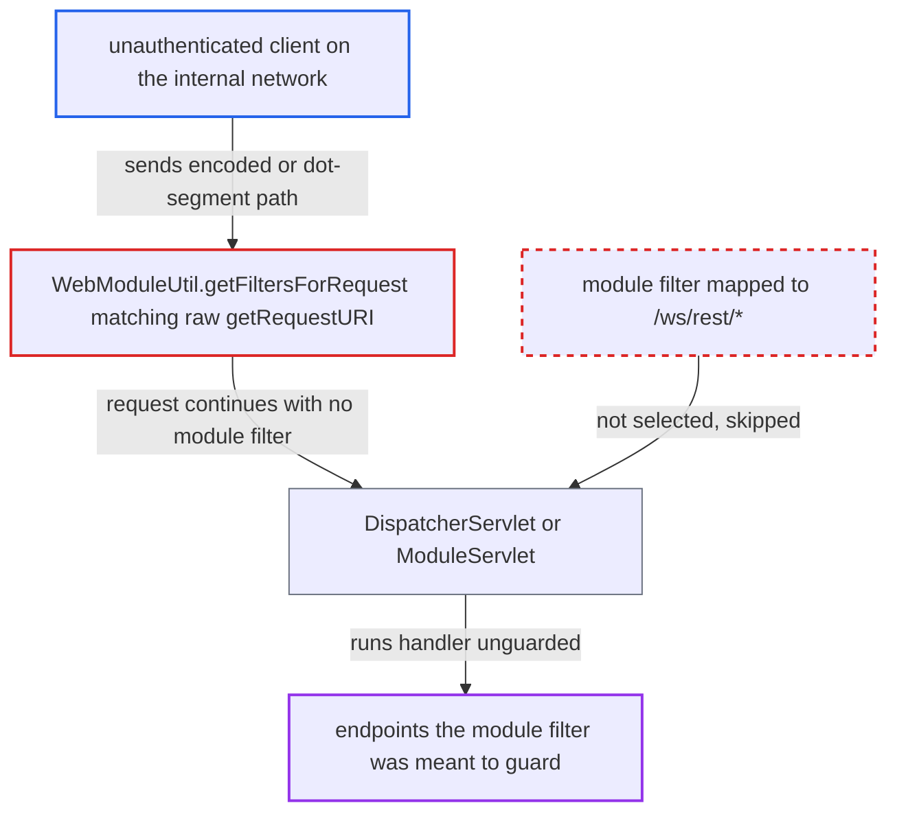

# Module filter mappings matched against raw, non-normalised request URI allow filter bypass

| Field | Value |
|---|---|
| ID | `find_01FhRkoWpGmFKKYXQNQYVwYg` |
| Severity | **Low** |
| Status | open |
| CWE | CWE-647 — Non-canonical URL path authorization |
| Created | 2026-10-21T22:59:00.519974Z |
| Claude Security | https://claude.ai/security/findings/find_01FhRkoWpGmFKKYXQNQYVwYg |

## Description

An unauthenticated client on the internal network can skip security filters that deployed modules attach to a URL prefix or file extension. The attack needs a module that maps a filter to a pattern such as `/ws/rest/*`. The cause is that `WebModuleUtil.getFiltersForRequest` matches the raw `getRequestURI()`, not the normalised path the container routes on. A separate defect means filters mapped by `<servlet-name>` never run.

1. **client** sends a request with the guarded prefix obfuscated. For example `/openmrs/%77s/rest/v1/patient`, `/openmrs/ws;x/rest/v1/patient`, `/openmrs/./ws/rest/v1/patient` or `/openmrs//ws/rest/v1/patient`, which the container treats as `/ws/rest/v1/patient`.
2. **the container filter `ModuleFilter`** asks `getFiltersForRequest` which module filters apply. `ModuleFilter` is mapped to `/*` and builds its chain only from the list that method returns. ([`web/src/main/java/org/openmrs/module/web/filter/ModuleFilter.java:52-57`](https://github.com/cx-benchmark/openmrs-core/blob/e6a1b3374ef040e8821dbe4bacc1bdcb50fa4d29/web/src/main/java/org/openmrs/module/web/filter/ModuleFilter.java#L52-L57))
3. **`WebModuleUtil.getFiltersForRequest`** matches the mappings against the raw `getRequestURI()` minus the context path. The raw URI is still percent-encoded and keeps path parameters, dot segments and doubled slashes. ([`web/src/main/java/org/openmrs/module/web/WebModuleUtil.java:703-729`](https://github.com/cx-benchmark/openmrs-core/blob/e6a1b3374ef040e8821dbe4bacc1bdcb50fa4d29/web/src/main/java/org/openmrs/module/web/WebModuleUtil.java#L703-L729))
4. **`ModuleFilterMapping.urlPatternMatches`** finds no match for the obfuscated path. It does plain exact, `/*`-prefix and `*.ext` string comparison with no decoding or normalisation, so a filter mapped to `/ws/rest/*` is not selected. ([`web/src/main/java/org/openmrs/module/web/filter/ModuleFilterMapping.java:147-245`](https://github.com/cx-benchmark/openmrs-core/blob/e6a1b3374ef040e8821dbe4bacc1bdcb50fa4d29/web/src/main/java/org/openmrs/module/web/filter/ModuleFilterMapping.java#L147-L245))
5. **the container** dispatches the request on the normalised path to the target servlet. The Spring `DispatcherServlet` on `/ws/*` or `ModuleServlet` on `/ms/*` and `/moduleServlet/*` runs the handler without the module filter's checks, and no earlier filter rejects or canonicalises such URIs. ([`webapp/src/main/webapp/WEB-INF/web.xml:187-319`](https://github.com/cx-benchmark/openmrs-core/blob/e6a1b3374ef040e8821dbe4bacc1bdcb50fa4d29/webapp/src/main/webapp/WEB-INF/web.xml#L187-L319))

## Assessment

The attacker is an unauthenticated client who can reach the server, which the report assumes is on an internal network. The attack needs a deployed module whose filter is mapped to a prefix or extension pattern, such as `/ws/rest/*`, `/ms/<servlet>/*`, or `*.form` with a `;x` suffix. The client sends the normal URL with the guarded part written as `%77s`, `ws;x`, `/./ws` or `//ws`. Only `*` and `/*` mappings are immune. A second route exists: `ModuleFilterMapping.filterMappingPasses` passes the request path to `servletNameMatches`, which tests equality with the servlet name. A filter mapped by `<servlet-name>` therefore never runs for any request, even though `ModuleServlet` dispatches by that name. No module in this repository registers a filter mapping, so the impact falls on deployed modules, such as the REST web services module's `/ws/rest/*` filters, which are not in view. The report assumes Tomcat 8.5 and Spring 5.3.23.

Impact: Whatever a module enforces in a prefix- or extension-mapped filter is skipped for the guarded endpoints. Examples are IP allow-listing, request authentication, and content or CSRF checks on a sub-path. The loss is partial: the service-layer `@Authorized` checks in core still apply to the handlers behind the filters, and availability is unaffected.

## Recommendation

(1) `WebModuleUtil.getFiltersForRequest` matches module filter mappings against the raw `getRequestURI()`. Encoding, path parameters and dot segments change which filters are chosen, but not which servlet the container reaches.

Fix criteria: Module filter matching uses the same decoded, path-parameter-free, normalised context-relative path the container uses for servlet mapping (for example `getServletPath()` plus `getPathInfo()`). It fails closed, by rejecting the request or treating it as matching all filters, when the path cannot be normalised. Requests for `/ws/rest/x` written as `/%77s/rest/x`, `/ws;a=b/rest/x`, `/./ws/rest/x` and `/y/../ws/rest/x` all invoke a module filter mapped to `/ws/rest/*`.

(2) `ModuleFilterMapping.filterMappingPasses` compares the request path to `<servlet-name>` patterns. Servlet-name filter mappings therefore never apply, and the module's intended guard is silently absent.

Fix criteria: A module filter mapped by `<servlet-name>` runs for every request dispatched to the module servlet of that name, by resolving the target servlet for the request and comparing names. Alternatively, such a configuration is rejected when the module starts, so the author learns the guard is not in effect.

## Evidence

**https://github.com/cx-benchmark/openmrs-core**

- [`web/src/main/java/org/openmrs/module/web/WebModuleUtil.java:703-729`](https://github.com/cx-benchmark/openmrs-core/blob/e6a1b3374ef040e8821dbe4bacc1bdcb50fa4d29/web/src/main/java/org/openmrs/module/web/WebModuleUtil.java#L703-L729)
- [`web/src/main/java/org/openmrs/module/web/filter/ModuleFilterMapping.java:147-245`](https://github.com/cx-benchmark/openmrs-core/blob/e6a1b3374ef040e8821dbe4bacc1bdcb50fa4d29/web/src/main/java/org/openmrs/module/web/filter/ModuleFilterMapping.java#L147-L245)
- [`web/src/main/java/org/openmrs/module/web/filter/ModuleFilter.java:52-57`](https://github.com/cx-benchmark/openmrs-core/blob/e6a1b3374ef040e8821dbe4bacc1bdcb50fa4d29/web/src/main/java/org/openmrs/module/web/filter/ModuleFilter.java#L52-L57)
- [`webapp/src/main/webapp/WEB-INF/web.xml:187-319`](https://github.com/cx-benchmark/openmrs-core/blob/e6a1b3374ef040e8821dbe4bacc1bdcb50fa4d29/webapp/src/main/webapp/WEB-INF/web.xml#L187-L319)
- [`web/src/main/java/org/openmrs/module/web/ModuleServlet.java:34-72`](https://github.com/cx-benchmark/openmrs-core/blob/e6a1b3374ef040e8821dbe4bacc1bdcb50fa4d29/web/src/main/java/org/openmrs/module/web/ModuleServlet.java#L34-L72)
- [`Dockerfile:95-110`](https://github.com/cx-benchmark/openmrs-core/blob/e6a1b3374ef040e8821dbe4bacc1bdcb50fa4d29/Dockerfile#L95-L110)

