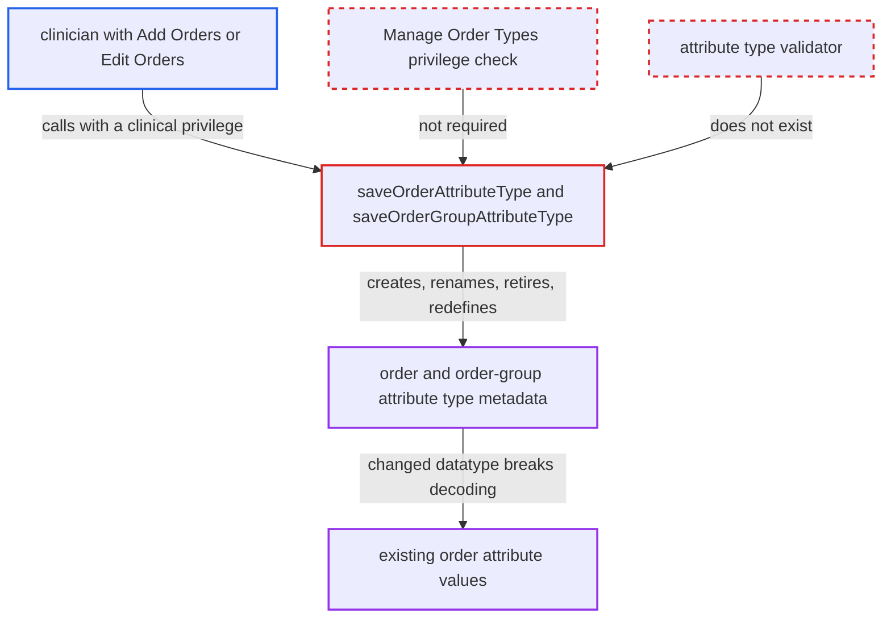

# Order and order-group attribute type metadata writable with clinical Add/Edit Orders privileges

| Field | Value |
|---|---|
| ID | `find_01Li6XubHyYdEQqa9KsnFvmG` |
| Severity | **Low** |
| Status | open |
| CWE | CWE-266 — Incorrect privilege assignment |
| Created | 2026-10-21T22:57:07.670799Z |
| Claude Security | https://claude.ai/security/findings/find_01Li6XubHyYdEQqa9KsnFvmG |

## Description

A clinician who holds only `Add Orders` or `Edit Orders` can create, rename, retire and redefine the system-wide order and order-group attribute types. Redefining a type can break the display and re-save of existing attribute values. The attack needs a module that forwards requests to `OrderService`, and core ships none. The cause is that `saveOrderAttributeType` and `saveOrderGroupAttributeType` are guarded only by clinical privileges, and no validator checks the class names.

1. **authenticated clinician** submits a new or changed attribute type through a module that calls `OrderService`. The clinician has `Add Orders` or `Edit Orders` but no metadata privilege, and the change can be a new name, `retired=true`, or a different `datatypeClassname` or config.
2. **the service method `saveOrderAttributeType`** accepts the call on a clinical privilege alone. It is annotated `@Authorized({EDIT_ORDERS, ADD_ORDERS})`, and because `requireAll` defaults to false, either privilege is enough. `saveOrderGroupAttributeType` has the same guard. ([`api/src/main/java/org/openmrs/api/OrderService.java:995-996`](https://github.com/cx-benchmark/openmrs-core/blob/e6a1b3374ef040e8821dbe4bacc1bdcb50fa4d29/api/src/main/java/org/openmrs/api/OrderService.java#L995-L996))
3. **the implementation in `OrderServiceImpl`** writes the object straight to the DAO. There is no further privilege check and no `BaseAttributeTypeValidator` subclass for these types, so even a class name that is not a `CustomDatatype` is saved. ([`api/src/main/java/org/openmrs/api/impl/OrderServiceImpl.java:1212-1230`](https://github.com/cx-benchmark/openmrs-core/blob/e6a1b3374ef040e8821dbe4bacc1bdcb50fa4d29/api/src/main/java/org/openmrs/api/impl/OrderServiceImpl.java#L1212-L1230))
4. **the clinician** retires a type by saving it with `retired=true`. `retireOrderAttributeType` is only a call to `saveOrderAttributeType`, so `Add Orders` reaches the same change that `Manage Order Types` is meant to protect. ([`api/src/main/java/org/openmrs/api/impl/OrderServiceImpl.java:1212-1230`](https://github.com/cx-benchmark/openmrs-core/blob/e6a1b3374ef040e8821dbe4bacc1bdcb50fa4d29/api/src/main/java/org/openmrs/api/impl/OrderServiceImpl.java#L1212-L1230))
5. **`BaseAttribute.getValue()`** throws `CustomDatatypeException` for existing values of the altered type. Every stored value is decoded through the type's datatype class, and a replaced class name fails the cast to `CustomDatatype`. ([`api/src/main/java/org/openmrs/attribute/BaseAttribute.java:112-117`](https://github.com/cx-benchmark/openmrs-core/blob/e6a1b3374ef040e8821dbe4bacc1bdcb50fa4d29/api/src/main/java/org/openmrs/attribute/BaseAttribute.java#L112-L117))

## Assessment

The attacker is an authenticated clinician with `Add Orders` or `Edit Orders` and no metadata privilege. The report places them on the internal network from which the server is reachable. Core has no web endpoint for these methods. A module that passes user requests to `OrderService`, for example a REST resource, must be deployed, and that module inherits the weak check. The attacker then submits a new or modified `OrderAttributeType` or `OrderGroupAttributeType`.

Impact: The attacker can create, rename, retire and redefine system-wide order attribute metadata that the project otherwise reserves to `Manage Order Types`. Replacing the datatype class of a type in use makes existing values throw on decode, which breaks their display and re-save. The report finds no patient data disclosure and no code execution, because instantiating an arbitrary class stops at a failed cast.

## Recommendation

(1) `saveOrderAttributeType` and `saveOrderGroupAttributeType` are gated by the clinical privileges `Add Orders` and `Edit Orders`. The retire and unretire methods of the same objects, and the other attribute-type services, use a metadata privilege.

Fix criteria: Creating or changing order and order-group attribute types requires an administrative metadata privilege, either the one used for retire/unretire or a dedicated manage privilege. A user with only `Add Orders` or `Edit Orders` gets `APIAuthenticationException` from both save methods. This also holds when the submitted object has `retired=true`.

(2) No validator constrains `datatypeClassname`, `preferredHandlerClassname` or the configuration of `OrderAttributeType` and `OrderGroupAttributeType`. Class names that are not valid `CustomDatatype` or `CustomDatatypeHandler` implementations are therefore saved.

Fix criteria: Saving these types rejects a datatype that does not load as a `CustomDatatype`. It also rejects a handler that is not compatible with the datatype, and invalid min/max occurs. The behaviour matches `BaseAttributeTypeValidator` for the other attribute types.

## Evidence

**https://github.com/cx-benchmark/openmrs-core**

- [`api/src/main/java/org/openmrs/api/OrderService.java:995-996`](https://github.com/cx-benchmark/openmrs-core/blob/e6a1b3374ef040e8821dbe4bacc1bdcb50fa4d29/api/src/main/java/org/openmrs/api/OrderService.java#L995-L996)
- [`api/src/main/java/org/openmrs/api/OrderService.java:897-898`](https://github.com/cx-benchmark/openmrs-core/blob/e6a1b3374ef040e8821dbe4bacc1bdcb50fa4d29/api/src/main/java/org/openmrs/api/OrderService.java#L897-L898)
- [`api/src/main/java/org/openmrs/api/OrderService.java:1007-1018`](https://github.com/cx-benchmark/openmrs-core/blob/e6a1b3374ef040e8821dbe4bacc1bdcb50fa4d29/api/src/main/java/org/openmrs/api/OrderService.java#L1007-L1018)
- [`api/src/main/java/org/openmrs/api/impl/OrderServiceImpl.java:1212-1230`](https://github.com/cx-benchmark/openmrs-core/blob/e6a1b3374ef040e8821dbe4bacc1bdcb50fa4d29/api/src/main/java/org/openmrs/api/impl/OrderServiceImpl.java#L1212-L1230)
- [`api/src/main/java/org/openmrs/api/impl/OrderServiceImpl.java:1135-1137`](https://github.com/cx-benchmark/openmrs-core/blob/e6a1b3374ef040e8821dbe4bacc1bdcb50fa4d29/api/src/main/java/org/openmrs/api/impl/OrderServiceImpl.java#L1135-L1137)
- [`api/src/main/java/org/openmrs/api/OrderSetService.java:167-168`](https://github.com/cx-benchmark/openmrs-core/blob/e6a1b3374ef040e8821dbe4bacc1bdcb50fa4d29/api/src/main/java/org/openmrs/api/OrderSetService.java#L167-L168)
- [`api/src/main/java/org/openmrs/attribute/BaseAttribute.java:112-117`](https://github.com/cx-benchmark/openmrs-core/blob/e6a1b3374ef040e8821dbe4bacc1bdcb50fa4d29/api/src/main/java/org/openmrs/attribute/BaseAttribute.java#L112-L117)
- [`api/src/main/java/org/openmrs/customdatatype/CustomDatatypeUtil.java:53-104`](https://github.com/cx-benchmark/openmrs-core/blob/e6a1b3374ef040e8821dbe4bacc1bdcb50fa4d29/api/src/main/java/org/openmrs/customdatatype/CustomDatatypeUtil.java#L53-L104)

