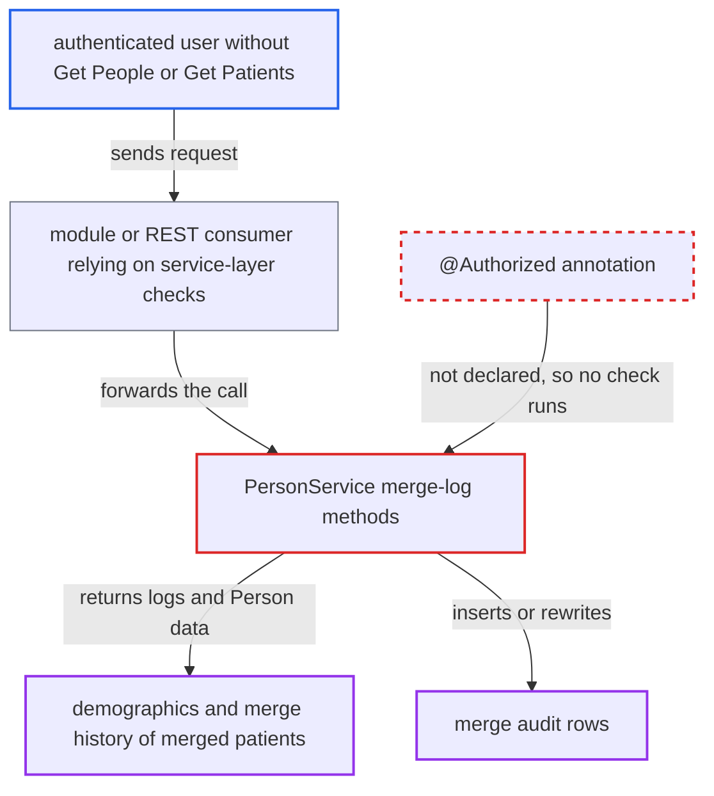

# PersonService merge-log methods lack @Authorized, exposing merged patients' demographics

| Field | Value |
|---|---|
| ID | `find_01C1k3xPMr63LZNKC63aPg9Z` |
| Severity | **Low** |
| Status | open |
| CWE | CWE-862 — Missing authorization |
| Created | 2026-10-21T22:54:33.377601Z |
| Claude Security | https://claude.ai/security/findings/find_01C1k3xPMr63LZNKC63aPg9Z |

## Description

A logged-in user without the `Get People` or `Get Patients` privilege could read the demographics and merge history of merged patients. They could also insert or rewrite merge audit records. This needs a module or REST consumer that forwards the user's call to `PersonService`. The five merge-log methods have no `@Authorized` annotation, so no privilege or login check runs.

1. **authenticated user** sends a request that a module or REST consumer forwards to a merge-log method of `PersonService`. The user does not hold `Get People` or `Get Patients`, and the consumer relies on service-layer checks instead of making its own.
2. **the interface `PersonService`** declares the merge-log methods without `@Authorized`. `savePersonMergeLog`, `getPersonMergeLogByUuid`, `getAllPersonMergeLogs`, `getWinningPersonMergeLogs` and `getLosingPersonMergeLog` have no annotation, unlike neighbouring methods such as `getRelationshipMap`. ([`api/src/main/java/org/openmrs/api/PersonService.java:759-802`](https://github.com/cx-benchmark/openmrs-core/blob/e6a1b3374ef040e8821dbe4bacc1bdcb50fa4d29/api/src/main/java/org/openmrs/api/PersonService.java#L759-L802))
3. **the advice `AuthorizationAdvice.before`** skips every check for these calls. It reads only method-level `@Authorized` values, and its authentication-only branch also needs the annotation, so the call runs with no privilege and no login requirement. ([`api/src/main/java/org/openmrs/aop/AuthorizationAdvice.java:59-98`](https://github.com/cx-benchmark/openmrs-core/blob/e6a1b3374ef040e8821dbe4bacc1bdcb50fa4d29/api/src/main/java/org/openmrs/aop/AuthorizationAdvice.java#L59-L98))
4. **`PersonServiceImpl`** passes the call straight to the DAO and deserializes the log data on request. None of the implementations calls `Context.requirePrivilege`. ([`api/src/main/java/org/openmrs/api/impl/PersonServiceImpl.java:815-911`](https://github.com/cx-benchmark/openmrs-core/blob/e6a1b3374ef040e8821dbe4bacc1bdcb50fa4d29/api/src/main/java/org/openmrs/api/impl/PersonServiceImpl.java#L815-L911))
5. **the caller** receives `PersonMergeLog` objects, or writes one with `savePersonMergeLog`. Each log holds the `winner` and `loser` `Person` entities and, when `deserialize` is true, a `PersonMergeLogData` with prior gender, date of birth, death data and UUIDs of moved records. ([`api/src/main/java/org/openmrs/person/PersonMergeLog.java:40-56`](https://github.com/cx-benchmark/openmrs-core/blob/e6a1b3374ef040e8821dbe4bacc1bdcb50fa4d29/api/src/main/java/org/openmrs/person/PersonMergeLog.java#L40-L56))

## Assessment

The attacker is an authenticated user who lacks `Get People` and `Get Patients`. The default `Authenticated` role does not hold them. Their request must reach `PersonService` through an installed module or REST consumer that relies on the service-layer checks. Core has no caller of the getters, so exposure depends on such a consumer. The attacker can call `getAllPersonMergeLogs(true)`, or loop over person ids with `getLosingPersonMergeLog` or `getWinningPersonMergeLogs` to probe them. For a write, the attacker calls `savePersonMergeLog` with a crafted log. In core, `savePersonMergeLog` is only called from `PatientServiceImpl.mergePatients`, which requires `Edit Patients`, but the method itself imposes nothing on other callers.

Impact: The attacker can read demographics and merge history of merged patients, including prior gender, date of birth, death data and UUIDs of moved records. The set is limited to patients that were merged and is not attacker-chosen, and clinical content appears only as UUIDs. The attacker can also insert or rewrite merge audit rows, which damages the audit trail but not clinical data.

## Recommendation

The `PersonMergeLog` methods on `PersonService` have no `@Authorized`, so the privilege model does not cover the merge audit log. Any caller that reaches them passes unchecked.

Fix criteria: Reading merge logs requires a privilege at least as strong as `Get People` or `Get Patients`, or a dedicated merge-log privilege. `savePersonMergeLog` requires `Edit Patients`, the privilege that gates patient merging, or is restricted to the internal merge flow. An authenticated user without those privileges gets `APIAuthenticationException` from all five methods: `savePersonMergeLog`, `getPersonMergeLogByUuid`, `getAllPersonMergeLogs`, `getWinningPersonMergeLogs` and `getLosingPersonMergeLog`.

## Evidence

**https://github.com/cx-benchmark/openmrs-core**

- [`api/src/main/java/org/openmrs/api/PersonService.java:759-802`](https://github.com/cx-benchmark/openmrs-core/blob/e6a1b3374ef040e8821dbe4bacc1bdcb50fa4d29/api/src/main/java/org/openmrs/api/PersonService.java#L759-L802)
- [`api/src/main/java/org/openmrs/aop/AuthorizationAdvice.java:59-98`](https://github.com/cx-benchmark/openmrs-core/blob/e6a1b3374ef040e8821dbe4bacc1bdcb50fa4d29/api/src/main/java/org/openmrs/aop/AuthorizationAdvice.java#L59-L98)
- [`api/src/main/java/org/openmrs/api/impl/PersonServiceImpl.java:815-911`](https://github.com/cx-benchmark/openmrs-core/blob/e6a1b3374ef040e8821dbe4bacc1bdcb50fa4d29/api/src/main/java/org/openmrs/api/impl/PersonServiceImpl.java#L815-L911)
- [`api/src/main/java/org/openmrs/person/PersonMergeLog.java:40-56`](https://github.com/cx-benchmark/openmrs-core/blob/e6a1b3374ef040e8821dbe4bacc1bdcb50fa4d29/api/src/main/java/org/openmrs/person/PersonMergeLog.java#L40-L56)
- [`api/src/main/java/org/openmrs/api/impl/PatientServiceImpl.java:606-610`](https://github.com/cx-benchmark/openmrs-core/blob/e6a1b3374ef040e8821dbe4bacc1bdcb50fa4d29/api/src/main/java/org/openmrs/api/impl/PatientServiceImpl.java#L606-L610)

